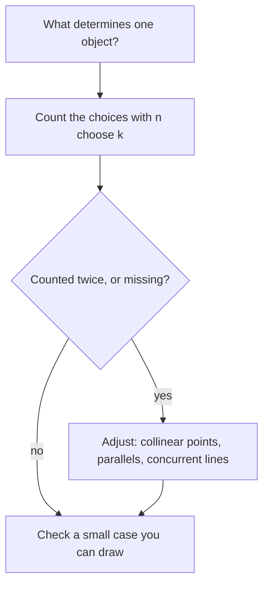

In Lesson 1, Example 1 counted the lines through three noncollinear points: one line for each pair, so 3 lines. The same idea, "one object for each choice of the points or lines that determine it", answers a whole family of questions. How many lines do 20 points determine? Into how many pieces do 10 straight cuts divide a plane? How many pairs of vertical angles appear when 6 lines pass through one point? This honors lesson builds the counting tools for these questions, proves the formulas, and uses them to finally explain the circle-regions pattern from Lesson 5 that broke at 31.

## Counting pairs and triples

Suppose $n$ points are given and no three are collinear. Each line we want is determined by a pair of points (postulate 1), and different pairs give different lines (if two pairs gave the same line, three or more of the points would be collinear). So we need the number of pairs.

Count *ordered* pairs first: $n$ choices for the first point and $n - 1$ for the second, $n(n - 1)$ in all. But the ordered pairs $(A, B)$ and $(B, A)$ name the same line, so every line has been counted exactly twice. The number of lines is

$$\binom{n}{2} = \frac{n(n-1)}{2},$$

read "$n$ choose 2". This number of unordered choices is called a **combination**. In general, $\binom{n}{k}$ is the number of ways to choose $k$ objects from $n$ when order doesn't matter. For triples, $n(n-1)(n-2)$ ordered choices count each triple $3 \cdot 2 \cdot 1 = 6$ times, so

$$\binom{n}{3} = \frac{n(n-1)(n-2)}{6}.$$

Triples count planes: if $n$ points in space have no four coplanar (and so no three collinear), each plane through three of them contains no fourth point, so they determine exactly $\binom{n}{3}$ planes. Six such points determine $\binom{6}{3} = 20$ planes.

### Example 1

Ten points are marked. Four of them lie on one line, and no other three of the points are collinear. How many lines pass through at least two of the points?

**Step 1.** If no three were collinear, there would be $\binom{10}{2} = 45$ lines.

**Step 2.** The four collinear points form $\binom{4}{2} = 6$ pairs, and all six pairs give the *same* line. The count of 45 included that line 6 times instead of once.

**Step 3.** Remove the extra copies: $45 - 6 + 1 = 40$ lines.

**Check with a small case.** Three collinear points plus nothing else: $\binom{3}{2} - \binom{3}{2} + 1 = 1$ line, which is right.

## Lines cutting the plane

Lines are in **general position** when no two are parallel and no three pass through one point. Then every pair of lines meets, and in a different point from every other pair, so $n$ lines in general position meet in exactly $\binom{n}{2}$ points.

How many regions do they cut the plane into? Build the picture one line at a time. With no lines there is $1$ region, the whole plane. Now suppose $k - 1$ lines are drawn and we add the $k$th. It crosses each of the $k - 1$ earlier lines once, at $k - 1$ different points, and those points cut the new line into $k$ pieces (two rays and $k - 2$ segments). Each piece runs through one old region and splits it in two. So the $k$th line adds exactly $k$ regions.

This gives a **recurrence**, a rule that finds each value from the one before: $R(k) = R(k - 1) + k$, starting from $R(0) = 1$. Adding up,

$$R(n) = 1 + (1 + 2 + \cdots + n) = 1 + \frac{n(n+1)}{2} = \frac{n^2 + n + 2}{2}.$$

So 1, 2, 3, 4 lines give 2, 4, 7, 11 regions. The picture shows the 11 regions from four lines.

Some regions are **bounded regions** (enclosed, with finite area) and the rest are **unbounded regions** (stretching off to infinity). Imagine a huge circle around all the crossing points. Each line crosses it twice, making $2n$ crossing points that split the circle into $2n$ arcs, one for each unbounded region. So there are $2n$ unbounded regions and

$$\frac{n^2 + n + 2}{2} - 2n = \frac{n^2 - 3n + 2}{2} = \frac{(n-1)(n-2)}{2} = \binom{n-1}{2}$$

bounded ones. For four lines: $8$ unbounded and $3$ bounded, as in the picture.

### Example 2

Six lines are in general position. Find the number of crossing points, regions, bounded regions and unbounded regions.

**Step 1.** Crossing points: $\binom{6}{2} = 15$.

**Step 2.** Regions: $\dfrac{36 + 6 + 2}{2} = 22$.

**Step 3.** Bounded: $\binom{5}{2} = 10$. Unbounded: $2 \cdot 6 = 12$.

**Check.** $10 + 12 = 22$.

### Example 3

How many lines in general position are needed to make exactly 37 regions?

**Step 1.** Set $\dfrac{n^2 + n + 2}{2} = 37$, so $n^2 + n + 2 = 74$ and $n^2 + n - 72 = 0$.

**Step 2.** Factor: $(n + 9)(n - 8) = 0$. A count can't be negative, so $n = 8$.

**Check.** $\dfrac{64 + 8 + 2}{2} = 37$.

**When the lines are not in general position**, the same "each new line adds one region per piece" idea still works: a new line crossing the earlier lines at $c$ distinct points is cut into $c + 1$ pieces and adds $c + 1$ regions. Three parallel lines make 4 strips. A transversal crossing all three adds $3 + 1 = 4$ regions, for 8. A second transversal crossing the three parallels and the first transversal (at a new point) adds $4 + 1 = 5$, for 13. Parallel lines and lines through a common point always mean fewer crossings, so fewer regions than $\frac{n^2+n+2}{2}$.

## Angles at a point

Suppose $n$ distinct rays share an endpoint and no two of them are opposite rays. Any two of the rays form one angle (the one measuring less than $180^\circ$), so there are $\binom{n}{2}$ angles.

Now let $n$ lines pass through one point. They make $2n$ rays from that point, in $n$ opposite pairs. Of the $\binom{2n}{2}$ pairs of rays, $n$ are opposite pairs, which form straight angles rather than ordinary angles. That leaves

$$\binom{2n}{2} - n = n(2n - 1) - n = 2n(n - 1)$$

angles. Each one has a vertical partner, formed by the two opposite rays, and the partners are different angles, so the angles come in $n(n - 1)$ pairs of vertical angles. Check $n = 2$: two crossing lines make $4$ angles in $2$ vertical pairs, as Lesson 3 said.

### Example 4

Four lines pass through one point, and the angles between neighboring rays are all equal. How many angles are formed, what sizes are they, and how many vertical pairs are there?

**Step 1.** The $8$ rays split the full turn into $8$ equal angles of $\tfrac{360^\circ}{8} = 45^\circ$ (equivalently, $\tfrac{180^\circ}{n}$ with $n = 4$).

**Step 2.** Angles: $2 \cdot 4 \cdot 3 = 24$. Vertical pairs: $4 \cdot 3 = 12$.

**Step 3.** Sizes: two rays $1$, $2$ or $3$ steps apart make $45^\circ$, $90^\circ$ or $135^\circ$, and there are $8$ pairs of each kind. Rays $4$ steps apart are opposite (straight angles, not counted). Check: $8 + 8 + 8 = 24$.

## The circle-regions puzzle explained

Lesson 5 placed $n$ points on a circle, joined every pair with a chord, and counted the regions inside: 1, 2, 4, 8, 16, then 31 instead of 32. The adding-pieces argument explains it. Assume no three chords pass through one interior point. Start with $1$ region, the disk. Add the chords one at a time: a chord that crosses $c$ earlier chords is cut into $c + 1$ pieces and adds $c + 1$ regions. Adding over all chords, each chord contributes its own $1$, and each interior crossing point contributes $1$ (counted when the second of its two chords is drawn). So

$$\text{regions} = 1 + (\text{number of chords}) + (\text{number of interior crossings}).$$

There are $\binom{n}{2}$ chords. Each interior crossing comes from exactly $4$ of the points: two chords cross inside the circle exactly when their four endpoints alternate around it, that is, when they are the two diagonals of the quadrilateral those four points form. So there are $\binom{n}{4}$ crossings, and

$$\text{regions} = 1 + \binom{n}{2} + \binom{n}{4}.$$

For $n = 5$: $1 + 10 + 5 = 16$. For $n = 6$: $1 + 15 + 15 = 31$. The pattern $2^{n-1}$ only agreed for $n \le 5$. This is known as **Moser's circle problem**, after Leo Moser, and it is a standard warning that a pattern is a guess until it is proved.

## Common mistakes

- **Counting ordered pairs.** $AB$ and $BA$ are the same line. Divide $n(n - 1)$ by 2.
- **Ignoring collinear points.** Four collinear points give 1 line, not 6. Subtract the extras and add the one line back.
- **Using $2^n$ for regions.** Lines in general position give $\frac{n^2 + n + 2}{2}$ regions: $2^n$ is right only for $n \le 2$.
- **Applying general-position formulas to parallel or concurrent lines.** Count crossings directly and use "each new line adds crossings plus one".
- **Counting straight angles at a point.** Opposite rays form a straight angle, not one of the angles in a vertical pair.

## Key points

- $\binom{n}{2} = \frac{n(n-1)}{2}$ counts lines through $n$ points (no three collinear) and crossings of $n$ lines in general position; $\binom{n}{3}$ counts planes through $n$ points in space with no four coplanar.
- Each new line adds one region for each piece it is cut into: $R(n) = \frac{n^2 + n + 2}{2}$ in general position, with $2n$ unbounded and $\binom{n-1}{2}$ bounded regions.
- $n$ concurrent lines make $2n(n - 1)$ angles (not counting straight angles) in $n(n - 1)$ vertical pairs.
- Chords joining $n$ points on a circle (no three through one point) make $1 + \binom{n}{2} + \binom{n}{4}$ regions.
- Always check a formula against a small case you can draw.
