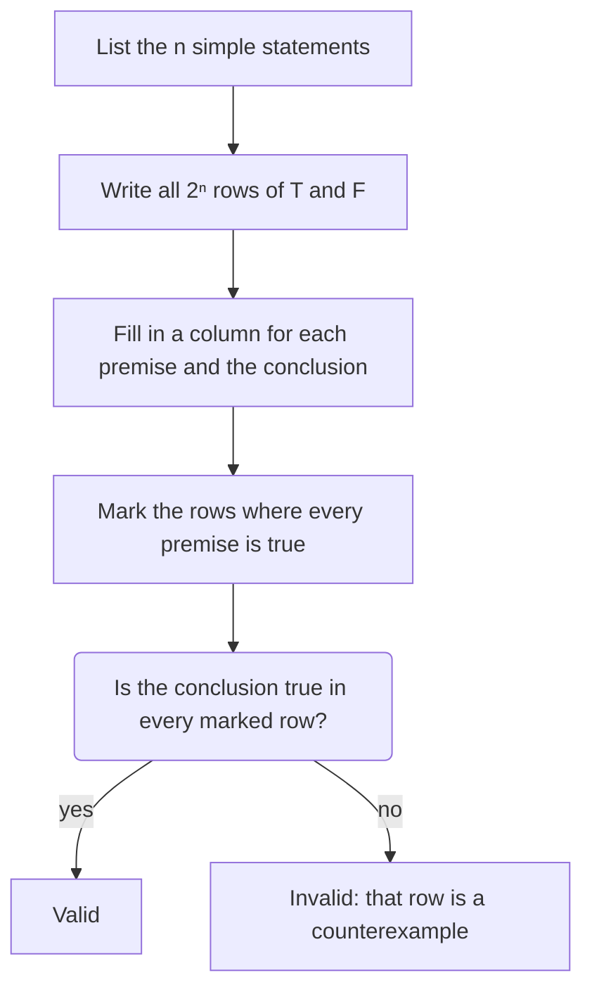

In the core lessons you met conditionals and their converse, inverse and contrapositive, and two laws of deduction. You were told that a conditional and its contrapositive "always have the same truth value", and that affirming the consequent is an error. This honors lesson gives you a tool that checks claims like these mechanically: the **truth table**. With it you can build compound statements, negate them correctly (a surprisingly common source of mistakes, even in proofs written by adults), and test whether an argument is valid. This is the start of symbolic logic, the subject that underlies proof in every branch of mathematics and the design of the circuits inside every computer.

## Statements and connectives

A *statement* is a sentence that is either true or false, not both. Whichever it is, that is its **truth value**, written T or F. "Vertical angles are congruent" is a statement (true). "$x + 2 = 5$" is not a statement until you know what $x$ is, and "Draw a line" is not a statement at all.

Simple statements are joined into **compound statements** with connectives:

| Connective | Symbol | Read | True when |
|---|---|---|---|
| Negation | $\sim p$ | not $p$ | $p$ is false |
| **Conjunction** | $p \wedge q$ | $p$ and $q$ | both parts are true |
| **Disjunction** | $p \vee q$ | $p$ or $q$ | at least one part is true |
| Conditional | $p \to q$ | if $p$, then $q$ | every case except $p$ true and $q$ false |
| Biconditional | $p \leftrightarrow q$ | $p$ if and only if $q$ | $p$ and $q$ have the same truth value |

The "or" of mathematics is *inclusive*: $p \vee q$ is true when both parts are true. "$x > 2$ or $x < 5$" is true for $x = 3$, where both parts hold. In everyday speech "or" sometimes means "one or the other but not both" ("soup or salad"); in logic and mathematics it never does unless that is said outright.

## Truth tables

A truth table lists every possible combination of truth values for the simple statements and works out the compound statement in each row. With two simple statements there are $2 \times 2 = 4$ rows; with three there are $2^3 = 8$; with $n$ statements there are $2^n$ rows, because each new statement doubles the number of cases (each old row splits into one where the new statement is true and one where it is false).

Here are all the basic connectives in one table:

| $p$ | $q$ | $\sim p$ | $p \wedge q$ | $p \vee q$ | $p \to q$ | $p \leftrightarrow q$ |
|---|---|---|---|---|---|---|
| T | T | F | T | T | T | T |
| T | F | F | F | T | F | F |
| F | T | T | F | T | T | F |
| F | F | T | F | F | T | T |

The conditional column is the one people question. Its last two rows say that a conditional with a false hypothesis is true. Such a statement is called *vacuously true*: "If a triangle has four sides, then it is a circle" makes a promise that can never be tested, so it can never be broken. This is a convention, but it is the only choice that makes the conditional agree with its contrapositive and keeps the laws of deduction working, as Example 1 shows.

### Example 1: The contrapositive rule, proved

Show with a truth table that $p \to q$ and $\sim q \to \sim p$ are logically equivalent.

Build the columns one at a time: the conditional, then the two negations, then the conditional of the negations.

| $p$ | $q$ | $p \to q$ | $\sim q$ | $\sim p$ | $\sim q \to \sim p$ |
|---|---|---|---|---|---|
| T | T | T | F | F | T |
| T | F | F | T | F | F |
| F | T | T | F | T | T |
| F | F | T | T | T | T |

In row 2, $\sim q$ is true and $\sim p$ is false: true-then-false, so the conditional is F. Every other row has a false hypothesis or a true conclusion, so it is T. The third and sixth columns agree in all four rows, so the statements are logically equivalent.

This *is* a proof, not just a check of examples: the four rows are all the cases there are, so nothing is left unchecked. That is the difference between a truth table and inductive reasoning. The same method shows two more facts worth knowing (try them yourself):

- $p \to q$ is equivalent to $\sim p \vee q$: "either the hypothesis fails or the conclusion holds".
- $p \leftrightarrow q$ is equivalent to $(p \to q) \wedge (q \to p)$, which is why a biconditional needs both a conditional and its converse.

A compound statement that is true in every row is a **tautology**. For example, $p \vee \sim p$ ("an angle is acute or it is not acute") is a tautology. A statement that is false in every row, such as $p \wedge \sim p$, is a **contradiction**. Contradictions are the engine of indirect proof, which you will use in the next honors lesson.

## Negating compound statements

To negate a statement is to say exactly when it is false. Two rules, **De Morgan's laws**, handle "and" and "or". Writing $\equiv$ for "is logically equivalent to":

$$\sim(p \wedge q) \equiv \sim p \vee \sim q \qquad\qquad \sim(p \vee q) \equiv \sim p \wedge \sim q$$

In words: "not both" means "at least one fails", and "not either" means "both fail". The laws are named after the English mathematician Augustus De Morgan, who stated them in his writing on logic in the 1840s; medieval logicians had already described the idea in words. Here is the truth-table proof of the first law:

| $p$ | $q$ | $p \wedge q$ | $\sim(p \wedge q)$ | $\sim p$ | $\sim q$ | $\sim p \vee \sim q$ |
|---|---|---|---|---|---|---|
| T | T | T | F | F | F | F |
| T | F | F | T | F | T | T |
| F | T | F | T | T | F | T |
| F | F | F | T | T | T | T |

Columns 4 and 7 match in every row.

The negation of a conditional is the biggest trap. A conditional $p \to q$ is false in exactly one row, where $p$ is true and $q$ is false. So

$$\sim(p \to q) \equiv p \wedge \sim q.$$

The negation of "If $\angle A$ is a right angle, then $m\angle A = 90^\circ$" is "$\angle A$ is a right angle and $m\angle A \ne 90^\circ$". It is not the inverse, and it is not "If $\angle A$ is a right angle, then $m\angle A \ne 90^\circ$". The negation of a conditional is not a conditional at all: it describes a counterexample.

## Quantifiers: "all" and "some"

Most theorems are about *every* object of some kind. "All right angles are congruent" is a **universal statement**. "Some rectangle is a square" (meaning at least one) is an **existential statement**. Words such as "all", "every", "each" and "no", and "some", "there is" and "at least one", are called **quantifiers**.

To negate a quantified statement, switch the quantifier and negate what follows it:

| Statement | Its negation |
|---|---|
| All A are B. | Some A is not B. |
| Some A is B. | No A is B. |
| No A is B. | Some A is B. |
| Some A is not B. | All A are B. |

In the picture, "All A are B" fails as soon as a single member of A sits outside B. That is why **one counterexample disproves a universal statement**, the rule you met in the lesson on inductive reasoning, and why one example is enough to prove an existential statement. A universal statement is really a conditional applied to every object ("for every angle, if it is right, then it measures $90^\circ$"), and its negation is $p \wedge \sim q$ for at least one object: a counterexample.

### Example 2: Negating statements

Write the negation of each statement.

(a) Every angle in the figure is acute.

(b) Some pair of lines in the figure is parallel.

(c) $\angle 1$ is acute and $\angle 2$ is obtuse.

(d) If $AB = CD$, then $\overline{AB} \cong \overline{CD}$.

**(a)** Switch "every" to "some" and negate: *Some angle in the figure is not acute.* "No angle in the figure is acute" is too strong; it is the opposite extreme, not the negation.

**(b)** *No pair of lines in the figure is parallel.*

**(c)** By De Morgan's law, "not ($p$ and $q$)" is "not $p$ or not $q$": *$\angle 1$ is not acute, or $\angle 2$ is not obtuse.*

**(d)** "Not ($p \to q$)" is "$p$ and not $q$": *$AB = CD$ and $\overline{AB} \not\cong \overline{CD}$.* The original is true (it is the definition of congruent segments), so its negation must be false, and it is: segments with equal lengths are always congruent. Checking that a statement and its negation have opposite truth values is a good test of your work.

## Valid and invalid arguments

An *argument* is a list of statements called premises followed by a conclusion. It is **valid** if the conclusion is true in every case where all the premises are true. Validity is about the *form* of the argument, not about whether the premises are actually true. A valid argument whose premises are all true is called **sound**, and its conclusion is guaranteed.

A truth table tests validity:

These forms come up again and again, so they have names:

| Form | Premises | Conclusion | Valid? |
|---|---|---|---|
| Law of Detachment (**modus ponens**) | $p \to q$; $p$ | $q$ | Valid |
| **Modus tollens** | $p \to q$; $\sim q$ | $\sim p$ | Valid |
| Law of Syllogism | $p \to q$; $q \to r$ | $p \to r$ | Valid |
| Disjunctive syllogism | $p \vee q$; $\sim p$ | $q$ | Valid |
| Affirming the consequent | $p \to q$; $q$ | $p$ | Invalid |
| **Denying the antecedent** | $p \to q$; $\sim p$ | $\sim q$ | Invalid |

The Latin names mean "the mode that affirms" and "the mode that denies". Some books call modus tollens the Law of Contrapositive, because it is detachment applied to the contrapositive $\sim q \to \sim p$. The *antecedent* is an old name for the hypothesis, just as the consequent is the conclusion.

### Example 3: Testing two arguments

(a) If two angles form a linear pair, then they are supplementary. $\angle A$ and $\angle B$ do not form a linear pair. Therefore $\angle A$ and $\angle B$ are not supplementary.

(b) If two angles are vertical angles, then they are congruent. $m\angle 1 = 40^\circ$ and $m\angle 2 = 50^\circ$, so they are not congruent. Therefore $\angle 1$ and $\angle 2$ are not vertical angles.

**(a)** Let $p$ = "they form a linear pair" and $q$ = "they are supplementary". The form is $p \to q$; $\sim p$; therefore $\sim q$. Look back at the table of connectives: both premises are true in rows 3 and 4 (where $p$ is F). In row 3, $q$ is T, so the conclusion $\sim q$ is F. **Invalid.** A concrete counterexample: a $100^\circ$ angle in one corner of a page and an $80^\circ$ angle in another are supplementary but not a linear pair. This is denying the antecedent; it treats the inverse as if it followed from the conditional.

**(b)** Let $p$ = "they are vertical angles" and $q$ = "they are congruent". The form is $p \to q$; $\sim q$; therefore $\sim p$. Both premises are true only in row 4 ($p$ F, $q$ F), and there $\sim p$ is T. **Valid** (modus tollens). The premises are also true, so the argument is sound: $\angle 1$ and $\angle 2$ really are not vertical angles.

## Valid is not the same as true

"If a polygon is a triangle, then it has four sides. Polygon $XYZ$ is a triangle. Therefore $XYZ$ has four sides." This is modus ponens, so it is valid, but its first premise is false, so it is not sound and its conclusion is false. In the other direction, an invalid argument can reach a true conclusion by luck. A proof needs both: a valid form and true premises (givens, definitions, postulates and proved theorems).

## Common mistakes

- **Negating "all" with "no".** The negation of "All rectangles are squares" is "Some rectangle is not a square", not "No rectangle is a square".
- **Negating a conditional with another conditional.** $\sim(p \to q)$ is $p \wedge \sim q$, not the inverse.
- **Distributing "not" without switching the connective.** "Not ($p$ and $q$)" is "not $p$ *or* not $q$".
- **Reading "or" as "one but not both".** In logic, $p \vee q$ is true when both are true.
- **Confusing valid with true.** Validity is about form; soundness also needs true premises.
- **Too few rows.** A table with $n$ simple statements needs $2^n$ rows; three statements need 8.

## Key points

- A truth table checks every case, so it can prove that two statements are equivalent; $n$ simple statements need $2^n$ rows.
- $p \wedge q$ is true only when both are true; $p \vee q$ is false only when both are false; $p \to q$ is false only when $p$ is true and $q$ is false.
- De Morgan: $\sim(p \wedge q) \equiv \sim p \vee \sim q$ and $\sim(p \vee q) \equiv \sim p \wedge \sim q$. Also $\sim(p \to q) \equiv p \wedge \sim q$.
- The negation of "All A are B" is "Some A is not B"; the negation of "Some A is B" is "No A is B".
- Valid forms: modus ponens, modus tollens, syllogism, disjunctive syllogism. Invalid: affirming the consequent, denying the antecedent.
