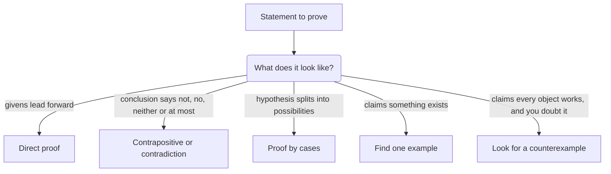

Every proof in the core lesson on writing proofs was a **direct proof**: start from the given facts and chain forward, one justified step at a time, until you reach the conclusion. Direct proof is the default, but some statements resist it. The conclusion may be a "not" statement that gives you nothing to work with, or the hypothesis may split into possibilities that behave differently. This honors lesson adds three strategies that mathematicians use every day: proof by contrapositive, proof by contradiction and proof by cases. Each is backed by a fact of logic, so each is exactly as rigorous as a direct proof. (If you did the honors lesson on symbolic logic, you have already seen those facts in truth tables.)

## Proof by contrapositive

A conditional $p \to q$ and its contrapositive $\sim q \to \sim p$ are logically equivalent: they are true in exactly the same cases. So to prove $p \to q$, you may give a direct proof of $\sim q \to \sim p$ instead. This is a **proof by contrapositive**.

It helps when the conclusion $q$ is a negative statement ("is not", "neither", "no"). Then $\sim q$ is a positive statement you can actually use.

### Example 1: A linear pair that isn't congruent

*Given:* $\angle 1$ and $\angle 2$ form a linear pair. *Prove:* If $\angle 1 \not\cong \angle 2$, then neither angle is a right angle.

A direct attack is awkward: "not congruent" doesn't hand you any equation. Look at the contrapositive instead. The negation of "neither angle is a right angle" is "at least one of the angles is a right angle" (not "both are"), and the negation of "$\angle 1 \not\cong \angle 2$" is "$\angle 1 \cong \angle 2$". So we prove:

*If at least one of $\angle 1$, $\angle 2$ is a right angle, then $\angle 1 \cong \angle 2$.*

*Proof.* Suppose $\angle 1$ is a right angle, so $m\angle 1 = 90^\circ$. The angles form a linear pair, so by the Linear Pair Postulate they are supplementary: $m\angle 1 + m\angle 2 = 180^\circ$. Substituting, $90^\circ + m\angle 2 = 180^\circ$, so $m\angle 2 = 90^\circ$ by the subtraction property. Then $m\angle 1 = m\angle 2$, and $\angle 1 \cong \angle 2$ by the definition of congruent angles. If instead $\angle 2$ is the right angle, the same argument works with the names swapped. This proves the contrapositive, so the original statement is true. $\blacksquare$

Notice that the negation of "neither" needed care. Getting the negation wrong is the most common way a contrapositive or indirect proof goes astray.

### Example 2: Even squares

*Prove:* For every whole number $n$, if $n^2$ is even, then $n$ is even.

Knowing that $n^2$ is even tells you little about $n$ directly. The contrapositive is "if $n$ is odd, then $n^2$ is odd", and "odd" gives you a formula to work with.

*Proof.* Suppose $n$ is odd, so $n = 2k + 1$ for some whole number $k$. Then
$$n^2 = 4k^2 + 4k + 1 = 2(2k^2 + 2k) + 1,$$
which is one more than an even number, so $n^2$ is odd. This proves the contrapositive, so if $n^2$ is even, $n$ is even. $\blacksquare$

We will need this fact in Example 4.

## Proof by contradiction

A **proof by contradiction** (also called an **indirect proof**) proves a statement $S$ like this:

1. Assume $S$ is false.
2. Reason correctly from that assumption until you reach a contradiction: something that is impossible, such as a statement and its negation together, or a statement that violates a given fact, a definition, a postulate or a proved theorem.
3. Since every step after the assumption was valid, the assumption is what failed. So $S$ is true.

The logic: if "not $S$" leads to a statement that is false in every case, then "not $S$" cannot be true. You will use indirect proof again in Module 4 for the triangle inequality theorems.

### Example 3: Two lines meet in at most one point

The first lesson of this course listed "two lines meet in at most one point" among its postulates. In fact it follows from another one: *through any two points there is exactly one line.*

```shape
{"segments": [{"from": [-5, -2], "to": [5, 2]}, {"from": [-5, 1.5], "to": [5, -1.5]}], "points": [{"at": [0, 0], "label": "P"}, {"at": [3.5, 1.4], "label": "Q?"}], "labels": [{"at": [5.3, 2.4], "text": "ℓ"}, {"at": [5.3, -1.9], "text": "m"}], "caption": "Distinct lines ℓ and m cross at P. If they also shared a second point Q, two different lines would pass through P and Q."}
```

*Prove:* Two distinct lines $\ell$ and $m$ intersect in at most one point.

*Proof.* Assume the opposite: $\ell$ and $m$ intersect in at least two different points, $P$ and $Q$. Then $\ell$ is a line through $P$ and $Q$, and so is $m$. But through two points there is exactly one line, so $\ell$ and $m$ are the same line. This contradicts the given fact that they are distinct. So $\ell$ and $m$ share at most one point. $\blacksquare$

The negation of "at most one" is "at least two", not "exactly two" and not "none". Choosing the right negation is the first step of every indirect proof. This example also shows something about axiom systems (you'll meet them in Module 10): a list of postulates can contain a statement that is really provable from the others. Including it does no harm, but it isn't needed.

### Example 4: $\sqrt{2}$ is irrational

A square with sides of length 1 has a diagonal of length $\sqrt{2}$ (you'll see why in Module 6). Is $\sqrt{2}$ a fraction of whole numbers? A number that is not such a fraction is called **irrational**.

*Prove:* $\sqrt{2}$ is irrational.

*Proof.* Assume the opposite: $\sqrt{2} = \tfrac{a}{b}$ for whole numbers $a$ and $b$, with the fraction in lowest terms (a fraction can always be reduced until $a$ and $b$ have no common factor). Squaring, $2 = \tfrac{a^2}{b^2}$, so $a^2 = 2b^2$. That makes $a^2$ even, so $a$ is even by Example 2. Write $a = 2c$. Then $4c^2 = 2b^2$, so $b^2 = 2c^2$, which makes $b^2$ even and therefore $b$ even. Now $a$ and $b$ are both even, so they share the factor 2, contradicting "lowest terms". So $\sqrt{2}$ is not a fraction of whole numbers. $\blacksquare$

The Greek discovery that the side and diagonal of a square are **incommensurable** (no unit length, however small, fits a whole number of times into both) is traditionally credited to the Pythagoreans in the fifth century BCE. The popular story that a member named Hippasus was drowned for revealing it is a legend, not history. An argument along the lines of this proof is mentioned by Aristotle, which makes it one of the oldest proofs by contradiction we know of.

## Proof by cases

Sometimes the hypothesis naturally splits into possibilities. A **proof by cases** lists cases that together cover every possibility, then proves the conclusion in each case. The logic: if "$p$ or $q$" is true, and both $p \to r$ and $q \to r$ are true, then $r$ is true whichever of $p$ and $q$ holds. The cases may overlap, but they must not leave a gap.

### Example 5: A linear pair has a non-acute angle

*Given:* $\angle 1$ and $\angle 2$ form a linear pair. *Prove:* At least one of the two angles is not acute.

*Proof.* By the Linear Pair Postulate, $m\angle 1 + m\angle 2 = 180^\circ$. Every angle measure is either less than $90^\circ$ or at least $90^\circ$, so there are two cases.

*Case 1: $m\angle 1 \ge 90^\circ$.* Then $\angle 1$ is not acute, and we are done.

*Case 2: $m\angle 1 < 90^\circ$.* Then $m\angle 2 = 180^\circ - m\angle 1 > 180^\circ - 90^\circ = 90^\circ$, so $\angle 2$ is obtuse, and in particular not acute.

The two cases cover every possibility, and the conclusion holds in both. $\blacksquare$

The same fact also has a short proof by contradiction: if both angles were acute, their measures would add to less than $90^\circ + 90^\circ = 180^\circ$, contradicting the Linear Pair Postulate. Often more than one method works; choose the one that makes the argument clearest.

A non-geometric example of cases: $n^2 + n = n(n + 1)$ is even for every whole number $n$. If $n$ is even, the factor $n$ is even; if $n$ is odd, the factor $n + 1$ is even. Either way the product is even.

## Examples prove some things, but not others

How you prove or disprove a statement depends on its quantifier:

- To *disprove* a universal statement ("every angle …"), one counterexample is enough.
- To *prove* an existential statement ("there is an angle that …"), one example is enough. For instance, "some angle is congruent to its own supplement" is proved by the $90^\circ$ angle.
- To *prove* a universal statement, examples are never enough, however many you check. You need a general argument.
- To *disprove* an existential statement, you must show that *no* object works, which again needs a general argument.

## Choosing a method



## Common mistakes

- **Negating the wrong way.** The negation of "at most one" is "at least two"; the negation of "neither is right" is "at least one is right".
- **Proving the converse instead of the contrapositive.** Proving $q \to p$ says nothing about $p \to q$.
- **Cases with a gap.** "$m\angle A < 90^\circ$" and "$m\angle A > 90^\circ$" miss the right angle.
- **A contradiction that isn't one.** Say exactly which given fact, definition or theorem the assumption violates.
- **Using examples to prove a universal statement.** Examples only prove existence (or disprove a universal).

## Key points

- Direct proof chains forward from the givens to the conclusion.
- Proof by contrapositive proves $\sim q \to \sim p$, which is equivalent to $p \to q$; it suits "not" conclusions.
- Proof by contradiction assumes the statement is false and reaches an impossibility; the first step is writing the correct negation.
- Proof by cases needs cases that cover every possibility, with the conclusion proved in each.
- One counterexample disproves a universal statement; one example proves an existential one.
