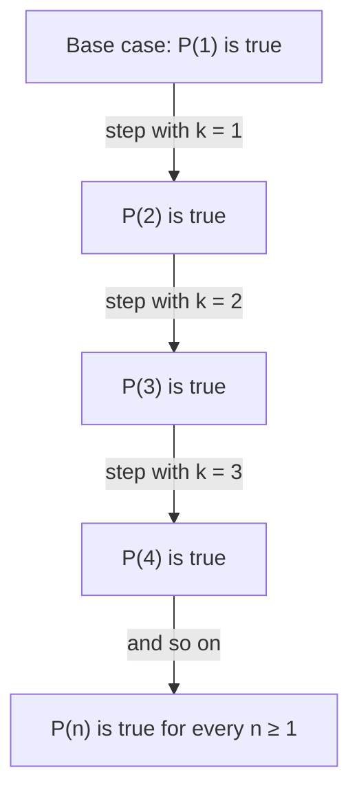

The lesson on inductive reasoning ended with a warning. Points on a circle, joined in every possible way, cut the circle into 1, 2, 4, 8 and 16 regions, and then 31: the doubling pattern was a lie. Checking cases can suggest a rule, but it can't prove one, because a rule about every whole number $n$ covers infinitely many cases. Yet mathematicians *do* prove such rules. The main tool is **mathematical induction**, a deductive method (despite its name) that turns a pattern into a proof. This honors lesson explains how it works, why it is valid, and how to use it on counting problems from geometry.

## The principle of induction

Let $P(n)$ be a statement about a whole number $n$, such as "$n$ points have $\tfrac{n(n-1)}{2}$ connecting segments". To prove $P(n)$ for every $n \ge n_0$:

1. **Base case.** Prove $P(n_0)$, the first case.
2. **Inductive step.** Prove that for every $k \ge n_0$, *if* $P(k)$ is true, *then* $P(k + 1)$ is true.

In the inductive step you assume $P(k)$; that assumption is called the **inductive hypothesis**. You are not assuming what you want to prove. You are proving a conditional, "$P(k) \to P(k+1)$", for an arbitrary $k$, and a conditional is proved by assuming its hypothesis.

Think of an endless row of dominoes. The base case knocks over the first one. The inductive step guarantees that each falling domino knocks over the next. Together they topple every domino:



## Why induction is valid

Here is a short indirect proof that the two steps really cover every case. Suppose the base case and the inductive step have both been proved, but $P(n)$ is false for some $n \ge n_0$. Among the numbers where $P$ fails, there is a smallest one, call it $m$; every nonempty set of whole numbers has a smallest member (this is the **well-ordering principle**). The failure $m$ isn't $n_0$, because the base case proved $P(n_0)$. So $m - 1 \ge n_0$, and since $m$ is the *smallest* failure, $P(m - 1)$ is true. The inductive step with $k = m - 1$ then gives $P(m)$, contradicting the assumption that $P(m)$ fails. So there is no failure at all.

### Example 1: Segments joining $n$ points

*Prove:* For every $n \ge 2$, joining every pair of $n$ points with a segment gives $S(n) = \tfrac{n(n-1)}{2}$ segments.

**Base case, $n = 2$.** Two points give one segment, and $\tfrac{2 \cdot 1}{2} = 1$. ✓

**Inductive step.** Assume that for some $k \ge 2$, $k$ points give $\tfrac{k(k-1)}{2}$ segments (the inductive hypothesis). Add a new point. The old segments are all still there, and the new point is joined to each of the $k$ old points, which adds exactly $k$ new segments. So
$$S(k + 1) = \frac{k(k-1)}{2} + k = \frac{k^2 - k + 2k}{2} = \frac{(k + 1)k}{2},$$
which is the formula with $n = k + 1$, since $\tfrac{(k+1)\big((k+1) - 1\big)}{2} = \tfrac{(k+1)k}{2}$. ✓

By induction, the formula holds for every $n \ge 2$. $\blacksquare$

The core lesson gave a different proof (each point joins $n - 1$ others, and each segment is counted twice). Having two independent proofs is a good sign you understand a result.

## Lines that divide the plane

Draw $n$ lines in a plane in **general position**: no two parallel and no three through a single point. Into how many regions $R(n)$ do they cut the plane?

```shape
{"segments": [{"from": [-5, -1], "to": [5, -1]}, {"from": [-3.667, -4], "to": [2.333, 5]}, {"from": [-2.333, 5], "to": [3.667, -4]}], "labels": [{"at": [0, -0.25], "text": "1"}, {"at": [0, 3.4], "text": "2"}, {"at": [-3.2, 1.4], "text": "3"}, {"at": [3.2, 1.4], "text": "4"}, {"at": [-4.2, -3.2], "text": "5"}, {"at": [0, -3.2], "text": "6"}, {"at": [4.2, -3.2], "text": "7"}], "caption": "Three lines, no two parallel and no three through one point, divide the plane into 7 regions."}
```

With no lines there is 1 region; then 2, 4, 7 and 11 regions for 1, 2, 3 and 4 lines. The start 1, 2, 4 looks like doubling again, but 7 breaks it. The differences are 1, 2, 3, 4, which suggests that the $n$th line adds $n$ regions, and the conjecture

$$R(n) = 1 + (1 + 2 + \dots + n) = \frac{n(n+1)}{2} + 1.$$

### Example 2: Proving the line formula

*Prove:* For every $n \ge 0$, $n$ lines in general position divide the plane into $\tfrac{n(n+1)}{2} + 1$ regions.

**Base case, $n = 0$.** With no lines the plane is one region, and $\tfrac{0 \cdot 1}{2} + 1 = 1$. ✓

**Inductive step.** Assume $k$ lines in general position make $\tfrac{k(k+1)}{2} + 1$ regions. Add line number $k + 1$, keeping general position. It is not parallel to any old line, so it crosses each of them, and it crosses each one exactly once, because two distinct lines meet in at most one point. That gives $k$ crossing points, and they are all different, because no three lines pass through one point. The $k$ points cut the new line into $k + 1$ pieces (two rays at the ends and $k - 1$ segments between). Each piece runs through one old region and splits it in two, so each piece adds one region:
$$R(k + 1) = \frac{k(k+1)}{2} + 1 + (k + 1) = \frac{k(k+1) + 2(k+1)}{2} + 1 = \frac{(k+1)(k+2)}{2} + 1. \checkmark$$

By induction, the formula holds for every $n \ge 0$. $\blacksquare$

For 10 lines this gives $\tfrac{10 \cdot 11}{2} + 1 = 56$ regions; doubling would have predicted 1,024. Notice how much geometry the step used: the facts about crossings came straight from the postulates, and "general position" was needed at two specific places.

## Odd numbers make squares

### Example 3: The sum of the first $n$ odd numbers

Add odd numbers: $1 = 1$, $1 + 3 = 4$, $1 + 3 + 5 = 9$, $1 + 3 + 5 + 7 = 16$. The sums are perfect squares, and a picture shows why.

```shape
{"polygons": [{"points": [[0, 0], [1, 0], [1, 1], [0, 1]], "fill": true}, {"points": [[1, 0], [2, 0], [2, 2], [0, 2], [0, 1], [1, 1]], "fill": true}, {"points": [[2, 0], [3, 0], [3, 3], [0, 3], [0, 2], [2, 2]], "fill": true}, {"points": [[3, 0], [4, 0], [4, 4], [0, 4], [0, 3], [3, 3]], "fill": true}], "segments": [{"from": [0, 0], "to": [0, 4]}, {"from": [0, 0], "to": [4, 0]}, {"from": [1, 0], "to": [1, 4]}, {"from": [0, 1], "to": [4, 1]}, {"from": [2, 0], "to": [2, 4]}, {"from": [0, 2], "to": [4, 2]}, {"from": [3, 0], "to": [3, 4]}, {"from": [0, 3], "to": [4, 3]}, {"from": [4, 0], "to": [4, 4]}, {"from": [0, 4], "to": [4, 4]}], "labels": [{"at": [0.5, 0.5], "text": "1"}, {"at": [1.5, 1.5], "text": "3"}, {"at": [2.5, 2.5], "text": "5"}, {"at": [3.5, 3.5], "text": "7"}], "caption": "1 + 3 + 5 + 7 = 16 = 4². Each L-shaped layer adds the next odd number of squares and turns a k-by-k square into a (k + 1)-by-(k + 1) square."}
```

An L-shaped layer around a $k$-by-$k$ square needs $k$ squares along one side, $k$ along the other and 1 in the corner: $2k + 1$ squares, the next odd number. The Greeks called such an L-shape a **gnomon** (the word also names the upright part of a sundial), and arrangements of pebbles like this are traditionally linked with the early Pythagoreans. Induction turns the picture into a proof.

*Prove:* For every $n \ge 1$, $1 + 3 + 5 + \dots + (2n - 1) = n^2$.

**Base case, $n = 1$.** The sum is just $1 = 1^2$. ✓

**Inductive step.** Assume $1 + 3 + \dots + (2k - 1) = k^2$. The next odd number is $2(k+1) - 1 = 2k + 1$, so
$$1 + 3 + \dots + (2k - 1) + (2k + 1) = k^2 + 2k + 1 = (k + 1)^2. \checkmark$$

By induction, the formula holds for every $n \ge 1$. $\blacksquare$

To use it, count the terms first: in $1 + 3 + \dots + 39$, the last term $39 = 2n - 1$ gives $n = 20$, so the sum is $20^2 = 400$.

## The circle regions, revisited

What about the regions inside a circle with $n$ points, the pattern that broke at 31? The correct count (when no three chords meet at one point) is
$$1 + \frac{n(n-1)}{2} + \frac{n(n-1)(n-2)(n-3)}{24}.$$
We state this without proof here; one standard proof counts how each chord and each crossing of two chords adds a region. Check it: for $n = 5$ it gives $1 + 10 + 5 = 16$, and for $n = 6$ it gives $1 + 15 + 15 = 31$, not 32. For $n = 7$ it gives 57, far from the 64 that doubling predicts. The formula's last term is 0 for $n \le 3$ and grows like $n^4$, so it was hidden in the first few cases. That is exactly how patterns lie.

## Common mistakes

- **Skipping the base case.** Take the false claim "$n^2 + n + 1$ is even for every $n \ge 1$". The inductive step actually works: $(k+1)^2 + (k+1) + 1 = (k^2 + k + 1) + (2k + 2)$, an even number plus an even number. But the base case fails ($1 + 1 + 1 = 3$), and in fact $n^2 + n + 1$ is always odd. Both steps are essential.
- **Checking one step instead of proving all of them.** Showing $P(3)$ leads to $P(4)$ is not an inductive step; the argument must work for an arbitrary $k$.
- **A step that fails for one value of $k$.** A famous joke "proves" that all horses are the same color: in any group of $k + 1$ horses, the first $k$ match and the last $k$ match, so all match. The overlap argument breaks when $k + 1 = 2$, since two groups of one horse don't overlap. One broken link stops the dominoes.
- **Using $P(k + 1)$ inside the step.** That assumes the conclusion. Start from $P(k)$ and build up to $P(k + 1)$.
- **Forgetting the conditions.** The line formula needs general position; parallel lines or three lines through one point give fewer regions.

## Key points

- Induction proves $P(n)$ for all $n \ge n_0$: prove the base case $P(n_0)$, then prove $P(k) \to P(k + 1)$ for every $k \ge n_0$.
- The inductive hypothesis is the assumption $P(k)$ inside the step; the step is a conditional, so assuming it is legitimate.
- Induction is valid because a smallest counterexample would contradict the base case or the inductive step.
- Segments joining $n$ points: $\tfrac{n(n-1)}{2}$. Regions from $n$ lines in general position: $\tfrac{n(n+1)}{2} + 1$. Sum of the first $n$ odd numbers: $n^2$.
- Both parts are essential: a step without a base case, or a base case without a working step, proves nothing.
