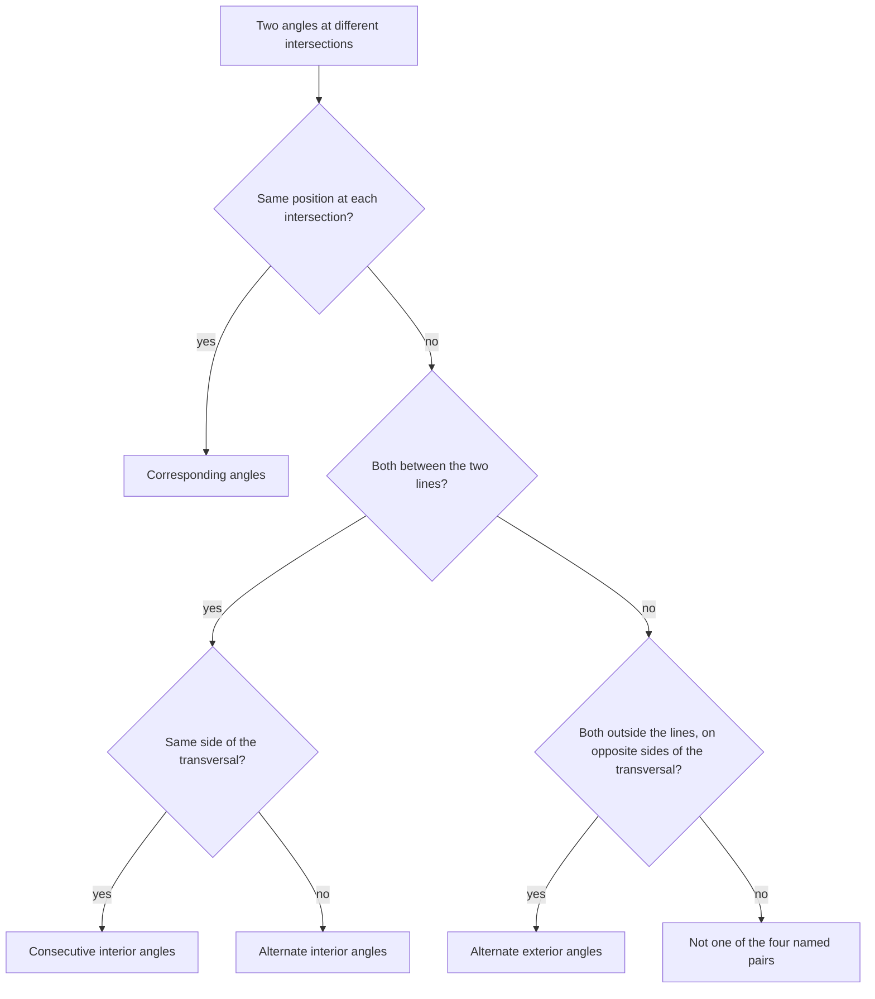
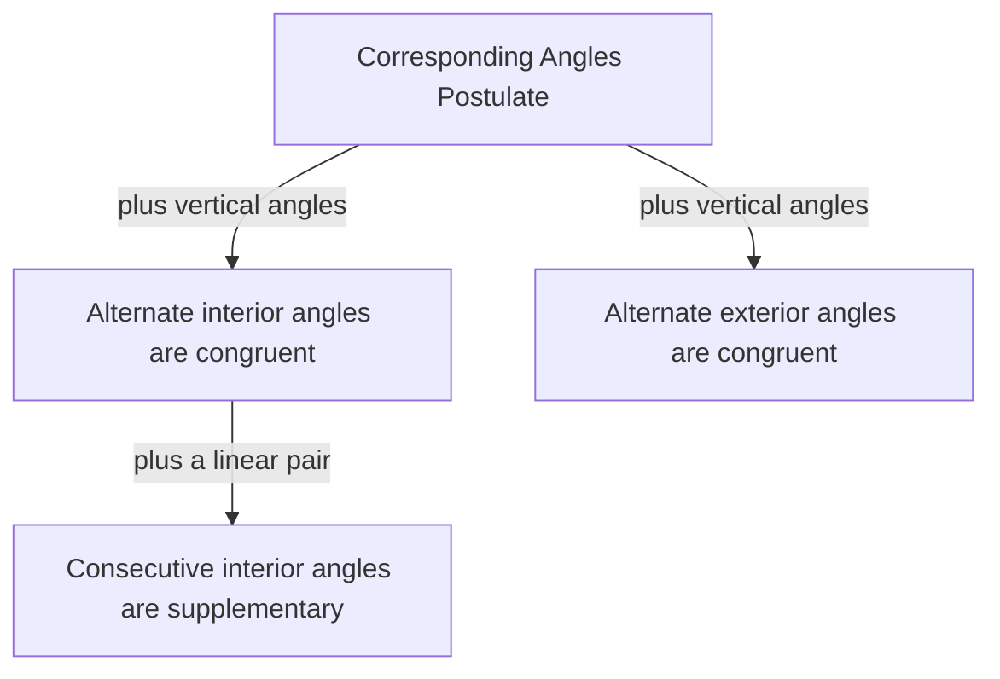

In Module 2 you proved facts about angles formed by *two* lines. Now add a third. When a line crosses two others, it creates eight angles, and if the two lines are parallel, those eight angles come in just two sizes. This lesson names the angle pairs, states which are congruent or supplementary when lines are parallel, and then runs the logic backwards to prove lines *are* parallel. These facts power the triangle angle sum in Module 4 and most of the work with polygons after that.

## Transversals and the eight angles

A **transversal** is a line that intersects two or more coplanar lines at different points. Line $t$ below crosses lines $\ell$ and $m$, making angles 1–8.

```shape
{"segments": [{"from": [-6, 2], "to": [6, 2]}, {"from": [-6, -2], "to": [6, -2]}, {"from": [-2.5, -5], "to": [2.5, 5]}], "labels": [{"at": [6.4, 2], "text": "ℓ"}, {"at": [6.4, -2], "text": "m"}, {"at": [2.8, 5], "text": "t"}, {"at": [-0.1, 2.6], "text": "1"}, {"at": [2.1, 2.6], "text": "2"}, {"at": [-0.1, 1.4], "text": "3"}, {"at": [2.1, 1.4], "text": "4"}, {"at": [-2.1, -1.4], "text": "5"}, {"at": [0.1, -1.4], "text": "6"}, {"at": [-2.1, -2.6], "text": "7"}, {"at": [0.1, -2.6], "text": "8"}], "caption": "Transversal t crosses ℓ and m, forming angles 1–8."}
```

The region between $\ell$ and $m$ is the *interior*; outside them is the *exterior*. Pairs of angles at different intersections get these names:

| Pair | Position | Examples |
|---|---|---|
| **Corresponding angles** | same position at each intersection | $\angle 1$ & $\angle 5$, $\angle 2$ & $\angle 6$, $\angle 3$ & $\angle 7$, $\angle 4$ & $\angle 8$ |
| **Alternate interior angles** | between the lines, opposite sides of $t$ | $\angle 3$ & $\angle 6$, $\angle 4$ & $\angle 5$ |
| **Alternate exterior angles** | outside the lines, opposite sides of $t$ | $\angle 1$ & $\angle 8$, $\angle 2$ & $\angle 7$ |
| **Consecutive interior angles** (same-side interior) | between the lines, same side of $t$ | $\angle 3$ & $\angle 5$, $\angle 4$ & $\angle 6$ |

These names describe *positions* only. They say nothing about measures until we know the lines are parallel.

The picture below shades one example of each named pair.


To name a pair, ask the questions in this chart in order.



## When the lines are parallel

**Corresponding Angles Postulate.** If two parallel lines are cut by a transversal, then corresponding angles are congruent.

This is accepted as a postulate. Intuitively, sliding line $\ell$ along $t$ onto $m$ carries each angle at the top intersection exactly onto its partner below. Everything else follows from it, together with vertical angles and linear pairs.

**Alternate Interior Angles Theorem.** If parallel lines are cut by a transversal, alternate interior angles are congruent.

*Proof (for $\angle 3$ and $\angle 6$).* $\angle 3 \cong \angle 2$ because they are vertical angles. $\angle 2 \cong \angle 6$ by the Corresponding Angles Postulate. By the transitive property, $\angle 3 \cong \angle 6$. $\blacksquare$

**Alternate Exterior Angles Theorem.** Alternate exterior angles are congruent (proof: same idea, using vertical angles at the other end).

**Consecutive Interior Angles Theorem.** Consecutive interior angles are supplementary.

*Proof (for $\angle 4$ and $\angle 6$).* $\angle 4$ and $\angle 3$ form a linear pair, so $m\angle 4 + m\angle 3 = 180^\circ$. From the theorem above, $m\angle 3 = m\angle 6$. Substituting, $m\angle 4 + m\angle 6 = 180^\circ$. $\blacksquare$

This chart shows how the three theorems grow out of the one postulate.



The upshot: with parallel lines, every one of the eight angles is either equal to $\angle 1$ or supplementary to it. Angles that look the same size (both acute or both obtuse) are congruent; an acute and an obtuse one are supplementary.

### Example 1

In the figure, $\ell \parallel m$ and $m\angle 1 = 112^\circ$. Find $m\angle 6$ and $m\angle 7$.

**Step 1.** $\angle 1$ and $\angle 2$ form a linear pair, so $m\angle 2 = 180 - 112 = 68^\circ$.

**Step 2.** $\angle 2$ and $\angle 6$ are corresponding, so $m\angle 6 = 68^\circ$.

**Step 3.** $\angle 7$ and $\angle 2$ are alternate exterior angles, so $m\angle 7 = 68^\circ$. (Check with the shortcut: $\angle 7$ is acute, so it is the supplement of the obtuse $112^\circ$ angle.)

### Example 2

$\ell \parallel m$. Consecutive interior angles measure $(3x + 10)^\circ$ and $(5x - 2)^\circ$. Find both angles.

**Step 1.** Consecutive interior angles are supplementary: $(3x + 10) + (5x - 2) = 180$.

**Step 2.** $8x + 8 = 180$, so $x = 21.5$.

**Step 3.** The angles are $3(21.5) + 10 = 74.5^\circ$ and $5(21.5) - 2 = 105.5^\circ$, which add to $180^\circ$.

## Proving lines are parallel

Each theorem above has a true converse, which gives a way to *prove* lines are parallel.

**Corresponding Angles Converse.** If two lines are cut by a transversal so that corresponding angles are congruent, then the lines are parallel.

Likewise, the lines are parallel if *alternate interior angles are congruent*, if *alternate exterior angles are congruent*, or if *consecutive interior angles are supplementary*.

Two more useful facts:

- **Transitivity of parallels.** If two lines are each parallel to a third line, they are parallel to each other.
- In a plane, if two lines are each *perpendicular to the same line*, they are parallel. (Both make $90^\circ$ corresponding angles.)

### Example 3

Lines $p$ and $q$ are cut by a transversal. Alternate interior angles measure $(7x - 24)^\circ$ and $(4x + 18)^\circ$. For what value of $x$ is $p \parallel q$?

**Step 1.** By the Alternate Interior Angles Converse, the lines are parallel when these angles are congruent: $7x - 24 = 4x + 18$.

**Step 2.** $3x = 42$, so $x = 14$.

**Step 3.** Each angle is then $7(14) - 24 = 74^\circ$. For any other $x$, the angles differ and the lines meet somewhere.

## The parallel postulate

Behind all this sits a deeper assumption. **Playfair's axiom**, a form of Euclid's **parallel postulate**, says: *through a point not on a line, there is exactly one line parallel to the given line.* Our Corresponding Angles Postulate is equivalent to it. You might expect such a basic fact to be provable from the other postulates; mathematicians tried for two thousand years and failed, for a good reason you'll meet in Module 10.

## Common mistakes

- **Using parallel-line theorems without parallel lines.** If $\ell$ and $m$ aren't known to be parallel, corresponding angles need not be equal.
- **Mixing up the theorem and its converse.** "Lines parallel, so angles congruent" uses the theorem; "angles congruent, so lines parallel" uses the converse.
- **Setting consecutive interior angles equal.** They are supplementary.
- **Mislabeling pairs.** Alternate means opposite sides of the transversal; consecutive means the same side.
- **Forgetting to answer with angles.** Finding $x$ is usually a middle step.

## Key points

- A transversal crossing two lines makes corresponding, alternate interior, alternate exterior and consecutive interior pairs.
- With parallel lines: corresponding, alternate interior and alternate exterior angles are congruent; consecutive interior angles are supplementary.
- The converses prove lines parallel.
- Through a point not on a line there is exactly one parallel (the parallel postulate).
