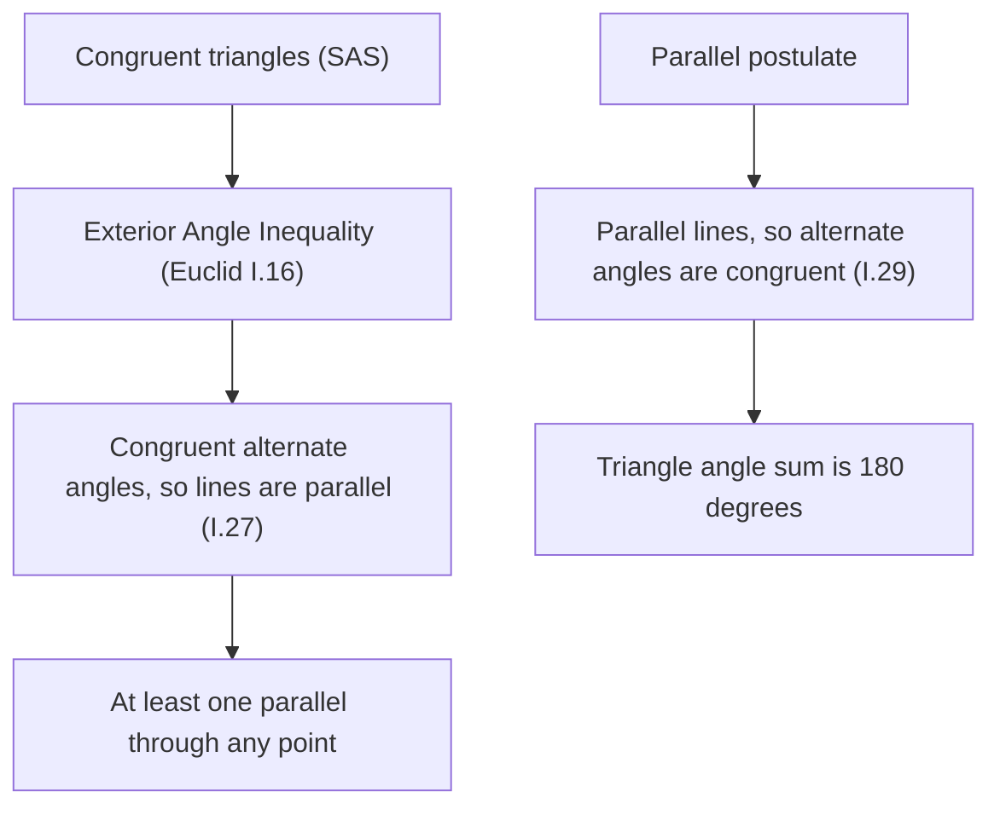

Lesson 8 built every parallel-line fact on one assumption, the Corresponding Angles Postulate, and then listed four converses ("if these angles are congruent, the lines are parallel") without proving them. This lesson fills that gap and goes further. You will prove the converses, see that some of them do not need the parallel postulate at all (the arrangement of Euclid's *Elements*, written about 2,300 years ago, already reflects this), and learn one of the most useful tricks in angle proofs: drawing an **auxiliary line**, an extra line added to a figure to make a proof possible.

Throughout, number the angles as in Lesson 8: line $t$ crosses $\ell$ at $P$ (angles 1–4) and $m$ at $Q$ (angles 5–8), with 1, 2 above $\ell$, 3, 4 below it, and the same pattern at $Q$.

## Proving the Corresponding Angles Converse

**Corresponding Angles Converse.** If two lines are cut by a transversal so that corresponding angles are congruent, the lines are parallel.

The idea is to build the parallel line we want and then show it is the line we already have.

*Proof.* Suppose $\angle 1 \cong \angle 5$. Through $P$ there is a line $\ell'$ parallel to $m$ (the parallel postulate says there is exactly one). Since $\ell' \parallel m$, the Corresponding Angles Postulate says the angle $\ell'$ makes with $t$ in the position of $\angle 1$ is congruent to $\angle 5$, so it has the same measure as $\angle 1$. Now $\ell$ and $\ell'$ both pass through $P$, and on the same side of $t$ they make angles of the same measure with the same ray of $t$. By the Protractor Postulate there is only one such ray, so $\ell$ and $\ell'$ share a ray and are the same line. Hence $\ell = \ell' \parallel m$. $\blacksquare$

This is a common pattern for proving a converse: construct the object the conclusion talks about, then use a uniqueness fact to show it coincides with the given one. With this converse in hand, the other three converses take only a line or two each.

### Example 1: the Consecutive Interior Angles Converse

**Given:** $m\angle 4 + m\angle 6 = 180^\circ$. **Prove:** $\ell \parallel m$.

| Statement | Reason |
|---|---|
| 1. $m\angle 4 + m\angle 6 = 180^\circ$ | Given |
| 2. $\angle 2$ and $\angle 4$ form a linear pair | Definition of linear pair (they share the right-hand ray of $\ell$; their other sides are opposite rays of $t$) |
| 3. $m\angle 2 + m\angle 4 = 180^\circ$ | Linear Pair Postulate |
| 4. $\angle 2 \cong \angle 6$ | Congruent Supplements Theorem (both are supplements of $\angle 4$) |
| 5. $\ell \parallel m$ | Corresponding Angles Converse ($\angle 2$ and $\angle 6$ are corresponding) |

The Alternate Interior Angles Converse is shorter still: if $\angle 3 \cong \angle 6$, then $\angle 2 \cong \angle 3$ (vertical angles), so $\angle 2 \cong \angle 6$ by the transitive property, and the corresponding angles converse finishes it.

## Euclid's split: which facts need the parallel postulate?

The proof above used the parallel postulate (to get exactly one line $\ell'$). Euclid, in Book I of the *Elements*, proved the converse in a way that does not use it at all. His Proposition 27 says, in modern words, that if alternate interior angles are congruent then the lines are parallel, and his proof is indirect.

*Euclid's argument.* Suppose $\angle 3 \cong \angle 6$ but $\ell$ and $m$ are not parallel. Then they meet at some point $R$, say on the right of $t$. Points $P$, $Q$, $R$ form a triangle. The triangle's angle at $P$ is $\angle 4$, so $\angle 3$, which forms a linear pair with it, is an **exterior angle** of $\triangle PQR$; and $\angle 6$, the triangle's angle at $Q$, is one of its remote interior angles. The Exterior Angle Inequality says an exterior angle is *greater* than each remote interior angle, so $m\angle 3 > m\angle 6$. That contradicts $\angle 3 \cong \angle 6$. (If $R$ is on the left, the roles swap: $\angle 6$ is an exterior angle of the triangle and $\angle 3$ a remote interior angle, so $m\angle 6 > m\angle 3$, again a contradiction.) So the lines are parallel. $\blacksquare$

The crucial point is that Euclid proved the Exterior Angle Inequality (his Proposition 16) with congruent triangles alone, *before* he ever used the parallel postulate. In this course you met it in Lesson 10 as a consequence of the triangle angle sum, which does use the parallel postulate, but Euclid's route shows it is not needed. Euclid's first use of the fifth postulate comes in Proposition 29: the *forward* direction, "parallel lines make congruent alternate interior angles."



So geometry without the fifth postulate, often called **neutral geometry** (or absolute geometry), already guarantees that parallels *exist*: draw any transversal through the point and copy the angle. What the parallel postulate adds is that the parallel is *unique*, and with uniqueness comes the forward theorems and the $180^\circ$ triangle. This is the precise reason the hyperbolic geometry of Module 10 can have many parallels through a point but never zero. (One caveat: on a sphere, where there are no parallels at all, Proposition 16 itself fails, because "lines" are great circles that close up. Euclid's proof quietly assumes lines can be extended without limit and never come back.)

Commentators on Euclid felt that a statement as complicated as the fifth postulate ought to be provable; Proclus, writing in the 400s AD, attempted a proof and reported an earlier attempt by Ptolemy. Every such attempt either failed or secretly assumed something equivalent to the postulate.

## Auxiliary lines: the bend theorem

Many angle problems show two parallel lines joined by a path that bends between them. No transversal crosses both lines, so none of the Lesson 8 theorems applies directly. The fix is to draw one.

```shape
{"segments": [{"from": [-1, 4], "to": [9, 4]}, {"from": [-1, 0], "to": [9, 0]}, {"from": [1, 4], "to": [5, 2]}, {"from": [5, 2], "to": [1, 0]}, {"from": [-1, 2], "to": [9, 2], "dashed": true}], "points": [{"at": [1, 4], "label": "A"}, {"at": [5, 2], "label": "P"}, {"at": [1, 0], "label": "B"}], "labels": [{"at": [9.4, 4], "text": "ℓ"}, {"at": [9.4, 0], "text": "m"}, {"at": [9.4, 2], "text": "n"}, {"at": [2.3, 3.75], "text": "a"}, {"at": [2.3, 0.25], "text": "b"}, {"at": [4.0, 2.25], "text": "a"}, {"at": [4.0, 1.75], "text": "b"}], "caption": "Auxiliary line n through P, parallel to ℓ and m, splits angle APB into a copy of a and a copy of b."}
```

**Bend theorem.** Let $\ell \parallel m$, with $A$ on $\ell$, $B$ on $m$, and $P$ a point between the lines. If $a$ is the angle at $A$ between $\ell$ and $\overline{AP}$ and $b$ is the angle at $B$ between $m$ and $\overline{BP}$, both on the side toward which the path bends, then $m\angle APB = a + b$.

*Proof.* Through $P$ draw line $n \parallel \ell$ (exactly one exists, by the parallel postulate). Since $\ell \parallel m$ too, $n \parallel m$ (transitivity of parallels). Line $n$ splits $\angle APB$ into two parts. The upper part and angle $a$ are alternate interior angles for the parallels $\ell$, $n$ and transversal $\overleftrightarrow{AP}$, so the upper part measures $a$. Likewise the lower part measures $b$ (parallels $n$, $m$, transversal $\overleftrightarrow{BP}$). By the Angle Addition Postulate, $m\angle APB = a + b$. $\blacksquare$

The justification for an auxiliary line matters. "Through $P$ draw the line parallel to $\ell$" is legitimate because exactly one such line exists. A line that must satisfy *two* conditions at once (say, parallel to $\ell$ *and* through some other chosen point) usually does not exist, and a proof that draws one is invalid.

### Example 2: bisectors of consecutive interior angles

$\ell \parallel m$, and transversal $t$ meets them at $A$ and $B$. The bisectors of the two consecutive interior angles on the right of $t$ meet at $P$. Prove that $\angle APB$ is a right angle.

**Step 1.** Call the consecutive interior angles $\alpha$ (at $A$) and $\beta$ (at $B$). They are supplementary: $\alpha + \beta = 180^\circ$.

**Step 2.** The bisectors make angles $\tfrac{\alpha}{2}$ with $\ell$ and $\tfrac{\beta}{2}$ with $m$, both opening to the right, toward $P$, which lies between the lines.

**Step 3.** Path $A \to P \to B$ is a bend between parallel lines, so by the bend theorem $m\angle APB = \tfrac{\alpha}{2} + \tfrac{\beta}{2} = \tfrac{180^\circ}{2} = 90^\circ$. $\blacksquare$

Notice that this proof never used the triangle angle sum; the auxiliary line did that work.

## Paths with several bends

The same trick handles a zigzag with any number of bends: draw a parallel through every bend point.

**Zigzag rule.** Suppose $\ell \parallel m$ and a path of segments runs from $\ell$ to $m$, switching between heading right and heading left at every bend. At each bend take the angle between the two segments; where the path leaves $\ell$ and where it meets $m$, take the acute angle between the path and that line. Each of these angles opens either to the left or to the right. Then *the angles that open to the right add up to the same total as the angles that open to the left.*

*Why.* With a parallel through every bend, each segment makes the same acute angle with every parallel it touches (alternate interior angles), and each bend angle is the sum of the angles its two segments make with the parallel through it. Count where each segment's angle appears: once in a right-opening angle and once in a left-opening angle. So the two totals are equal.

For one bend this is exactly the bend theorem: $a$ and $b$ open toward the bend, $\angle APB$ opens the other way, and $a + b = m\angle APB$.

```shape
{"segments": [{"from": [-1, 6], "to": [8, 6]}, {"from": [-1, 0], "to": [8, 0]}, {"from": [0, 6], "to": [4.29, 4]}, {"from": [4.29, 4], "to": [2.29, 2]}, {"from": [2.29, 2], "to": [5.15, 0]}], "points": [{"at": [0, 6], "label": "A"}, {"at": [4.29, 4], "label": "P"}, {"at": [2.29, 2], "label": "Q"}, {"at": [5.15, 0], "label": "B"}], "labels": [{"at": [8.4, 6], "text": "ℓ"}, {"at": [8.4, 0], "text": "m"}, {"at": [1.5, 5.7], "text": "25°"}, {"at": [3.5, 4], "text": "70°"}, {"at": [3.1, 2], "text": "80°"}, {"at": [4.0, 0.3], "text": "x"}], "caption": "A path with two bends between parallel lines ℓ and m (Example 3)."}
```

### Example 3

In the figure, $\ell \parallel m$. The path leaves $\ell$ at $A$ making a $25^\circ$ angle that opens to the right, bends at $P$ with an angle of $70^\circ$ opening to the left, bends at $Q$ with an angle of $80^\circ$ opening to the right, and meets $m$ at $B$ making angle $x$ that opens to the left. Find $x$.

**Step 1.** Sort the angles. Opening right: $25^\circ$ (at $A$) and $80^\circ$ (at $Q$). Opening left: $70^\circ$ (at $P$) and $x$ (at $B$).

**Step 2.** Zigzag rule: $25 + 80 = 70 + x$, so $x = 35^\circ$.

**Step 3 (check by the long way).** Draw parallels through $P$ and $Q$. Segment $\overline{AP}$ makes $25^\circ$ with the parallels, so the upper part of the $70^\circ$ angle at $P$ is $25^\circ$ and the lower part, the angle $\overline{PQ}$ makes with the parallels, is $45^\circ$. At $Q$, the upper part is $45^\circ$ and the lower part is $80 - 45 = 35^\circ$, the angle $\overline{QB}$ makes with the parallels. At $B$, alternate interior angles give $x = 35^\circ$. ✓

### Example 4

$\ell \parallel m$ and a single bend at $P$ makes $m\angle APB = (5x - 12)^\circ$, with angles $(2x + 4)^\circ$ at $A$ and $(x + 8)^\circ$ at $B$ opening toward the bend. Find $m\angle APB$.

**Step 1.** Bend theorem: $5x - 12 = (2x + 4) + (x + 8) = 3x + 12$.

**Step 2.** $2x = 24$, so $x = 12$.

**Step 3.** $m\angle APB = 5(12) - 12 = 48^\circ$. Check: $2(12) + 4 = 28$ and $12 + 8 = 20$, and $28 + 20 = 48$. ✓

## Common mistakes

- **Using the converse to prove itself.** In proving "corresponding angles congruent implies parallel", you may not assume the lines are parallel. The proof works with the *new* line $\ell'$, which is parallel by construction.
- **Adding the wrong pair.** In the bend theorem only the angles that open *toward* the bend add up to the bend angle. If an angle is given on the other side of the path, replace it by its supplement first.
- **Overloaded auxiliary lines.** Draw a line with one condition (through $P$, parallel to $\ell$). A line asked to meet two conditions may not exist.
- **Forgetting the second parallel.** The bend proof needs $n \parallel m$ as well as $n \parallel \ell$; that comes from transitivity of parallels and should be stated.
- **Thinking every parallel fact needs the parallel postulate.** The converses (parallels exist) hold without it; the forward theorems (parallels are unique and make congruent angles) need it.

## Key points

- To prove a converse, construct the line the conclusion describes and use uniqueness (here, the Protractor Postulate) to show it is the given line.
- All four parallel-line converses follow from the Corresponding Angles Converse with vertical angles, linear pairs or congruent supplements.
- Euclid proved "congruent alternate interior angles imply parallel lines" (I.27) by contradiction with the Exterior Angle Inequality, without the parallel postulate; the forward theorem (I.29) is where the postulate is first needed.
- An auxiliary line through a bend point, parallel to the given lines, turns a bent path into ordinary transversals.
- Bend theorem: the bend angle equals the sum of the two angles that open toward it. Zigzag rule: angles opening right total the same as angles opening left.
