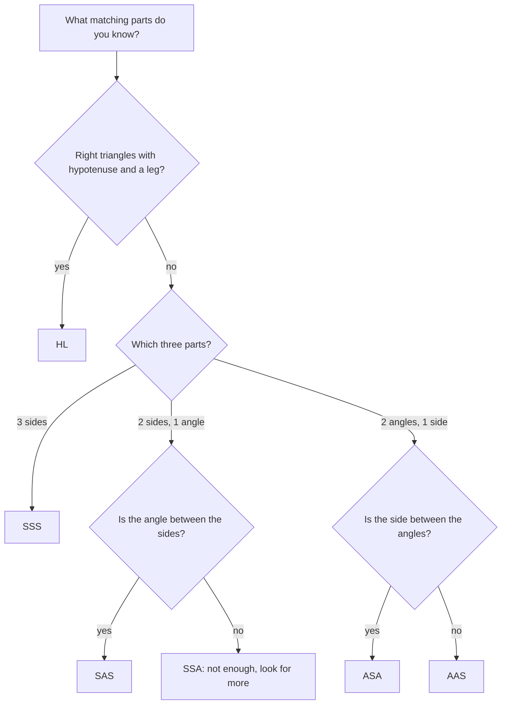

SSS and SAS lead with sides. This lesson completes the toolkit with three shortcuts that lead with angles (ASA, AAS) or apply to right triangles (HL). Then comes the payoff: once two triangles are proved congruent, *every* pair of corresponding parts is congruent. That last step, called CPCTC, is how congruent triangles prove things about segments and angles that have nothing to do with triangles on their face.

## ASA: Angle-Side-Angle

**ASA Congruence Postulate.** If two angles and the **included side** (the side between their vertices) of one triangle are congruent to the corresponding parts of another, the triangles are congruent.

Intuition: fix a segment, and fix the angles at both ends. The two rays from the ends can only meet at one point, so the triangle is determined.

## AAS: Angle-Angle-Side

**AAS Congruence Theorem.** If two angles and a non-included side of one triangle are congruent to the corresponding parts of another, the triangles are congruent.

*Why it's a theorem, not a postulate.* If $\angle A \cong \angle D$ and $\angle B \cong \angle E$, the Third Angles Theorem gives $\angle C \cong \angle F$. Now the given side sits between two known congruent angles, so ASA applies.

## HL: Hypotenuse-Leg (right triangles only)

**HL Congruence Theorem.** If the hypotenuse and one leg of a right triangle are congruent to the hypotenuse and a leg of another right triangle, the triangles are congruent.

This looks like SSA, which normally fails. It works here because the angle is $90^\circ$: by the Pythagorean theorem (Module 6), the third sides are both $\sqrt{c^2 - a^2}$, so SSS applies. HL needs three facts in a proof: both triangles are right triangles, the hypotenuses are congruent, and one pair of legs is congruent.

## Summary of the tests

| Works | Doesn't work |
|---|---|
| SSS, SAS, ASA, AAS, HL (right triangles) | SSA (in general), AAA |

Here are all five valid tests side by side. In each triangle, tick marks show sides and arcs show angles that are known to match the other triangle; the little square in the HL triangle is its right angle.


```shape
{"polygons": [{"points": [[0, 0], [6, 0], [2, 3]]}, {"points": [[9, 0], [15, 0], [11, 3]]}], "curves": [{"x": "0.9cos(t)", "y": "0.9sin(t)", "t": [0, 0.98]}, {"x": "9 + 0.9cos(t)", "y": "0.9sin(t)", "t": [0, 0.98]}, {"x": "6 - 0.9cos(t)", "y": "0.9sin(t)", "t": [0, 0.64]}, {"x": "6 - 1.1cos(t)", "y": "1.1sin(t)", "t": [0, 0.64]}, {"x": "15 - 0.9cos(t)", "y": "0.9sin(t)", "t": [0, 0.64]}, {"x": "15 - 1.1cos(t)", "y": "1.1sin(t)", "t": [0, 0.64]}], "segments": [{"from": [3, -0.25], "to": [3, 0.25]}, {"from": [12, -0.25], "to": [12, 0.25]}], "caption": "ASA: two angles and the side between them match."}
```

## CPCTC

**CPCTC** stands for **Corresponding Parts of Congruent Triangles are Congruent**. It's just the definition of congruent triangles read in the "then" direction, but it deserves its own name because it's the last step in so many proofs. The typical plan is:

1. Identify two triangles that contain the parts you want to prove congruent.
2. Prove the triangles congruent with SSS, SAS, ASA, AAS or HL.
3. Conclude the parts are congruent by CPCTC.

You *cannot* use CPCTC before proving the triangles congruent; that would assume what you want.

### Example 1

*Given:* $M$ is the midpoint of $\overline{AD}$ and of $\overline{BC}$, as segments that cross at $M$. *Prove:* $\overline{AB} \cong \overline{DC}$.

```shape
{"segments": [{"from": [0, 3], "to": [8, 0]}, {"from": [0, 0], "to": [8, 3]}, {"from": [0, 3], "to": [0, 0]}, {"from": [8, 0], "to": [8, 3]}], "labels": [{"at": [-0.4, 3.3], "text": "A"}, {"at": [-0.4, -0.3], "text": "B"}, {"at": [8.4, -0.3], "text": "D"}, {"at": [8.4, 3.3], "text": "C"}, {"at": [4, 2.0], "text": "M"}]}
```

| Statements | Reasons |
|---|---|
| 1. $M$ is the midpoint of $\overline{AD}$ and $\overline{BC}$ | 1. Given |
| 2. $\overline{AM} \cong \overline{DM}$, $\overline{BM} \cong \overline{CM}$ | 2. Definition of midpoint |
| 3. $\angle AMB \cong \angle DMC$ | 3. Vertical Angles Theorem |
| 4. $\triangle AMB \cong \triangle DMC$ | 4. SAS |
| 5. $\overline{AB} \cong \overline{DC}$ | 5. CPCTC |

The angle at $M$ is included between the two pairs of sides, so SAS fits.

### Example 2

*Given:* $\overline{QS} \perp \overline{PR}$ at $S$ and $\overline{PQ} \cong \overline{RQ}$. *Prove:* $S$ is the midpoint of $\overline{PR}$.

| Statements | Reasons |
|---|---|
| 1. $\overline{QS} \perp \overline{PR}$; $\overline{PQ} \cong \overline{RQ}$ | 1. Given |
| 2. $\angle QSP$ and $\angle QSR$ are right angles | 2. Definition of perpendicular |
| 3. $\triangle QSP$ and $\triangle QSR$ are right triangles | 3. Definition of right triangle |
| 4. $\overline{QS} \cong \overline{QS}$ | 4. Reflexive property |
| 5. $\triangle QSP \cong \triangle QSR$ | 5. HL |
| 6. $\overline{PS} \cong \overline{RS}$ | 6. CPCTC |
| 7. $S$ is the midpoint of $\overline{PR}$ | 7. Definition of midpoint |

Here the hypotenuses are $\overline{PQ}$ and $\overline{RQ}$, and the shared leg is $\overline{QS}$.

### Example 3

$\triangle ABC$ and $\triangle DEF$ have $\angle A \cong \angle D$, $\angle C \cong \angle F$, and $\overline{BC} \cong \overline{EF}$. Which test applies, and what else is congruent?

**Step 1.** The side $\overline{BC}$ is not between $\angle A$ and $\angle C$ (the included side would be $\overline{AC}$). So this is AAS.

**Step 2.** By CPCTC, $\overline{AB} \cong \overline{DE}$, $\overline{AC} \cong \overline{DF}$ and $\angle B \cong \angle E$.

## Choosing a test

When deciding which shortcut to use, list the three pairs of parts you know and look at *where* they sit:

- Three sides: **SSS**.
- Two sides and the angle between them: **SAS**.
- Two angles and the side between them: **ASA**.
- Two angles and a side not between them: **AAS**.
- Right triangles with a hypotenuse and a leg: **HL**.

If what you have is two sides and an angle *not* between them, look for something else: perhaps a right angle (making HL available) or another pair of angles.

The same choice as a flowchart:



### Example 4

Two right triangles have congruent hypotenuses of length $3x + 1$ and $5x - 9$, and congruent legs. Find the hypotenuse, and name the test.

**Step 1.** The hypotenuses are congruent: $3x + 1 = 5x - 9$, so $x = 5$ and each hypotenuse is 16.

**Step 2.** Right triangles, congruent hypotenuses, a pair of congruent legs: the triangles are congruent by **HL**.

## Common mistakes

- **Mixing up ASA and AAS.** In ASA the side is between the angles; in AAS it isn't. Both work, but name the right one.
- **Using HL on triangles not known to be right.** State the right angles first.
- **Using CPCTC to prove the triangles congruent.** CPCTC comes *after* congruence.
- **Mismatched correspondence.** If $\triangle AMB \cong \triangle DMC$, then $\angle A$ matches $\angle D$ and $\overline{AB}$ matches $\overline{DC}$; read the parts off in the order the letters appear.

## Key points

- ASA: two angles and the included side. AAS: two angles and a non-included side.
- HL: hypotenuse and a leg of right triangles.
- Valid tests: SSS, SAS, ASA, AAS, HL. Invalid: SSA, AAA.
- CPCTC: once triangles are congruent, all corresponding parts are congruent.
