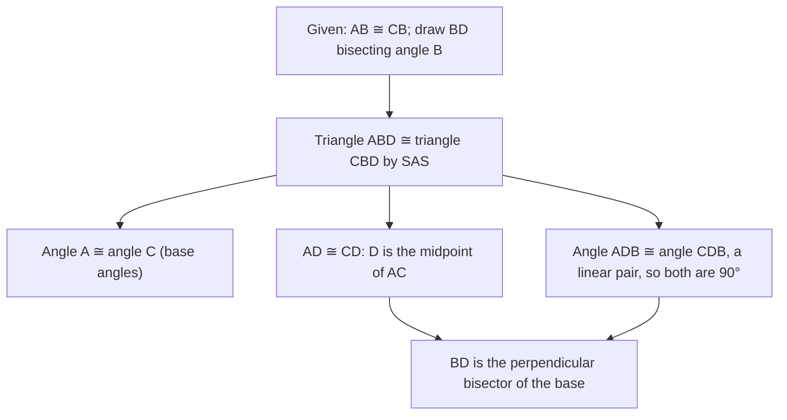

Isosceles triangles are everywhere: roof gables, the two radii and chord of a circle, the halves of a kite. Their symmetry gives them special properties, and proving those properties is a perfect first use of the congruence shortcuts from the last two lessons.

## Parts of an isosceles triangle

In an isosceles triangle with exactly two congruent sides, those sides are the **legs**, the third side is the **base**, the angle between the legs is the **vertex angle**, and the two angles touching the base are the **base angles**.


```shape
{"polygons": [{"points": [[0, 0], [6, 0], [3, 5]]}], "segments": [{"from": [1.3, 2.6], "to": [1.7, 2.4]}, {"from": [4.7, 2.4], "to": [4.3, 2.6]}, {"from": [3, 5], "to": [3, 0], "dashed": true}], "rightAngles": [[[3, 0], [6, 0], [3, 5]]], "labels": [{"at": [-0.4, -0.4], "text": "A"}, {"at": [6.4, -0.4], "text": "C"}, {"at": [3, 5.5], "text": "B"}, {"at": [3, -0.5], "text": "D"}], "caption": "Legs AB and CB are congruent; base angles are at A and C. The dashed segment BD bisects the vertex angle and the base."}
```

## The Base Angles Theorem

**Isosceles Triangle Theorem (Base Angles Theorem).** If two sides of a triangle are congruent, the angles opposite them are congruent.

*Proof.* Let $\overline{AB} \cong \overline{CB}$. Draw the bisector of $\angle B$, meeting $\overline{AC}$ at $D$. Then $\angle ABD \cong \angle CBD$ (definition of bisector) and $\overline{BD} \cong \overline{BD}$ (reflexive), so $\triangle ABD \cong \triangle CBD$ by SAS. By CPCTC, $\angle A \cong \angle C$. $\blacksquare$

The same pair of congruent triangles gives more for free. By CPCTC, $\overline{AD} \cong \overline{CD}$, so $D$ is the midpoint of the base. Also $\angle ADB \cong \angle CDB$, and they form a linear pair, so each is $90^\circ$. So:

**The bisector of the vertex angle of an isosceles triangle is the perpendicular bisector of the base.**

This one pair of congruent triangles does a lot of work. The chart traces each conclusion back to it.



**Converse of the Base Angles Theorem.** If two angles of a triangle are congruent, the sides opposite them are congruent. (Proof: draw the bisector of the third angle and use AAS.)

## Equilateral triangles

Apply the Base Angles Theorem to each pair of sides of an equilateral triangle and every pair of angles is congruent:

- **Corollary.** A triangle is equilateral if and only if it is equiangular.
- Since the angles are equal and add to $180^\circ$, each angle of an equilateral triangle is $60^\circ$.

## Finding angles in isosceles triangles

If the vertex angle is $v$, the two equal base angles share the rest: each base angle is $\dfrac{180 - v}{2}$. If a base angle is $b$, the vertex angle is $180 - 2b$.

### Example 1

The vertex angle of an isosceles triangle is $38^\circ$. Find each base angle.

Each base angle is $\dfrac{180 - 38}{2} = \dfrac{142}{2} = 71^\circ$. Check: $38 + 71 + 71 = 180$.

### Example 2

In $\triangle PQR$, $\overline{PQ} \cong \overline{PR}$, $m\angle Q = (4x + 6)^\circ$ and $m\angle R = (6x - 20)^\circ$. Find $m\angle P$.

**Step 1.** $\angle Q$ is opposite $\overline{PR}$ and $\angle R$ is opposite $\overline{PQ}$. Those sides are congruent, so $\angle Q \cong \angle R$: $4x + 6 = 6x - 20$, giving $x = 13$.

**Step 2.** Each base angle is $4(13) + 6 = 58^\circ$.

**Step 3.** $m\angle P = 180 - 2(58) = 64^\circ$.

### Example 3

In $\triangle ABC$, $m\angle A = 50^\circ$ and $m\angle B = 80^\circ$. If $AC = 3y + 1$ and $BC = 5y - 9$, find $AC$.

**Step 1.** $m\angle C = 180 - 50 - 80 = 50^\circ$. So $\angle A \cong \angle C$.

**Step 2.** By the converse, the sides opposite those angles are congruent. The side opposite $\angle A$ is $\overline{BC}$, and opposite $\angle C$ is $\overline{AB}$. So $BC = AB$, which does *not* involve $AC$!

**Step 3.** The given information about $AC$ and $BC$ can't be set equal. In fact $\overline{AC}$ is opposite the $80^\circ$ angle and is the longest side. This example shows why you must match each angle with its *opposite* side before writing an equation. (If the problem had given $AB = 3y + 1$ instead, then $3y + 1 = 5y - 9$ would give $y = 5$ and $AB = BC = 16$.)

### Example 4

An isosceles triangle's vertex angle is twice a base angle. Find all three angles.

Let a base angle be $b$; the vertex angle is $2b$. Then $b + b + 2b = 180$, so $b = 45^\circ$ and the vertex angle is $90^\circ$. It's an isosceles right triangle, with angles $45^\circ$, $45^\circ$, $90^\circ$.

## Isosceles triangles hiding in other figures

Any two radii of a circle are congruent, so a triangle formed by two radii and a chord is isosceles. Its base angles are equal, a fact used constantly in circle problems (Module 7). Likewise the triangles formed by the diagonals of a rhombus or a kite contain isosceles triangles.

### Example 5

$\triangle XYZ$ is equilateral with $XY = 4a + 3$ and $YZ = 7a - 9$. Find the perimeter.

**Step 1.** All sides are equal: $4a + 3 = 7a - 9$, so $a = 4$.

**Step 2.** Each side is $4(4) + 3 = 19$, so the perimeter is $3 \cdot 19 = 57$.

## Using isosceles triangles in proofs

The Base Angles Theorem and its converse let you trade sides for angles and back. A typical move: you know two sides are congruent, so you get two congruent angles; those angles then feed an ASA or AAS congruence elsewhere in the figure. In the other direction, finding two congruent angles in a triangle (say from parallel lines) tells you the triangle is isosceles, which gives two congruent sides you didn't have before.

## Common mistakes

- **Matching angles with the wrong sides.** Base angles are opposite the *legs*, not next to them.
- **Making the vertex angle equal to a base angle.** Only the base angles are equal (unless the triangle is equilateral).
- **Forgetting the halving.** Base angle $= \tfrac{180 - v}{2}$, not $180 - v$.
- **Assuming the altitude from any vertex bisects the opposite side.** That's only true for the altitude to the base (from the vertex angle).

## Key points

- In an isosceles triangle, the angles opposite congruent sides are congruent, and conversely.
- The bisector of the vertex angle is the perpendicular bisector of the base.
- Equilateral $\Leftrightarrow$ equiangular; each angle is $60^\circ$.
- Base angle $= \tfrac{180 - \text{vertex}}{2}$; vertex $= 180 - 2(\text{base})$.
