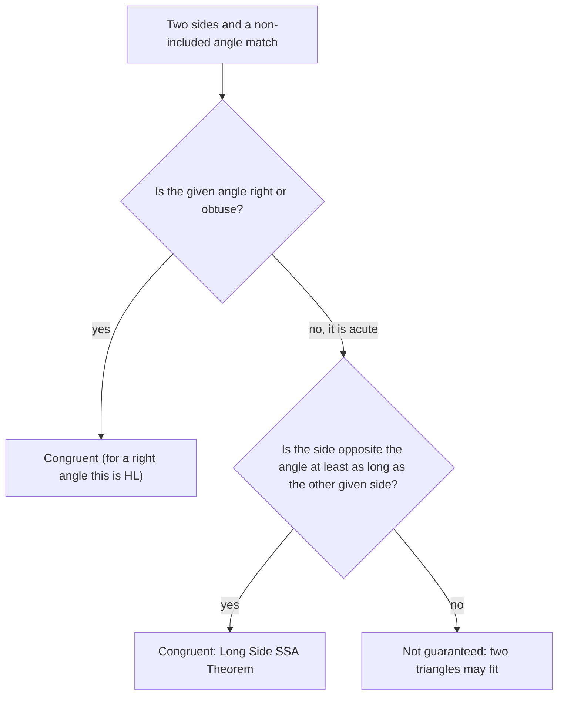

Lesson 11 said that two sides and a non-included angle (SSA) do not prove two triangles congruent, and Lesson 12 then used HL, which *is* a kind of SSA, with the angle a right angle. Lesson 12 justified HL with the Pythagorean theorem from Module 6. This lesson answers the natural question behind both facts: *exactly when* does SSA work? The answer is a theorem you can prove with nothing but this module's tools (congruence shortcuts, isosceles triangles and the side–angle inequality), and HL drops out of it as a special case.

## Building a triangle from SSA

Suppose you are told $\angle A$, the side $b = AC$ along one side of the angle, and the length $a = BC$ of the side *opposite* $\angle A$. Try to build the triangle:

1. Draw $\angle A$ and mark $C$ on one of its sides, at distance $b$ from $A$.
2. The vertex $B$ must lie on the *other* side of the angle (a ray from $A$), at distance $a$ from $C$. So $B$ lies on the circle of radius $a$ centered at $C$.
3. Every point where that circle meets the ray (other than $A$ itself) gives a triangle.

So the question "how many triangles?" becomes "how many times does a circle cross a ray?" Drop a perpendicular from $C$ to the line containing the ray; the point $F$ where it lands is the **foot of the perpendicular**, and $d = CF$ is the distance from $C$ to the line (Lesson 9). No point of the line is closer to $C$ than $F$.

![Four panels, each with an acute angle at A, point C on its upper side, and a dashed perpendicular from C down to the lower ray. Panel 1, a less than d: the dashed circle around C does not reach the ray, so there is no triangle. Panel 2, a equal to d: the circle just touches the ray at the foot of the perpendicular, giving one right triangle. Panel 3, d less than a less than b: the circle crosses the ray at two points, giving two triangles. Panel 4, a at least b: the circle crosses the ray once beyond the foot, and its other crossing is behind A, off the ray, giving one triangle.](images/geo-m4-ssa-cases.svg)

When $\angle A$ is acute, $F$ lies on the ray, and there are four cases:

| Length of $a$ | Circle meets the ray | Triangles |
|---|---|---|
| $a < d$ | not at all | none |
| $a = d$ | once, at $F$ | one (right angle at $B$) |
| $d < a < b$ | twice, at points the same distance from $F$ on either side | two |
| $a \ge b$ | once beyond $F$ (the other crossing is at $A$ or behind it) | one |

Why does the second crossing stay on the ray exactly when $a < b$? The two crossings are mirror images across $F$, and $A$ is itself a point of the line at distance $b$ from $C$. If $a < b$, both crossings are closer to $C$ than $A$ is, so both lie between $A$ and the mirror image of $A$, on the ray. If $a \ge b$, the nearer crossing is $A$ itself or lies behind $A$.

When $\angle A$ is right or obtuse, $F$ is at $A$ or behind it, so the ray can meet the circle at most once: there is one triangle if $a > b$ and none otherwise.

Lesson 25 does the same count with trigonometry, writing $d = b\sin A$. Here we care about something different: *when is the triangle forced to be unique?*

### Example 1

$\angle A$ is acute, $AC = 10$, and $C$ is $6$ units from the other side of the angle, so $d = 6$. (By the Pythagorean theorem from Module 6, the foot $F$ is then $AF = 8$ from $A$.) How many triangles have $BC = 5$, $6$, $7.5$, $10$ or $12$?

**$a = 5$.** $5 < 6 = d$: the circle never reaches the ray. **No triangle.**

**$a = 6$.** $a = d$: the circle touches the ray only at $F$. **One triangle**, with a right angle at $B = F$ and $AB = 8$.

**$a = 7.5$.** $6 < 7.5 < 10$: **two triangles.** Each crossing is $\sqrt{7.5^2 - 6^2} = \sqrt{20.25} = 4.5$ from $F$, so $AB = 8 - 4.5 = 3.5$ or $AB = 8 + 4.5 = 12.5$.

**$a = 10$.** $a = b$: one crossing is $A$ itself (no triangle there) and the other is $8$ past $F$. **One triangle**, isosceles, with $AB = 16$.

**$a = 12$.** $a > b$: **one triangle** (the other crossing is behind $A$).

## The Long Side SSA Theorem

The table shows that trouble happens only in one row: an acute angle with the opposite side *shorter* than the adjacent side. That suggests the theorem.

**Long Side SSA Theorem.** If two sides and a non-included angle of one triangle are congruent to the corresponding parts of another, and the side *opposite* the angle is at least as long as the other given side, then the triangles are congruent.

(This name is ours; the result has no standard name. Some books write it SsA, with the capital S marking the longer side.)

*Proof.* Let $\triangle ABC$ and $\triangle DEF$ have $\angle A \cong \angle D$, $\overline{AC} \cong \overline{DF}$ and $\overline{BC} \cong \overline{EF}$, with $BC \ge AC$.

On ray $\overrightarrow{AB}$, mark the point $G$ with $AG = DE$. Then $\triangle AGC \cong \triangle DEF$ by SAS ($AG = DE$, $\angle A \cong \angle D$, $AC = DF$), so by CPCTC $CG = EF = BC$.

If $G = B$, then $AB = DE$ and $\triangle ABC \cong \triangle DEF$ by SAS, and we're done. So suppose $G \ne B$, and call the one of $B$, $G$ nearer to $A$ point $X$, the farther one $Y$.

```shape
{"segments": [{"from": [0, 0], "to": [11, 0]}, {"from": [0, 0], "to": [6, 3.2]}, {"from": [6, 3.2], "to": [4, 0]}, {"from": [6, 3.2], "to": [8, 0]}, {"from": [4.83, 1.71], "to": [5.17, 1.49]}, {"from": [6.83, 1.49], "to": [7.17, 1.71]}], "points": [{"at": [0, 0]}, {"at": [6, 3.2]}, {"at": [4, 0]}, {"at": [8, 0]}], "labels": [{"at": [-0.3, -0.45], "text": "A"}, {"at": [6, 3.65], "text": "C"}, {"at": [4, -0.5], "text": "X"}, {"at": [8, -0.5], "text": "Y"}], "caption": "If two different points X and Y on the ray were both at distance BC from C, triangle CXY would be isosceles."}
```

Since $CX = CY$, $\triangle CXY$ is isosceles, so its base angles $\angle CXY$ and $\angle CYX$ are congruent. Two congruent angles in a triangle add to less than $180^\circ$, so each is acute. Now $\angle AXC$ and $\angle CXY$ form a linear pair, so $\angle AXC$ is obtuse. An obtuse angle is the largest angle in its triangle, so in $\triangle AXC$ the side opposite it is the longest side (Lesson 14): $AC > CX$. But $CX = BC \ge AC$. That's a contradiction, so $G = B$ after all. $\blacksquare$

This is an indirect proof (Lesson 14): assuming two different positions for the third vertex led to an impossible inequality.



## Consequences

**HL without the Pythagorean theorem.** In a right triangle, the right angle is the largest angle, so the hypotenuse (opposite it) is longer than either leg. HL gives a right angle, the leg next to it and the hypotenuse opposite it, with the opposite side the longer one: exactly the Long Side SSA situation. So HL is a special case, and its proof needs only this module.

**SSA with a right or obtuse angle always works.** The side opposite a right or obtuse angle is the longest side of the triangle, so it is automatically longer than the other given side.

**The two ambiguous triangles have supplementary angles.** In the two-triangle case, call the crossings $B_1$ (nearer $A$) and $B_2$. Since $CB_1 = CB_2$, $\triangle CB_1B_2$ is isosceles and $\angle CB_1B_2 \cong \angle CB_2B_1$. The angle of the first triangle at $B_1$, $\angle AB_1C$, forms a linear pair with $\angle CB_1B_2$. So

$$m\angle AB_1C + m\angle AB_2C = 180^\circ.$$

One triangle has an obtuse angle at $B$ and the other an acute one. That gives one more way to rescue SSA: if you also know that the angles opposite the *other* given side are both acute (or both obtuse), only one of the two triangles fits, and the triangles are congruent. This is also why the Law of Sines in Lesson 25 can return either $B$ or $180^\circ - B$.

## Where the congruence tests come from

Euclid's *Elements* (about 300 BCE) proves SAS as Book I, Proposition 4, SSS as Proposition 8, and ASA and AAS together as Proposition 26. His proof of SAS works by **superposition**: imagine picking up one triangle and laying it on the other. Later mathematicians found this step hard to justify from his stated postulates, so many modern axiom systems, including David Hilbert's of 1899, take a form of SAS as an axiom instead. That is why this course calls SAS a postulate. HL and the Long Side SSA Theorem do not appear among Euclid's numbered propositions; they are later conveniences that follow from the others, as you just saw.

### Example 2

In $\triangle PQR$ and $\triangle STU$, $\angle P \cong \angle S$ (each $40^\circ$), $PQ = ST = 7$ and $QR = TU = 9$. Are the triangles congruent? What if instead $QR = TU = 5$?

**Step 1.** Locate the parts. $\overline{PQ}$ is next to $\angle P$, and $\overline{QR}$ is opposite it. So this is SSA.

**Step 2.** The side opposite the angle is $9$, which is at least the other given side, $7$. By the Long Side SSA Theorem, $\triangle PQR \cong \triangle STU$.

**Step 3.** With $QR = TU = 5 < 7$, the angle is acute and the opposite side is the shorter one. The theorem doesn't apply, and in fact two different triangles fit (the distance from $Q$ to the other side of $\angle P$ is about $4.5$, which is less than 5: the two-triangle row). Congruence is not guaranteed.

### Example 3

*Given:* $\triangle ABC$ and $\triangle ADC$ share side $\overline{AC}$; $\angle B \cong \angle D$, and both are obtuse; $\overline{AB} \cong \overline{AD}$. *Prove:* $\overline{BC} \cong \overline{DC}$.

| Statements | Reasons |
|---|---|
| 1. $\angle B \cong \angle D$, both obtuse; $\overline{AB} \cong \overline{AD}$ | 1. Given |
| 2. $\overline{AC} \cong \overline{AC}$ | 2. Reflexive property |
| 3. $AC > AB$ | 3. $\overline{AC}$ is opposite the obtuse (largest) angle of $\triangle ABC$ |
| 4. $\triangle ABC \cong \triangle ADC$ | 4. Long Side SSA Theorem |
| 5. $\overline{BC} \cong \overline{DC}$ | 5. CPCTC |

The angle at $B$ is *not* between $\overline{AB}$ and $\overline{AC}$, so SAS does not apply; step 3 is what makes the proof legal.

### Example 4

In Example 1 with $a = 7.5$, the two triangles have their third vertices at $B_1$ ($AB_1 = 3.5$) and $B_2$ ($AB_2 = 12.5$). Measuring (or using trigonometry from Lesson 24) gives $m\angle AB_2C \approx 53.1^\circ$. Find $m\angle AB_1C$ without measuring.

**Step 1.** $CB_1 = CB_2 = 7.5$, so $\triangle CB_1B_2$ is isosceles and its base angles match: $m\angle CB_1B_2 = m\angle CB_2B_1 \approx 53.1^\circ$.

**Step 2.** $\angle AB_1C$ and $\angle CB_1B_2$ form a linear pair: $m\angle AB_1C \approx 180 - 53.1 = 126.9^\circ$.

So one triangle is acute at $B$ and the other obtuse, as the supplementary-angle fact predicts.

## Common mistakes

- **Comparing the wrong pair of sides.** The test is whether the side *opposite* the given angle is at least as long as the side *next to* it, not the other way round.
- **Using the theorem on a single acute-angle case without checking lengths.** With an acute angle and a shorter opposite side, two triangles can really fit; "it looks the same in my sketch" proves nothing.
- **Forgetting that a right or obtuse angle settles it.** The side opposite such an angle is automatically the longest, so no length check is needed.
- **Writing "SSA" as a reason.** Name the theorem you are using (Long Side SSA, or HL) and state the fact that makes it apply, as in step 3 of Example 3.
- **Assuming the two ambiguous triangles have equal angles at $B$.** Their angles at $B$ are supplementary, not congruent.

## Key points

- Building a triangle from SSA means crossing a ray with a circle of radius $a$ around $C$: no crossings, one, or two.
- Long Side SSA Theorem: SSA proves congruence when the side opposite the angle is at least as long as the other given side.
- HL is a special case (the hypotenuse is opposite the right angle and is the longest side), and SSA with any right or obtuse angle works.
- In the two-triangle case the angles at the third vertex are supplementary, so knowing that angle is acute (or obtuse) in both triangles also forces congruence.
- Euclid proved SAS, SSS, ASA and AAS; modern axiom systems often take SAS as an axiom.
