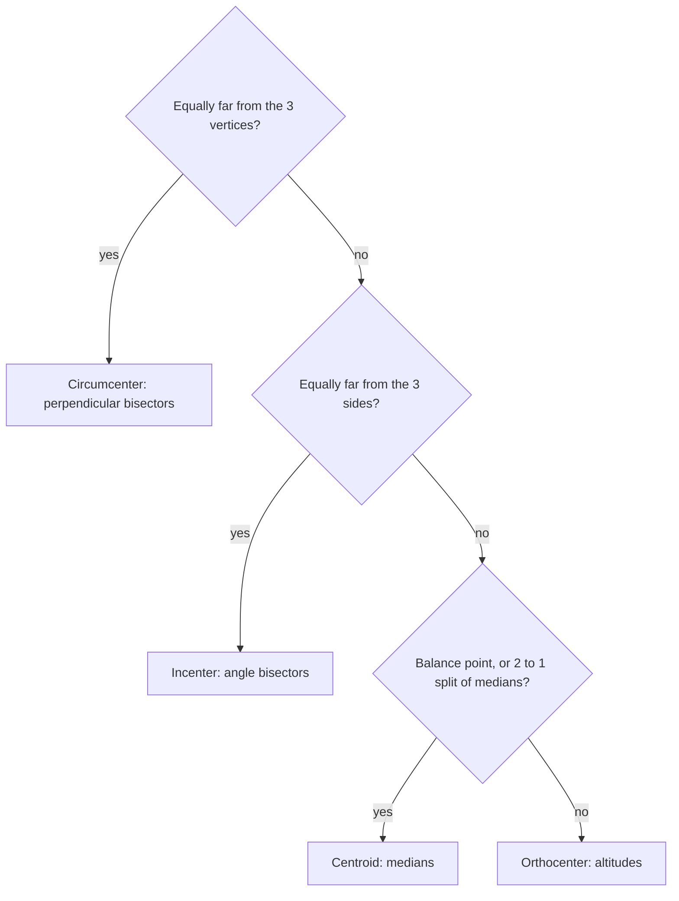

The last lesson's centers came from bisectors. This lesson adds the other two classic centers, the centroid (from medians) and the orthocenter (from altitudes), and the midsegment, a segment that turns out to be a "half-size copy" of a triangle side. The centroid in particular has a physical meaning: it's the balance point of a triangular plate.

## Medians and the centroid

A **median** of a triangle is a segment from a vertex to the midpoint of the opposite side. Every triangle has three medians.

**Centroid Theorem.** The three medians of a triangle are concurrent at a point, the **centroid**, which lies two-thirds of the way along each median from the vertex. Equivalently, the centroid splits each median in the ratio $2 : 1$, with the longer piece next to the vertex.

```shape
{"polygons": [{"points": [[0, 0], [9, 0], [3, 6]]}], "segments": [{"from": [0, 0], "to": [6, 3], "dashed": true}, {"from": [9, 0], "to": [1.5, 3], "dashed": true}, {"from": [3, 6], "to": [4.5, 0], "dashed": true}], "points": [{"at": [4, 2], "label": "G"}, {"at": [4.5, 0]}, {"at": [6, 3]}, {"at": [1.5, 3]}], "labels": [{"at": [-0.4, -0.4], "text": "A"}, {"at": [9.4, -0.4], "text": "B"}, {"at": [3, 6.5], "text": "C"}], "caption": "Medians meet at the centroid G, two-thirds of the way from each vertex."}
```

If $\overline{CM}$ is a median with centroid $G$, then

$$CG = \tfrac23 CM, \qquad GM = \tfrac13 CM, \qquad CG = 2\,GM.$$

The centroid is the triangle's **center of gravity**: a cardboard triangle balances on a pin placed there. Each median splits the triangle into two pieces of equal area (equal bases, same height), which is why the balance point must lie on all three.

**Centroid in coordinates.** The centroid is the average of the vertices:

$$G = \left(\frac{x_1 + x_2 + x_3}{3},\; \frac{y_1 + y_2 + y_3}{3}\right).$$

### Example 1

In $\triangle ABC$, median $\overline{AD}$ has length 21 and $G$ is the centroid. Find $AG$ and $GD$.

$AG = \tfrac23 \cdot 21 = 14$ and $GD = \tfrac13 \cdot 21 = 7$. Check: $14 = 2 \cdot 7$ and $14 + 7 = 21$.

### Example 2

Find the centroid of the triangle with vertices $(-2, 1)$, $(6, 3)$ and $(2, 8)$.

$G = \left(\tfrac{-2 + 6 + 2}{3}, \tfrac{1 + 3 + 8}{3}\right) = (2, 4)$.

## Altitudes and the orthocenter

An **altitude** of a triangle is the perpendicular segment from a vertex to the line containing the opposite side. Its length is the triangle's **height** relative to that side.

In an obtuse triangle, two altitudes fall *outside* the triangle: you extend the opposite side and drop the perpendicular to the extension. In a right triangle, the two legs are themselves altitudes.

Medians, altitudes, angle bisectors and perpendicular bisectors are easy to mix up. The picture draws one of each for side $\overline{AB}$ of the same triangle: three go from vertex $C$ to the side, and the perpendicular bisector need not pass through $C$ at all.


**Orthocenter Theorem.** The lines containing the three altitudes are concurrent at the **orthocenter**. It's inside an acute triangle, at the right-angle vertex of a right triangle, and outside an obtuse triangle.

### Example 3

Find the orthocenter of the triangle with vertices $A(0, 0)$, $B(6, 0)$ and $C(2, 4)$.

**Step 1.** The altitude from $C$ is perpendicular to $\overline{AB}$, which is horizontal, so it's the vertical line $x = 2$.

**Step 2.** The altitude from $A$ is perpendicular to $\overline{BC}$. The slope of $\overline{BC}$ is $\tfrac{4 - 0}{2 - 6} = -1$, so the altitude has slope $1$ and passes through $A$: $y = x$.

**Step 3.** Intersect: $x = 2$, $y = 2$. The orthocenter is $(2, 2)$, inside the triangle, as it should be for an acute triangle.

## The four centers at a glance

| Center | Lines that meet | Property |
|---|---|---|
| Circumcenter | perpendicular bisectors of sides | equidistant from vertices |
| Incenter | angle bisectors | equidistant from sides |
| Centroid | medians | balance point; $2 : 1$ split |
| Orthocenter | altitudes | — |

To decide which center a problem needs, ask what the point has to do:



A remarkable fact (Euler, 1765): in any triangle, the circumcenter, centroid and orthocenter are collinear, on the **Euler line**, and the centroid is always one-third of the way from the circumcenter to the orthocenter. In an equilateral triangle all four centers coincide.

## Midsegments

A **midsegment** of a triangle joins the midpoints of two sides.

**Triangle Midsegment Theorem.** A midsegment is parallel to the third side and half as long.

*Coordinate proof.* Place the triangle at $A(0, 0)$, $B(2b, 0)$, $C(2c, 2d)$ (using doubled coordinates so midpoints are whole). The midpoints of $\overline{AC}$ and $\overline{BC}$ are $M(c, d)$ and $N(b + c, d)$. Then $\overline{MN}$ is horizontal (both have $y = d$), parallel to $\overline{AB}$, and $MN = (b + c) - c = b$, half of $AB = 2b$. $\blacksquare$

```shape
{"polygons": [{"points": [[0, 0], [10, 0], [4, 6]]}], "segments": [{"from": [2, 3], "to": [7, 3], "label": "x"}], "points": [{"at": [2, 3]}, {"at": [7, 3]}], "labels": [{"at": [5, -0.6], "text": "2x"}], "caption": "The midsegment is parallel to the base and half its length."}
```

The three midsegments cut the triangle into four congruent triangles, each similar to the original with half the side lengths.

### Example 4

$\overline{DE}$ is a midsegment of $\triangle ABC$, parallel to $\overline{BC}$. $DE = 3x - 2$ and $BC = 4x + 8$. Find $BC$.

**Step 1.** The third side is twice the midsegment: $4x + 8 = 2(3x - 2) = 6x - 4$.

**Step 2.** $12 = 2x$, so $x = 6$.

**Step 3.** $BC = 4(6) + 8 = 32$ and $DE = 16$. Check: $32 = 2 \cdot 16$.

## Common mistakes

- **Reversing the centroid ratio.** The longer piece ($\tfrac23$) is next to the *vertex*.
- **Confusing median and altitude.** A median goes to the midpoint; an altitude goes in perpendicularly. They coincide only in special cases (like the altitude to the base of an isosceles triangle).
- **Doubling the wrong segment** with midsegments: the side is twice the midsegment, not the other way around.
- **Forgetting to extend a side** when drawing the altitude of an obtuse triangle.

## Key points

- Medians meet at the centroid, which is $\tfrac23$ of the way from each vertex; in coordinates it's the average of the vertices.
- Altitudes meet at the orthocenter.
- A midsegment is parallel to the third side and half as long.
- Circumcenter, centroid and orthocenter lie on the Euler line.
