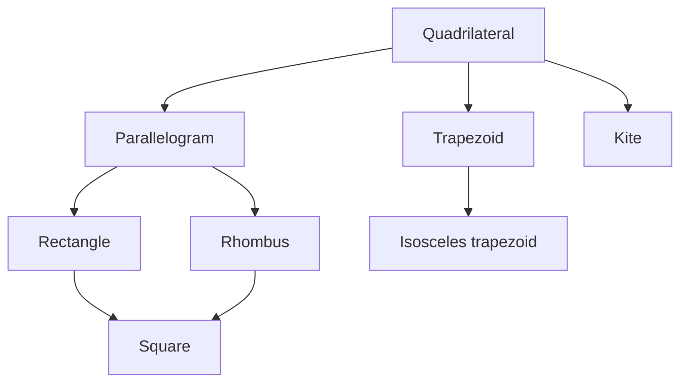

Parallelograms were the general case. Now we add extra conditions and get the special quadrilaterals you know by name. Each one inherits every parallelogram property (if it is a parallelogram) and adds a few of its own, mostly about the diagonals. Then we leave the parallelogram family for trapezoids and kites.

## The family tree

- A **rectangle** is a parallelogram with four right angles.
- A **rhombus** is a parallelogram with four congruent sides.
- A **square** is a parallelogram with four right angles *and* four congruent sides, so it's both a rectangle and a rhombus.
- A **trapezoid** is a quadrilateral with exactly one pair of parallel sides.
- A **kite** is a quadrilateral with two pairs of congruent *consecutive* sides and no congruent opposite sides.

So every square is a rectangle and a rhombus; every rectangle and rhombus is a parallelogram; but trapezoids and kites are not parallelograms. (Some textbooks define a trapezoid as having *at least* one pair of parallel sides, which makes parallelograms trapezoids too. We use "exactly one".) The family tree shows which shapes are special cases of which: each shape is a special case of every shape above it that it's connected to.



## Diagonals of special parallelograms

**Rectangle Diagonals Theorem.** A parallelogram is a rectangle if and only if its diagonals are congruent.

*Why.* In rectangle $ABCD$, $\triangle ABC \cong \triangle DCB$ by SAS (right angles at $B$ and $C$, $AB = DC$, shared $\overline{BC}$), so $AC = DB$ by CPCTC.

**Rhombus Diagonals Theorems.** A parallelogram is a rhombus if and only if its diagonals are perpendicular. Also, a parallelogram is a rhombus if and only if each diagonal bisects a pair of opposite angles.

*Why perpendicular.* In rhombus $ABCD$ with diagonals meeting at $E$: $AB = AD$ and $BE = DE$ (parallelogram diagonals bisect each other), with $AE$ shared. So $\triangle AEB \cong \triangle AED$ by SSS, the angles at $E$ are congruent, and as a linear pair each is $90^\circ$.

```shape
{"polygons": [{"points": [[0, 0], [5, 0], [8, 4], [3, 4]]}], "segments": [{"from": [0, 0], "to": [8, 4], "dashed": true}, {"from": [5, 0], "to": [3, 4], "dashed": true}], "rightAngles": [[[4, 2], [8, 4], [5, 0]]], "labels": [{"at": [-0.4, -0.4], "text": "A"}, {"at": [5.4, -0.4], "text": "B"}, {"at": [8.4, 4.4], "text": "C"}, {"at": [2.6, 4.4], "text": "D"}], "caption": "Rhombus ABCD (all sides 5): its diagonals are perpendicular bisectors of each other."}
```

| Property | Parallelogram | Rectangle | Rhombus | Square |
|---|---|---|---|---|
| Diagonals bisect each other | ✓ | ✓ | ✓ | ✓ |
| Diagonals congruent | | ✓ | | ✓ |
| Diagonals perpendicular | | | ✓ | ✓ |
| Diagonals bisect the angles | | | ✓ | ✓ |

### Example 1

The diagonals of rhombus $ABCD$ are 16 and 30. Find the side length.

**Step 1.** The diagonals bisect each other at right angles, so they form four right triangles with legs $8$ and $15$.

**Step 2.** Side $= \sqrt{8^2 + 15^2} = \sqrt{289} = 17$.

### Example 2

In rectangle $PQRS$, diagonals meet at $T$. $PT = 3x + 1$ and $QS = 8x - 6$. Find $PR$.

**Step 1.** Rectangle diagonals are congruent and bisect each other, so $PT$ is half of $QS$: $2(3x + 1) = 8x - 6$.

**Step 2.** $6x + 2 = 8x - 6$, so $x = 4$.

**Step 3.** $PT = 13$, so $PR = QS = 26$.

## Trapezoids

In a trapezoid, the parallel sides are the **bases** and the other two are the **legs**. A pair of angles sharing a base are **base angles**. Since the bases are parallel, the two angles along each leg are consecutive interior angles, so they're supplementary.


An **isosceles trapezoid** has congruent legs. Then:

- each pair of base angles is congruent, and
- the diagonals are congruent.

The **midsegment** of a trapezoid joins the midpoints of the legs.

**Trapezoid Midsegment Theorem.** The midsegment is parallel to the bases, and its length is the average of the bases:

$$\text{midsegment} = \frac{b_1 + b_2}{2}.$$

*Why.* Draw a diagonal; it splits the trapezoid into two triangles. The midsegment consists of a triangle midsegment in each, of lengths $\tfrac12 b_1$ and $\tfrac12 b_2$.

```shape
{"polygons": [{"points": [[0, 0], [12, 0], [9, 5], [3, 5]]}], "segments": [{"from": [1.5, 2.5], "to": [10.5, 2.5], "dashed": true, "label": "9"}], "labels": [{"at": [6, -0.6], "text": "12"}, {"at": [6, 5.6], "text": "6"}], "caption": "Isosceles trapezoid with bases 6 and 12: midsegment (6 + 12)/2 = 9."}
```

### Example 3

A trapezoid's midsegment is 21 and one base is 15. Find the other base.

$\tfrac{15 + b}{2} = 21$ gives $15 + b = 42$, so $b = 27$.

### Example 4

In isosceles trapezoid $ABCD$ with bases $\overline{AB}$ and $\overline{DC}$, $m\angle A = 64^\circ$. Find the other angles.

$\angle B \cong \angle A$ (base angles of the same base): $64^\circ$. $\angle D$ is supplementary to $\angle A$ (along leg $\overline{AD}$): $116^\circ$. $\angle C \cong \angle D$: $116^\circ$.

## Kites

In kite $ABCD$ with $AB = AD$ and $CB = CD$:

```shape
{"polygons": [{"points": [[0, 4], [-3, 0], [0, -6], [3, 0]]}], "segments": [{"from": [0, 4], "to": [0, -6], "dashed": true}, {"from": [-3, 0], "to": [3, 0], "dashed": true}], "rightAngles": [[[0, 0], [3, 0], [0, 4]]], "labels": [{"at": [0, 4.5], "text": "A"}, {"at": [-3.5, 0], "text": "B"}, {"at": [0, -6.5], "text": "C"}, {"at": [3.5, 0], "text": "D"}, {"at": [-2, 2.6], "text": "5"}, {"at": [2, 2.6], "text": "5"}], "caption": "Kite ABCD with AB = AD = 5: diagonal AC is the perpendicular bisector of BD."}
```


- The diagonals are perpendicular.
- One diagonal ($\overline{AC}$, joining the vertices between the congruent pairs) is the perpendicular bisector of the other.
- Exactly one pair of opposite angles is congruent: the angles $\angle B$ and $\angle D$ *between* non-congruent sides.

*Why.* $\triangle ABC \cong \triangle ADC$ by SSS (shared $\overline{AC}$), so $\angle B \cong \angle D$ by CPCTC. Also $A$ and $C$ are each equidistant from $B$ and $D$, so both lie on the perpendicular bisector of $\overline{BD}$.

### Example 5

In kite $ABCD$ with $AB = AD$ and $CB = CD$, $m\angle A = 70^\circ$ and $m\angle C = 110^\circ$. Find $m\angle B$.

**Step 1.** The congruent opposite angles are the ones between the unequal sides: $\angle B \cong \angle D$.

**Step 2.** The four angles add to $360^\circ$: $70 + 110 + 2\,m\angle B = 360$, so $m\angle B = 90^\circ$ (and $m\angle D = 90^\circ$).

## Common mistakes

- **Giving a rhombus congruent diagonals.** That's a rectangle (or square) property.
- **Averaging the wrong segments** for a trapezoid midsegment: use the two *bases* (the parallel sides).
- **Thinking every trapezoid has congruent base angles.** Only isosceles trapezoids do.
- **Choosing the wrong congruent angles in a kite.** They're the ones between the unequal sides.

## Key points

- Rectangle: congruent diagonals. Rhombus: perpendicular diagonals that bisect the angles. Square: all of these.
- Trapezoid: exactly one pair of parallel sides; midsegment $= \tfrac{b_1 + b_2}{2}$.
- Isosceles trapezoid: congruent legs, congruent base angles, congruent diagonals.
- Kite: perpendicular diagonals; one pair of opposite angles congruent.
