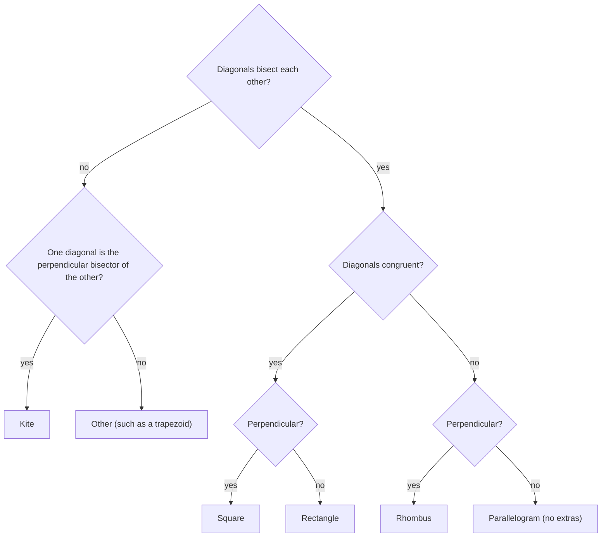

Lesson 18 showed that "the diagonals bisect each other" is the quickest test for a parallelogram, and Lesson 19 showed that each special parallelogram is marked by its diagonals: congruent for a rectangle, perpendicular for a rhombus. This lesson pushes both ideas further. First, a surprise: join the midpoints of the sides of *any* quadrilateral, however lopsided, and you always get a parallelogram. Second, the diagonals alone are enough to classify a quadrilateral, and knowing exactly which diagonal facts are *enough* trains the careful "if and only if" thinking that proofs need. The lesson ends with a question that has no single right answer: should a square count as a rectangle, and a parallelogram as a trapezoid?

## Varignon's theorem

**Varignon's Theorem.** The midpoints of the four sides of any quadrilateral are the vertices of a parallelogram. Its sides are parallel to the quadrilateral's diagonals and half as long.

This parallelogram is called the **Varignon parallelogram**. The theorem is named for the French mathematician Pierre Varignon (1654–1722); his proof was published in 1731, after his death.

*Proof.* Let $E$, $F$, $G$, $H$ be the midpoints of $\overline{AB}$, $\overline{BC}$, $\overline{CD}$, $\overline{DA}$, and draw diagonal $\overline{AC}$.

- In $\triangle ABC$, $\overline{EF}$ is a midsegment, so $\overline{EF} \parallel \overline{AC}$ and $EF = \tfrac12 AC$.
- In $\triangle ADC$, $\overline{HG}$ is a midsegment, so $\overline{HG} \parallel \overline{AC}$ and $HG = \tfrac12 AC$.

So $\overline{EF}$ and $\overline{HG}$ are parallel and congruent, and $EFGH$ is a parallelogram (Lesson 18, test 5). The other diagonal does the same for $\overline{FG}$ and $\overline{EH}$: each is parallel to $\overline{BD}$ and half as long. $\blacksquare$

Nothing in the proof used convexity, so the theorem holds for concave quadrilaterals too. Two consequences follow at once.

- **Perimeter.** The Varignon parallelogram has two sides of $\tfrac12 AC$ and two of $\tfrac12 BD$, so its perimeter is $AC + BD$, the sum of the diagonals.
- **Area.** Its area is half the quadrilateral's. For a convex quadrilateral: the corner triangle $\triangle EBF$ is a half-size copy of $\triangle ABC$, so its area is $\tfrac14$ of that triangle's (scaling lengths by $\tfrac12$ scales area by $\tfrac14$, Lesson 20). Likewise $\triangle HDG$ is $\tfrac14$ of $\triangle ADC$. Together those two corners are $\tfrac14$ of the whole quadrilateral; the corners at $A$ and $C$ are another $\tfrac14$ by the same argument with diagonal $\overline{BD}$. The four corners take half, leaving half for $EFGH$. (The half-area rule also holds for concave quadrilaterals, but the corner argument needs more care there.)

### Example 1

For $A(0, 0)$, $B(10, 0)$, $C(8, 6)$, $D(2, 8)$, find the Varignon parallelogram and check its perimeter and area.

**Step 1.** Midpoints: $E(5, 0)$, $F(9, 3)$, $G(5, 7)$, $H(1, 4)$.

**Step 2.** $\overrightarrow{EF} = (4, 3)$ and $\overrightarrow{HG} = (4, 3)$: the same direction and length, so $\overline{EF}$ and $\overline{HG}$ are parallel and congruent. Also $\overrightarrow{AC} = (8, 6)$, twice $(4, 3)$, as the theorem says.

**Step 3.** $EF = \sqrt{4^2 + 3^2} = 5$ and $FG = \sqrt{(-4)^2 + 4^2} = 4\sqrt2$, so the perimeter is $10 + 8\sqrt2 \approx 21.31$. The diagonals are $AC = 10$ and $BD = \sqrt{8^2 + 8^2} = 8\sqrt2$, with the same sum. ✓

**Step 4.** For the area, enclose each figure in a box and subtract the right triangles at the corners (the "box method"). $ABCD$: split it along $\overline{AC}$. $\triangle ABC$ has base $AB = 10$ and height 6, so area 30. $\triangle ACD$ sits in the box from $(0, 0)$ to $(8, 8)$, area 64, minus corner right triangles of areas $\tfrac12 \cdot 8 \cdot 6 = 24$, $\tfrac12 \cdot 6 \cdot 2 = 6$ and $\tfrac12 \cdot 2 \cdot 8 = 8$, so area 26. Total: 56. $EFGH$ sits in the box from $(1, 0)$ to $(9, 7)$, area 56, minus four corner triangles of areas 6, 8, 6 and 8, so area 28. Half of 56. ✓

## What shape is the Varignon parallelogram?

Its sides run parallel to the two diagonals, so the angle between its sides equals the angle between the diagonals, and its side lengths are half the diagonals. That gives a complete answer:

| The original quadrilateral's diagonals are… | The Varignon parallelogram is a… |
|---|---|
| perpendicular | rectangle |
| congruent | rhombus |
| perpendicular and congruent | square |
| neither | parallelogram with no right angles and unequal sides |

So a rhombus (perpendicular diagonals) gives a rectangle, a rectangle (congruent diagonals) gives a rhombus, a kite gives a rectangle, and an isosceles trapezoid gives a rhombus. The roles cross over: *perpendicular* diagonals make a *rectangle*, not a rhombus.

### Example 2

A kite has diagonals 10 and 24. Describe its Varignon parallelogram.

A kite's diagonals are perpendicular, so the Varignon parallelogram is a rectangle. Its sides are half the diagonals: 5 and 12. Its diagonals are $\sqrt{5^2 + 12^2} = 13$, its perimeter is $10 + 24 = 34$, and its area is $5 \cdot 12 = 60$, half the kite's area of $\tfrac12 \cdot 10 \cdot 24 = 120$.

## Classifying a quadrilateral by its diagonals

In this section quadrilaterals are convex, so the diagonals cross inside. Four facts about the diagonals do almost all the work:

| Diagonals | Quadrilateral |
|---|---|
| bisect each other | parallelogram |
| bisect each other and are congruent | rectangle |
| bisect each other and are perpendicular | rhombus |
| bisect each other, congruent and perpendicular | square |
| one is the perpendicular bisector of the other, but they don't bisect each other | kite |

Each line is an "if and only if". The kite line works because of the Perpendicular Bisector Theorem: if $\overline{AC}$ is the perpendicular bisector of $\overline{BD}$, then $A$ and $C$ are each equidistant from $B$ and $D$, so $AB = AD$ and $CB = CD$.

The picture shows the diagonal patterns with the usual marks: matching tick marks for equal lengths and a small square for a right angle.

![Six pairs of crossing segments, each the diagonals of a quadrilateral, with tick marks. Parallelogram: each diagonal is cut into two equal halves, but the two diagonals have different lengths. Rectangle: all four half-diagonals are equal, and the diagonals are not perpendicular. Rhombus: each diagonal is cut in half, the diagonals differ in length, and they meet at a right angle. Square: all four halves equal and a right angle. Kite: one diagonal is cut in half and meets the other at a right angle; the other is not cut in half. Isosceles trapezoid: the diagonals cut each other into a shorter piece and a longer piece, the two short pieces equal and the two long pieces equal.](images/geo-m5-diagonal-patterns.svg)

The last panel is worth a sentence. If the diagonals cut each other into the *same two lengths* (two short pieces equal, two long pieces equal) without bisecting each other, the quadrilateral is an isosceles trapezoid: the two small triangles at the crossing are isosceles with equal vertical angles, so their base angles match, and those are alternate interior angles that make one pair of sides parallel.

### Example 3

Classify $P(1, 1)$, $Q(7, 3)$, $R(5, 9)$, $S(-1, 7)$ using only the diagonals.

**Step 1 (bisect?).** Midpoint of $\overline{PR}$: $(3, 5)$. Midpoint of $\overline{QS}$: $(3, 5)$. Same point, so it's a parallelogram.

**Step 2 (congruent?).** $\overrightarrow{PR} = (4, 8)$ and $\overrightarrow{QS} = (-8, 4)$. Both have length $\sqrt{80}$, so it's a rectangle.

**Step 3 (perpendicular?).** The dot product is $4(-8) + 8(4) = 0$, so the diagonals are perpendicular: it's a rhombus too.

All three: $PQRS$ is a **square**. (Check a side: $PQ = \sqrt{6^2 + 2^2} = \sqrt{40}$ and $QR = \sqrt{2^2 + 6^2} = \sqrt{40}$.)

### Example 4

True or false: "A quadrilateral whose diagonals are congruent and perpendicular is a square."

**False.** Take diagonals from $A(-2, 0)$ to $C(8, 0)$ and from $B(0, -3)$ to $D(0, 7)$. Both have length 10 and they are perpendicular, but they cross at the origin, which is not the midpoint of either. Quadrilateral $ABCD$ has sides $\sqrt{13}$, $\sqrt{73}$, $\sqrt{113}$ and $\sqrt{53}$: no two equal, and no two parallel. The missing condition is that the diagonals *bisect each other*. (Its Varignon parallelogram, though, *is* a square, with side 5.)

## Inclusive and exclusive definitions

This course defines a trapezoid as having *exactly* one pair of parallel sides, and a kite as having no congruent opposite sides. Those are **exclusive definitions**: they leave out the parallelograms and rhombuses. Many mathematicians and some textbooks use **inclusive definitions** instead: a trapezoid has *at least* one pair of parallel sides, and a kite has two pairs of congruent consecutive sides, with no further condition. Then every parallelogram is a trapezoid and every rhombus is a kite, just as every square is a rectangle in both systems.

Neither choice is wrong; definitions are agreements. The argument for inclusive definitions is that theorems reach further. Under the inclusive definition, the Trapezoid Midsegment Theorem automatically covers parallelograms (a segment joining the midpoints of two opposite sides has length $\tfrac{b + b}{2} = b$, which is true), and the kite theorems about diagonals (perpendicular, one bisecting the other) automatically cover rhombuses. The argument for exclusive definitions is that "trapezoid" then names a distinct shape. When you read another book or take a test, check which definition it uses: some statements, like "no trapezoid is a parallelogram", are true in one system and false in the other.

## Common mistakes

- **Mixing up the Varignon crossover.** Perpendicular diagonals give a Varignon *rectangle*; congruent diagonals give a Varignon *rhombus*.
- **Dropping "bisect each other".** Congruent and perpendicular diagonals alone don't make a square, or even a parallelogram (Example 4).
- **Using Varignon's sides as half the *sides*.** They're half the *diagonals*.
- **Calling an exclusive-definition fact "wrong" in an inclusive book** (or the reverse). State which definition you're using.

## Key points

- Varignon: the midpoints of any quadrilateral's sides form a parallelogram with sides parallel to and half as long as the diagonals; perimeter $= AC + BD$, area $=$ half the quadrilateral's.
- The Varignon parallelogram is a rectangle when the diagonals are perpendicular, a rhombus when they're congruent, a square when both.
- Diagonals that bisect each other make a parallelogram; add congruent for a rectangle, perpendicular for a rhombus, both for a square. One diagonal being the perpendicular bisector of the other (without bisecting each other) makes a kite.
- Inclusive and exclusive definitions are both legitimate; inclusive ones let theorems cover more shapes.
