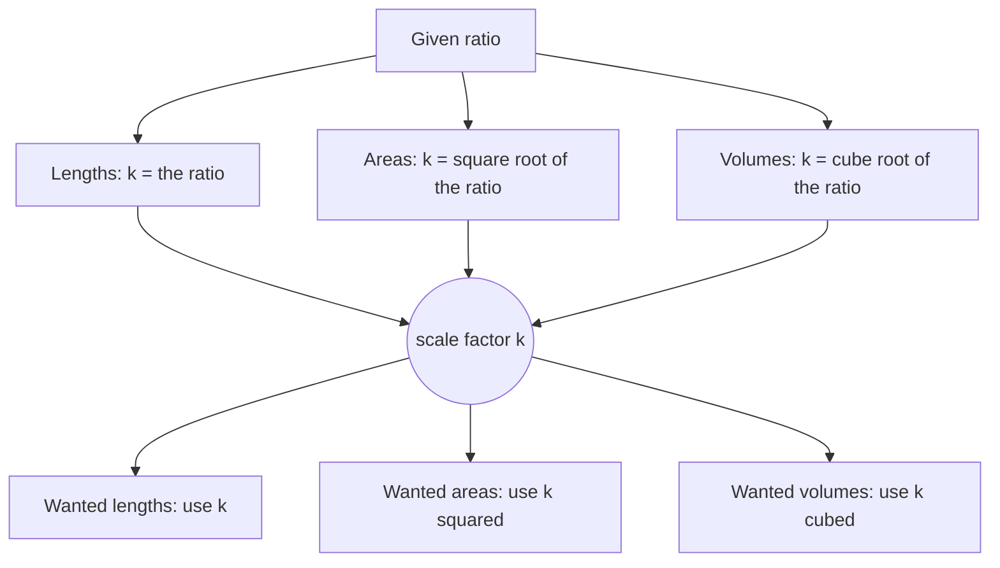

Congruent figures have the same shape *and* size. Similar figures have the same shape but possibly different sizes, like a photo and its enlargement, or a map and the land it shows. This lesson sets up the algebra of ratios and proportions, defines similarity, and works out how lengths, areas and volumes change when a figure is scaled.

## Ratios and proportions

A **ratio** compares two quantities by division: $a : b$ or $\tfrac{a}{b}$ (with $b \ne 0$). A **proportion** is an equation stating that two ratios are equal:

$$\frac{a}{b} = \frac{c}{d}.$$

**Cross Products Property.** In a proportion, the cross products are equal: if $\tfrac{a}{b} = \tfrac{c}{d}$, then $ad = bc$. (Multiply both sides by $bd$.)

Other true rearrangements: $\tfrac{b}{a} = \tfrac{d}{c}$ (flip both), $\tfrac{a}{c} = \tfrac{b}{d}$ (swap the means), and $\tfrac{a + b}{b} = \tfrac{c + d}{d}$ (add 1 to both sides).

### Example 1

Solve $\dfrac{x + 3}{8} = \dfrac{x - 2}{5}$.

**Step 1.** Cross multiply: $5(x + 3) = 8(x - 2)$.

**Step 2.** $5x + 15 = 8x - 16$, so $31 = 3x$ and $x = \tfrac{31}{3}$.

The **geometric mean** of two positive numbers $a$ and $b$ is the positive $x$ with $\tfrac{a}{x} = \tfrac{x}{b}$, so $x = \sqrt{ab}$. The geometric mean of 4 and 9 is 6. It will reappear inside right triangles in Lesson 23.

## Similar polygons

Two polygons are **similar polygons** ($\sim$) if their vertices can be matched so that

1. all corresponding angles are congruent, and
2. all corresponding side lengths are proportional.

The common ratio of corresponding sides is the **scale factor**. If $ABCD \sim EFGH$ with scale factor $k = \tfrac{EF}{AB}$, then every side of $EFGH$ is $k$ times the matching side of $ABCD$.

Both conditions matter. All rectangles have congruent angles, but a $2 \times 3$ and a $2 \times 5$ rectangle aren't similar ($\tfrac22 \ne \tfrac35$). A square and a non-square rhombus with equal sides have proportional sides but aren't similar, because their angles differ.

As with congruence, the order of letters in a **similarity statement** shows the correspondence.

```shape
{"polygons": [{"points": [[0, 0], [4, 0], [4, 3]]}, {"points": [[7, 0], [15, 0], [15, 6]]}], "rightAngles": [[[4, 0], [0, 0], [4, 3]], [[15, 0], [7, 0], [15, 6]]], "segments": [{"from": [0, 0], "to": [4, 0], "label": "4"}, {"from": [4, 0], "to": [4, 3], "label": "3"}, {"from": [7, 0], "to": [15, 0], "label": "8"}, {"from": [15, 0], "to": [15, 6], "label": "x"}], "caption": "Similar right triangles with scale factor 2: x = 6."}
```

### Example 2

$\triangle ABC \sim \triangle DEF$ with $AB = 6$, $BC = 9$, $AC = 12$, and $DE = 10$. Find $EF$, $DF$ and the scale factor from $\triangle ABC$ to $\triangle DEF$.

**Step 1.** Scale factor $k = \tfrac{DE}{AB} = \tfrac{10}{6} = \tfrac53$.

**Step 2.** $EF = \tfrac53 \cdot 9 = 15$ and $DF = \tfrac53 \cdot 12 = 20$.

**Check.** $\tfrac{10}{6} = \tfrac{15}{9} = \tfrac{20}{12} = \tfrac53$.

## Perimeters, areas and volumes of similar figures

If two figures are similar with scale factor $k$:

| Measure | Ratio |
|---|---|
| Any length (sides, perimeter, heights, diagonals, radii) | $k$ |
| Area (including surface area) | $k^2$ |
| Volume | $k^3$ |

*Why squared for area?* Area is length times length, and *both* lengths get multiplied by $k$. Think of a $1 \times 1$ square scaled by 3: it becomes $3 \times 3$, which holds nine of the originals. Volume multiplies three lengths, so it scales by $k^3$: a $3 \times 3 \times 3$ cube holds 27 unit cubes.

```shape
{"polygons": [{"points": [[0, 0], [1, 0], [1, 1], [0, 1]]}, {"points": [[3, 0], [6, 0], [6, 3], [3, 3]]}], "segments": [{"from": [4, 0], "to": [4, 3]}, {"from": [5, 0], "to": [5, 3]}, {"from": [3, 1], "to": [6, 1]}, {"from": [3, 2], "to": [6, 2]}, {"from": [0, 0], "to": [1, 0], "label": "1"}, {"from": [3, 0], "to": [6, 0], "label": "3"}], "caption": "Scale factor 3: the side triples, but the area becomes 9 copies of the original square."}
```

### Example 3

Two similar pentagons have perimeters 20 cm and 30 cm. The smaller has area 48 cm². Find the larger's area.

**Step 1.** Scale factor (small to large): $k = \tfrac{30}{20} = \tfrac32$.

**Step 2.** Area ratio: $k^2 = \tfrac94$.

**Step 3.** Larger area $= 48 \cdot \tfrac94 = 108$ cm².

The common slip is multiplying 48 by $\tfrac32$ and getting 72.

### Example 4

Two similar cylinders have volumes $54\pi$ and $250\pi$. What is the ratio of their radii, and of their surface areas?

**Step 1.** Volume ratio $= \tfrac{250}{54} = \tfrac{125}{27}$, which is $k^3$.

**Step 2.** $k = \sqrt[3]{\tfrac{125}{27}} = \tfrac53$. Radii are in ratio $5 : 3$ (large to small).

**Step 3.** Surface areas are in ratio $k^2 = \tfrac{25}{9}$.

To go backward from areas or volumes to lengths, take the square root or cube root.

The chart below sums up the method: always pass through the scale factor $k$.



## Scale drawings

A map or blueprint is a scale drawing: similar to the real object. A scale like "1 cm : 5 km" is a scale factor with units.

### Example 5

On a map with scale 1 : 25,000, two towns are 7.2 cm apart. How far apart are they in kilometers?

$7.2 \text{ cm} \times 25{,}000 = 180{,}000 \text{ cm} = 1800 \text{ m} = 1.8 \text{ km}$.

### Example 6

Rectangle $A$ is $6 \times 10$ and rectangle $B$ is $9 \times 15$. Rectangle $C$ is $8 \times 12$. Which are similar to $A$?

**Step 1.** All rectangles have four right angles, so only the side ratios matter. Compare short to short and long to long.

**Step 2.** $B$: $\tfrac96 = 1.5$ and $\tfrac{15}{10} = 1.5$. Equal, so $B \sim A$ with scale factor 1.5.

**Step 3.** $C$: $\tfrac86 \approx 1.33$ and $\tfrac{12}{10} = 1.2$. Not equal, so $C$ is not similar to $A$.

## Common mistakes

- **Scaling area by $k$.** Area scales by $k^2$; volume by $k^3$.
- **Mismatched correspondence** in the proportion (setting $\tfrac{AB}{DE} = \tfrac{DF}{AC}$, which flips one ratio).
- **Checking only angles or only sides** for polygons with more than three sides. Both are needed.
- **Taking the wrong root.** From an area ratio, $k = \sqrt{\text{ratio}}$; from a volume ratio, $k = \sqrt[3]{\text{ratio}}$.

## Key points

- In a proportion, cross products are equal; the geometric mean of $a$ and $b$ is $\sqrt{ab}$.
- Similar polygons: congruent corresponding angles and proportional corresponding sides.
- With scale factor $k$: lengths scale by $k$, areas by $k^2$, volumes by $k^3$.
