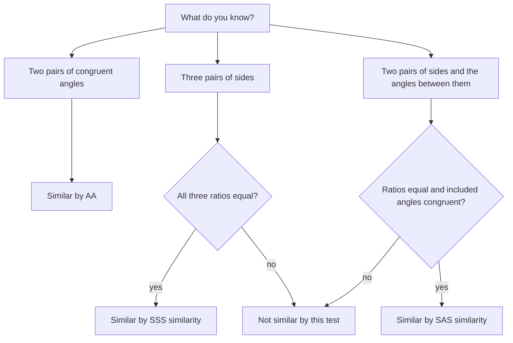

For general polygons, similarity needs every angle and every side ratio. Triangles are special: just as SSS and SAS shortcut congruence, three shortcuts prove triangles similar. This lesson gives those tests, then uses them to find lengths in figures with parallel lines and angle bisectors, and in indirect measurement problems like finding a tree's height from its shadow.

## The three similarity tests

**AA Similarity Postulate.** If two angles of one triangle are congruent to two angles of another, the triangles are similar.

This is the most-used test. The third angles match automatically (Third Angles Theorem), so the shape is fixed; only the size is free.

**SSS Similarity Theorem.** If the three sides of one triangle are proportional to the three sides of another, the triangles are similar.

**SAS Similarity Theorem.** If two sides of one triangle are proportional to two sides of another, and the included angles are congruent, the triangles are similar.

Compare with congruence: SSS and SAS appear in both lists (with "proportional" replacing "congruent"), while AA is enough for similarity because similarity doesn't care about size.

This chart shows which test to reach for, depending on what you know.



### Example 1

Are triangles with sides 6, 8, 12 and 9, 12, 18 similar?

Order each triangle's sides and compare ratios: $\tfrac96 = 1.5$, $\tfrac{12}{8} = 1.5$, $\tfrac{18}{12} = 1.5$. All equal, so the triangles are similar by SSS similarity, with scale factor $\tfrac32$.

### Example 2

In the figure, $\overline{DE} \parallel \overline{BC}$, $AD = 4$, $DB = 6$ and $DE = 5$. Find $BC$.

```shape
{"polygons": [{"points": [[0, 0], [10, 0], [3, 7]]}], "segments": [{"from": [1.8, 4.2], "to": [5.8, 4.2]}], "labels": [{"at": [3, 7.5], "text": "A"}, {"at": [-0.5, -0.4], "text": "B"}, {"at": [10.5, -0.4], "text": "C"}, {"at": [1.2, 4.4], "text": "D"}, {"at": [6.4, 4.4], "text": "E"}], "caption": "DE ∥ BC, so △ADE ∼ △ABC."}
```

**Step 1.** $\angle A$ is shared, and $\angle ADE \cong \angle ABC$ (corresponding angles, since $\overline{DE} \parallel \overline{BC}$). So $\triangle ADE \sim \triangle ABC$ by AA.

**Step 2.** Corresponding sides: $\tfrac{DE}{BC} = \tfrac{AD}{AB}$, where $AB = AD + DB = 10$.

**Step 3.** $\tfrac{5}{BC} = \tfrac{4}{10}$, so $BC = \tfrac{50}{4} = 12.5$.

The common error is using $\tfrac{AD}{DB} = \tfrac{4}{6}$ here. That ratio compares two *pieces* of a side; the similar triangles compare a piece to a whole.

## The Side Splitter Theorem

When a line parallel to one side cuts the other two, there's a handy shortcut that does compare pieces.

**Triangle Proportionality (Side Splitter) Theorem.** If a line parallel to one side of a triangle intersects the other two sides, it divides them proportionally:

$$\frac{AD}{DB} = \frac{AE}{EC}.$$

*Why.* From the similar triangles, $\tfrac{AB}{AD} = \tfrac{AC}{AE}$. Subtract 1 from both sides: $\tfrac{AB - AD}{AD} = \tfrac{AC - AE}{AE}$, i.e. $\tfrac{DB}{AD} = \tfrac{EC}{AE}$. Flip both.

The converse holds too: if a line divides two sides proportionally, it's parallel to the third side.

A related fact: **three or more parallel lines cut any two transversals proportionally.**

### Example 3

In $\triangle ABC$, $\overline{DE} \parallel \overline{BC}$ with $D$ on $\overline{AB}$, $E$ on $\overline{AC}$. $AD = 8$, $DB = 12$, $AE = 6$. Find $EC$.

$\tfrac{8}{12} = \tfrac{6}{EC}$, so $8 \cdot EC = 72$ and $EC = 9$.

## The Triangle Angle Bisector Theorem

**Theorem.** An angle bisector of a triangle divides the opposite side into segments proportional to the other two sides. If $\overline{AD}$ bisects $\angle A$ in $\triangle ABC$, then

$$\frac{BD}{DC} = \frac{AB}{AC}.$$

*Why (sketch).* Draw a line through $C$ parallel to $\overline{AD}$, meeting line $AB$ extended at $E$. Corresponding and alternate interior angles show $\triangle ACE$ is isosceles with $AE = AC$. Then the Side Splitter Theorem in $\triangle BCE$ gives $\tfrac{BD}{DC} = \tfrac{BA}{AE} = \tfrac{AB}{AC}$.

### Example 4

In $\triangle ABC$, $AB = 10$, $AC = 14$ and $BC = 18$. The bisector of $\angle A$ meets $\overline{BC}$ at $D$. Find $BD$ and $DC$.

**Step 1.** $\tfrac{BD}{DC} = \tfrac{10}{14} = \tfrac57$.

**Step 2.** Split 18 in the ratio $5 : 7$: $BD = \tfrac{5}{12} \cdot 18 = 7.5$ and $DC = \tfrac{7}{12} \cdot 18 = 10.5$.

## Indirect measurement

Similar triangles let you measure things you can't reach. Sun rays are parallel, so a person and a tree, with their shadows, form similar right triangles (AA: both have right angles, and the sun's angle is the same).

### Example 5

A 1.8 m person casts a 2.4 m shadow at the same time a tree casts a 16 m shadow. How tall is the tree?


$\tfrac{h}{16} = \tfrac{1.8}{2.4}$, so $h = 16 \cdot 0.75 = 12$ m.

### Example 6: overlapping triangles

In $\triangle ABC$, point $D$ is on $\overline{AB}$ and $E$ is on $\overline{AC}$ with $AD = 4$, $AB = 10$, $AE = 6$, $AC = 15$. Is $\triangle ADE \sim \triangle ABC$?

**Step 1.** The two triangles share $\angle A$, which is included between the sides we know in each.

**Step 2.** Ratios: $\tfrac{AD}{AB} = \tfrac{4}{10} = 0.4$ and $\tfrac{AE}{AC} = \tfrac{6}{15} = 0.4$.

**Step 3.** Proportional sides with a congruent included angle: $\triangle ADE \sim \triangle ABC$ by SAS similarity. As a bonus, $\angle ADE \cong \angle ABC$ (corresponding angles of similar triangles), so $\overline{DE} \parallel \overline{BC}$.

Drawing the two triangles separately, side by side, is the best way to avoid mixing up their parts.

## Common mistakes

- **Comparing a piece to a piece in similar triangles** (or a piece to a whole in the Side Splitter Theorem). Know which tool you're using.
- **Using AAA or SSA language.** AA is enough; SSA isn't a similarity test either.
- **Matching the wrong sides in the Angle Bisector Theorem.** Each piece of the opposite side goes with the side of the triangle *next to it*: $BD$ with $AB$, $DC$ with $AC$.
- **Forgetting the included angle in SAS similarity.**

## Key points

- Triangles are similar by AA, SSS similarity or SAS similarity.
- Side Splitter: a line parallel to one side divides the other two proportionally ($\tfrac{AD}{DB} = \tfrac{AE}{EC}$), and conversely.
- Angle Bisector Theorem: $\tfrac{BD}{DC} = \tfrac{AB}{AC}$.
- Similar right triangles from shadows give heights by proportion.
