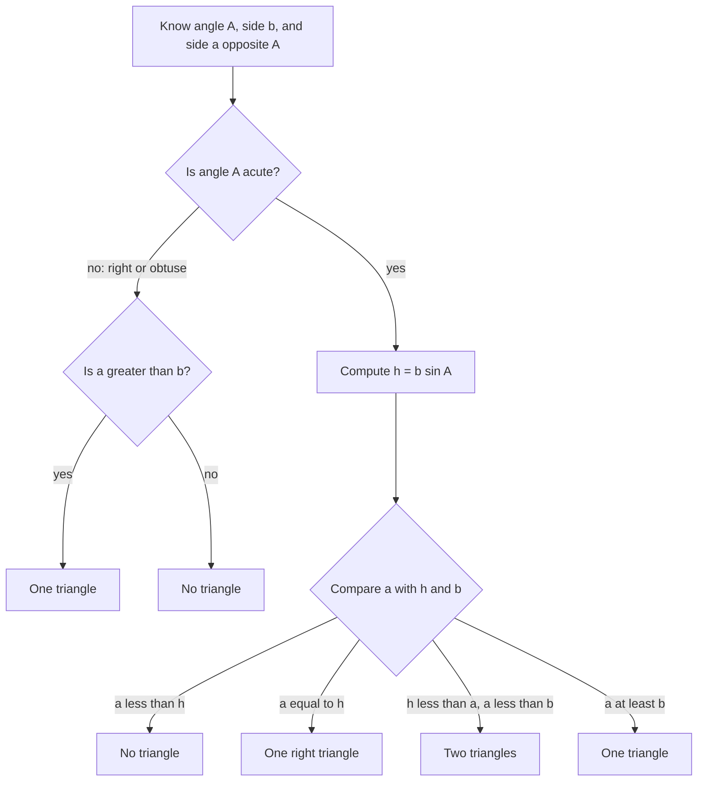

SOH-CAH-TOA from the last lesson only works when the triangle has a right angle. Most triangles don't. A triangle with no right angle is called an **oblique triangle**, and to solve one we need rules that hold for *every* triangle. This lesson gives the first of two: the **Law of Sines**. It handles triangles where you know two angles and a side, and it also explains the strange "two different triangles" behavior of SSA that you met in Lesson 11. The next lesson adds the Law of Cosines, and together they solve any triangle.

**Notation.** In $\triangle ABC$, the capital letters name the angles and the matching lowercase letters name the sides *opposite* them: side $a$ is across from $\angle A$, side $b$ across from $\angle B$, side $c$ across from $\angle C$. Every formula in this lesson and the next depends on that pairing.

## Sine and cosine of an obtuse angle

An oblique triangle can have an obtuse angle, but "opposite over hypotenuse" makes no sense for an angle of $120^\circ$. So we extend the definitions using coordinates. Put the angle's vertex at the origin with one side along the positive $x$-axis, and pick any point $P(x, y)$ on the other side, at distance $r$ from the origin. Define

$$\sin\theta = \frac{y}{r}, \qquad \cos\theta = \frac{x}{r}.$$

For an acute angle, $P$ is in the first quadrant, $x$ is the adjacent leg and $y$ the opposite leg of a right triangle with hypotenuse $r$, so nothing changes. For an obtuse angle, $P$ is in the second quadrant: $y$ is still positive but $x$ is negative.

```plot
{"x": [-5, 5], "y": [-1, 3.5], "equal": true, "segments": [{"from": [0, 0], "to": [4, 0]}, {"from": [0, 0], "to": [-3.464, 2]}, {"from": [0, 0], "to": [3.464, 2], "dashed": true}, {"from": [-3.464, 2], "to": [-3.464, 0], "dashed": true}, {"from": [3.464, 2], "to": [3.464, 0], "dashed": true}], "points": [{"at": [-3.464, 2], "label": "P (150°)"}, {"at": [3.464, 2], "label": "Q (30°)"}], "caption": "P and Q are mirror images across the y-axis: the same height y, opposite x."}
```

The point $Q$ on the $30^\circ$ side is the mirror image of $P$ on the $150^\circ$ side. Same height, opposite $x$. That gives two rules for any angle $\theta$ between $0^\circ$ and $180^\circ$:

$$\sin\theta = \sin(180^\circ - \theta), \qquad \cos\theta = -\cos(180^\circ - \theta).$$

So $\sin 150^\circ = \sin 30^\circ = \tfrac12$ and $\cos 150^\circ = -\cos 30^\circ = -\tfrac{\sqrt3}{2}$. Also $\sin 90^\circ = 1$ and $\cos 90^\circ = 0$ (the point is straight up). Your calculator already uses these definitions; just keep it in degree mode.

Two facts to remember. The cosine of an obtuse angle is *negative*, which the Law of Cosines will use to detect obtuse angles. And the sine *cannot tell* an angle from its supplement: $\sin 40^\circ = \sin 140^\circ$. That second fact is the root of the ambiguous case below.

## The Law of Sines

**Law of Sines.** In any triangle,

$$\frac{a}{\sin A} = \frac{b}{\sin B} = \frac{c}{\sin C}.$$

Each side divided by the sine of its opposite angle gives the same number. (You can flip all three fractions, $\tfrac{\sin A}{a} = \tfrac{\sin B}{b} = \tfrac{\sin C}{c}$, which is handier when the unknown is an angle.)

**Why it's true.** Drop the altitude from $C$ to line $AB$ and call its length $h$.

```shape
{"polygons": [{"points": [[0, 0], [9, 0], [3, 4]]}], "segments": [{"from": [3, 4], "to": [3, 0], "dashed": true, "label": "h"}, {"from": [0, 0], "to": [3, 4], "label": "b"}, {"from": [9, 0], "to": [3, 4], "label": "a"}, {"from": [0, 0], "to": [9, 0], "label": "c"}], "rightAngles": [[[3, 0], [9, 0], [3, 4]]], "labels": [{"at": [-0.4, -0.3], "text": "A"}, {"at": [9.4, -0.3], "text": "B"}, {"at": [3, 4.5], "text": "C"}], "caption": "The altitude h splits the triangle into two right triangles."}
```

In the left right triangle, $h$ is opposite $\angle A$ with hypotenuse $b$, so $h = b\sin A$. In the right one, $h$ is opposite $\angle B$ with hypotenuse $a$, so $h = a\sin B$. Setting them equal, $b\sin A = a\sin B$, and dividing by $\sin A \sin B$ gives $\tfrac{a}{\sin A} = \tfrac{b}{\sin B}$. (If $\angle B$ is obtuse, the altitude lands outside the triangle and the right triangle uses the angle $180^\circ - B$; since $\sin(180^\circ - B) = \sin B$, the result is the same.) Dropping the altitude from $A$ instead brings in $c$ and $\sin C$ the same way.

**When to use it.** You need one complete "pair" (a side and its opposite angle, both known) plus one more piece. That happens with:

- **AAS** or **ASA**: two angles and any side. Find the third angle from the $180^\circ$ sum, and every side has a known opposite angle.
- **SSA**: two sides and an angle opposite one of them. This works but can give zero, one or two triangles (see below).

It does *not* start SAS or SSS, where no side's opposite angle is known; those need the next lesson.

### Example 1: ASA

In $\triangle ABC$, $m\angle A = 40^\circ$, $m\angle B = 65^\circ$ and $c = 12$. Solve the triangle.

**Step 1.** Third angle: $m\angle C = 180^\circ - 40^\circ - 65^\circ = 75^\circ$. Now $c = 12$ and $C = 75^\circ$ form a complete pair.

**Step 2.** $\dfrac{a}{\sin 40^\circ} = \dfrac{12}{\sin 75^\circ}$, so $a = \dfrac{12\sin 40^\circ}{\sin 75^\circ} \approx \dfrac{12(0.6428)}{0.9659} \approx 7.99$.

**Step 3.** $b = \dfrac{12\sin 65^\circ}{\sin 75^\circ} \approx \dfrac{12(0.9063)}{0.9659} \approx 11.26$.

**Check.** The largest angle ($75^\circ$) is across from the longest side (12), and the smallest angle ($40^\circ$) from the shortest side (7.99), as Lesson 14 says it must be.

### Example 2: measuring across a river

Surveyors mark points $A$ and $B$ 300 m apart along a straight riverbank and sight a tree $C$ on the far bank. They measure $m\angle CAB = 52^\circ$ and $m\angle CBA = 71^\circ$. How far is the tree from $A$, and how wide is the river?

```shape
{"polygons": [{"points": [[0, 0], [10, 0], [6.94, 8.88]]}], "segments": [{"from": [-1, 0], "to": [11.5, 0]}, {"from": [-1, 8.88], "to": [11.5, 8.88], "dashed": true}, {"from": [6.94, 8.88], "to": [6.94, 0], "dashed": true, "label": "width"}, {"from": [0, 0], "to": [10, 0], "label": "300 m"}], "rightAngles": [[[6.94, 0], [10, 0], [6.94, 8.88]]], "labels": [{"at": [-0.4, -0.5], "text": "A"}, {"at": [10.4, -0.5], "text": "B"}, {"at": [6.94, 9.5], "text": "C (tree)"}, {"at": [1.3, 0.55], "text": "52°"}, {"at": [9.2, 0.6], "text": "71°"}], "caption": "Baseline AB on the near bank (solid line), tree C on the far bank (dashed line)."}
```

**Step 1.** $m\angle C = 180^\circ - 52^\circ - 71^\circ = 57^\circ$, and the known side $AB = 300$ is opposite $\angle C$.

**Step 2.** $AC$ is opposite $\angle B$: $AC = \dfrac{300\sin 71^\circ}{\sin 57^\circ} \approx \dfrac{300(0.9455)}{0.8387} \approx 338.2$ m.

**Step 3.** The river's width is the perpendicular distance from $C$ to the bank, the altitude from $C$. In the right triangle at $A$ it is $AC\sin 52^\circ \approx 338.2(0.7880) \approx 266.5$ m.

## The ambiguous case (SSA)

Suppose you know $\angle A$, the side $b$ next to it, and the side $a$ opposite it. Picture building the triangle: draw $\angle A$, mark $C$ at distance $b$ along one side, then swing side $a$ from $C$ like a pendulum and see where it reaches the other side of the angle. The shortest distance from $C$ to that side is the altitude $h = b\sin A$.

```shape
{"segments": [{"from": [0, 0], "to": [11, 0]}, {"from": [0, 0], "to": [6.062, 3.5], "label": "b = 7"}, {"from": [6.062, 3.5], "to": [9.633, 0], "label": "5"}, {"from": [6.062, 3.5], "to": [2.491, 0], "label": "5"}, {"from": [6.062, 3.5], "to": [6.062, 0], "dashed": true, "label": "h"}], "curves": [{"x": "6.062 + 5cos(t)", "y": "3.5 + 5sin(t)", "t": [3.9, 5.53], "dashed": true}], "labels": [{"at": [-0.4, -0.3], "text": "A"}, {"at": [6.062, 4.0], "text": "C"}, {"at": [2.491, -0.5], "text": "B₂"}, {"at": [9.633, -0.5], "text": "B₁"}, {"at": [1.3, 0.3], "text": "30°"}], "caption": "Side a = 5 swung from C reaches the base twice: two triangles AB₁C and AB₂C."}
```

For an *acute* $\angle A$:

| Condition | Number of triangles | Picture |
|---|---|---|
| $a < h$ | 0 | the side is too short to reach |
| $a = h$ | 1 | it just touches: a right triangle |
| $h < a < b$ | 2 | it reaches the base at two points |
| $a \ge b$ | 1 | the second crossing is behind $A$ |

For a *right or obtuse* $\angle A$ there is one triangle if $a > b$ and none if $a \le b$ (the side opposite the largest angle must be the longest).

The same tests as a flowchart:



This is the **ambiguous case**: two sides and a non-included angle may fit two different triangles, which is exactly why SSA is not a congruence test. Algebraically it shows up when you solve for $\sin B$: if $\sin B > 1$ there is no triangle; otherwise $B$ could be the calculator's acute angle $B_1 = \sin^{-1}(\cdots)$ *or* its supplement $B_2 = 180^\circ - B_1$, and $B_2$ is a real triangle only if $A + B_2 < 180^\circ$.

### Example 3: two triangles

In Lesson 11 we claimed that sides 5 and 7 with a $30^\circ$ angle opposite the 5 fit two different triangles. Find both. So $A = 30^\circ$, $a = 5$, $b = 7$.

**Step 1. Count.** $h = 7\sin 30^\circ = 3.5$. Since $3.5 < 5 < 7$, there are two triangles.

**Step 2. Find $B$.** $\sin B = \dfrac{b\sin A}{a} = \dfrac{7(0.5)}{5} = 0.7$. The calculator gives $B_1 = \sin^{-1}(0.7) \approx 44.43^\circ$; the supplement is $B_2 \approx 135.57^\circ$. Both work, since $30^\circ + 135.57^\circ < 180^\circ$.

**Step 3. Finish each triangle.**

- Triangle 1: $C_1 = 180^\circ - 30^\circ - 44.43^\circ = 105.57^\circ$, and $c_1 = \dfrac{5\sin 105.57^\circ}{\sin 30^\circ} \approx 9.63$.
- Triangle 2: $C_2 = 180^\circ - 30^\circ - 135.57^\circ = 14.43^\circ$, and $c_2 = \dfrac{5\sin 14.43^\circ}{\sin 30^\circ} \approx 2.49$.

These match the figure: $AB_1 \approx 9.63$ and $AB_2 \approx 2.49$.

### Example 4: no triangle

Is there a triangle with $A = 50^\circ$, $a = 4$, $b = 10$?

$\sin B = \dfrac{10\sin 50^\circ}{4} \approx 1.92$. No angle has a sine greater than 1, so no triangle exists. (Geometrically, $h = 10\sin 50^\circ \approx 7.66$, and a side of 4 can't reach.)

## Common mistakes

- **Pairing a side with the wrong angle.** In $\tfrac{a}{\sin A}$ the side and angle must be *opposite* each other, not adjacent.
- **Forgetting the second SSA triangle.** $\sin^{-1}$ returns only the acute angle. Always test $180^\circ - B_1$ as well.
- **Keeping an impossible second angle.** $B_2$ counts only if $A + B_2 < 180^\circ$.
- **Using the Law of Sines on SAS or SSS.** With no known side–angle pair, it has nothing to start from.
- **Rounding too early.** Keep full calculator values for intermediate angles and round only the final answers.

## Key points

- Side $a$ is opposite $\angle A$, and so on.
- For $0^\circ < \theta < 180^\circ$: $\sin\theta = \sin(180^\circ - \theta)$ and $\cos\theta = -\cos(180^\circ - \theta)$; obtuse angles have negative cosines.
- Law of Sines: $\dfrac{a}{\sin A} = \dfrac{b}{\sin B} = \dfrac{c}{\sin C}$, proved with one altitude.
- Use it for AAS, ASA and SSA.
- SSA can give 0, 1 or 2 triangles; compare $a$ with $h = b\sin A$ and with $b$.
