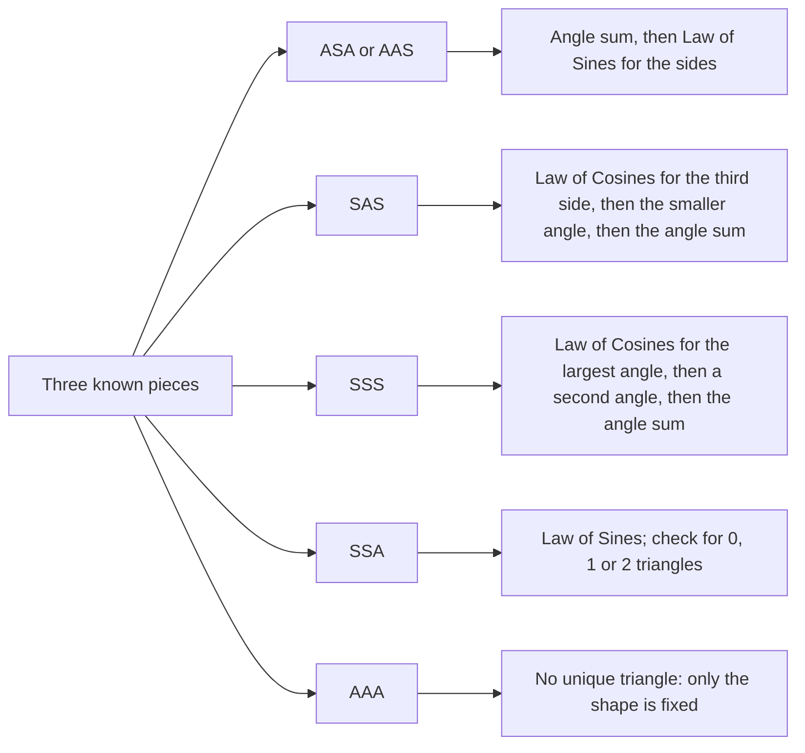

The Law of Sines from the last lesson needs a side together with its opposite angle. Two common situations never give you that: two sides and the angle between them (SAS), and three sides (SSS). Both determine a unique triangle (they are congruence tests), so there must be a way to compute the rest. That way is the **Law of Cosines**, a version of the Pythagorean theorem that works for every triangle. With both laws in hand, this lesson ends with a plan for solving any triangle.

As before, side $a$ is opposite $\angle A$, side $b$ opposite $\angle B$ and side $c$ opposite $\angle C$.

## The Law of Cosines

**Law of Cosines.** In any triangle,

$$a^2 = b^2 + c^2 - 2bc\cos A.$$

The same pattern holds for each side: $b^2 = a^2 + c^2 - 2ac\cos B$ and $c^2 = a^2 + b^2 - 2ab\cos C$. In words: the square of one side equals the sum of the squares of the other two, minus twice their product times the cosine of the angle *between* them.

**Why it's true.** Put $\triangle ABC$ on coordinates with $A$ at the origin and $B$ on the positive $x$-axis, so $B = (c, 0)$. Point $C$ is at distance $b$ from the origin along the side of $\angle A$, so by the coordinate definition of sine and cosine from the last lesson, $C = (b\cos A,\; b\sin A)$. This works whether $\angle A$ is acute, right or obtuse.

```plot
{"x": [-1, 10], "y": [-1, 6], "equal": true, "polygons": [{"points": [[0, 0], [9, 0], [3, 5]]}], "points": [{"at": [0, 0], "label": "A (0, 0)"}, {"at": [9, 0], "label": "B (c, 0)"}, {"at": [3, 5], "label": "C (b cos A, b sin A)"}], "labels": [{"at": [1.1, 2.9], "text": "b"}, {"at": [6.4, 2.9], "text": "a"}, {"at": [5.2, 0.4], "text": "c"}], "caption": "Placing the triangle so the distance formula gives side a."}
```

Side $a$ is the distance from $B$ to $C$. By the distance formula (Lesson 22),

$$a^2 = (b\cos A - c)^2 + (b\sin A)^2 = b^2\cos^2 A - 2bc\cos A + c^2 + b^2\sin^2 A.$$

Now $\cos^2 A + \sin^2 A = 1$, because $\left(\tfrac{x}{r}\right)^2 + \left(\tfrac{y}{r}\right)^2 = \tfrac{x^2 + y^2}{r^2} = 1$. So $b^2\cos^2 A + b^2\sin^2 A = b^2$, and $a^2 = b^2 + c^2 - 2bc\cos A$.

**It contains the Pythagorean theorem.** If $A = 90^\circ$, then $\cos A = 0$ and the formula becomes $a^2 = b^2 + c^2$. The term $-2bc\cos A$ is a correction for angles that aren't right. When $\angle A$ is acute, $\cos A > 0$ and $a^2 < b^2 + c^2$; when $\angle A$ is obtuse, $\cos A < 0$ and $a^2 > b^2 + c^2$. That is exactly the acute/obtuse test from Lesson 22, now with an explanation.

**Solving for an angle.** Rearranged, the law finds an angle from three sides:

$$\cos A = \frac{b^2 + c^2 - a^2}{2bc}.$$

Because cosine is negative for obtuse angles and positive for acute ones, $\cos^{-1}$ of this value gives the correct angle every time, with no ambiguous case. That is the big advantage over the Law of Sines.

### Example 1: SAS

In $\triangle ABC$, $b = 8$, $c = 11$ and $m\angle A = 38^\circ$. Solve the triangle.

**Step 1. Third side.** $\angle A$ is between the known sides, so use the Law of Cosines:
$a^2 = 8^2 + 11^2 - 2(8)(11)\cos 38^\circ \approx 64 + 121 - 176(0.7880) \approx 185 - 138.69 = 46.31$, so $a \approx 6.81$.

**Step 2. Smaller remaining angle first.** $\angle B$ is opposite $b = 8$, the shorter of the two remaining sides, so it can't be obtuse (only the largest angle can be). Law of Sines: $\sin B = \dfrac{8\sin 38^\circ}{6.805} \approx 0.7237$, so $m\angle B \approx 46.37^\circ$.

**Step 3. Last angle.** $m\angle C = 180^\circ - 38^\circ - 46.37^\circ = 95.63^\circ$.

**Why that order?** If you had used the Law of Sines on $\angle C$ instead, you would get $\sin C \approx 0.9952$ and the calculator's answer $84.37^\circ$, which is wrong: $C$ is actually obtuse. Finding the smaller angle first (or using the Law of Cosines for $C$) avoids the trap.

### Example 2: SSS

A triangle has sides $a = 7$, $b = 9$, $c = 13$. Find all three angles.

**Step 1. Check it exists.** $7 + 9 = 16 > 13$, so the triangle inequality holds.

**Step 2. Largest angle first.** The largest angle, $\angle C$, is opposite the longest side:
$\cos C = \dfrac{7^2 + 9^2 - 13^2}{2(7)(9)} = \dfrac{49 + 81 - 169}{126} = \dfrac{-39}{126} \approx -0.3095$, so $m\angle C \approx 108.03^\circ$. The negative cosine announces an obtuse angle.

**Step 3. Another angle.** $\cos A = \dfrac{9^2 + 13^2 - 7^2}{2(9)(13)} = \dfrac{201}{234} \approx 0.8590$, so $m\angle A \approx 30.80^\circ$.

**Step 4. The last one.** $m\angle B = 180^\circ - 108.03^\circ - 30.80^\circ \approx 41.17^\circ$.

If the sides fail the triangle inequality, the formula tells you: for sides 3, 4 and 8, $\cos C = \tfrac{9 + 16 - 64}{24} = -1.625$, and no angle has a cosine below $-1$.

### Example 3: distance between two boats

Two boats leave a harbor at the same time. One travels 12 km in a straight line, the other 9 km, and the angle between their paths is $115^\circ$. How far apart are they?

```shape
{"segments": [{"from": [0, 0], "to": [11.28, 4.1], "label": "12 km"}, {"from": [0, 0], "to": [-6.36, 6.36]}, {"from": [-6.36, 6.36], "to": [11.28, 4.1], "dashed": true, "label": "d"}], "points": [{"at": [0, 0]}, {"at": [11.28, 4.1]}, {"at": [-6.36, 6.36]}], "labels": [{"at": [0.2, 1.6], "text": "115°"}, {"at": [0, -1.0], "text": "harbor"}, {"at": [-4.4, 2.6], "text": "9 km"}], "caption": "Two paths from the harbor with 115° between them; d is the distance between the boats."}
```

The paths are two sides with the $115^\circ$ angle between them (SAS):
$d^2 = 12^2 + 9^2 - 2(12)(9)\cos 115^\circ \approx 144 + 81 - 216(-0.4226) \approx 225 + 91.29 = 316.29$, so $d \approx 17.78$ km.

Notice that subtracting a negative *adds*: an obtuse angle pushes the boats farther apart than the $15$ km a right angle would give.

## Solving any triangle

To **solve a triangle** is to find all three sides and all three angles. Three pieces, including at least one side, are enough, and the case tells you where to start.

| You know | Start with | Then |
|---|---|---|
| ASA or AAS | angle sum for the third angle | Law of Sines for each side |
| SAS | Law of Cosines for the third side | smaller remaining angle (either law), then angle sum |
| SSS | Law of Cosines for the largest angle | either law for a second angle, then angle sum |
| SSA | Law of Sines for the second angle | check for 0, 1 or 2 triangles (last lesson) |
| AAA | no unique triangle | the angles fix only the shape (similar triangles) |

The same plan as a decision chart:



**The safe-order rule.** A triangle has at most one obtuse angle, and it is always the largest angle, opposite the longest side. If you settle the largest angle with the Law of Cosines (or find it last by subtraction), every other angle is acute, and the Law of Sines' acute answer is correct for each.

Right triangles are just a special case: the Law of Cosines with a $90^\circ$ angle is the Pythagorean theorem, and the Law of Sines with $\sin 90^\circ = 1$ gives $\sin A = \tfrac{a}{c}$, opposite over hypotenuse.

Once a triangle is solved you can also find its area from two sides and the included angle, $\tfrac12 ab\sin C$, which Lesson 31 develops.

## Common mistakes

- **Using the wrong angle.** In $a^2 = b^2 + c^2 - 2bc\cos A$, the angle must be the one *between* $b$ and $c$, opposite $a$.
- **Order of operations.** Compute $2bc\cos A$ first and subtract it; don't subtract $2bc$ from $b^2 + c^2$ and then multiply by $\cos A$.
- **Dropping the sign of the cosine.** For an obtuse angle, $-2bc\cos A$ is positive; the side opposite comes out longer.
- **Finding the largest angle with the Law of Sines.** It can't tell $84^\circ$ from $96^\circ$. Use the Law of Cosines for it, or find it last.
- **Rounding a side early.** Rounding $a$ to one decimal before finding angles can shift them by a tenth of a degree or more.

## Key points

- Law of Cosines: $a^2 = b^2 + c^2 - 2bc\cos A$; for an angle, $\cos A = \dfrac{b^2 + c^2 - a^2}{2bc}$.
- It reduces to the Pythagorean theorem when the angle is $90^\circ$; a negative cosine means an obtuse angle.
- Use it for SAS (third side) and SSS (angles); use the Law of Sines for ASA, AAS and SSA.
- Settle the largest angle with the Law of Cosines first, then the others are acute.
- Three sides, or two sides and the included angle, always give one triangle; SSA may give two; AAA gives a whole family of similar triangles.
