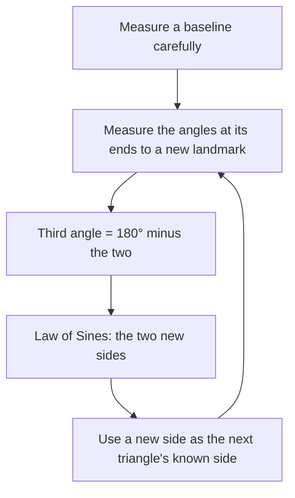

Lesson 24 found the height of a building from one angle of elevation, but only because you could walk to its base and measure the distance. Lesson 25 found the width of a river from two angles and a measured baseline. This lesson puts those ideas to work the way surveyors and navigators do: finding the height of a mountain whose base you can't reach, following a course given as compass bearings, and mapping a whole region from one measured length and a chain of angles. It ends with a question every real measurement raises: how much does a small error in an angle change the answer?

## The height of something you can't walk under

You want the height $h$ of a mountain peak $T$ above the plain. The point $F$ directly below the peak is inside the mountain, so the horizontal distance to it is unknown. Instead, measure two angles of elevation along a straight line toward the peak: angle $\alpha$ from a point $P$, and a larger angle $\beta$ from a point $Q$ that is $d$ closer.

**Method 1: two right triangles.** Let $x = QF$. The right triangles $TFQ$ and $TFP$ give

$$\tan\beta = \frac{h}{x}, \qquad \tan\alpha = \frac{h}{x + d}.$$

So $x = \dfrac{h}{\tan\beta}$ and $x + d = \dfrac{h}{\tan\alpha}$. Subtract to remove the unknown $x$:

$$d = \frac{h}{\tan\alpha} - \frac{h}{\tan\beta} \quad\Longrightarrow\quad h = \frac{d\tan\alpha\tan\beta}{\tan\beta - \tan\alpha}.$$

**Method 2: the Law of Sines.** In the oblique triangle $PQT$, the angle at $Q$ is $180^\circ - \beta$ (a linear pair with $\beta$), so the angle at $T$ is $180^\circ - \alpha - (180^\circ - \beta) = \beta - \alpha$. This is the Exterior Angle Theorem: $\beta$ is an exterior angle of triangle $PQT$, so it equals $\alpha$ plus the angle at $T$. The Law of Sines gives $QT = \dfrac{d\sin\alpha}{\sin(\beta - \alpha)}$, and then the right triangle at $F$ gives

$$h = QT\sin\beta = \frac{d\sin\alpha\sin\beta}{\sin(\beta - \alpha)}.$$

The two formulas look different but always agree. Method 2 is the one surveyors think in, because it works in triangles of any shape.

### Example 1

From $P$ the angle of elevation of a peak is $20^\circ$. After walking 200 m straight toward it, to $Q$, the angle is $32^\circ$. How high is the peak above the ground, and how far is $Q$ from the point beneath it?

**Step 1.** Angle at the top: $\beta - \alpha = 12^\circ$.

**Step 2.** Law of Sines in $\triangle PQT$: $QT = \dfrac{200\sin 20^\circ}{\sin 12^\circ} \approx \dfrac{200(0.3420)}{0.2079} \approx 329.0$ m.

**Step 3.** $h = QT\sin 32^\circ \approx 329.0(0.5299) \approx 174.3$ m.

**Step 4.** $x = \dfrac{h}{\tan 32^\circ} \approx \dfrac{174.3}{0.6249} \approx 279.0$ m.

**Check with Method 1.** $\dfrac{200(0.36397)(0.62487)}{0.62487 - 0.36397} \approx \dfrac{45.49}{0.2609} \approx 174.3$ ✓.

In real surveying the angles are measured from the instrument, which stands a meter or two above the ground, so that height is added at the end. We ignore it here.

## Bearings

Navigators and surveyors give directions as **bearings**: angles measured *clockwise from north*, written with three digits. North is $000^\circ$, east $090^\circ$, south $180^\circ$ and west $270^\circ$, so a bearing of $030^\circ$ points $30^\circ$ east of north, between north-northeast ($022.5^\circ$) and northeast ($045^\circ$). (Another convention, common in land surveying, writes the same direction as N 30° E: start facing north and turn $30^\circ$ toward east. This lesson uses three-digit bearings.)

Two facts do most of the work:

- **North lines are parallel.** On a local map, the north direction is the same everywhere, so the north lines at two points are parallel, and the angle facts from Lesson 8 apply.
- The **back bearing** (the direction for the return trip) differs by $180^\circ$: if $B$ is on bearing $030^\circ$ from $A$, then $A$ is on bearing $210^\circ$ from $B$.

### Example 2: a two-leg voyage

A ship sails 40 km from harbor $A$ on a bearing of $030^\circ$ to point $B$, then 25 km on a bearing of $110^\circ$ to point $C$. How far is $C$ from the harbor, and on what bearing should the ship sail to return?

**Step 1. The angle at $B$.** At $B$, the direction back toward $A$ is the back bearing $030^\circ + 180^\circ = 210^\circ$. The direction to $C$ is $110^\circ$. The angle between them is $210^\circ - 110^\circ = 100^\circ$. So $m\angle ABC = 100^\circ$.

**Step 2. Distance, by the Law of Cosines (SAS).**
$AC^2 = 40^2 + 25^2 - 2(40)(25)\cos 100^\circ \approx 1600 + 625 + 347.3 = 2572.3$, so $AC \approx 50.72$ km.

**Step 3. The angle at $A$, by the Law of Sines.** $\angle BAC$ is opposite the shorter side (25 km), so it is acute: $\sin\angle BAC = \dfrac{25\sin 100^\circ}{50.72} \approx 0.4854$, and $m\angle BAC \approx 29.04^\circ$.

**Step 4. Bearings.** $C$ lies $29.04^\circ$ clockwise from the direction $AB$, so the bearing of $C$ from $A$ is $030^\circ + 29.04^\circ \approx 059.0^\circ$. To return, sail the back bearing, about $059.0^\circ + 180^\circ = 239.0^\circ$.

**Check with coordinates** (east $= x$, north $= y$; a bearing $\theta$ and distance $r$ move you $r\sin\theta$ east and $r\cos\theta$ north): $B \approx (20.00, 34.64)$ and $C \approx (43.49, 26.09)$, so $AC = \sqrt{43.49^2 + 26.09^2} \approx 50.72$ ✓. Notice sine goes with east and cosine with north, because bearings start from north, not from the $x$-axis.

## Triangulation: a map from one length

Measuring long distances on the ground used to be slow and inaccurate, while measuring angles with a good instrument was quick and precise. **Triangulation** exploits this: measure one distance very carefully, the **baseline**, then measure only angles, and compute every other distance with the Law of Sines, triangle after triangle.

### Example 3: a chain of two triangles

Surveyors measure a baseline $AB = 500$ m. A landmark $C$ is sighted with $m\angle CAB = 62^\circ$ and $m\angle CBA = 75^\circ$. Then, from $A$ and $C$, they sight a farther landmark $D$ on the other side of line $AC$ from $B$, measuring $m\angle DAC = 48^\circ$ and $m\angle DCA = 70^\circ$. Find $AC$ and $CD$.

**Step 1. First triangle.** $m\angle ACB = 180^\circ - 62^\circ - 75^\circ = 43^\circ$. $AC$ is opposite the $75^\circ$ angle:
$AC = \dfrac{500\sin 75^\circ}{\sin 43^\circ} \approx \dfrac{500(0.9659)}{0.6820} \approx 708.2$ m.

**Step 2. Second triangle.** Now $AC$ is the known side. $m\angle ADC = 180^\circ - 48^\circ - 70^\circ = 62^\circ$, which is opposite $AC$. $CD$ is opposite the $48^\circ$ angle:
$CD = \dfrac{AC\sin 48^\circ}{\sin 62^\circ} \approx \dfrac{708.2(0.7431)}{0.8829} \approx 596.0$ m.

No distance except the baseline was ever measured with a tape.

Real surveys chained hundreds of triangles. Around 1615 the Dutch scientist Willebrord Snellius used a chain of triangles to measure a north–south distance in the Netherlands, an early large-scale use of the method. The Great Trigonometrical Survey of India, begun in 1802, triangulated the subcontinent over several decades, and its computations gave the first measured height of the peak now called Mount Everest. Over such distances the curvature of the earth and the bending of light in air matter, and surveyors corrected for both; the flat-ground triangles here are a simplification.

## How errors grow

Every measured angle has some error. How much it matters depends on the shape of the triangle.

### Example 4: sensitivity

In Example 1, suppose the first angle was really $21^\circ$ instead of $20^\circ$, with everything else the same. Recompute $h$.

$h = \dfrac{200\sin 21^\circ\sin 32^\circ}{\sin 11^\circ} \approx \dfrac{200(0.3584)(0.5299)}{0.1908} \approx 199.1$ m.

A $1^\circ$ change in $\alpha$, an error of 5%, changed the height by about 25 m, or 14%. The reason is the small angle $\beta - \alpha$ in the denominator: when the two lines of sight are nearly parallel, they cross at a shallow angle, and a tiny change in either line slides the crossing point a long way. This is why surveyors avoid long, thin triangles and prefer angles near $60^\circ$, and why in Example 1 it would help to walk farther than 200 m before the second sighting, making $\beta - \alpha$ larger.

## Common mistakes

- **Using the wrong angle at the top.** In the two-sighting problem, the angle at $T$ in triangle $PQT$ is $\beta - \alpha$, not $180^\circ - \beta$.
- **Measuring bearings counterclockwise or from east.** Bearings go clockwise from north; with coordinates, east $= r\sin\theta$ and north $= r\cos\theta$.
- **Forgetting the back bearing.** The direction from $B$ to $A$ is the bearing of $B$ from $A$ plus or minus $180^\circ$.
- **Adding bearings to get an interior angle.** Draw the north lines and find the angle between the two directions at that point.
- **Rounding in the middle of a chain.** Each triangle's error passes to the next; keep full calculator values.

## Key points

- Two angles of elevation $\alpha < \beta$ taken a distance $d$ apart give $h = \dfrac{d\sin\alpha\sin\beta}{\sin(\beta - \alpha)} = \dfrac{d\tan\alpha\tan\beta}{\tan\beta - \tan\alpha}$.
- Bearings are measured clockwise from north as three-digit angles; the back bearing differs by $180^\circ$.
- Triangulation: one measured baseline plus measured angles, solved triangle by triangle with the Law of Sines.
- Thin triangles (a small angle where two sight lines cross) magnify angle errors.
