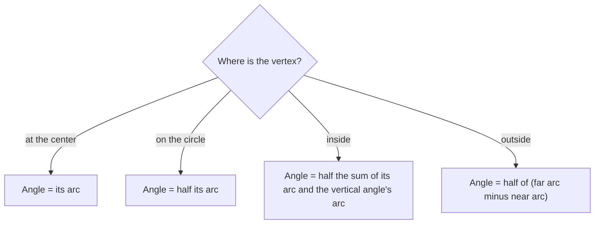

A central angle has its vertex at the center and equals its arc. But angles in circle problems can have their vertex anywhere: on the circle, inside it, or outside it. This lesson shows that in every case the angle is determined by the arcs it cuts off, and the rules come in a neat family: the sum of the arcs halved (vertex on or inside the circle) or the difference halved (vertex outside).

## Inscribed angles

An **inscribed angle** has its vertex on the circle and its sides are chords. The arc inside the angle is its **intercepted arc**.

**Inscribed Angle Theorem.** An inscribed angle measures half its intercepted arc:

$$m\angle ABC = \tfrac12 m\overset{\frown}{AC}.$$

*Proof of the main case.* Suppose one side, $\overline{BC}$, is a diameter through the center $O$. Then $\triangle OAB$ is isosceles ($OA = OB$, radii), so its base angles are equal: $m\angle OAB = m\angle OBA = x$. The central angle $\angle AOC$ is an exterior angle of $\triangle OAB$, so $m\angle AOC = x + x = 2x$. Since $m\overset{\frown}{AC} = m\angle AOC = 2x$, the inscribed angle $x$ is half the arc. The other cases (center inside or outside the angle) follow by adding or subtracting two angles of this kind. $\blacksquare$

```shape
{"circles": [{"center": [0, 0], "r": 5}], "segments": [{"from": [-5, 0], "to": [3, 4]}, {"from": [-5, 0], "to": [3, -4]}, {"from": [0, 0], "to": [3, 4], "dashed": true}, {"from": [0, 0], "to": [3, -4], "dashed": true}], "points": [{"at": [-5, 0], "label": "B"}, {"at": [3, 4], "label": "A"}, {"at": [3, -4], "label": "C"}, {"at": [0, 0], "label": "O"}], "caption": "Inscribed angle ABC is half the central angle AOC; both intercept arc AC."}
```

### Consequences

- **Inscribed angles that intercept the same arc are congruent.** (Each is half that arc.)
- **An angle inscribed in a semicircle is a right angle** (this is **Thales' theorem**): its intercepted arc is $180^\circ$. Conversely, a right inscribed angle intercepts a semicircle, so its hypotenuse is a diameter.
- **Opposite angles of an inscribed quadrilateral are supplementary.** If $ABCD$ is inscribed in a circle (a **cyclic quadrilateral**), $\angle A$ and $\angle C$ intercept arcs that together make the whole circle, so $m\angle A + m\angle C = \tfrac12 (360^\circ) = 180^\circ$.

### Example 1

In $\odot O$, inscribed $\angle PQR$ intercepts $\overset{\frown}{PR}$ of $112^\circ$. Find $m\angle PQR$ and the central angle $\angle POR$.

$m\angle PQR = \tfrac12 \cdot 112 = 56^\circ$, and $m\angle POR = 112^\circ$.

### Example 2

Quadrilateral $ABCD$ is inscribed in a circle with $m\angle A = (3x + 4)^\circ$ and $m\angle C = (5x - 8)^\circ$. Find $m\angle A$.

Opposite angles are supplementary: $8x - 4 = 180$, so $x = 23$ and $m\angle A = 73^\circ$ (and $m\angle C = 107^\circ$).

## Tangent and chord

**Tangent–Chord Theorem.** An angle formed by a tangent and a chord at the point of tangency measures half its intercepted arc.

It's the limiting case of an inscribed angle, where one chord shrinks to the single point of tangency. If a tangent at $A$ and chord $\overline{AB}$ cut off a $150^\circ$ arc, the angle between them is $75^\circ$.

## Vertex inside the circle: two chords

**Theorem.** If two chords intersect inside a circle, each angle formed is half the *sum* of the arcs intercepted by it and its vertical angle:

$$m\angle 1 = \tfrac12 \left(m\overset{\frown}{AB} + m\overset{\frown}{CD}\right).$$

*Why.* Draw a chord to make a triangle in which $\angle 1$ is an exterior angle; the two remote interior angles are inscribed angles worth $\tfrac12$ of each arc.

### Example 3

Chords $\overline{AC}$ and $\overline{BD}$ intersect at $E$. $m\overset{\frown}{AB} = 70^\circ$ and $m\overset{\frown}{CD} = 110^\circ$. Find $m\angle AEB$.

$m\angle AEB = \tfrac12 (70 + 110) = 90^\circ$.

## Vertex outside the circle: secants and tangents

**Theorem.** If two secants, a secant and a tangent, or two tangents meet outside a circle, the angle formed is half the *difference* of the intercepted arcs (far arc minus near arc):

$$m\angle P = \tfrac12 \left(\text{far arc} - \text{near arc}\right).$$

```shape
{"circles": [{"center": [0, 0], "r": 4}], "segments": [{"from": [9, 0], "to": [-3.06, 2.57]}, {"from": [9, 0], "to": [-3.06, -2.57]}], "points": [{"at": [9, 0], "label": "P"}, {"at": [-3.06, 2.57]}, {"at": [-3.06, -2.57]}, {"at": [3.85, 1.1]}, {"at": [3.85, -1.1]}], "caption": "Two secants from P: the angle at P is half the far arc minus half the near arc."}
```

### Example 4

Two secants from $P$ intercept a far arc of $130^\circ$ and a near arc of $40^\circ$. Find $m\angle P$.

$m\angle P = \tfrac12 (130 - 40) = 45^\circ$.

### Example 5

Two tangents from $P$ touch a circle at $A$ and $B$, and the minor arc $\overset{\frown}{AB}$ is $110^\circ$. Find $m\angle P$.

**Step 1.** The major arc is $360 - 110 = 250^\circ$.

**Step 2.** $m\angle P = \tfrac12 (250 - 110) = 70^\circ$.

**Check.** In quadrilateral $OAPB$, the angles at $A$ and $B$ are $90^\circ$ (tangent ⟂ radius) and $\angle AOB = 110^\circ$, so $\angle P = 360 - 90 - 90 - 110 = 70^\circ$ ✓. For two tangents, $m\angle P = 180^\circ - (\text{minor arc})$.

## Summary

| Vertex | Angle equals |
|---|---|
| Center | the arc |
| On the circle (inscribed, or tangent–chord) | $\tfrac12$ arc |
| Inside the circle | $\tfrac12$ (sum of the two arcs) |
| Outside the circle | $\tfrac12$ (far arc − near arc) |

The four cases side by side, with the intercepted arcs in color (for the outside vertex, the far arc is red and the near arc blue):

![Four circles. Top left: an angle with its vertex at the center, intercepting a red arc; the angle equals the arc. Top right: an angle with its vertex on the circle, intercepting a red arc; the angle is half the arc. Bottom left: two chords crossing inside the circle, with red arcs inside the angle and inside its vertical angle; the angle is half the sum of the arcs. Bottom right: two secants from a point outside the circle, with a red far arc and a blue near arc; the angle is half of far minus near.](images/geo-m7-angle-types.svg)



## Common mistakes

- **Forgetting to halve.** Only central angles equal their arcs.
- **Adding arcs for an outside vertex** (or subtracting for an inside one).
- **Using the wrong arcs for two chords.** Use the arc inside the angle and the arc inside its vertical angle, not the neighbors.
- **Assuming any quadrilateral's opposite angles are supplementary.** That only holds if it's inscribed in a circle.

## Key points

- Inscribed angle $= \tfrac12$ intercepted arc; same arc ⟹ congruent angles.
- An angle inscribed in a semicircle is a right angle.
- Opposite angles of a cyclic quadrilateral are supplementary.
- Chords crossing inside: $\tfrac12$(sum of arcs). Secants/tangents meeting outside: $\tfrac12$(difference of arcs).
