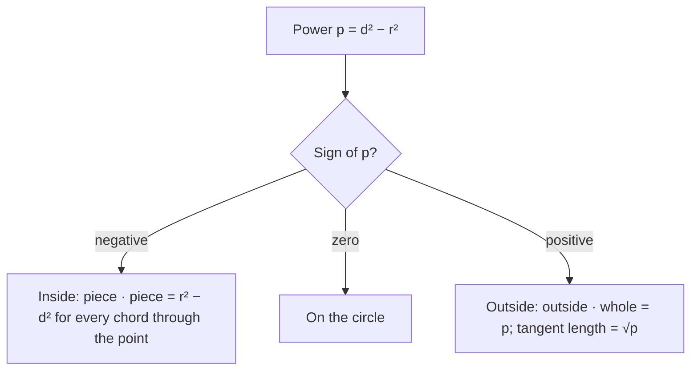

Lesson 30 ended with three product rules (two chords, two secants, a tangent and a secant) and a remark: all three say that for a fixed point $P$ and a fixed circle, the product of the two distances from $P$ to the circle along any line through $P$ is the same. That constant was called the power of a point. This honors lesson takes the remark seriously. We find a formula for the power that needs no chords at all, connect it to the equation of a circle, and use it to answer a question that sounds hard: where are the points that have the *same* power with respect to two different circles? The answer, a straight line called the radical axis, ties together common chords, common tangents and the equation of a circle. The name "power" (German *Potenz*) is due to Jakob Steiner, who introduced it in 1826.

## A formula for the power

Let $\odot O$ have radius $r$, and let $P$ be a point at distance $d = PO$ from the center. Every line through $P$ that meets the circle twice gives the same product of distances, so we may pick the most convenient line: the one through the center.

- **$P$ outside** ($d > r$). The line $PO$ meets the circle at distances $d - r$ and $d + r$ from $P$. Their product is $(d - r)(d + r) = d^2 - r^2$.
- **$P$ inside** ($d < r$). The line $PO$ meets the circle at distances $r - d$ and $r + d$ (on opposite sides of $P$). Their product is $r^2 - d^2$.
- **$P$ on the circle.** One of the distances is 0.

To handle all three cases with one formula, define the **power of a point** $P$ with respect to the circle as

$$\operatorname{pow}(P) = d^2 - r^2.$$

This is a **signed power**: it is positive outside the circle, zero on it and negative inside. Its size is the constant product from Lesson 30, so

- outside: outside $\cdot$ whole $= d^2 - r^2$ for every secant, and the tangent length is $t = \sqrt{d^2 - r^2}$ (this is just the Pythagorean theorem in the right triangle $OTP$);
- inside: piece $\cdot$ piece $= r^2 - d^2$ for every chord through $P$.



### Example 1: chords through an inside point

A circle has radius 10, and $P$ is 6 units from the center. (a) A chord through $P$ has one piece of length 5. How long is the chord? (b) What is the shortest chord through $P$?

**Step 1.** $\operatorname{pow}(P) = 6^2 - 10^2 = -64$. The point is inside, and every chord through $P$ has piece $\cdot$ piece $= 64$.

**Step 2.** (a) The other piece is $64 \div 5 = 12.8$, so the chord is $5 + 12.8 = 17.8$.

**Step 3.** (b) By Lesson 28, a chord is shorter the farther it is from the center. A chord through $P$ is at most $OP = 6$ from the center, and exactly 6 when it is perpendicular to $\overline{OP}$, so that chord is the shortest. The perpendicular from the center bisects it, so its two pieces are equal; their product is 64, so each is $\sqrt{64} = 8$ and the chord is 16. Check with Lesson 28: half-chord $\sqrt{10^2 - 6^2} = 8$. ✓

(The longest chord through $P$ is the diameter, with pieces $10 - 6 = 4$ and $10 + 6 = 16$; again $4 \cdot 16 = 64$.)

## The power in coordinates

If the circle has center $(h, k)$ and radius $r$, the squared distance from $P(x_0, y_0)$ to the center is $(x_0 - h)^2 + (y_0 - k)^2$, so

$$\operatorname{pow}(P) = (x_0 - h)^2 + (y_0 - k)^2 - r^2.$$

That is the left side of the circle's equation, moved to the form "$\ldots = 0$", evaluated at $P$. Expanding, any circle can be written in **general form** $x^2 + y^2 + Dx + Ey + F = 0$, and then

$$\operatorname{pow}(x_0, y_0) = x_0^2 + y_0^2 + Dx_0 + Ey_0 + F.$$

So the inside/on/outside test from Lesson 30 (plug the point in and compare with $r^2$) was really computing the power. One condition matters: the coefficients of $x^2$ and $y^2$ must both be 1. If the equation is $2x^2 + 2y^2 + \ldots = 0$, divide by 2 first.

### Example 2: power from an equation

For the circle $x^2 + y^2 - 4x + 6y - 12 = 0$, find the power of $P(7, 9)$ and of $Q(4, -1)$, and interpret each.

**Step 1.** $\operatorname{pow}(P) = 49 + 81 - 28 + 54 - 12 = 144$. Positive, so $P$ is outside, and a tangent segment from $P$ has length $\sqrt{144} = 12$. A secant from $P$ with external segment 8 has whole length $144 \div 8 = 18$.

**Step 2.** $\operatorname{pow}(Q) = 16 + 1 - 16 - 6 - 12 = -17$. Negative, so $Q$ is inside, and every chord through $Q$ is cut into pieces with product 17.

**Check.** Completing the square gives $(x - 2)^2 + (y + 3)^2 = 25$: center $(2, -3)$, $r = 5$. For $P$, $d^2 = 5^2 + 12^2 = 169$ and $169 - 25 = 144$. ✓ For $Q$, $d^2 = 2^2 + 2^2 = 8$ and $8 - 25 = -17$. ✓

## The radical axis of two circles

Now take two circles that are not concentric. Which points have the same power with respect to both?

**Theorem.** For two circles with different centers, the set of points with equal power with respect to both is a line perpendicular to the line of centers. It is called the **radical axis** of the two circles.

*Proof.* Write the circles in general form, $x^2 + y^2 + D_1x + E_1y + F_1 = 0$ and $x^2 + y^2 + D_2x + E_2y + F_2 = 0$. A point has equal powers exactly when the two left sides are equal there. The $x^2$ and $y^2$ terms cancel, leaving

$$(D_1 - D_2)x + (E_1 - E_2)y + (F_1 - F_2) = 0.$$

The centers are $\left(-\tfrac{D_1}{2}, -\tfrac{E_1}{2}\right)$ and $\left(-\tfrac{D_2}{2}, -\tfrac{E_2}{2}\right)$; they differ, so $D_1 - D_2$ and $E_1 - E_2$ are not both 0, and the equation is a line. The vector $(D_1 - D_2,\; E_1 - E_2)$ is perpendicular to that line, and it is twice the vector from the first center to the second, so the line is perpendicular to the line of centers. $\blacksquare$

(For concentric circles, subtracting leaves $F_1 - F_2 = 0$, which is false when the radii differ: no point has equal powers, and there is no radical axis.)

In practice: **to find the radical axis, write both circles in general form and subtract.**

**What the radical axis looks like.**

- *Circles that cross at $X$ and $Y$.* Both points have power 0 with respect to both circles, so the radical axis is the line $XY$, the line through the **common chord**. You can also see this without coordinates: for any point $P$ on line $XY$ (outside the segment), the line $PXY$ is a secant of *both* circles, so the power with respect to each is the same product $PX \cdot PY$.
- *Circles tangent at $T$.* The radical axis is the common tangent line at $T$.
- *Circles that don't meet.* The radical axis lies between them (when neither is inside the other), and it is *not* the perpendicular bisector of the centers unless the radii are equal.

From a point outside both circles on the radical axis, the two tangent segments are equal, since each is the square root of the same power. That is the picture below.


### Example 3: common chord

Find the radical axis of $x^2 + y^2 = 25$ and $(x - 6)^2 + y^2 = 13$, the common chord's endpoints and its length, and the tangent length from $P(4, 6.5)$ to each circle.

**Step 1.** General forms: $x^2 + y^2 - 25 = 0$ and $x^2 + y^2 - 12x + 23 = 0$.

**Step 2.** Subtract: $(x^2 + y^2 - 25) - (x^2 + y^2 - 12x + 23) = 12x - 48$. Setting it to 0 gives the radical axis $x = 4$, a vertical line, perpendicular to the line of centers (the $x$-axis), as promised.

**Step 3.** On $x = 4$, the first circle gives $16 + y^2 = 25$, so $y = \pm 3$. Check in the second: $(4 - 6)^2 + 9 = 13$. ✓ The common chord runs from $(4, 3)$ to $(4, -3)$ and has length 6.

**Step 4.** $P(4, 6.5)$ is on the axis. Power with respect to the first circle: $16 + 42.25 - 25 = 33.25$; with respect to the second: $16 + 42.25 - 48 + 23 = 33.25$. Both tangent segments have length $\sqrt{33.25} \approx 5.77$.

```plot
{"x": [-6, 11], "y": [-7, 8], "equal": true, "circles": [{"center": [0, 0], "r": 5}, {"center": [6, 0], "r": 3.6056}], "segments": [{"from": [4, -7], "to": [4, 8], "dashed": true}], "points": [{"at": [0, 0], "label": "(0, 0)"}, {"at": [6, 0], "label": "(6, 0)"}, {"at": [4, 3]}, {"at": [4, -3]}, {"at": [4, 6.5], "label": "P"}], "labels": [{"at": [5.8, 4.4], "text": "(4, 3)"}, {"at": [5.8, -4.7], "text": "(4, −3)"}, {"at": [5.6, -6.2], "text": "x = 4"}], "caption": "Example 3: x² + y² = 25 and (x − 6)² + y² = 13. The radical axis x = 4 contains their common chord."}
```

## Three circles: the radical center

**Theorem.** If three circles have centers that are not collinear, their three radical axes (one for each pair) meet at one point, the **radical center**.

*Why.* The centers are not collinear, so the axis of circles 1 and 2 and the axis of circles 2 and 3 are not parallel (each is perpendicular to a different line of centers). Let them meet at $Q$. Then $\operatorname{pow}_1(Q) = \operatorname{pow}_2(Q)$ and $\operatorname{pow}_2(Q) = \operatorname{pow}_3(Q)$, so $\operatorname{pow}_1(Q) = \operatorname{pow}_3(Q)$: $Q$ is on the third axis too. $\blacksquare$

One consequence: if three circles cross each other in pairs, their three common chords (extended as lines) pass through one point. If the centers are collinear, the axes are all perpendicular to that one line, so they are parallel or the same line, and there may be no radical center.

### Example 4: a radical center

Find the radical center of $x^2 + y^2 = 9$, $(x - 8)^2 + y^2 = 1$ and $x^2 + (y - 8)^2 = 1$, and the common tangent length from it.

**Step 1.** General forms: $x^2 + y^2 - 9 = 0$, $x^2 + y^2 - 16x + 63 = 0$, $x^2 + y^2 - 16y + 63 = 0$.

**Step 2.** Circles 1 and 2: subtracting gives $16x - 72 = 0$, so $x = 4.5$. Circles 1 and 3: $16y - 72 = 0$, so $y = 4.5$.

**Step 3.** The radical center is $(4.5, 4.5)$. Check with circles 2 and 3: subtracting gives $-16x + 16y = 0$, the line $y = x$, which passes through $(4.5, 4.5)$. ✓

**Step 4.** Its power: $4.5^2 + 4.5^2 - 9 = 31.5$ (the same for all three circles). Tangent segments from $(4.5, 4.5)$ to all three circles have length $\sqrt{31.5} \approx 5.61$. The circle with that center and radius $\sqrt{31.5}$ crosses all three circles at right angles, because at each crossing point its radius is a tangent segment to the other circle.

## Common mistakes

- **Plugging into an equation that isn't in general form.** The power is the value of $x^2 + y^2 + Dx + Ey + F$ with both square terms having coefficient 1 and the right side 0. Plugging into $(x - h)^2 + (y - k)^2 = r^2$ without subtracting $r^2$ gives $d^2$, not the power.
- **Dropping the sign.** A negative power means the point is inside; there is no tangent from it, and $\sqrt{\text{power}}$ is meaningless.
- **Thinking the radical axis is halfway between the centers.** It is only when the radii are equal. In Example 3 the centers are at $x = 0$ and $x = 6$, but the axis is $x = 4$.
- **Subtracting circles written with different leading coefficients.** Divide each equation so $x^2$ and $y^2$ have coefficient 1 before subtracting, or the square terms won't cancel.
- **Looking for a radical axis of concentric circles.** There is none.

## Key points

- Power of $P$: $\operatorname{pow}(P) = d^2 - r^2$, where $d$ is the distance from $P$ to the center. Positive outside, 0 on the circle, negative inside.
- Outside: outside $\cdot$ whole $=$ power, tangent $= \sqrt{\text{power}}$. Inside: piece $\cdot$ piece $= r^2 - d^2$.
- For $x^2 + y^2 + Dx + Ey + F = 0$, the power of $(x_0, y_0)$ is $x_0^2 + y_0^2 + Dx_0 + Ey_0 + F$.
- The radical axis of two non-concentric circles is the line of equal power; subtract the general forms to find it. It is perpendicular to the line of centers and contains the common chord (or common tangent) when the circles meet.
- Tangent segments to two circles from a point on their radical axis are equal.
- Three circles with non-collinear centers have a radical center, where all three axes meet.
