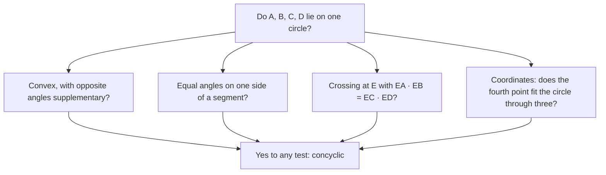

Lesson 29 proved that the opposite angles of a quadrilateral inscribed in a circle are supplementary, and Lesson 30 proved that crossing chords cut each other into pieces with equal products. Both theorems *start* from a circle. This honors lesson runs them backward: given four points, how can you tell whether they lie on one circle? Points that do are called **concyclic**. Recognizing concyclic points is one of the most useful moves in geometry problems, because once you find a hidden circle, every inscribed-angle fact from Lesson 29 becomes available. The second half of the lesson studies the circle through the three vertices of a triangle and finds its radius, which turns out to be the number hiding in the Law of Sines.

## Three points, then four

Three points that are not collinear always lie on exactly one circle. Its center is equidistant from all three, so it lies on the perpendicular bisector of each segment joining them; Lesson 15 showed these bisectors meet at one point, the circumcenter. Three collinear points lie on no circle, because a line meets a circle at most twice.

A fourth point is different: it may or may not land on the circle through the first three. A rectangle's four vertices are concyclic (the diagonals are diameters), but a non-rectangular parallelogram's are not. We need tests.

## Test 1: opposite angles

**Theorem.** A convex quadrilateral is cyclic if and only if a pair of opposite angles is supplementary. (Then the other pair is too, since the four angles sum to $360^\circ$.)

The "only if" half is Lesson 29. The converse rests on the next test, so we prove it after Test 2.

## Test 2: equal angles on one side

From Lesson 29, inscribed angles that intercept the same arc are congruent. Turned around: points on the same arc see a chord at the same angle. The converse is also true.

**Theorem.** If $C$ and $D$ are on the same side of line $AB$ and $\angle ACB \cong \angle ADB$, then $A$, $B$, $C$ and $D$ are concyclic.

*Proof sketch.* Draw the circle through $A$, $B$ and $C$. Suppose $D$ were inside it. Extend $\overline{AD}$ past $D$ to meet the circle at $D'$. Then $\angle ADB$ is an exterior angle of $\triangle DD'B$, so it is larger than the remote interior angle $\angle AD'B$. But $\angle AD'B \cong \angle ACB$ (inscribed angles on the same arc $\overset{\frown}{AB}$), so $\angle ADB > \angle ACB$, a contradiction. A similar argument rules out $D$ outside the circle, where the angle comes out smaller. So $D$ is on the circle. $\blacksquare$

The phrase "same side" matters. Points of the circle on the *other* side of $\overline{AB}$ see it at the supplementary angle, $180^\circ - m\angle ACB$.

*Proof of Test 1's converse.* Suppose convex $ABCD$ has $m\angle B + m\angle D = 180^\circ$. Draw the circle through $A$, $B$, $C$ and pick any point $E$ on its arc $\overset{\frown}{AC}$ that doesn't contain $B$. Quadrilateral $ABCE$ is inscribed, so $m\angle AEC = 180^\circ - m\angle B = m\angle D$. Because $ABCD$ is convex, $D$ is on the same side of $\overline{AC}$ as $E$ (the side away from $B$). By Test 2, $D$ is on the circle. $\blacksquare$

### Example 1: finding a hidden circle

In convex quadrilateral $ABCD$, $m\angle BAC = 35^\circ$, $m\angle BDC = 35^\circ$ and $m\angle ABC = 100^\circ$. Find $m\angle ADC$.

**Step 1.** $A$ and $D$ are on the same side of $\overline{BC}$ (the quadrilateral is convex) and see $\overline{BC}$ at equal angles, $35^\circ$. By Test 2, $A$, $B$, $C$, $D$ are concyclic.

**Step 2.** So $ABCD$ is a cyclic quadrilateral, and its opposite angles are supplementary: $m\angle ADC = 180^\circ - 100^\circ = 80^\circ$.

Without spotting the circle, this problem has too little information to solve.

## Test 3: products of pieces

**Theorem (converse of the Intersecting Chords Theorem).** If segments $\overline{AB}$ and $\overline{CD}$ cross at $E$ and $EA \cdot EB = EC \cdot ED$, then $A$, $B$, $C$, $D$ are concyclic.

*Proof.* Rewrite the equation as $\tfrac{EA}{ED} = \tfrac{EC}{EB}$. The angles $\angle AEC$ and $\angle DEB$ are vertical, so $\triangle AEC \sim \triangle DEB$ by SAS similarity. Corresponding angles give $\angle CAB \cong \angle CDB$. These angles at $A$ and $D$ both look at segment $\overline{CB}$, and $A$ and $D$ are on the same side of line $CB$, so Test 2 finishes the proof. $\blacksquare$

The same converse holds for secants (Lesson 30): if rays from $P$ pass through $A$ then $B$, and through $C$ then $D$, with $PA \cdot PB = PC \cdot PD$, the four points are concyclic.

### Example 2

Segments $\overline{AB}$ and $\overline{CD}$ cross at $E$. Are the four endpoints concyclic if (a) $EA = 4$, $EB = 9$, $EC = 6$, $ED = 6$; (b) $EA = 4$, $EB = 9$, $EC = 6$, $ED = 5$?

(a) $4 \cdot 9 = 36$ and $6 \cdot 6 = 36$. Equal, so yes.

(b) $36$ versus $30$. Not equal. Since the Intersecting Chords Theorem says concyclic points *must* give equal products, these four points are not concyclic.

## Which quadrilaterals are cyclic?

Test 1 sorts the special quadrilaterals of Lesson 19:

| Quadrilateral | Always cyclic? | Why |
|---|---|---|
| Rectangle, square | Yes | All angles $90^\circ$; opposite angles sum to $180^\circ$ |
| Isosceles trapezoid | Yes | Angles along a leg are supplementary and base angles are equal, so opposite angles are supplementary |
| Parallelogram | Only if it is a rectangle | Opposite angles are equal, so supplementary means $90^\circ$ each |
| Rhombus | Only if it is a square | It's a parallelogram |
| Kite | Only if its two equal angles are right angles | The equal pair of opposite angles must sum to $180^\circ$ |
| Trapezoid that isn't isosceles | Never | Its base angles differ, so opposite angles aren't supplementary |

(For the trapezoid row: with bases parallel, $m\angle A + m\angle D = 180^\circ$ for consecutive angles on one leg; if also $m\angle A + m\angle C = 180^\circ$, then $\angle C \cong \angle D$, and a trapezoid with congruent base angles is isosceles.)

## The circumradius and the Law of Sines

The circle through a triangle's vertices is its circumscribed circle, and its radius $R$ is the **circumradius**. Lesson 25 proved that $\tfrac{a}{\sin A} = \tfrac{b}{\sin B} = \tfrac{c}{\sin C}$ but never said what that common value is. Here is the answer.

**Extended Law of Sines.** In any triangle with circumradius $R$,

$$\frac{a}{\sin A} = \frac{b}{\sin B} = \frac{c}{\sin C} = 2R.$$

*Proof.* Draw the diameter from $B$ through the center $O$, ending at $A'$, so $BA' = 2R$.

- *If $\angle A$ is acute,* $A'$ and $A$ are on the same arc cut off by $\overline{BC}$, so $\angle BA'C \cong \angle A$ (same intercepted arc). Since $\overline{BA'}$ is a diameter, $\angle BCA' = 90^\circ$ (Thales). In right triangle $BCA'$, $\sin A = \sin\angle BA'C = \tfrac{BC}{BA'} = \tfrac{a}{2R}$.
- *If $\angle A$ is obtuse,* $A'$ is on the other side of $\overline{BC}$, so $ABA'C$ is a cyclic quadrilateral and $m\angle BA'C = 180^\circ - m\angle A$. Since $\sin(180^\circ - A) = \sin A$ (Lesson 25), the same equation holds.
- *If $\angle A$ is right,* $a$ is a diameter: $a = 2R$ and $\sin A = 1$.

In every case $\tfrac{a}{\sin A} = 2R$, and the same argument works for each side. $\blacksquare$

So the Law of Sines ratio is the circumcircle's diameter. For a right triangle, $R = \tfrac{c}{2}$, half the hypotenuse, which matches Thales' theorem.

**A formula from the sides.** The area of a triangle is $K = \tfrac12 bc\sin A$ (the height to side $b$ is $c\sin A$; Lesson 31 develops this). Substituting $\sin A = \tfrac{a}{2R}$ gives $K = \tfrac{abc}{4R}$, so

$$R = \frac{abc}{4K}.$$

### Example 3: circumradius from a side and its angle

In $\triangle ABC$, $a = 12$, $m\angle A = 40^\circ$ and $m\angle B = 75^\circ$. Find $R$ and $b$.

**Step 1.** $2R = \dfrac{12}{\sin 40^\circ} \approx \dfrac{12}{0.6428} \approx 18.67$, so $R \approx 9.33$.

**Step 2.** $b = 2R \sin B \approx 18.669 \cdot \sin 75^\circ \approx 18.03$. (Keep $2R$ unrounded until the end.)

### Example 4: the 13–14–15 triangle

Find the circumradius of a triangle with sides 13, 14 and 15.

**Step 1. Area.** Drop the altitude to the side of length 14. It splits that side into pieces $x$ and $14 - x$ with $13^2 - x^2 = 15^2 - (14 - x)^2$. Expanding, $169 - x^2 = 225 - 196 + 28x - x^2$, so $28x = 140$ and $x = 5$. The altitude is $\sqrt{13^2 - 5^2} = 12$, and $K = \tfrac12 \cdot 14 \cdot 12 = 84$.

**Step 2.** $R = \dfrac{13 \cdot 14 \cdot 15}{4 \cdot 84} = \dfrac{2730}{336} = \dfrac{65}{8} = 8.125$.

**Check.** The angle opposite the side 13 is at the end of the base where the side 15 meets it, so its sine is $\tfrac{12}{15} = 0.8$. The extended Law of Sines gives $\tfrac{13}{0.8} = 16.25 = 2R$. ✓

## The circle through three points in coordinates

To find the circle through three given points, write it in general form $x^2 + y^2 + Dx + Ey + F = 0$ and substitute each point. That gives three linear equations in $D$, $E$, $F$. (Lesson 15's method, intersecting two perpendicular bisectors, also works.) The same equation then tests a fourth point: it is on the circle exactly when its power (honors lesson on the radical axis) is 0.

### Example 5

Find the circle through $(5, 7)$, $(-1, 7)$ and $(6, 0)$. Then decide whether $(2, -2)$ and $(-2, 3)$ are on it.

**Step 1.** Substituting:

$$\begin{aligned} 74 + 5D + 7E + F &= 0 \\ 50 - D + 7E + F &= 0 \\ 36 + 6D + F &= 0 \end{aligned}$$

**Step 2.** Subtract the second equation from the first: $24 + 6D = 0$, so $D = -4$. The third gives $F = -36 - 6D = -12$. The second gives $7E = -50 + D - F = -42$, so $E = -6$.

**Step 3.** The circle is $x^2 + y^2 - 4x - 6y - 12 = 0$, which is $(x - 2)^2 + (y - 3)^2 = 25$: center $(2, 3)$, radius 5.

**Step 4.** $(2, -2)$: $4 + 4 - 8 + 12 - 12 = 0$, so it is on the circle, and the four points are concyclic. $(-2, 3)$: $4 + 9 + 8 - 18 - 12 = -9$, so it is inside; those four points are not concyclic.

## Common mistakes

- **Using Test 2 with points on opposite sides.** Equal angles prove concyclic only when the two vertices are on the same side of the segment they look at.
- **Assuming any quadrilateral with a right angle, or any parallelogram, is cyclic.** Check opposite angles.
- **Calling a quadrilateral cyclic because one pair of *adjacent* angles is supplementary.** That happens in every trapezoid and says nothing about a circle.
- **Forgetting the 2 in $\tfrac{a}{\sin A} = 2R$.** The ratio is the diameter, not the radius.
- **Rounding $R$ early** and then using it to find other sides.

## Key points

- Three non-collinear points determine exactly one circle; four points may or may not be **concyclic**.
- A convex quadrilateral is cyclic if and only if its opposite angles are supplementary.
- Two points on the same side of $\overline{AB}$ that see it at equal angles are concyclic with $A$ and $B$.
- If $\overline{AB}$ and $\overline{CD}$ cross at $E$ with $EA \cdot EB = EC \cdot ED$, the four points are concyclic.
- Rectangles and isosceles trapezoids are always cyclic; other parallelograms and trapezoids never are.
- Extended Law of Sines: $\tfrac{a}{\sin A} = \tfrac{b}{\sin B} = \tfrac{c}{\sin C} = 2R$; also $R = \tfrac{abc}{4K}$.
