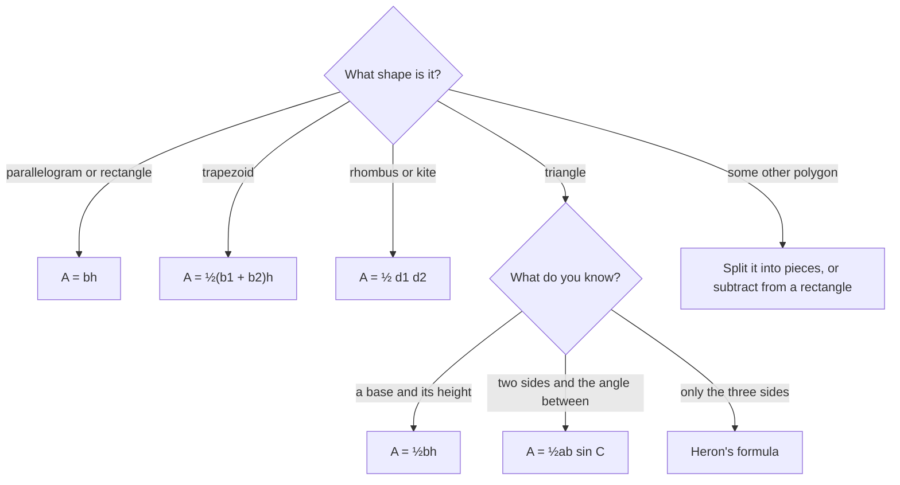

Perimeter measures the distance around a figure; area measures how much surface it covers. This lesson builds every standard polygon area formula from one starting point, the area of a rectangle, by cutting and rearranging. Knowing *where* each formula comes from means you never have to memorize one blindly, and you can handle composite shapes that no formula covers.

## Perimeter and area

The **perimeter** of a polygon is the sum of its side lengths. The **area** of a region is the number of unit squares that cover it, measured in square units (cm², ft², …).

Two postulates underlie all area work:

- **Area Congruence Postulate.** Congruent figures have equal areas.
- **Area Addition Postulate.** The area of a region is the sum of the areas of its non-overlapping parts.

And one starting formula: a **rectangle** with base $b$ and height $h$ has area $A = bh$ (count the rows of unit squares).

## Parallelograms and triangles

**Parallelogram.** Cut a right triangle off one end of a parallelogram and slide it to the other end. The result is a rectangle with the same base and height, so

$$A = bh,$$

where $h$ is the *perpendicular* height, not the slanted side.

```shape
{"polygons": [{"points": [[0, 0], [8, 0], [10, 4], [2, 4]]}], "segments": [{"from": [2, 4], "to": [2, 0], "dashed": true, "label": "h"}], "rightAngles": [[[2, 0], [8, 0], [2, 4]]], "labels": [{"at": [4, -0.6], "text": "b"}], "caption": "A parallelogram has the same area as a rectangle with the same base and height."}
```

**Triangle.** Two copies of any triangle fit together into a parallelogram with the same base and height. So a triangle is half a parallelogram:

$$A = \tfrac12 bh.$$

Any side can be the base, as long as the height is the altitude to that side. For an obtuse triangle, the altitude may fall outside.

### Example 1

A triangle has base 14 and height 9. A parallelogram has base 14, slanted side 10, and height 9. Find both areas.

Triangle: $\tfrac12 \cdot 14 \cdot 9 = 63$. Parallelogram: $14 \cdot 9 = 126$. The slanted side 10 is a distractor; it's only needed for the perimeter ($2 \cdot 14 + 2 \cdot 10 = 48$).

## Trapezoids

Two copies of a trapezoid, one flipped, fit together into a parallelogram with base $b_1 + b_2$ and the same height. Half of that is

$$A = \tfrac12 (b_1 + b_2) h.$$

Equivalently, area $=$ midsegment × height, since the midsegment is $\tfrac{b_1 + b_2}{2}$.

The picture names the parts of a trapezoid. Only the two bases and the height go into the area formula; the legs matter only for the perimeter (or for finding a missing height, as in Example 2).


### Example 2

A trapezoid has bases 9 and 15 and legs of 5 (isosceles). Find its area.

**Step 1.** The height isn't given. Dropping perpendiculars from the ends of the short base cuts off two right triangles, each with base $\tfrac{15 - 9}{2} = 3$ and hypotenuse 5.

**Step 2.** Height $= \sqrt{5^2 - 3^2} = 4$.

**Step 3.** $A = \tfrac12 (9 + 15)(4) = 48$.

## Rhombuses and kites

The diagonals of a rhombus or kite are perpendicular. They split the figure into four right triangles, which together fill exactly half of the rectangle drawn around the diagonals. So

$$A = \tfrac12 d_1 d_2.$$

### Example 3

A kite has diagonals 10 and 16. Find its area.

$A = \tfrac12 \cdot 10 \cdot 16 = 80$.

## Triangles from two sides and an angle

If you know two sides $a$ and $b$ and the included angle $C$, the height to side $a$ is $b\sin C$ (right-triangle trigonometry). So

$$A = \tfrac12 ab \sin C.$$

### Example 4

Find the area of a triangle with sides 8 and 11 and included angle $50^\circ$.

$A = \tfrac12 \cdot 8 \cdot 11 \cdot \sin 50^\circ \approx 44 \cdot 0.7660 \approx 33.71$.

**Heron's formula** (for the curious) finds the area from the three sides alone: with $s = \tfrac{a + b + c}{2}$, $A = \sqrt{s(s - a)(s - b)(s - c)}$. For a 13-14-15 triangle, $s = 21$ and $A = \sqrt{21 \cdot 8 \cdot 7 \cdot 6} = \sqrt{7056} = 84$.

## Composite figures and coordinates

A **composite figure** is made of simpler shapes. Find its area by adding the pieces, or by subtracting a missing piece from a larger shape.

### Example 5

An L-shaped room is a $12 \times 10$ rectangle with a $5 \times 4$ rectangle cut from one corner. Find its area and perimeter.

**Area:** $12 \cdot 10 - 5 \cdot 4 = 120 - 20 = 100$.

**Perimeter:** cutting a rectangular notch from a corner doesn't change the perimeter: the two new inside edges (5 and 4) exactly replace the two pieces removed from the outside. So the perimeter is still $2(12 + 10) = 44$.

For a polygon drawn on a grid, you can also enclose it in a rectangle and subtract the right triangles around it.

### Example 6: a triangle on a grid

Find the area of the triangle with vertices $(1, 1)$, $(7, 3)$ and $(3, 6)$.

**Step 1.** Enclose it in the rectangle from $x = 1$ to $7$ and $y = 1$ to $6$: area $6 \cdot 5 = 30$.

**Step 2.** Subtract the three right triangles in the corners: $\tfrac12 \cdot 6 \cdot 2 = 6$ (bottom), $\tfrac12 \cdot 4 \cdot 3 = 6$ (right), and $\tfrac12 \cdot 2 \cdot 5 = 5$ (left).

**Step 3.** $30 - 6 - 6 - 5 = 13$.

```plot
{"x": [0, 8], "y": [0, 7], "equal": true, "polygons": [{"points": [[1, 1], [7, 3], [3, 6]], "fill": true}], "segments": [{"from": [1, 1], "to": [7, 1], "dashed": true}, {"from": [7, 1], "to": [7, 6], "dashed": true}, {"from": [7, 6], "to": [1, 6], "dashed": true}, {"from": [1, 6], "to": [1, 1], "dashed": true}], "points": [{"at": [1, 1]}, {"at": [7, 3], "label": "(7, 3)"}, {"at": [3, 6], "label": "(3, 6)"}], "labels": [{"at": [0.55, 0.45], "text": "(1, 1)"}, {"at": [5.2, 1.6], "text": "6"}, {"at": [5.6, 4.9], "text": "6"}, {"at": [1.6, 4.4], "text": "5"}], "caption": "The 6 × 5 rectangle around the triangle; the three corner right triangles (areas 6, 6 and 5) are cut away, leaving 13."}
```

## Choosing a formula

The chart sums up which formula to reach for. When none fits, cut the figure into pieces or subtract it from a rectangle.



## Common mistakes

- **Using a slanted side as the height.** Height is always perpendicular to the base.
- **Forgetting the $\tfrac12$** for triangles, trapezoids, rhombuses and kites.
- **Mixing units.** Area is in *square* units; convert lengths first (1 ft = 12 in, so 1 ft² = 144 in²).
- **Adding all four sides of a trapezoid** in the area formula; only the bases go in.

## Key points

- Rectangle and parallelogram: $A = bh$. Triangle: $A = \tfrac12 bh$.
- Trapezoid: $A = \tfrac12(b_1 + b_2)h$. Rhombus or kite: $A = \tfrac12 d_1 d_2$.
- With two sides and the included angle: $A = \tfrac12 ab\sin C$.
- Composite figures: add pieces or subtract holes.
