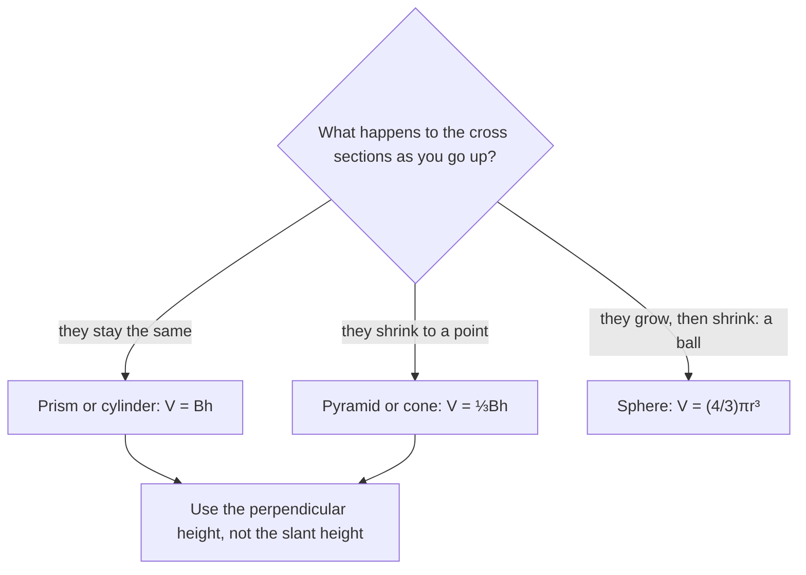

Surface area measures the skin of a solid; **volume** measures how much space it fills, in cubic units. This lesson starts from the volume of a box, extends it to every prism and cylinder with Cavalieri's principle, and then explains the mysterious $\tfrac13$ in pyramid and cone formulas and the $\tfrac43$ for the sphere.

## Prisms and cylinders

A box $\ell \times w \times h$ holds $\ell w$ unit cubes in its bottom layer and $h$ layers, so $V = \ell w h$. Since $\ell w$ is the base area $B$:

$$V = Bh.$$

The same layer-by-layer idea works for any prism or cylinder: each horizontal slice is a copy of the base. For a cylinder, $B = \pi r^2$:

$$V_{\text{cylinder}} = \pi r^2 h.$$

## Cavalieri's principle

What about an oblique (slanted) prism or cylinder, or a stack of coins pushed sideways?

**Cavalieri's Principle.** If two solids have the same height, and every horizontal cross section of one has the same area as the corresponding cross section of the other at the same level, then the solids have equal volumes.

```shape
{"polygons": [{"points": [[0, 0], [4, 0], [4, 5], [0, 5]]}, {"points": [[7, 0], [11, 0], [13, 5], [9, 5]]}], "segments": [{"from": [-0.5, 2.5], "to": [13.5, 2.5], "dashed": true}], "caption": "Same height, same cross-section area at every level ⇒ same volume (Cavalieri)."}
```

So an oblique cylinder has the same volume $\pi r^2 h$ as a right cylinder with the same base and height, where $h$ is the *perpendicular* height. Think of a deck of cards pushed into a slant: same cards, same volume.

## Pyramids and cones

A pyramid's volume is one-third of the prism with the same base and height:

$$V_{\text{pyramid}} = \tfrac13 Bh, \qquad V_{\text{cone}} = \tfrac13 \pi r^2 h.$$

Which formula applies depends on the solid's shape:



*Where the $\tfrac13$ comes from.* A cube can be cut into three congruent square pyramids, each with the cube's face as base and the cube's edge as height (all three share one corner of the cube as their apex). So each is $\tfrac13$ of the cube. Cavalieri's principle then extends the $\tfrac13$ to every pyramid with the same base area and height, and cones are the limit of pyramids. You can test it by filling a cone with water: three cones fill the cylinder with the same base and height.

### Example 1

A cone has radius 6 and height 10. Find its volume.

$V = \tfrac13 \pi (36)(10) = 120\pi \approx 376.99$.

### Example 2

A square pyramid has base edge 9 and slant height 7.5. Find its volume.

The picture shows the right triangle that connects the two heights: the height $h$, half the base edge $\tfrac{s}{2}$, and the slant height $\ell$ up the middle of a face. A lateral edge (from the apex to a corner of the base) is longer than the slant height, so don't mix them up either.


**Step 1.** We need the height, not the slant height. The height, half the base edge and the slant height form a right triangle: $h = \sqrt{7.5^2 - 4.5^2} = \sqrt{56.25 - 20.25} = \sqrt{36} = 6$.

**Step 2.** $V = \tfrac13 (81)(6) = 162$.

## Spheres

$$V_{\text{sphere}} = \tfrac43 \pi r^3.$$

A neat way to remember the $\tfrac13$ and the $\tfrac43$: a cone, a sphere and a cylinder with the same radius $r$ and the same height $2r$ have volumes $\tfrac23 \pi r^3$, $\tfrac43 \pi r^3$ and $2\pi r^3$, in the ratio $1 : 2 : 3$.


*Archimedes' argument (via Cavalieri).* Compare a hemisphere of radius $r$ with a cylinder of radius $r$ and height $r$ that has a cone (apex down) removed from it. At height $y$, the hemisphere's cross section is a circle of radius $\sqrt{r^2 - y^2}$, with area $\pi(r^2 - y^2)$. The other solid's cross section is a ring: the cylinder's circle $\pi r^2$ minus the cone's circle $\pi y^2$, again $\pi(r^2 - y^2)$. Equal cross sections at every level, so equal volumes:

$$V_{\text{hemisphere}} = \pi r^2 \cdot r - \tfrac13 \pi r^2 \cdot r = \tfrac23 \pi r^3.$$


Doubling gives the sphere: $\tfrac43 \pi r^3$. Archimedes was so pleased with this result that he asked for a sphere inside a cylinder to be carved on his tomb.

### Example 3

A spherical tank has diameter 6 m. How much does it hold?

$r = 3$: $V = \tfrac43 \pi (27) = 36\pi \approx 113.10$ m³.

### Example 4

An ice cream cone (a cone of radius 3 cm and height 10 cm) is topped with a hemisphere of the same radius. Find the total volume.

Cone: $\tfrac13 \pi (9)(10) = 30\pi$. Hemisphere: $\tfrac23 \pi (27) = 18\pi$. Total: $48\pi \approx 150.80$ cm³.

## Similar solids

From Lesson 20: if two solids are similar with scale factor $k$, their surface areas have ratio $k^2$ and their volumes $k^3$.

### Example 5

Two similar cones have heights 4 and 10. The smaller has volume $24\pi$. Find the larger's volume.

$k = \tfrac{10}{4} = 2.5$, so $V = 24\pi \cdot 2.5^3 = 24\pi \cdot 15.625 = 375\pi$.

## Density and units

Volume often feeds a further calculation. **Density** is mass per unit volume, so mass $=$ density × volume. A steel ball (density 7.85 g/cm³) of radius 2 cm has volume $\tfrac{32}{3}\pi \approx 33.51$ cm³ and mass about $263$ g. Remember that 1 m³ $= 100^3 = 1{,}000{,}000$ cm³, and 1 L $= 1000$ cm³.

### Example 6: a hollow pipe

A pipe is 2 m long, with outer radius 5 cm and inner radius 4 cm. How much material is in it?

Work in centimeters: $V = \pi(5^2)(200) - \pi(4^2)(200) = \pi(25 - 16)(200) = 1800\pi \approx 5654.87$ cm³. As with the ring in Lesson 32, subtract the volumes, not the radii.

## Common mistakes

- **Using slant height in a volume formula.** Volume needs the perpendicular height.
- **Forgetting the $\tfrac13$** for pyramids and cones.
- **Using $r^2$ for spheres.** Volume has $r^3$.
- **Converting cubic units linearly.** 1 m³ is a million cm³, not a hundred.

## Key points

- Prism and cylinder: $V = Bh$ (cylinder $\pi r^2 h$), oblique or right, by Cavalieri's principle.
- Pyramid and cone: $V = \tfrac13 Bh$ (cone $\tfrac13 \pi r^2 h$).
- Sphere: $V = \tfrac43 \pi r^3$.
- Similar solids: volumes scale by $k^3$.
