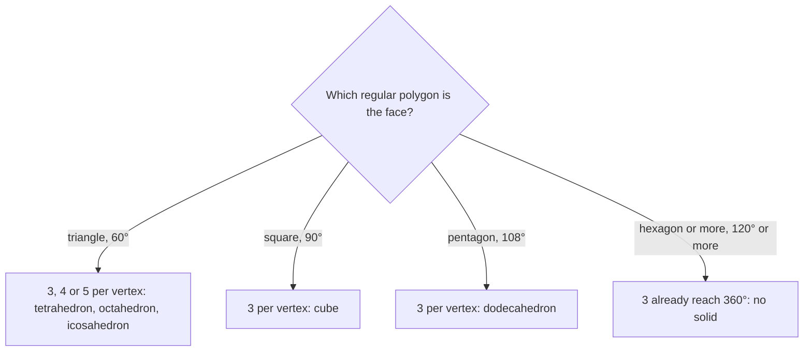

Lesson 33 named the polyhedra and checked Euler's formula, $V - E + F = 2$, on a cube and a square pyramid. This lesson asks a question the ancient Greeks asked: how many perfectly regular solids are there? The answer is exactly five, and the reason is a short argument about the angles at a corner. The same angles lead to a second counting rule, Descartes' theorem, which explains why every soccer ball has exactly 12 pentagons.

## Regular polyhedra

A **regular polyhedron** is a convex polyhedron in which

1. every face is the same regular polygon, and
2. the same number of faces meet at every vertex.

Regular polyhedra are also called Platonic solids, after Plato, whose dialogue *Timaeus* matched four of them with the four classical elements (fire, earth, air, water). There are exactly five:

| Solid | Faces | Faces at each vertex | $V$ | $E$ | $F$ |
|---|---|---|---|---|---|
| Tetrahedron | triangles | 3 | 4 | 6 | 4 |
| Cube | squares | 3 | 8 | 12 | 6 |
| Octahedron | triangles | 4 | 6 | 12 | 8 |
| Dodecahedron | pentagons | 3 | 20 | 30 | 12 |
| Icosahedron | triangles | 5 | 12 | 30 | 20 |

Both conditions matter. Glue two tetrahedra together face to face and you get a **bipyramid** (two pyramids joined base to base) with six congruent equilateral faces. It is not regular: three faces meet at each of the two tips, but four meet at each of the three vertices around the middle.

## Why there are only five

Look at one vertex of a convex polyhedron. At least three faces must meet there (two faces would only make a fold, not a corner). And the face angles at the vertex must add up to *less than* $360^\circ$. If they added to exactly $360^\circ$, the faces would lie flat in a plane; if more, they could not fit around a point without buckling inward. Cut along one edge and press a corner flat, and you see a gap where the missing angle is.

Now test each kind of regular face. An interior angle of a regular $n$-gon is $\tfrac{(n - 2)180^\circ}{n}$ (Lesson 17).

- **Triangles** ($60^\circ$): 3, 4 or 5 at a vertex give $180^\circ$, $240^\circ$, $300^\circ$. Six give $360^\circ$, which is flat. So three solids: tetrahedron, octahedron, icosahedron.
- **Squares** ($90^\circ$): 3 give $270^\circ$; 4 give $360^\circ$. One solid: the cube.
- **Pentagons** ($108^\circ$): 3 give $324^\circ$; 4 give $432^\circ$. One solid: the dodecahedron.
- **Hexagons** ($120^\circ$): 3 already give $360^\circ$. None.
- **Seven or more sides**: each angle is more than $120^\circ$, so even 3 of them pass $360^\circ$. None.

That leaves at most five possibilities, and all five really exist. The argument closes Euclid's *Elements*: its last book constructs the five solids and then shows there are no others.

## Counting edges and vertices

You can find $E$ and $V$ from the faces alone. Every edge is shared by exactly two faces, so if you add up the sides of all the faces you count each edge twice. If every vertex has $q$ faces around it, adding up the corners of all the faces counts each vertex $q$ times.

$$E = \frac{\text{total number of face sides}}{2}, \qquad V = \frac{\text{total number of face corners}}{q}.$$

### Example 1: the icosahedron

An icosahedron has 20 triangular faces, 5 at each vertex. Find $V$ and $E$, and check Euler's formula.

**Step 1.** The faces have $20 \times 3 = 60$ sides in all. Each edge is counted twice, so $E = 30$.

**Step 2.** The faces have 60 corners in all, and each vertex is a corner of 5 faces, so $V = \tfrac{60}{5} = 12$.

**Step 3.** $V - E + F = 12 - 30 + 20 = 2$ ✓.

The same count for the dodecahedron (12 pentagons, 3 at each vertex) gives $E = \tfrac{60}{2} = 30$ and $V = \tfrac{60}{3} = 20$. The numbers for the two solids are swapped. That is no accident: put a dot at the center of each face of a dodecahedron and join the dots on neighboring faces, and you get an icosahedron. This new solid is the **dual polyhedron**. Faces become vertices and vertices become faces, while the number of edges stays the same. The cube and octahedron are duals of each other, and the tetrahedron is its own dual.

## Angle defect and Descartes' theorem

The gap at a flattened vertex has a name. The **angle defect** at a vertex is

$$\text{defect} = 360^\circ - (\text{sum of the face angles at that vertex}).$$

For a cube, each vertex has three $90^\circ$ angles, so the defect is $90^\circ$, and the 8 vertices have a total defect of $720^\circ$. Try the others: tetrahedron $4 \times 180^\circ$, octahedron $6 \times 120^\circ$, dodecahedron $20 \times 36^\circ$, icosahedron $12 \times 60^\circ$. Every one totals $720^\circ$. That is **Descartes' theorem**: for every convex polyhedron, regular or not, the angle defects add up to exactly $720^\circ$, two full turns. Descartes worked this out around 1630, but his notes were not published until the 1800s.

*Why it is true (using Euler's formula).* A face with $n$ sides has angles adding to $(n - 2)180^\circ = 180^\circ n - 360^\circ$. Add this over all $F$ faces. The $n$'s add to $2E$ (each edge counted twice), so all the face angles of the polyhedron add to $180^\circ \cdot 2E - 360^\circ F = 360^\circ(E - F)$. The total defect is $360^\circ$ for each vertex minus all the face angles:

$$360^\circ V - 360^\circ(E - F) = 360^\circ(V - E + F) = 360^\circ \times 2 = 720^\circ.$$

So Descartes' theorem and Euler's formula say the same thing in different units.

### Example 2: a pyramid with all edges equal

A square pyramid has every edge the same length, so its four side faces are equilateral triangles. Check Descartes' theorem.

**Step 1.** At the apex, four $60^\circ$ angles meet: the sum is $240^\circ$, so the defect is $120^\circ$.

**Step 2.** At each base corner there is one $90^\circ$ angle from the square and two $60^\circ$ angles: the sum is $210^\circ$, so the defect is $150^\circ$.

**Step 3.** Total: $120^\circ + 4(150^\circ) = 720^\circ$ ✓.

### Example 3: the soccer ball

A classic soccer ball is a **truncated icosahedron**: an icosahedron with each corner sliced off. At every vertex, one regular pentagon and two regular hexagons meet. How many vertices, faces and edges does it have?

**Step 1.** The angles at a vertex add to $108^\circ + 120^\circ + 120^\circ = 348^\circ$, so each vertex has defect $12^\circ$.

**Step 2.** By Descartes' theorem the defects total $720^\circ$, so $V = \tfrac{720}{12} = 60$.

**Step 3.** Each vertex touches one pentagon, and each pentagon has 5 corners, so there are $\tfrac{60}{5} = 12$ pentagons. Each vertex touches two hexagons, giving $60 \times 2 = 120$ hexagon corners, so there are $\tfrac{120}{6} = 20$ hexagons. $F = 32$.

**Step 4.** Three edges meet at each vertex and each edge has two ends, so $E = \tfrac{3 \times 60}{2} = 90$. Check: $60 - 90 + 32 = 2$ ✓.

## Always twelve pentagons

Here is a surprise. Take *any* polyhedron without holes whose faces are all pentagons and hexagons (not necessarily regular), with exactly three edges at every vertex. Say it has $p$ pentagons and $h$ hexagons. Then

$$F = p + h, \qquad 2E = 5p + 6h, \qquad 3V = 2E.$$

Substitute into Euler's formula: $V - E + F = \tfrac{2E}{3} - E + F = F - \tfrac{E}{3} = p + h - \tfrac{5p + 6h}{6} = \tfrac{p}{6}$. Setting $\tfrac{p}{6} = 2$ gives $p = 12$, no matter how many hexagons there are. The fullerenes, closed cage-shaped carbon molecules whose rings of atoms are all pentagons and hexagons, with three bonds at each atom (such as the 60-atom "buckyball", shaped like a soccer ball), follow the same rule: every one has exactly 12 pentagonal rings.

## When V − E + F is not 2

Euler published his formula in the 1750s, but his argument had gaps, and later mathematicians found odd solids that break it. The simplest is a solid with a hole, like a square picture frame built from flat faces. A frame made of 4 trapezoids on top, 4 on the bottom, 4 outer walls and 4 inner walls has $V = 16$, $E = 32$, $F = 16$, and $16 - 32 + 16 = 0$.

The number $V - E + F$ is called the **Euler characteristic**. It is 2 for every polyhedron without holes, convex or not, and drops by 2 for each hole. This is the starting point of topology, the study of properties that survive stretching and bending.

*Why $V - E + F = 2$ (a sketch).* Remove one face and stretch the rest flat into a network of polygons in the plane; this keeps $V$ and $E$ and loses one face. Draw diagonals until every region is a triangle (each diagonal adds one edge and one face, so $V - E + F$ doesn't change). Then peel triangles off the outside one at a time; each removal leaves $V - E + F$ unchanged. You end with a single triangle, where $3 - 3 + 1 = 1$. Adding back the removed face gives 2. Making every step airtight takes more care than this sketch.

## Common mistakes

- **Forgetting to divide by 2 when counting edges.** Adding up face sides counts every edge twice.
- **Calling a solid regular because its faces match.** The bipyramid has six congruent equilateral faces but different numbers of faces at its vertices.
- **Getting the defect backwards.** It is $360^\circ$ minus the angle sum, and it is positive at every vertex of a convex polyhedron.
- **Using $V - E + F = 2$ on a solid with a hole.** A ring-shaped solid has Euler characteristic 0.

## Key points

- There are exactly five regular polyhedra, because the face angles at a vertex must total less than $360^\circ$ with at least three faces meeting.
- $E = \tfrac12(\text{total face sides})$; with $q$ faces at every vertex, $V = \tfrac1q(\text{total face corners})$.
- Dual polyhedra swap $V$ and $F$ and keep $E$: cube and octahedron, dodecahedron and icosahedron.
- Descartes' theorem: the angle defects of a convex polyhedron total $720^\circ$, which is Euler's formula in angle form.
- A polyhedron made only of pentagons and hexagons, three at each vertex, has exactly 12 pentagons.
