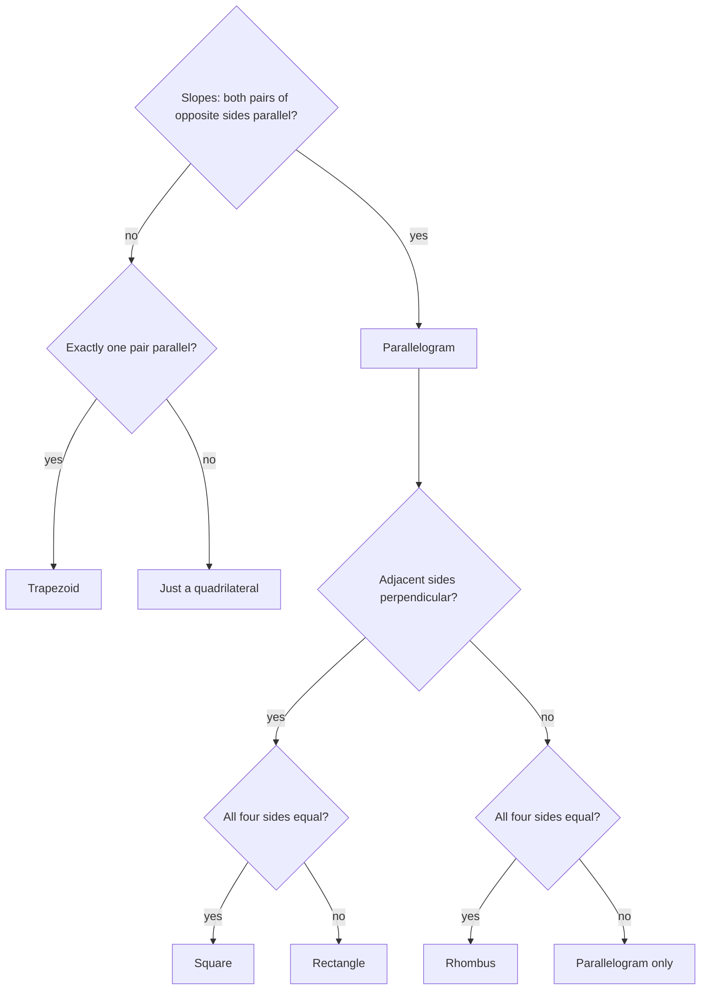

Coordinates turn geometry into algebra: a point is a pair of numbers, a segment's length is a calculation, and "parallel" is a statement about slopes. You've already met slope (Lesson 9), the distance formula (Lesson 22) and the equation of a circle (Lesson 30). This lesson gathers the coordinate tools, adds a formula for dividing a segment in any ratio, and shows how to *prove* theorems by placing figures on axes.

## Distance and midpoint

For points $A(x_1, y_1)$ and $B(x_2, y_2)$:

$$AB = \sqrt{(x_2 - x_1)^2 + (y_2 - y_1)^2}, \qquad M = \left(\frac{x_1 + x_2}{2}, \frac{y_1 + y_2}{2}\right).$$

The distance formula is the Pythagorean theorem on the horizontal and vertical legs; the midpoint averages each coordinate separately, just as on a number line.

### Example 1

$M(3, -1)$ is the midpoint of $\overline{AB}$, and $A = (-2, 4)$. Find $B$.

Each coordinate of $M$ is the average: $\tfrac{-2 + x}{2} = 3$ gives $x = 8$; $\tfrac{4 + y}{2} = -1$ gives $y = -6$. So $B = (8, -6)$.

A shortcut: going from $A$ to $M$ moves $+5$ in $x$ and $-5$ in $y$; do the same again from $M$ to get $B$.

## Partitioning a segment

To find the point $P$ that is a fraction $k$ of the way from $A$ to $B$ (with $0 < k < 1$), start at $A$ and move that fraction of the change in each coordinate:

$$P = \big(x_1 + k(x_2 - x_1),\; y_1 + k(y_2 - y_1)\big).$$

If $P$ divides $\overline{AB}$ in the ratio $m : n$ (meaning $AP : PB = m : n$), then $k = \dfrac{m}{m + n}$. The midpoint is the case $1 : 1$, $k = \tfrac12$.

```plot
{"x": [-2, 12], "y": [-2, 10], "equal": true, "segments": [{"from": [0, 0], "to": [9, 6]}], "points": [{"at": [0, 0], "label": "A(0, 0)"}, {"at": [9, 6], "label": "B(9, 6)"}, {"at": [6, 4], "label": "P(6, 4)"}], "caption": "P divides AB in the ratio 2 : 1, two-thirds of the way from A."}
```

### Example 2

Find the point $P$ that divides $\overline{AB}$ from $A(-3, 2)$ to $B(9, -4)$ in the ratio $1 : 3$.

**Step 1.** $k = \tfrac{1}{1 + 3} = \tfrac14$.

**Step 2.** Changes: $\Delta x = 12$, $\Delta y = -6$.

**Step 3.** $P = \left(-3 + \tfrac14 \cdot 12,\; 2 + \tfrac14 \cdot (-6)\right) = (0, 0.5)$.

**Check.** $AP = \sqrt{9 + 2.25} \approx 3.35$ and $PB = \sqrt{81 + 20.25} \approx 10.06$, a ratio of $1 : 3$ ✓.

## Classifying figures with coordinates

The tools match the properties:

| To show | Use |
|---|---|
| sides are congruent | distance formula |
| sides are parallel | equal slopes |
| sides are perpendicular | slopes multiply to $-1$ |
| a segment is bisected | midpoint formula |

For a quadrilateral whose vertices are listed in order around the figure, the flowchart turns the table into a procedure. (A horizontal side and a vertical side are perpendicular too, even though the vertical one has no slope.)



### Example 3

Show that $A(1, 2)$, $B(5, 5)$, $C(8, 1)$, $D(4, -2)$ is a square.

**Step 1 (sides).** $AB = \sqrt{16 + 9} = 5$, $BC = \sqrt{9 + 16} = 5$, $CD = \sqrt{16 + 9} = 5$, $DA = \sqrt{9 + 16} = 5$. A rhombus.

**Step 2 (angle).** Slope $AB = \tfrac34$, slope $BC = \tfrac{-4}{3}$. The product is $-1$, so $\angle B$ is a right angle.

**Step 3.** A rhombus with a right angle is a square.

```plot
{"x": [-1, 10], "y": [-4, 7], "equal": true, "polygons": [{"points": [[1, 2], [5, 5], [8, 1], [4, -2]]}], "rightAngles": [[[5, 5], [1, 2], [8, 1]]], "points": [{"at": [1, 2]}, {"at": [5, 5], "label": "B(5, 5)"}, {"at": [8, 1], "label": "C(8, 1)"}, {"at": [4, -2]}], "labels": [{"at": [2.75, 1.85], "text": "A(1, 2)"}, {"at": [4, -3], "text": "D(4, −2)"}], "caption": "The square of Example 3: four sides of length 5 and a right angle at B."}
```

## Coordinate proofs

A **coordinate proof** places a figure on the plane using variables for its coordinates, then proves a property with algebra. Because the variables stand for *any* values, the proof covers every case. Place figures to make the algebra easy:

- put a vertex at the origin and a side along the $x$-axis;
- use symmetry (for an isosceles triangle, put the base from $(-a, 0)$ to $(a, 0)$);
- use $2a$, $2b$ when midpoints will be needed, to avoid fractions.

### Example 4: the diagonals of a rectangle are congruent

Place rectangle $ABCD$ at $A(0, 0)$, $B(a, 0)$, $C(a, b)$, $D(0, b)$.

$AC = \sqrt{a^2 + b^2}$ and $BD = \sqrt{(0 - a)^2 + (b - 0)^2} = \sqrt{a^2 + b^2}$. They are equal. $\blacksquare$

### Example 5: the midpoint of a right triangle's hypotenuse is equidistant from all three vertices

Place the right angle at $O(0, 0)$ with legs on the axes: $A(2a, 0)$ and $B(0, 2b)$. The midpoint of $\overline{AB}$ is $M(a, b)$.


$MO = \sqrt{a^2 + b^2}$, $MA = \sqrt{(2a - a)^2 + (0 - b)^2} = \sqrt{a^2 + b^2}$ and $MB = \sqrt{a^2 + (2b - b)^2} = \sqrt{a^2 + b^2}$. All equal. $\blacksquare$

That's why the circumcenter of a right triangle is the midpoint of its hypotenuse (Lesson 15).

### Example 6: is the triangle right?

Is the triangle with vertices $P(-2, 1)$, $Q(2, 3)$ and $R(4, -1)$ a right triangle?

**Step 1.** Slopes: $PQ$: $\tfrac{3 - 1}{2 - (-2)} = \tfrac12$. $QR$: $\tfrac{-1 - 3}{4 - 2} = -2$. $PR$: $\tfrac{-1 - 1}{4 - (-2)} = -\tfrac13$.

**Step 2.** $\tfrac12 \cdot (-2) = -1$, so $\overline{PQ} \perp \overline{QR}$ and the right angle is at $Q$.

**Check with distances.** $PQ^2 = 16 + 4 = 20$, $QR^2 = 4 + 16 = 20$, $PR^2 = 36 + 4 = 40$, and $20 + 20 = 40$ ✓. It is in fact an isosceles right triangle.

## Common mistakes

- **Subtracting in different orders** for $x$ and $y$ in slope (distance is safe because of squaring).
- **Using $k = \tfrac{m}{n}$ instead of $\tfrac{m}{m + n}$** for a ratio $m : n$.
- **Placing a figure in a special position that loses generality,** like making a "general" quadrilateral a square.
- **Showing only sides for a square.** Four equal sides makes a rhombus; you also need a right angle (or equal diagonals).

## Key points

- Distance: $\sqrt{(x_2 - x_1)^2 + (y_2 - y_1)^2}$. Midpoint: average the coordinates.
- The point a fraction $k$ from $A$ to $B$ is $A + k(B - A)$; for ratio $m : n$, $k = \tfrac{m}{m+n}$.
- Distances test congruence, slopes test parallel and perpendicular, midpoints test bisection.
- Coordinate proofs use variable coordinates placed to keep the algebra simple.
