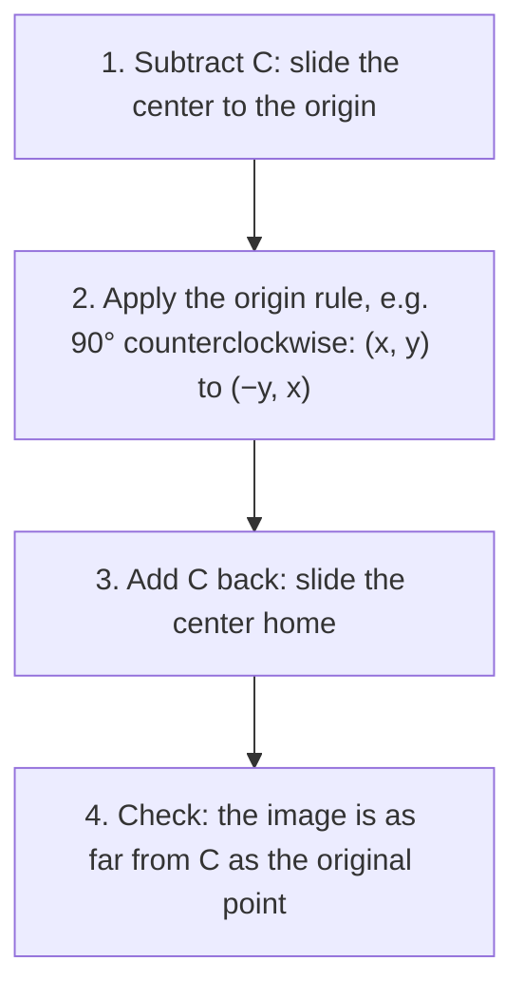

In Module 4 we said two figures are congruent if one can be moved exactly onto the other. This lesson makes "moved" precise. A transformation is a rule that sends each point of the plane to a new point. The three basic **rigid motions** (translations, reflections and rotations) keep every distance and angle unchanged, and modern geometry *defines* congruence using them.

## Transformations

A **transformation** maps each point $P$ (the **preimage**) to a point $P'$ (the **image**, read "P prime"). A transformation that preserves distance, so that $P'Q' = PQ$ for every pair of points, is an **isometry** or **rigid motion**. Isometries also preserve angle measures, collinearity and parallelism.

## Translations

A **translation** slides every point the same distance in the same direction. In coordinates, a translation by the vector $\langle a, b \rangle$ is

$$(x, y) \to (x + a,\; y + b).$$

```plot
{"x": [-3, 9], "y": [-3, 7], "equal": true, "polygons": [{"points": [[0, 0], [2, 0], [1, 2]]}, {"points": [[4, 3], [6, 3], [5, 5]]}], "segments": [{"from": [0, 0], "to": [4, 3], "arrow": true, "dashed": true}], "caption": "Translation by ⟨4, 3⟩: every point moves 4 right and 3 up."}
```

### Example 1

Translate $\triangle ABC$ with $A(-1, 2)$, $B(3, 0)$, $C(1, 5)$ by $\langle 4, -3 \rangle$.

Add 4 to each $x$ and subtract 3 from each $y$: $A'(3, -1)$, $B'(7, -3)$, $C'(5, 2)$.

## Reflections

A **reflection** in a line $\ell$ (the **line of reflection**) maps each point $P$ to $P'$ so that $\ell$ is the perpendicular bisector of $\overline{PP'}$. (Points on $\ell$ stay put.) A reflection reverses orientation: clockwise labels become counterclockwise, like a mirror image.


Coordinate rules:

| Reflection in | Rule |
|---|---|
| $x$-axis | $(x, y) \to (x, -y)$ |
| $y$-axis | $(x, y) \to (-x, y)$ |
| line $y = x$ | $(x, y) \to (y, x)$ |
| line $y = -x$ | $(x, y) \to (-y, -x)$ |
| vertical line $x = h$ | $(x, y) \to (2h - x, y)$ |
| horizontal line $y = k$ | $(x, y) \to (x, 2k - y)$ |

*Why $2h - x$?* The line $x = h$ must be halfway between $x$ and the image's $x'$: $\tfrac{x + x'}{2} = h$, so $x' = 2h - x$.

### Example 2

Reflect $P(5, -2)$ in (a) the $y$-axis, (b) the line $y = x$, (c) the line $x = 1$.

**(a)** $(-5, -2)$. **(b)** $(-2, 5)$. **(c)** $(2 \cdot 1 - 5, -2) = (-3, -2)$.

The picture shows part (b): the line $y = x$ is the perpendicular bisector of the segment from $P$ to its image.

```plot
{"x": [-5, 7], "y": [-4, 7], "equal": true, "functions": [{"f": "x", "dashed": true, "label": "y = x"}], "segments": [{"from": [5, -2], "to": [-2, 5], "dashed": true}], "rightAngles": [[[1.5, 1.5], [5, -2], [4, 4]]], "points": [{"at": [5, -2], "label": "P(5, −2)"}, {"at": [-2, 5], "label": "P′(−2, 5)"}, {"at": [1.5, 1.5], "label": "(1.5, 1.5)"}], "caption": "Reflecting in y = x swaps the coordinates; the midpoint (1.5, 1.5) lies on the mirror line."}
```

## Rotations

A **rotation** turns every point about a fixed **center of rotation** through a given angle. Positive angles are counterclockwise. Each point stays the same distance from the center, and the angle from $P$ to $P'$ at the center equals the angle of rotation.

Rotations about the origin:

| Rotation (counterclockwise) | Rule |
|---|---|
| $90^\circ$ | $(x, y) \to (-y, x)$ |
| $180^\circ$ | $(x, y) \to (-x, -y)$ |
| $270^\circ$ (or $90^\circ$ clockwise) | $(x, y) \to (y, -x)$ |

*Why the $90^\circ$ rule?* The point $(1, 0)$ goes to $(0, 1)$ and $(0, 1)$ goes to $(-1, 0)$. So $x$ units "right" become $x$ units "up", and $y$ units "up" become $y$ units "left": $(x, y) \to (-y, x)$. This is the same reason perpendicular slopes are negative reciprocals (Lesson 9).

```plot
{"x": [-6, 6], "y": [-3, 7], "equal": true, "polygons": [{"points": [[1, 1], [4, 1], [4, 3]]}, {"points": [[-1, 1], [-1, 4], [-3, 4]]}], "points": [{"at": [0, 0], "label": "O"}], "caption": "A 90° counterclockwise rotation about the origin: (x, y) → (−y, x)."}
```

### Example 3

Rotate $Q(2, 5)$ about the origin by $90^\circ$, $180^\circ$ and $270^\circ$ counterclockwise.

$90^\circ$: $(-5, 2)$. $180^\circ$: $(-2, -5)$. $270^\circ$: $(5, -2)$.

To rotate about a point $C$ other than the origin: translate so $C$ moves to the origin, rotate, then translate back.



### Example 4

Rotate $P(6, 3)$ by $90^\circ$ counterclockwise about $C(2, 1)$.

**Step 1.** Relative to $C$: $(6 - 2, 3 - 1) = (4, 2)$.

**Step 2.** Rotate: $(4, 2) \to (-2, 4)$.

**Step 3.** Add $C$ back: $(-2 + 2, 4 + 1) = (0, 5)$.

## Congruence through rigid motions

Here is the modern definition: **two figures are congruent if and only if there is a sequence of rigid motions mapping one onto the other.** It agrees with the old definition (matching sides and angles), and it explains *why* the congruence postulates work: SAS, for example, says that once two sides and the included angle match, a rigid motion carrying one triangle's angle onto the other's must carry the whole triangle along with it.

### Example 5: identifying a rigid motion

$\triangle ABC$ has $A(1, 1)$, $B(4, 1)$, $C(1, 3)$, and $\triangle A'B'C'$ has $A'(-1, 1)$, $B'(-1, 4)$, $C'(-3, 1)$. What single rigid motion maps the first onto the second?

**Step 1.** Test the $90^\circ$ counterclockwise rule $(x, y) \to (-y, x)$: $A(1, 1) \to (-1, 1)$ ✓, $B(4, 1) \to (-1, 4)$ ✓, $C(1, 3) \to (-3, 1)$ ✓.

**Step 2.** All three match, so the map is a $90^\circ$ counterclockwise rotation about the origin, and the triangles are congruent.

Checking all vertices matters: a rule that works for one point might fail for another.

## Common mistakes

- **Mixing up the rotation rules.** Test with $(1, 0)$: a $90^\circ$ counterclockwise turn sends it to $(0, 1)$.
- **Reflecting in $y = x$ by negating.** Swap the coordinates; don't change signs.
- **Rotating about the wrong center.** The rules in the table are for the origin only.
- **Thinking a reflection is a rotation.** A reflection reverses orientation; a rotation keeps it.

## Key points

- Rigid motions preserve distance and angle measure.
- Translation $\langle a, b \rangle$: $(x, y) \to (x + a, y + b)$.
- Reflections: $x$-axis $(x, -y)$; $y$-axis $(-x, y)$; $y = x$: $(y, x)$.
- Rotations about the origin: $90^\circ$ $(-y, x)$; $180^\circ$ $(-x, -y)$; $270^\circ$ $(y, -x)$.
- Figures are congruent exactly when a sequence of rigid motions maps one onto the other.
