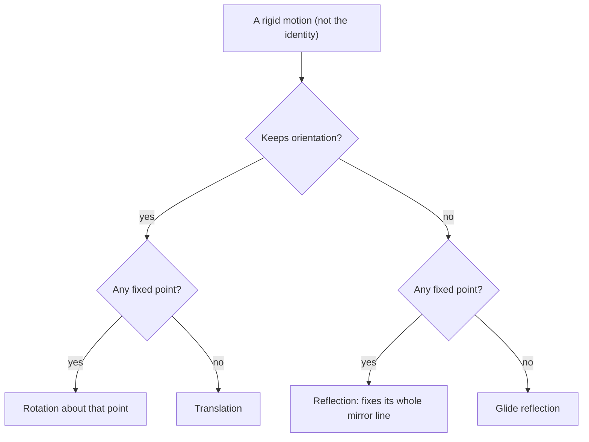

Rigid motions keep size. Dilations change it, and they give a transformation-based definition of similarity just as rigid motions defined congruence. This lesson covers dilations, then combines transformations (compositions), and ends with symmetry: the transformations that map a figure onto itself.

## Dilations

A **dilation** with center $C$ and scale factor $k > 0$ maps each point $P$ to the point $P'$ on ray $\overrightarrow{CP}$ with $CP' = k \cdot CP$. (This course uses positive scale factors only. Some textbooks also allow $k < 0$, which puts $P'$ on the ray opposite $\overrightarrow{CP}$, $|k|$ times as far away; that is a dilation by $|k|$ combined with a $180^\circ$ rotation about $C$.)

- If $k > 1$ it's an **enlargement**; if $0 < k < 1$, a **reduction**; $k = 1$ changes nothing.
- A dilation multiplies every length by $k$, keeps angle measures, and maps each line to a parallel line (or to itself, if the line passes through the center).


With center at the origin:

$$(x, y) \to (kx,\; ky).$$

For another center $C(a, b)$: $(x, y) \to \big(a + k(x - a),\; b + k(y - b)\big)$.

```plot
{"x": [-1, 10], "y": [-1, 10], "equal": true, "polygons": [{"points": [[1, 1], [3, 1], [2, 3]]}, {"points": [[3, 3], [9, 3], [6, 9]]}], "segments": [{"from": [0, 0], "to": [3, 3], "dashed": true}, {"from": [0, 0], "to": [9, 3], "dashed": true}, {"from": [0, 0], "to": [6, 9], "dashed": true}], "points": [{"at": [0, 0], "label": "O"}], "caption": "Dilation centered at O with scale factor 3."}
```

### Example 1

Dilate $\triangle ABC$ with $A(2, -1)$, $B(4, 3)$, $C(-2, 1)$ by scale factor $\tfrac32$ centered at the origin. How do perimeter and area change?

**Step 1.** Multiply each coordinate by $1.5$: $A'(3, -1.5)$, $B'(6, 4.5)$, $C'(-3, 1.5)$.

**Step 2.** The perimeter is multiplied by $1.5$ and the area by $1.5^2 = 2.25$.

### Example 2

Dilate $P(7, 5)$ with center $C(1, 2)$ and scale factor $\tfrac13$.

$P' = \left(1 + \tfrac13(6),\; 2 + \tfrac13(3)\right) = (3, 3)$.

**Similarity through transformations.** Two figures are similar if and only if a sequence of rigid motions and dilations maps one onto the other. This is why the scale factor of similar figures is a single number for every length. The next lesson uses it to prove that all circles are similar.

## Compositions

A **composition** applies one transformation, then another, to the image. Order usually matters.

### Example 3

Reflect $P(3, 1)$ in the $x$-axis, then rotate the image $90^\circ$ counterclockwise about the origin. Then try the other order.

**Reflect, then rotate:** $(3, 1) \to (3, -1) \to (1, 3)$.

**Rotate, then reflect:** $(3, 1) \to (-1, 3) \to (-1, -3)$.

Different results, so order matters.

Some compositions have simple descriptions:

- Two translations make a translation (add the vectors).
- Reflections in two parallel lines make a translation, by twice the distance between the lines, perpendicular to them.
- Reflections in two intersecting lines make a rotation about their intersection, by twice the angle between the lines.
- A **glide reflection** is a translation followed by a reflection in a line parallel to the translation (footprints in sand).

Every rigid motion of the plane is one of four kinds: a translation, a reflection, a rotation, or a glide reflection.

Two questions tell them apart: does the motion keep orientation or reverse it, and does it leave any point where it was (a fixed point)?



### Example 4

Reflect $P(2, 5)$ in $x = 1$ and then in $x = 4$. Compare with a translation.

**Step 1.** In $x = 1$: $(2 \cdot 1 - 2, 5) = (0, 5)$.

**Step 2.** In $x = 4$: $(2 \cdot 4 - 0, 5) = (8, 5)$.

The point moved 6 units right, twice the distance (3) between the lines.

```plot
{"x": [-1, 9], "y": [0, 8], "equal": true, "segments": [{"from": [1, 0], "to": [1, 8], "dashed": true, "label": "x = 1"}, {"from": [4, 0], "to": [4, 8], "dashed": true, "label": "x = 4"}, {"from": [2, 5], "to": [0, 5], "arrow": true}, {"from": [0, 4.4], "to": [8, 4.4], "arrow": true}], "points": [{"at": [2, 5], "label": "P(2, 5)"}, {"at": [0, 5], "label": "(0, 5)"}, {"at": [8, 5], "label": "(8, 5)"}], "caption": "Reflect in x = 1, then in x = 4: P ends up 6 units to the right, twice the gap of 3 between the lines."}
```

## Symmetry

A figure has **symmetry** if some rigid motion other than "do nothing" maps it onto itself.

- **Line symmetry** (reflectional symmetry): a reflection maps the figure onto itself. The mirror line is a **line of symmetry**.
- **Rotational symmetry**: a rotation by less than $360^\circ$ about the figure's center maps it onto itself. The smallest such angle is the **angle of rotational symmetry**, and the number of positions in a full turn is the **order**.

A regular $n$-gon has $n$ lines of symmetry and rotational symmetry of order $n$, with angle $\tfrac{360^\circ}{n}$.

| Figure | Lines of symmetry | Rotational symmetry |
|---|---|---|
| Isosceles triangle (non-equilateral) | 1 | none |
| Rectangle (non-square) | 2 | $180^\circ$ (order 2) |
| Rhombus (non-square) | 2 | $180^\circ$ (order 2) |
| Square | 4 | $90^\circ$ (order 4) |
| Parallelogram (general) | 0 | $180^\circ$ (order 2) |
| Regular hexagon | 6 | $60^\circ$ (order 6) |
| Circle | infinitely many | every angle |

### Example 5

What is the smallest angle of rotation that maps a regular decagon onto itself, and how many lines of symmetry does it have?

$\tfrac{360^\circ}{10} = 36^\circ$, and it has 10 lines of symmetry.

### Example 6: finding a dilation

A dilation centered at the origin maps $A(4, -6)$ to $A'(10, -15)$. Find the scale factor, and the image of $B(-2, 8)$.

**Step 1.** $k = \tfrac{10}{4} = \tfrac{-15}{-6} = 2.5$ (both coordinates must give the same ratio, or it isn't a dilation about the origin).

**Step 2.** $B' = (2.5 \cdot (-2),\; 2.5 \cdot 8) = (-5, 20)$.

**Step 3.** Every length in the figure is multiplied by 2.5; for instance $AB = \sqrt{36 + 196} = \sqrt{232}$ becomes $A'B' = 2.5\sqrt{232}$.

## Common mistakes

- **Dilating from the wrong center.** Subtract the center, scale, then add it back.
- **Scaling area by $k$.** Lengths scale by $k$, areas by $k^2$.
- **Assuming compositions commute.** Reflect-then-rotate differs from rotate-then-reflect.
- **Giving a parallelogram lines of symmetry.** A general parallelogram has none (folding along a diagonal doesn't match it up).

## Key points

- Dilation centered at the origin: $(x, y) \to (kx, ky)$; lengths scale by $k$, angles are kept.
- Similar figures are related by rigid motions and dilations.
- Two reflections make a translation (parallel lines) or a rotation (intersecting lines).
- A regular $n$-gon has $n$ lines of symmetry and rotational symmetry with angle $\tfrac{360^\circ}{n}$.
