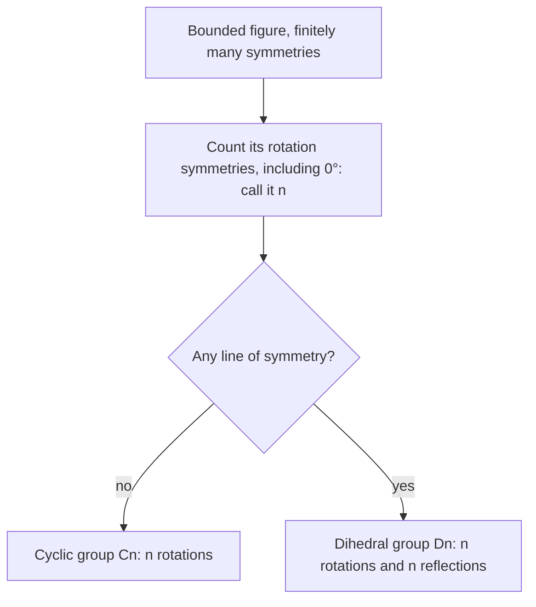

Lesson 37 made three claims without proof: two reflections make a translation or a rotation, every rigid motion of the plane is a translation, rotation, reflection or glide reflection, and a regular $n$-gon has $n$ lines of symmetry and $n$ rotations. This lesson explains why. The key idea is that reflections are the building blocks: every isometry is a composition of at most three of them. Then we turn to the full set of symmetries of a figure, which has a structure of its own.

## Three points pin down an isometry

**Claim.** If an isometry maps three noncollinear points $A$, $B$, $C$ to $A'$, $B'$, $C'$, it is the only isometry that does.

**Why.** Take any other point $P$. Its image $P'$ must be at distance $PA$ from $A'$, $PB$ from $B'$ and $PC$ from $C'$, because isometries keep distances. Circles about $A'$ and $B'$ with those radii meet in at most two points, and if there are two, they are mirror images across line $A'B'$. The points equidistant from those two candidates form their perpendicular bisector, which is line $A'B'$ itself. $C'$ is not on that line, so it is at different distances from the two candidates, and only one of them is at distance $PC$. So $P'$ is forced. $\blacksquare$

A special case: an isometry that leaves three noncollinear points where they were (three **fixed points**) is the identity, the motion that moves nothing.

## Every isometry is at most three reflections

**Theorem.** Every isometry of the plane is a composition of at most three reflections.

**Proof.** Suppose the isometry $T$ sends noncollinear $A$, $B$, $C$ to $A'$, $B'$, $C'$. We build reflections that do the same job.

1. If $A \ne A'$, reflect in the perpendicular bisector of $\overline{AA'}$. This sends $A$ to $A'$; call the new images of $B$ and $C$ $B_1$ and $C_1$.
2. If $B_1 \ne B'$: $A'B_1 = AB = A'B'$, so $A'$ is equidistant from $B_1$ and $B'$ and lies on the perpendicular bisector of $\overline{B_1B'}$. Reflect in that bisector. $A'$ stays put (it is on the mirror) and $B_1$ goes to $B'$. Call the new image of $C$ $C_2$.
3. Now $C_2$ is at the right distances from $A'$ and $B'$, so (as above) it is either $C'$ or the mirror image of $C'$ across line $A'B'$. In the second case, reflect in line $A'B'$, which fixes $A'$ and $B'$.

The reflections used send $A$, $B$, $C$ to $A'$, $B'$, $C'$, so by the claim above their composition is $T$. $\blacksquare$

## Two reflections

**Parallel mirrors.** Reflect in $x = h_1$, then in $x = h_2$:

$$x \;\to\; 2h_1 - x \;\to\; 2h_2 - (2h_1 - x) = x + 2(h_2 - h_1).$$

Every point moves $2(h_2 - h_1)$ horizontally: a translation by twice the gap, perpendicular to the mirrors, in the direction from the first mirror toward the second.

**Intersecting mirrors.** Describe a point by its distance from the intersection $O$ and its angle $\varphi$ measured counterclockwise from the positive $x$-axis. A mirror through $O$ at angle $\alpha$ bisects the angle between $P$ and its image, so reflection keeps the distance from $O$ and sends angle $\varphi$ to $2\alpha - \varphi$. Reflect in a line at angle $\alpha$, then in a line at angle $\beta$:

$$\varphi \;\to\; 2\alpha - \varphi \;\to\; 2\beta - (2\alpha - \varphi) = \varphi + 2(\beta - \alpha).$$

Every point turns through $2(\beta - \alpha)$ about $O$: a *rotation by twice the angle between the mirrors*, turning in the direction from the first mirror to the second.

### Example 1: two mirrors through the origin

Reflect in the $x$-axis, then in the line $y = x$. What single motion is this? What if the order is reversed?

**Step 1. Angles.** The $x$-axis is at $0^\circ$ and $y = x$ is at $45^\circ$. Going from the first mirror to the second is $45^\circ$ counterclockwise, so the composition is a rotation about the origin by $2 \cdot 45^\circ = 90^\circ$ counterclockwise.

**Step 2. Check with coordinates.** $(x, y) \to (x, -y) \to (-y, x)$. That is exactly the $90^\circ$ rule of Lesson 36 ✓.

**Step 3. Other order.** $(x, y) \to (y, x) \to (y, -x)$: the $270^\circ$ counterclockwise rule, that is, $90^\circ$ clockwise. Swapping the mirrors reverses the turn.

Read the theorem backward and you get a useful freedom: any rotation about $O$ by angle $\theta$ is two reflections in lines through $O$ that meet at $\tfrac{\theta}{2}$, and any translation is two reflections in parallel lines half the translation distance apart. Only the angle (or gap) and the order matter, so the pair of mirrors can be turned or slid together.

## Orientation sorts the four kinds

Each reflection reverses **orientation** (the clockwise or counterclockwise order of labeled points), so a composition of an even number of reflections keeps it and an odd number reverses it. An isometry that keeps orientation is a **direct isometry**; one that reverses it is an **opposite isometry**.

By the theorem, every isometry uses 0, 1, 2 or 3 reflections, and orientation tells the parity:

| Kind | Reflections | Orientation | Fixed points |
|---|---|---|---|
| identity | 0 | kept | every point |
| translation | 2 (parallel mirrors) | kept | none |
| rotation | 2 (mirrors that cross) | kept | the center only |
| reflection | 1 | reversed | its mirror line |
| glide reflection | 3 | reversed | none |

The direct row is fully proved here: zero reflections is the identity, two are a translation or a rotation. For the opposite case, three reflections always reduce to a single reflection or a glide reflection; that last step takes a longer argument, which we skip. The flowchart in Lesson 37 is this table turned into questions.

### Example 2: reflect, then translate

Describe (a) $T$: reflect in the $x$-axis, then translate by $\langle 0, 6 \rangle$; (b) $U$: reflect in the $x$-axis, then translate by $\langle 4, 6 \rangle$.

**(a)** $T(x, y) = (x,\; 6 - y) = (x,\; 2 \cdot 3 - y)$. That is the rule for reflection in $y = 3$ (Lesson 36). A translation perpendicular to the mirror just moves the mirror, by half the translation.

**(b)** $U(x, y) = (x + 4,\; 6 - y)$. Orientation is reversed (one reflection). A fixed point would need $x + 4 = x$, which is impossible, so $U$ has no fixed points: by the table it is a glide reflection. To find its parts, note that $y$ and $6 - y$ always average to 3, so every point and its image are equally far from $y = 3$ on opposite sides. $U$ is reflection in $y = 3$ followed by a translation of 4 units along it.

**Check.** $P(1, 1)$: $U$ gives $(5, 5)$. Reflect in $y = 3$: $(1, 5)$; slide 4 right: $(5, 5)$ ✓.

## Symmetry groups

The **symmetry group** of a figure is the set of all isometries that map it onto itself, the identity included. It has three properties: doing one symmetry and then another is again a symmetry, the identity is a symmetry, and every symmetry can be undone by a symmetry. Any set of transformations with these properties is called a group in algebra.

### Example 3: the rectangle

A rectangle that is not a square, centered at the origin with sides parallel to the axes, has four symmetries: the identity $I$, the $180^\circ$ rotation $R$, the reflection $H$ in the $x$-axis and the reflection $V$ in the $y$-axis.

**Step 1. Compose two of them.** $H$ then $V$: $(x, y) \to (x, -y) \to (-x, -y)$, which is $R$. That matches the two-mirror rule: the mirrors meet at $90^\circ$, so the result is a $180^\circ$ rotation.

**Step 2. Fill in the rest.** $R$ then $H$: $(x, y) \to (-x, -y) \to (-x, y)$, which is $V$. Doing any symmetry twice gives $I$. Every composition lands back among $I$, $R$, $H$, $V$: nothing new appears, as the group properties promise.

**Step 3. Count.** Two rotations ($0^\circ$ and $180^\circ$) and two reflections: four symmetries.

**Leonardo's theorem.** If a figure fits inside some circle and has only finitely many symmetries, then its symmetry group is one of two kinds:

- the **cyclic group** $C_n$: the $n$ rotations by multiples of $\tfrac{360^\circ}{n}$ about a center, and nothing else; or
- the **dihedral group** $D_n$: those $n$ rotations together with $n$ reflections in lines through the center, $2n$ symmetries in all.

The name goes back to Hermann Weyl's book *Symmetry* (1952), which credits Leonardo da Vinci with working out the possible symmetries of a building's floor plan. Here is why it is true.

- A bounded figure has no translation or glide reflection symmetries: repeating one would carry the figure arbitrarily far away. So every symmetry is a rotation or a reflection, and they all fix one common point (for example, the center of the smallest circle that holds the figure, since each symmetry maps that circle to itself).
- Among the finitely many rotations, take the smallest positive angle $\alpha$. Any other rotation angle must be a whole multiple of $\alpha$, or subtracting multiples of $\alpha$ would leave a smaller positive one. Since $360^\circ$ is one of them, $\alpha = \tfrac{360^\circ}{n}$.
- If there is at least one reflection $F$, composing $F$ with each of the $n$ rotations gives $n$ different reflections, and every reflection $G$ arises this way, since $G$ followed by $F$ is a rotation. So there are exactly $n$.

### Example 4: name the group

Classify (a) a regular pentagon, (b) the capital letter Z, (c) the capital letter H, (d) a three-bladed pinwheel like the one above.

**(a)** Rotations by multiples of $72^\circ$: $n = 5$. It has lines of symmetry, so $D_5$, with 10 symmetries.

**(b)** A $180^\circ$ turn maps Z onto itself, so $n = 2$; no line of symmetry works (a mirror reverses the slant of the diagonal stroke). $C_2$.

**(c)** $180^\circ$ rotation and two lines of symmetry (horizontal and vertical): $D_2$, the same group as the rectangle.

**(d)** Three rotations, and a mirror would reverse the direction the blades lean: $C_3$.

Patterns that repeat forever, like a border along a strip or wallpaper filling the plane, have translation symmetries, so Leonardo's theorem does not apply. They have been classified too: there are exactly seven kinds of **frieze pattern** (strip pattern), and seventeen kinds of wallpaper pattern, first listed by Evgraf Fedorov in 1891.

## Common mistakes

- **Using the angle between the mirrors as the rotation angle.** The rotation is *twice* that angle, and a translation is twice the gap.
- **Ignoring the order of the reflections.** The turn goes from the first mirror toward the second; swapping them reverses the direction.
- **Calling every orientation-reversing motion a reflection.** If no point is fixed, it is a glide reflection.
- **Forgetting the identity.** It counts as one of the $n$ rotations, so $D_n$ has $2n$ symmetries, not $2n + 1$ or $2n - 1$.
- **Giving a pinwheel lines of symmetry.** A figure whose parts all lean one way has rotations only.

## Key points

- Three noncollinear points and their images determine an isometry.
- Every isometry is at most three reflections: an even number keeps orientation, an odd number reverses it.
- Parallel mirrors: translation by twice the gap. Crossing mirrors: rotation by twice the angle, from the first mirror toward the second.
- Direct isometries are the identity, translations and rotations; opposite ones are reflections and glide reflections.
- A bounded figure with finitely many symmetries has group $C_n$ ($n$ rotations) or $D_n$ ($n$ rotations and $n$ reflections).
