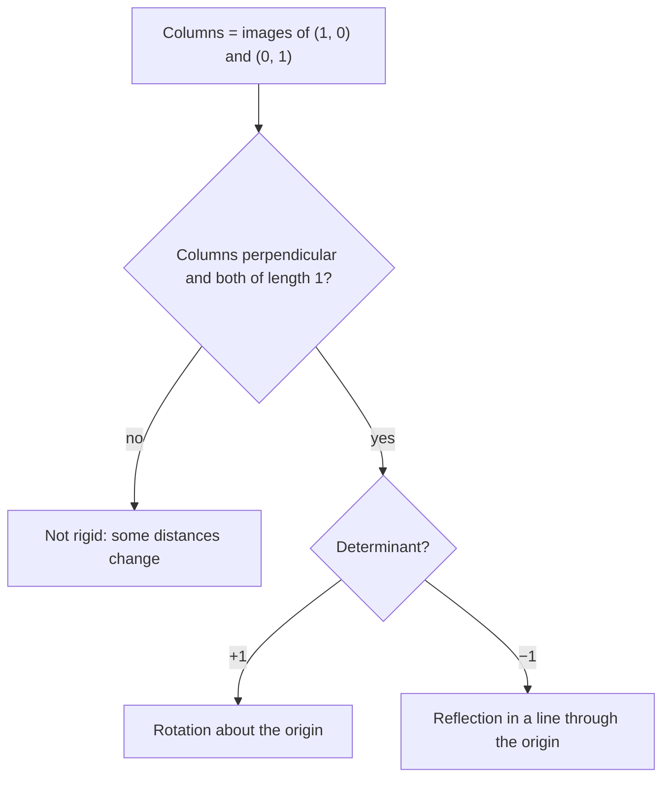

Lesson 36 gave coordinate rules for rotations of $90^\circ$, $180^\circ$ and $270^\circ$ only. What happens to $(4, 1)$ under a $30^\circ$ rotation? This lesson answers with trigonometry, then packs every transformation that fixes the origin into a small table of four numbers, a matrix. Composing transformations becomes multiplying matrices, and one number computed from the matrix tells how areas and orientation change. This is how computer graphics and robotics handle motion.

## Where $(1, 0)$ and $(0, 1)$ go

In Lesson 24, sine and cosine were ratios in a right triangle. For a point at distance 1 from the origin, at angle $\theta$ counterclockwise from the positive $x$-axis, the right triangle with hypotenuse 1 has horizontal leg $\cos\theta$ and vertical leg $\sin\theta$, so the point is $(\cos\theta, \sin\theta)$. For angles beyond $90^\circ$ we take this as the definition of $\cos\theta$ and $\sin\theta$ (the unit-circle definition used in Algebra 2 and precalculus); the signs then come out automatically, such as $\cos 120^\circ = -\tfrac12$.

Rotate by $\theta$ about the origin:

- $(1, 0)$ is at angle $0^\circ$ and moves to angle $\theta$: it lands on $(\cos\theta, \sin\theta)$.
- $(0, 1)$ is at angle $90^\circ$ and moves to angle $90^\circ + \theta$. That is the $90^\circ$ turn of the first image, so by the rule $(x, y) \to (-y, x)$ it lands on $(-\sin\theta, \cos\theta)$.

```plot
{"x": [-1.6, 1.6], "y": [-0.4, 1.4], "equal": true, "curves": [{"x": "cos(t)", "y": "sin(t)", "t": [0, 3.1416], "dashed": true}], "segments": [{"from": [0, 0], "to": [1, 0], "arrow": true}, {"from": [0, 0], "to": [0, 1], "arrow": true}, {"from": [0, 0], "to": [0.866, 0.5], "arrow": true}, {"from": [0, 0], "to": [-0.5, 0.866], "arrow": true}], "labels": [{"at": [1.05, -0.12], "text": "(1, 0)"}, {"at": [0.12, 1.12], "text": "(0, 1)"}, {"at": [1.15, 0.55], "text": "(cos θ, sin θ)"}, {"at": [-0.95, 0.98], "text": "(−sin θ, cos θ)"}], "caption": "A rotation by θ = 30° carries (1, 0) and (0, 1) to (cos θ, sin θ) and (−sin θ, cos θ)."}
```

## Why two points are enough

Any point $(x, y)$ is reached from the origin by walking $x$ copies of $(1, 0)$ and then $y$ copies of $(0, 1)$. A rotation about the origin carries that whole walk along rigidly: lines stay lines, parallel steps stay parallel and equal steps stay equal. So the image is $x$ copies of the image of $(1, 0)$ plus $y$ copies of the image of $(0, 1)$:

$$(x, y) \to x(\cos\theta, \sin\theta) + y(-\sin\theta, \cos\theta) = (x\cos\theta - y\sin\theta,\; x\sin\theta + y\cos\theta).$$

**Check.** For $\theta = 90^\circ$: $\cos 90^\circ = 0$, $\sin 90^\circ = 1$, and the rule becomes $(-y, x)$ ✓.

### Example 1: a $30^\circ$ rotation

Rotate $P(4, 1)$ by $30^\circ$ counterclockwise about the origin.

**Step 1.** $\cos 30^\circ = \tfrac{\sqrt3}{2} \approx 0.8660$ and $\sin 30^\circ = \tfrac12$.

**Step 2.** $x' = 4(0.8660) - 1(0.5) \approx 2.964$ and $y' = 4(0.5) + 1(0.8660) \approx 2.866$. Exactly, $P' = \left(2\sqrt3 - \tfrac12,\; 2 + \tfrac{\sqrt3}{2}\right)$.

**Check.** A rotation keeps the distance from the center: $OP = \sqrt{17} \approx 4.123$, and $\sqrt{2.964^2 + 2.866^2} \approx 4.123$ ✓.

### Example 2: about another center

Rotate $Q(5, 2)$ by $60^\circ$ counterclockwise about $C(1, 2)$.

**Step 1.** Relative to $C$: $(5 - 1, 2 - 2) = (4, 0)$.

**Step 2.** Rotate: $(4\cos 60^\circ - 0,\; 4\sin 60^\circ + 0) = (2,\; 2\sqrt3)$.

**Step 3.** Add $C$ back: $Q' = (3,\; 2 + 2\sqrt3) \approx (3, 5.464)$.

## Matrices

A **matrix** is a rectangular array of numbers. A $2 \times 2$ matrix acts on a point written as a column by "row times column":

$$\begin{bmatrix} a & b \\ c & d \end{bmatrix}\begin{bmatrix} x \\ y \end{bmatrix} = \begin{bmatrix} ax + by \\ cx + dy \end{bmatrix}.$$

Put $(1, 0)$ in and out comes $(a, c)$, the first column; $(0, 1)$ gives $(b, d)$, the second column. So **the columns are the images of $(1, 0)$ and $(0, 1)$**, and writing a matrix only takes knowing where those two points go. The rotation above has the **rotation matrix**

$$R_\theta = \begin{bmatrix} \cos\theta & -\sin\theta \\ \sin\theta & \cos\theta \end{bmatrix}.$$

A transformation given by a matrix is a **linear transformation**: it fixes the origin, sends lines to lines and keeps parallel lines parallel. Rotations about the origin, reflections in lines through the origin and dilations centered at the origin are all linear. A translation is not (it moves the origin), so it is handled by adding a vector after multiplying.

| Transformation | Matrix |
|---|---|
| reflection in the $x$-axis | $\begin{bmatrix} 1 & 0 \\ 0 & -1 \end{bmatrix}$ |
| reflection in the $y$-axis | $\begin{bmatrix} -1 & 0 \\ 0 & 1 \end{bmatrix}$ |
| reflection in $y = x$ | $\begin{bmatrix} 0 & 1 \\ 1 & 0 \end{bmatrix}$ |
| rotation $90^\circ$ counterclockwise | $\begin{bmatrix} 0 & -1 \\ 1 & 0 \end{bmatrix}$ |
| rotation $180^\circ$ | $\begin{bmatrix} -1 & 0 \\ 0 & -1 \end{bmatrix}$ |
| dilation by $k$, center $O$ | $\begin{bmatrix} k & 0 \\ 0 & k \end{bmatrix}$ |

**Reflection in any line through the origin.** Let the mirror make angle $\alpha$ with the positive $x$-axis. The mirror bisects the angle between a point and its image, so a point at angle $\varphi$ goes to angle $2\alpha - \varphi$ at the same distance. Then $(1, 0)$ goes to angle $2\alpha$, which is $(\cos 2\alpha, \sin 2\alpha)$, and $(0, 1)$ goes to angle $2\alpha - 90^\circ$, which is $(\sin 2\alpha, -\cos 2\alpha)$:

$$F_\alpha = \begin{bmatrix} \cos 2\alpha & \sin 2\alpha \\ \sin 2\alpha & -\cos 2\alpha \end{bmatrix}.$$

For the line $y = mx$ (slope $m = \tan\alpha$), trigonometric identities give $\cos 2\alpha = \dfrac{1 - m^2}{1 + m^2}$ and $\sin 2\alpha = \dfrac{2m}{1 + m^2}$, so no angle is needed. For $m = 1$ these are 0 and 1, the matrix for $y = x$ in the table ✓.

### Example 3: reflecting in $y = 2x$

Reflect $P(5, 5)$ in the line $y = 2x$.

**Step 1.** With $m = 2$: $\cos 2\alpha = \tfrac{1 - 4}{5} = -\tfrac35$ and $\sin 2\alpha = \tfrac{4}{5}$.

**Step 2.** $P' = \left(-\tfrac35 \cdot 5 + \tfrac45 \cdot 5,\; \tfrac45 \cdot 5 + \tfrac35 \cdot 5\right) = (1, 7)$.

**Check.** The midpoint of $\overline{PP'}$ is $(3, 6)$, on $y = 2x$ ✓. $\overline{PP'}$ runs along $(-4, 2)$, the line along $(1, 2)$, and $-4 \cdot 1 + 2 \cdot 2 = 0$, so they are perpendicular ✓ (zero dot product; equivalently the slopes $-\tfrac12$ and $2$ multiply to $-1$).

## Composition is multiplication

Apply $A$ and then $B$: the point $v$ goes to $Av$ and then to $B(Av)$. Multiplying the matrices gives one matrix $BA$ that does both. **The transformation done first is written on the right.** Each entry of a product is a row of the left matrix times a column of the right one.

### Example 4: reflect, then rotate

Find the single matrix for "reflect in the $x$-axis, then rotate $90^\circ$ counterclockwise", and for the other order.

**Step 1.** Reflect first, so it goes on the right:

$$\begin{bmatrix} 0 & -1 \\ 1 & 0 \end{bmatrix}\begin{bmatrix} 1 & 0 \\ 0 & -1 \end{bmatrix} = \begin{bmatrix} 0 \cdot 1 + (-1) \cdot 0 & 0 \cdot 0 + (-1)(-1) \\ 1 \cdot 1 + 0 \cdot 0 & 1 \cdot 0 + 0 \cdot (-1) \end{bmatrix} = \begin{bmatrix} 0 & 1 \\ 1 & 0 \end{bmatrix},$$

which is reflection in $y = x$. Lesson 37's Example 3 found the same: $(3, 1) \to (1, 3)$.

**Step 2.** Rotate first: $\begin{bmatrix} 1 & 0 \\ 0 & -1 \end{bmatrix}\begin{bmatrix} 0 & -1 \\ 1 & 0 \end{bmatrix} = \begin{bmatrix} 0 & -1 \\ -1 & 0 \end{bmatrix}$, reflection in $y = -x$, sending $(3, 1)$ to $(-1, -3)$ as before. Different products: order matters.

A bonus: rotating by $\beta$ and then by $\alpha$ is rotating by $\alpha + \beta$, so $R_\alpha R_\beta = R_{\alpha + \beta}$. Multiply out the left side and compare first columns:

$$\cos(\alpha + \beta) = \cos\alpha\cos\beta - \sin\alpha\sin\beta, \qquad \sin(\alpha + \beta) = \sin\alpha\cos\beta + \cos\alpha\sin\beta.$$

These are the angle-addition formulas of trigonometry, proved by geometry.

## The determinant: area and orientation

The **determinant** of $\begin{bmatrix} a & b \\ c & d \end{bmatrix}$ is $ad - bc$. The matrix sends the unit square to the parallelogram with sides along $(a, c)$ and $(b, d)$, and that parallelogram has area $|ad - bc|$. With $M = \begin{bmatrix} 2 & 1 \\ 1 & 3 \end{bmatrix}$ the parallelogram has corners $(0, 0)$, $(2, 1)$, $(3, 4)$, $(1, 3)$. It sits in a $3 \times 4$ box; cutting off two triangles of area $1$, two of area $1.5$ and two $1 \times 1$ squares leaves $12 - 2 - 3 - 2 = 5 = 2 \cdot 3 - 1 \cdot 1$.

```plot
{"x": [-0.5, 4], "y": [-0.5, 4.5], "equal": true, "polygons": [{"points": [[0, 0], [1, 0], [1, 1], [0, 1]]}, {"points": [[0, 0], [2, 1], [3, 4], [1, 3]]}], "points": [{"at": [2, 1], "label": "(2, 1)"}, {"at": [1, 3], "label": "(1, 3)"}, {"at": [3, 4], "label": "(3, 4)"}], "caption": "The matrix with columns (2, 1) and (1, 3) turns the unit square (area 1) into a parallelogram of area 2·3 − 1·1 = 5."}
```

The unit grid of squares becomes a grid of these parallelograms, so **every area is multiplied by $|\det|$**. The sign carries the orientation: positive keeps it, negative reverses it.

- Rotation: $\cos^2\theta + \sin^2\theta = 1$. Reflection: $-\cos^2 2\alpha - \sin^2 2\alpha = -1$. Rigid motions keep area, and reflections flip orientation ✓.
- Dilation by $k$: $k^2$, the area rule from Lesson 37 ✓.



### Example 5: area of an image

The triangle with vertices $(0, 0)$, $(3, 0)$, $(0, 2)$ is transformed by $M = \begin{bmatrix} 2 & 1 \\ 1 & 3 \end{bmatrix}$. Find the area of the image. Is $M$ a similarity?

**Step 1.** The original area is $\tfrac12 \cdot 3 \cdot 2 = 3$, and $\det M = 5$, so the image has area $15$.

**Step 2. Check directly.** The images are $(0, 0)$, $(6, 3)$ and $(2, 6)$. The triangle's area is half the determinant of the matrix with those two columns: $\tfrac12 |6 \cdot 6 - 2 \cdot 3| = 15$ ✓.

**Step 3.** The columns $(2, 1)$ and $(1, 3)$ have different lengths ($\sqrt5$ and $\sqrt{10}$) and are not perpendicular ($2 + 3 \ne 0$), so $M$ stretches different directions by different amounts. It is not a similarity: the image triangle is not similar to the original, even though areas scale by exactly 5.

## Common mistakes

- **Sign slip in the rotation matrix.** The $-\sin\theta$ is in the top right. Test with $\theta = 90^\circ$: $(1, 0)$ must go to $(0, 1)$.
- **Multiplying in the wrong order.** "$A$, then $B$" is $BA$, not $AB$.
- **Calculator in radian mode.** Problems in degrees need degree mode.
- **Treating a translation as a matrix product.** A $2 \times 2$ matrix always fixes the origin.
- **Reading $\det$ as a length factor.** It scales area. Only for a similarity with scale $k$ is it $k^2$, so lengths scale by $\sqrt{\det}$.

## Key points

- Rotation by $\theta$ about the origin: $(x, y) \to (x\cos\theta - y\sin\theta,\; x\sin\theta + y\cos\theta)$.
- A matrix's columns are the images of $(1, 0)$ and $(0, 1)$.
- Reflection in a line through the origin at angle $\alpha$: columns $(\cos 2\alpha, \sin 2\alpha)$ and $(\sin 2\alpha, -\cos 2\alpha)$.
- "First $A$, then $B$" is the product $BA$; order matters.
- $\det = ad - bc$: areas multiply by $|\det|$; a negative determinant reverses orientation. Rotations have $\det = 1$, reflections $-1$.
