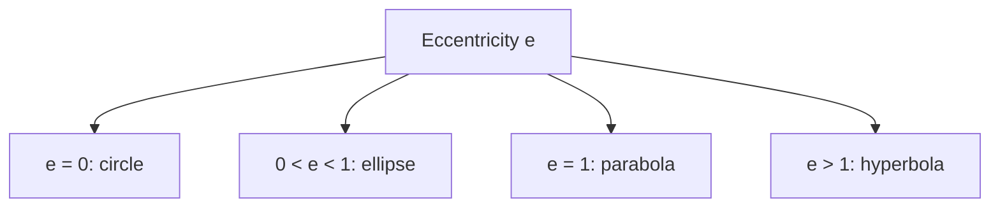

Lesson 30 turned "every point the same distance from a center" into the equation of a circle, and Lesson 38 turned "the same distance from a focus and a directrix" into the equation of a parabola. Two more curves come from distances to *two* fixed points: the ellipse (fixed sum of distances) and the hyperbola (fixed difference). With the circle and parabola they make up the **conic sections**, the curves you get by slicing a double cone with a plane. The Greek geometer Apollonius of Perga studied them around 200 BC and gave them the names we still use. This lesson derives their equations with the distance formula, exactly as for the parabola.

## The ellipse

An **ellipse** is the set of points $P$ whose distances to two fixed points $F_1$ and $F_2$, its foci, add up to a constant $2a$ (larger than the distance $F_1F_2$). You can draw one with two pins and a loop of string: pin the ends of a string of length $2a$ at the foci, pull it tight with a pencil and move the pencil around.


The parts:

- the center is the midpoint of $\overline{F_1F_2}$; each focus is $c$ units from it;
- the **major axis** is the chord through the foci; its endpoints are the **vertices of the ellipse**;
- the **minor axis** is the chord through the center perpendicular to the major axis; its endpoints are the **co-vertices**.

**The vertices are $a$ from the center.** Put the center at the origin and the foci at $(\pm c, 0)$. A vertex $(x, 0)$ to the right of $F_2$ has distances $x + c$ and $x - c$, which add to $2x$. Setting $2x = 2a$ gives $x = a$, so the major axis has length $2a$.

**The co-vertices are $b$ from the center, where $b^2 = a^2 - c^2$.** A co-vertex $(0, b)$ is equally far from both foci, so each distance is $a$. The center, a focus and a co-vertex form a right triangle with legs $c$ and $b$ and hypotenuse $a$: $a^2 = b^2 + c^2$.

**The equation.** For $P(x, y)$, $\sqrt{(x + c)^2 + y^2} + \sqrt{(x - c)^2 + y^2} = 2a$. Move the second root to the right side, square, and simplify: $a\sqrt{(x - c)^2 + y^2} = a^2 - cx$. Square again: $(a^2 - c^2)x^2 + a^2y^2 = a^2(a^2 - c^2)$. Replace $a^2 - c^2$ with $b^2$ and divide by $a^2b^2$:

$$\frac{x^2}{a^2} + \frac{y^2}{b^2} = 1 \qquad (a > b > 0,\ c^2 = a^2 - b^2).$$

(Both squarings are safe: the two sides being squared are never negative on the ellipse. Running the steps backward shows every solution of the equation is on the ellipse.) If the major axis is vertical, the larger number $a^2$ goes under $y^2$ instead; with center $(h, k)$, replace $x$ with $x - h$ and $y$ with $y - k$.

### Example 1: equation from the foci

Find the ellipse whose foci are $(-4, 0)$ and $(4, 0)$ and whose distances to the foci always add to 10.

**Step 1.** $2a = 10$, so $a = 5$; the center is the origin and $c = 4$.

**Step 2.** $b^2 = a^2 - c^2 = 25 - 16 = 9$, so $b = 3$.

**Step 3.** $\dfrac{x^2}{25} + \dfrac{y^2}{9} = 1$.

**Check.** The co-vertex $(0, 3)$ is $\sqrt{16 + 9} = 5$ from each focus, and $5 + 5 = 10$ ✓.

### Example 2: reading an equation

Find the center, vertices, co-vertices and foci of $\dfrac{(x - 1)^2}{16} + \dfrac{(y + 2)^2}{25} = 1$.

**Step 1. Center and direction.** The center is $(1, -2)$. The larger denominator, 25, is under the $y$-term, so the major axis is vertical: $a = 5$, $b = 4$.

**Step 2. Vertices and co-vertices.** Up and down 5: $(1, 3)$ and $(1, -7)$. Left and right 4: $(-3, -2)$ and $(5, -2)$.

**Step 3. Foci.** $c^2 = 25 - 16 = 9$, so $c = 3$: foci $(1, 1)$ and $(1, -5)$.

**Check.** The co-vertex $(5, -2)$ is $\sqrt{16 + 9} = 5$ from $(1, 1)$ and $\sqrt{16 + 9} = 5$ from $(1, -5)$, a sum of $10 = 2a$ ✓.

**Shape and eccentricity.** The **eccentricity** $e = \tfrac{c}{a}$ measures how stretched an ellipse is. For an ellipse $0 < e < 1$: near 0 the foci are close together and the ellipse is nearly a circle; near 1 it is long and thin. Johannes Kepler found in 1609 that each planet moves on an ellipse with the Sun at one focus. Earth's orbit has $e \approx 0.017$, so it is very nearly a circle, while Halley's comet has $e \approx 0.97$.

**Reflection.** A ray from one focus bounces off the ellipse through the other focus. In an elliptical room, a whisper at one focus can be heard clearly at the other, and some medical machines use an ellipsoid-shaped reflector to focus shock waves onto kidney stones.

## The hyperbola

A **hyperbola** is the set of points $P$ whose distances to two foci differ by a constant: $|PF_1 - PF_2| = 2a$, with $2a$ less than $F_1F_2$. Points closer to $F_2$ form one branch and points closer to $F_1$ the other, so a hyperbola has two separate branches.

With center at the origin, foci $(\pm c, 0)$ and $c > a$, the same squaring steps give

$$\frac{x^2}{a^2} - \frac{y^2}{b^2} = 1 \qquad (c^2 = a^2 + b^2).$$

The vertices are $(\pm a, 0)$; the curve has no points with $-a < x < a$. Far from the center, the 1 on the right side hardly matters, so $\tfrac{y}{x} \approx \pm\tfrac{b}{a}$: each branch approaches the lines $y = \pm\tfrac{b}{a}x$, the **asymptotes of the hyperbola**. They are the diagonals of the $2a \times 2b$ box centered at the origin. If the $y$-term is the positive one, $\tfrac{y^2}{a^2} - \tfrac{x^2}{b^2} = 1$, the branches open up and down, the foci are $(0, \pm c)$ and the asymptotes are $y = \pm\tfrac{a}{b}x$. Notice that for a hyperbola $a^2$ is the denominator of the *positive* term, which need not be the larger one, and $c$ is the largest of $a$, $b$, $c$. The eccentricity $e = \tfrac{c}{a}$ is greater than 1.

### Example 3: equation from the foci

Find the hyperbola with foci $(\pm 5, 0)$ on which the distances to the foci differ by 6, and its asymptotes.

**Step 1.** $2a = 6$, so $a = 3$, and $c = 5$.

**Step 2.** $b^2 = c^2 - a^2 = 25 - 9 = 16$, so $b = 4$.

**Step 3.** $\dfrac{x^2}{9} - \dfrac{y^2}{16} = 1$, with asymptotes $y = \pm\tfrac43 x$.

**Check.** At $x = 5$: $\tfrac{y^2}{16} = \tfrac{25}{9} - 1 = \tfrac{16}{9}$, so $y = \tfrac{16}{3}$. The point $(5, \tfrac{16}{3})$ is $\tfrac{16}{3}$ from $(5, 0)$ and $\sqrt{100 + \tfrac{256}{9}} = \tfrac{34}{3}$ from $(-5, 0)$; the difference is $\tfrac{18}{3} = 6$ ✓.

```plot
{"x": [-9, 9], "y": [-8, 8], "equal": true, "curves": [{"x": "3cosh(t)", "y": "4sinh(t)", "t": [-1.6, 1.6]}, {"x": "-3cosh(t)", "y": "4sinh(t)", "t": [-1.6, 1.6]}], "functions": [{"f": "4x/3", "dashed": true}, {"f": "-4x/3", "dashed": true}], "polygons": [{"points": [[-3, -4], [3, -4], [3, 4], [-3, 4]]}], "points": [{"at": [5, 0]}, {"at": [-5, 0]}, {"at": [3, 0]}, {"at": [-3, 0]}, {"at": [5, 5.333]}], "labels": [{"at": [5.6, -1.9], "text": "F₂(5, 0)"}, {"at": [-5.6, -1.9], "text": "F₁(−5, 0)"}, {"at": [2.05, 0.5], "text": "(3, 0)"}, {"at": [7.2, 4.6], "text": "(5, 16/3)"}], "caption": "x²/9 − y²/16 = 1: two branches between the dashed asymptotes y = ±4x/3, the diagonals of the 6-by-8 box."}
```

### Example 4: locating a ship

Two radio stations, $A$ at $(-50, 0)$ and $B$ at $(50, 0)$ (units: km), send pulses at the same instant. A ship receives the pulse from $B$ $100$ microseconds before the pulse from $A$. Radio waves travel about $300{,}000$ km per second. On what curve is the ship?

**Step 1. Time to distance.** $300{,}000 \times 0.0001 = 30$ km, so $PA - PB = 30$: the ship is 30 km closer to $B$.

**Step 2. The hyperbola.** The difference of distances is fixed, so $P$ is on a hyperbola with foci $A$ and $B$: $2a = 30$, $a = 15$, $c = 50$, $b^2 = 2500 - 225 = 2275$.

**Step 3.** The ship is on the branch nearer $B$: $\dfrac{x^2}{225} - \dfrac{y^2}{2275} = 1$ with $x > 0$.

**Check.** The vertex $(15, 0)$ is 65 km from $A$ and 35 km from $B$; $65 - 35 = 30$ ✓. A second pair of stations gives a second hyperbola, and the ship is where they cross. Navigation systems such as LORAN worked this way from World War II until satellite navigation replaced them.

## One family

All the conics except the circle share one definition: the set of points whose distance to a focus is $e$ times their distance to a directrix line. With $e = 1$ that is Lesson 38's parabola; $e < 1$ gives an ellipse and $e > 1$ a hyperbola, with the same $e = \tfrac{c}{a}$ as above. We state this without proof. The circle is the limiting case $e = 0$, where the foci merge at the center.



## Common mistakes

- **Mixing up the two Pythagorean relations.** Ellipse: $c^2 = a^2 - b^2$ ($a$ is largest). Hyperbola: $c^2 = a^2 + b^2$ ($c$ is largest).
- **Using the sum as $a$.** The fixed sum (or difference) is $2a$; halve it.
- **Reading the major axis from the order of the terms.** For an ellipse the larger denominator decides the direction, wherever it is written.
- **Taking the larger denominator as $a^2$ in a hyperbola.** For a hyperbola $a^2$ is under the positive term.
- **Forgetting square roots.** In $\tfrac{x^2}{25} + \tfrac{y^2}{9} = 1$, $a = 5$, not 25.
- **Swapping the asymptote slope.** $y = \pm\tfrac{b}{a}x$ for a left–right hyperbola, $y = \pm\tfrac{a}{b}x$ for an up–down one: in both cases the slope is (half-height of the box) ÷ (half-width).

## Key points

- Ellipse: $PF_1 + PF_2 = 2a$; $\tfrac{x^2}{a^2} + \tfrac{y^2}{b^2} = 1$ with $c^2 = a^2 - b^2$; vertices and foci $a$ and $c$ from the center along the major axis, co-vertices $b$ from it along the minor axis.
- Hyperbola: $|PF_1 - PF_2| = 2a$; $\tfrac{x^2}{a^2} - \tfrac{y^2}{b^2} = 1$ with $c^2 = a^2 + b^2$; asymptotes $y = \pm\tfrac{b}{a}x$.
- Eccentricity $e = \tfrac{c}{a}$: circle 0, ellipse between 0 and 1, parabola 1, hyperbola above 1.
- Ellipses reflect rays from one focus to the other; a fixed difference of distances (or arrival times) puts a point on a hyperbola.
