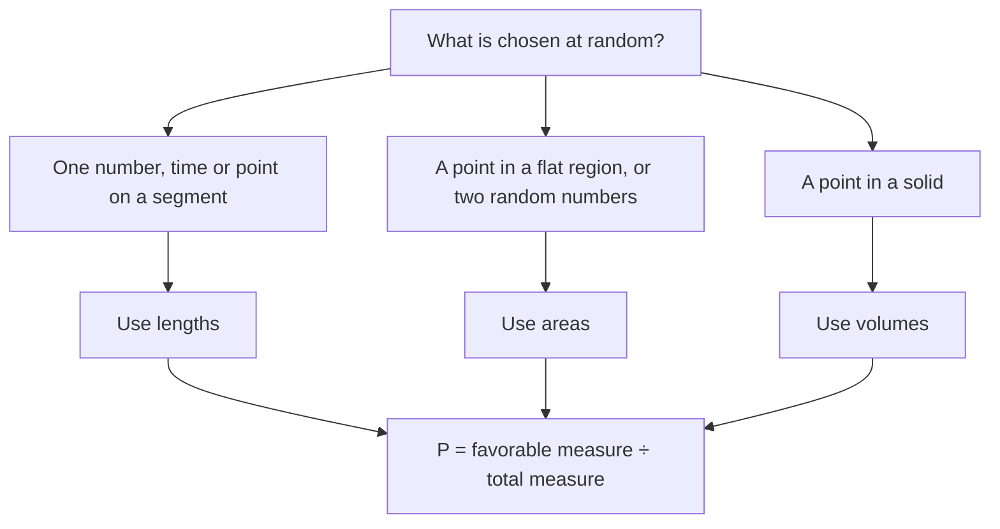

Probability usually counts outcomes: 1 face of a die out of 6. But some random experiments have infinitely many outcomes, like the exact spot where a dart lands or the exact moment a bus arrives. **Geometric probability** handles these by measuring instead of counting: the probability is a ratio of lengths, areas or volumes. This final lesson uses the measurement tools from the whole course, and ends with a famous problem that connects geometry and $\pi$.

## The basic principle

If a point is chosen **uniformly at random** from a region (every part of equal size is equally likely to contain it), then the probability it lands in a sub-region is

$$P = \frac{\text{measure of the favorable region}}{\text{measure of the whole region}},$$

where "measure" means length on a segment, area in a plane region, or volume in a solid.

The first decision in every problem is which of the three measures to use. It depends on what is chosen at random, not on what the picture looks like:



## Probability with lengths

### Example 1

A point is chosen at random on $\overline{AE}$, where $A$, $B$, $C$, $D$, $E$ are at $0, 3, 7, 8, 12$ on a number line. Find the probability that it lies on $\overline{BD}$.

```numberline
{"x": [0, 12], "points": [{"at": [0, 0], "label": "A"}, {"at": [3, 0], "label": "B"}, {"at": [7, 0], "label": "C"}, {"at": [8, 0], "label": "D"}, {"at": [12, 0], "label": "E"}], "segments": [{"from": [3, 0], "to": [8, 0]}], "caption": "BD has length 5 out of AE = 12."}
```

$P = \dfrac{BD}{AE} = \dfrac{8 - 3}{12} = \dfrac{5}{12} \approx 0.417$.

### Example 2: waiting time

A train leaves every 15 minutes. You arrive at a random time. What's the probability you wait at most 4 minutes?

Model your arrival as a random point in a 15-minute interval before the next train. You wait at most 4 minutes if you arrive in the last 4 minutes: $P = \tfrac{4}{15} \approx 0.267$.

## Probability with areas

### Example 3: a dartboard

A square board 20 in on a side has a circular bull's-eye of radius 3 in. A dart hits the board at a random point. Find the probability it hits the bull's-eye.

$P = \dfrac{\pi(3^2)}{20^2} = \dfrac{9\pi}{400} \approx 0.0707$, about 7%.

```shape
{"polygons": [{"points": [[0, 0], [20, 0], [20, 20], [0, 20]]}], "circles": [{"center": [10, 10], "r": 3, "fill": true}, {"center": [10, 10], "r": 7}], "caption": "A target: bull's-eye of radius 3 inside a ring of radius 7 on a 20 × 20 board."}
```

### Example 4: the ring

On the same board there is also a ring between radius 3 and radius 7. Find the probability a random dart lands in the ring.

Ring area $= \pi(49) - \pi(9) = 40\pi$. $P = \dfrac{40\pi}{400} = \dfrac{\pi}{10} \approx 0.314$.

### Example 5: the meeting problem

Two friends each arrive at a café at a random time between 12:00 and 1:00 and wait 15 minutes for the other. What's the probability they meet?

**Step 1.** Let $x$ and $y$ be their arrival times in minutes after 12:00. The point $(x, y)$ is uniform in the $60 \times 60$ square.

**Step 2.** They meet if $|x - y| \le 15$: the band around the diagonal $y = x$.

**Step 3.** The complement is two right triangles in the corners, each with legs $60 - 15 = 45$. Their combined area is $2 \cdot \tfrac12 \cdot 45^2 = 2025$.

**Step 4.** $P = 1 - \dfrac{2025}{3600} = 1 - 0.5625 = 0.4375$.

```plot
{"x": [0, 60], "y": [0, 60], "equal": true, "xLabel": "x", "yLabel": "y", "functions": [{"f": "x + 15", "from": 0, "to": 45}, {"f": "x - 15", "from": 15, "to": 60}], "shade": [{"f": "min(x + 15, 60)", "g": "max(x - 15, 0)", "from": 0, "to": 60}], "caption": "They meet when the point lies in the shaded band |x − y| ≤ 15."}
```

This idea, turning a question about two random quantities into an area in a square, is one of the most useful tricks in probability.

Every region of the square tells a story. Above the band, $y > x + 15$: friend X arrived more than 15 minutes before friend Y, gave up and left before Y came. Below the band, the roles are reversed. The diagonal $y = x$ is where they arrive at exactly the same moment.


## Probability with volumes

### Example 6

A point is chosen at random inside a cube of edge 2. What's the probability it lies inside the sphere inscribed in the cube?

Sphere radius 1: $P = \dfrac{\tfrac43 \pi (1)^3}{2^3} = \dfrac{\pi}{6} \approx 0.524$.

## Buffon's needle

In 1777 the Comte de Buffon asked: drop a needle of length $\ell$ onto a floor ruled with parallel lines a distance $d$ apart ($\ell \le d$). What's the probability the needle crosses a line? The answer, found by computing an area under a curve, is

$$P = \frac{2\ell}{\pi d}.$$

With $\ell = d$, $P = \tfrac{2}{\pi} \approx 0.637$. Remarkably, $\pi$ appears in a problem with no circle in sight, and dropping many needles and counting crossings gives an (inefficient!) experimental estimate of $\pi$.

## Expected value with areas

Geometric probabilities combine with points or prizes the same way ordinary probabilities do. Suppose the dartboard in Examples 3 and 4 scores 50 points for the bull's-eye, 10 for the ring and 0 elsewhere on the board. The **expected value** of one dart (thrown at a random point of the board) is

$$50 \cdot \frac{9\pi}{400} + 10 \cdot \frac{40\pi}{400} + 0 = \frac{450\pi + 400\pi}{400} = \frac{850\pi}{400} \approx 6.68 \text{ points}.$$

Each outcome's value is weighted by its share of the area.

### Example 7: closer to the center or the edge?

A point $P$ is chosen at random inside a circle of radius 10. What is the probability that $P$ is closer to the center than to the circle?

**Step 1.** $P$ is closer to the center when its distance from the center is less than its distance to the circle, $10 - d$. So $d < 10 - d$, i.e. $d < 5$.

**Step 2.** Those points form a circle of radius 5: $P = \tfrac{\pi \cdot 25}{\pi \cdot 100} = \tfrac14$.

It's tempting to answer $\tfrac12$ because 5 is half of 10, but area, not radius, is what matters.

## Common mistakes

- **Using lengths when the region is two-dimensional** (or areas for a volume problem). Match the dimension.
- **Forgetting the whole region.** The denominator is the full region the point can land in, not just the shapes drawn inside it.
- **Assuming a target's rings are equally likely.** Equal widths don't mean equal areas; outer rings are bigger.
- **Giving a probability greater than 1.** The favorable region must lie inside the whole region.

## Key points

- For a uniformly random point, probability $=$ favorable measure ÷ total measure (length, area or volume).
- Two random times can be modeled as a random point in a square.
- Rings and shaded regions: subtract areas, then divide.
- Buffon's needle: $P = \tfrac{2\ell}{\pi d}$.
