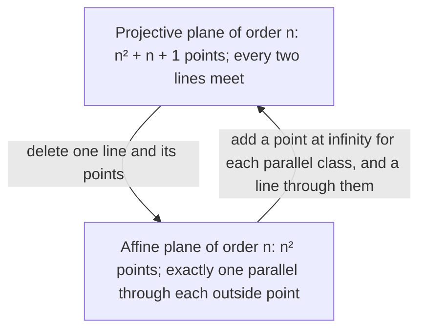

Lesson 39 built a tiny geometry with four points and six lines, and noticed something odd: its two "diagonals" never meet, so it has parallel lines, and each line has exactly one parallel. That is Playfair's axiom, in a geometry you can list on one line of paper. This lesson pushes the idea of a **finite geometry** (an axiom system with finitely many points) further. What if we demand that there are *no* parallels at all, so every two lines meet? The answer is a family of geometries called projective planes. They are small enough to check by hand, they obey a surprising counting law, they have a symmetry between points and lines that ordinary geometry lacks, and one simple question about them is still unsolved.

## Axioms with no parallels

A **projective plane** is an axiom system with undefined terms *point*, *line* and *on*, and three axioms:

- **P1.** Any two distinct points are on exactly one line.
- **P2.** Any two distinct lines meet in exactly one point.
- **P3.** There are four points, no three of which are on one line.

P1 is Euclid's first postulate made exact. P2 replaces the parallel postulate with its most extreme opposite: no parallels anywhere. P3 rules out cheap models. Three points $A$, $B$, $C$ with the three lines $AB$, $BC$, $CA$ satisfy P1 and P2 (check: each pair of lines shares one corner), but they have only three points, so P3 fails. A single line holding every point fails P3 too.

Where does the name come from? In a perspective drawing, parallel railroad tracks meet at a point on the horizon. Projective geometry, which grew out of the study of perspective, takes that seriously: it adds a "point at infinity" to every family of parallel lines, so any two lines meet. We will see exactly how that works for finite geometries below.

## The Fano plane

The smallest projective plane has seven points, $A$ through $G$, and seven lines, each with three points:

$$ADB,\quad BEC,\quad CFA,\quad AGE,\quad BGF,\quad CGD,\quad DEF.$$

It is called the **Fano plane**, after Gino Fano, who described finite geometries like it in 1892. In the usual picture, six of the lines are drawn straight (the sides of a triangle and its three medians) and the seventh line, $DEF$, is drawn as a circle.

Two warnings about the picture. First, a line of a geometry is just a set of points; nothing says it must look straight, so the circle is as good a line as any other. Second, the circle crosses the medians at places with no dot. Those crossings are not points of the geometry, just as the diagonals' crossing wasn't a point of the four-point geometry in Lesson 39.

### Example 1: checking the axioms

Show that the Fano plane is a model of P1, P2 and P3.

**P1.** Take point $A$. It is on three lines, $ADB$, $CFA$ and $AGE$, and its partners on those lines are $D, B, C, F, G, E$: each of the other six points exactly once. So $A$ is joined to every other point by exactly one line. The same check works for each of the seven points (try $G$: lines $AGE$, $BGF$, $CGD$ give partners $A, E, B, F, C, D$).

**P2.** Take line $DEF$. It meets $ADB$ at $D$, $BEC$ at $E$, $CFA$ at $F$, $AGE$ at $E$, $BGF$ at $F$ and $CGD$ at $D$: exactly one point each time. Checking the other lines the same way (or using the symmetry of the picture) covers every pair.

**P3.** The points $A$, $B$, $C$, $G$ work. Every line through two of them ($ADB$, $BEC$, $CFA$, $AGE$, $BGF$, $CGD$) contains exactly two of them, never three.

Because a model exists, the projective plane axioms are **consistent** (Lesson 39).

## Counting: the order of a plane

In the Fano plane every line has 3 points and every point is on 3 lines. That is no accident. In any finite projective plane, every line has the same number of points. Call that number $n + 1$; then $n$ is the **order of a projective plane**. (Why the same number? Given two lines $\ell$ and $m$, pick a point $Q$ on neither; P3 can be used to show one exists. Each point $X$ of $\ell$ gives the line $QX$, which meets $m$ in exactly one point, and this pairs the points of $\ell$ one-to-one with the points of $m$.)

**Theorem.** In a projective plane of order $n$:

- every point is on exactly $n + 1$ lines;
- there are exactly $n^2 + n + 1$ points and $n^2 + n + 1$ lines.

*Why.* Fix a point $P$ and a line $\ell$ not through it. Each line through $P$ meets $\ell$ in exactly one point (P2), and each point $X$ of $\ell$ gives exactly one line $PX$ (P1). So the lines through $P$ match the $n + 1$ points of $\ell$ one-to-one.

Now count points. Each of the $n + 1$ lines through $P$ holds $n$ points other than $P$, and every other point lies on exactly one line through $P$ (P1), so no point is counted twice and none is missed. The total is $1 + (n + 1)n = n^2 + n + 1$. The count of lines is the same argument with "point" and "line" swapped, as the duality section below explains.

### Example 2: a plane of order 3

How many points and lines does a projective plane of order 3 have, and how many points does each line have?

Each line has $n + 1 = 4$ points, each point is on 4 lines, and there are $3^2 + 3 + 1 = 13$ points and 13 lines.

**Check by counting pairs.** There are $\binom{13}{2} = 78$ pairs of points. Each line contains $\binom42 = 6$ pairs, and by P1 each pair is on exactly one line, so the number of lines is $78 \div 6 = 13$. ✓

## Which orders are possible?

For every prime power $n$ (2, 3, 4, 5, 7, 8, 9, 11, 13, 16, …) a projective plane of order $n$ exists. It is built from coordinates in a finite number system, the same way the real projective plane is built from real numbers. For other orders the story is hard:

- **Order 6** is impossible. This follows from the Bruck–Ryser theorem (1949): if $n$ leaves remainder 1 or 2 when divided by 4 and a plane of order $n$ exists, then $n$ must be a sum of two perfect squares. Six leaves remainder 2 and is not a sum of two squares.
- **Order 10** passes the Bruck–Ryser test ($10 = 9 + 1$), yet it is also impossible. That was settled in 1989 by Clement Lam, Larry Thiel and Stanley Swiercz after a massive computer search that used months of supercomputer time.
- **Order 12** is the smallest unsettled case. Whether every finite projective plane has prime-power order is an open problem.

So a question a middle-schooler can understand, "for which $n$ can you arrange $n^2 + n + 1$ points into lines like this?", is still unanswered. Projective planes also turn up in recreational math: the card game *Spot It!* (*Dobble*) is usually explained with the plane of order 7 (57 points, 57 lines), where cards are lines and symbols are points, so any two cards share exactly one symbol. The game's deck of 55 cards is two short of the full 57 lines.

## Affine planes: putting the parallels back

An **affine plane** is the finite cousin of Euclid's plane. Its axioms are P1, Playfair's axiom (through a point not on a line there is exactly one line that doesn't meet it), and "there are three points not all on one line". Lines that don't meet are parallel, and the lines split into **parallel classes**: sets of lines that are all parallel to each other.

The two kinds of plane are two views of the same object.

- **Projective to affine.** Delete one line and all its points. Every other line met the deleted line in exactly one point, so it loses exactly one point. Two lines that used to meet at a deleted point no longer meet: they have become parallel.
- **Affine to projective.** Add one new point to each parallel class (its **point at infinity**), put it on every line of that class, and add one new line containing all the new points. Now parallel lines meet, at infinity, just like railroad tracks on the horizon.

Counting: an affine plane of order $n$ has $(n^2 + n + 1) - (n + 1) = n^2$ points and $n^2 + n$ lines, with $n$ points on each line, in $n + 1$ parallel classes of $n$ lines each.

### Example 3: the four-point geometry, found inside the Fano plane

Delete the line $DEF$ from the Fano plane. What is left?

**Step 1.** The remaining points are $A$, $B$, $C$, $G$.

**Step 2.** Each remaining line loses its one point from $DEF$: $ADB \to AB$, $BEC \to BC$, $CFA \to CA$, $AGE \to AG$, $BGF \to BG$, $CGD \to CG$. Six lines, two points each.

**Step 3.** Four points, six lines, every pair of points on exactly one line, every line with two points: this is exactly Lesson 39's four-point geometry, the affine plane of order 2.

**Step 4.** The parallel classes come from the deleted points. $AB$ and $CG$ used to meet at $D$, so now they are parallel; likewise $BC \parallel AG$ (they met at $E$) and $CA \parallel BG$ (they met at $F$). Three classes of two lines, matching $n + 1 = 3$ classes of $n = 2$ lines.

## Duality

Read axioms P1 and P2 side by side. If you swap the words *point* and *line* (and "are on" with "meet in"), P1 becomes P2 and P2 becomes P1. The swapped version of P3, "there are four lines, no three of which pass through one point", is not an axiom, but it can be proved (Example 4). So every axiom's swapped version, its *dual*, is true in every projective plane. That gives the **principle of duality**: if a statement is a theorem of projective plane geometry, so is its dual, because you can dualize every step of its proof.

Duality is a two-for-one deal. We proved "each line has $n + 1$ points implies each point is on $n + 1$ lines", and counted $n^2 + n + 1$ points; duality hands us $n^2 + n + 1$ lines with no extra work. Affine planes have no such symmetry: two points always have a line, but two lines may have no point.

### Example 4: proving the dual of P3

Show that a projective plane has four lines, no three through one point.

Take the four points $A, B, C, D$ from P3 (no three on a line) and the lines $AB$, $BC$, $CD$, $DA$. Lines $AB$ and $BC$ meet at $B$, and $B$ is not on $CD$ (otherwise $B, C, D$ would be on one line), so $AB$, $BC$, $CD$ share no point. The same reasoning handles the other three choices of three lines: $AB$, $BC$, $DA$ (meeting point $B$, not on $DA$); $AB$, $CD$, $DA$ (meeting point $A$, not on $CD$); $BC$, $CD$, $DA$ (meeting point $D$, not on $BC$). So no three of the four lines are concurrent. ∎

## Common mistakes

- **Expecting lines to look straight.** In a model, a line is a set of points. The circle $DEF$ is a line of the Fano plane.
- **Counting crossings in the picture as points.** Only the seven dots are points.
- **Mixing up the order with the points per line.** A plane of order $n$ has $n + 1$ points on each line; the Fano plane has order 2, not 3.
- **Forgetting P3.** A triangle (three points, three lines) satisfies P1 and P2; P3 is what makes a plane interesting.
- **Assuming every order exists.** Orders 6 and 10 are impossible, and order 12 is unknown.
- **Using duality in an affine plane.** It holds in projective planes because P1 and P2 are duals; Playfair's axiom has no dual partner.

## Key points

- A projective plane: two points determine one line, two lines meet in one point, and four points exist with no three on a line.
- The Fano plane (7 points, 7 lines, 3 on each) is the smallest; it proves the axioms consistent.
- Order $n$: $n + 1$ points per line, $n + 1$ lines per point, $n^2 + n + 1$ points and lines.
- Delete a line from a projective plane to get an affine plane ($n^2$ points, $n + 1$ parallel classes); add points at infinity to go back. The four-point geometry is the affine plane of order 2.
- Duality: swap *point* and *line* in any projective theorem and you get another theorem.
- Prime-power orders exist; 6 and 10 don't; 12 is open.
