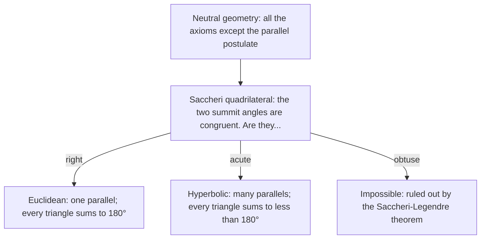

Lesson 40 described three geometries: Euclidean (angle sum $180^\circ$), hyperbolic (less) and spherical (more). This lesson asks what can be proved *before* choosing. Take every axiom of Euclidean geometry except the parallel postulate; the resulting system is called neutral geometry (or absolute geometry), and both Euclidean and hyperbolic geometry are models of it. You will prove that in neutral geometry no triangle's angles can add to more than $180^\circ$, see why that shuts spherical geometry out, and meet the four-sided figure that Girolamo Saccheri used in 1733 in a brave, failed attempt to prove the parallel postulate, which in hindsight was the first serious study of hyperbolic geometry.

## What neutral geometry can prove

Everything in this course that was proved without the parallel postulate stays true in neutral geometry. That includes SAS, ASA, SSS and HL, the isosceles triangle theorems, perpendicular bisectors, and one theorem that does most of the work in this lesson:

**Exterior Angle Inequality.** An exterior angle of a triangle is greater than each remote interior angle.

In Lesson 10 this came from the triangle angle sum, which needs the parallel postulate. But Euclid proved it (his Proposition I.16) with congruent triangles alone, so it holds in neutral geometry. Two consequences:

1. *Any two angles of a triangle add to less than $180^\circ$.* In $\triangle ABC$ the exterior angle at $C$ measures $180^\circ - \angle C$, and it is greater than $\angle A$. So $\angle A + \angle C < 180^\circ$.
2. *Parallels exist.* If a transversal makes congruent alternate interior angles, the lines can't meet, because they would form a triangle with an exterior angle equal to a remote interior angle. So through a point not on a line there is *at least one* parallel.

Spherical geometry breaks both: two great circles always meet, and a triangle with three right angles has two angles adding to $180^\circ$. The sphere is not a model of neutral geometry; its lines close up on themselves, which violates the axioms about betweenness and extending lines that Euclid's proof of I.16 quietly uses.

## The Saccheri–Legendre theorem

**Saccheri–Legendre theorem.** In neutral geometry, the angle sum of every triangle is at most $180^\circ$.

The proof rests on a clever construction that keeps a triangle's angle sum but squeezes one of its angles.

**Lemma.** For any $\triangle ABC$ there is a triangle with the same angle sum and an angle at most $\tfrac12 \angle A$.

*Construction.* Let $M$ be the midpoint of $\overline{BC}$. Extend $\overline{AM}$ past $M$ to a point $E$ with $ME = AM$, and draw $\overline{CE}$.

```shape
{"polygons": [{"points": [[0, 0], [6, 0], [1.5, 3.5]]}], "segments": [{"from": [1.5, 3.5], "to": [4.5, -3.5], "dashed": true}, {"from": [6, 0], "to": [4.5, -3.5]}], "points": [{"at": [1.5, 3.5], "label": "A"}, {"at": [0, 0], "label": "B"}, {"at": [6, 0], "label": "C"}, {"at": [3, 0], "label": "M"}, {"at": [4.5, -3.5], "label": "E"}], "caption": "Legendre's construction: M is the midpoint of BC and ME = AM. Triangle AEC has the same angle sum as triangle ABC."}
```

*Proof.* In $\triangle AMB$ and $\triangle EMC$: $BM = CM$, $AM = EM$, and the angles at $M$ are vertical angles. By SAS the triangles are congruent, so $\angle ABC = \angle ECM$ and $\angle BAM = \angle CEM$. Now add up the angles of $\triangle AEC$:

- at $A$: $\angle CAE = \angle CAM$;
- at $E$: $\angle AEC = \angle BAM$;
- at $C$: $\angle ACE = \angle ACB + \angle BCE = \angle C + \angle B$.

The total is $\angle CAM + \angle BAM + \angle B + \angle C = \angle A + \angle B + \angle C$: the same sum. And the angles at $A$ and $E$ of the new triangle add up to $\angle CAM + \angle BAM = \angle A$, so one of them is at most $\tfrac12\angle A$. ∎

*Proof of the theorem.* Suppose some triangle had angle sum $180^\circ + p$ with $p > 0$. Apply the lemma $k$ times: the result is a triangle with the same sum and an angle at most $\angle A / 2^k$. Choose $k$ so large that $\angle A / 2^k < p$; this step uses the fact that angle measures are real numbers, so halving again and again eventually beats any positive amount (the Archimedean property). The other two angles of that triangle then add to more than $(180^\circ + p) - p = 180^\circ$, which contradicts consequence 1. So no triangle has a sum over $180^\circ$. ∎

### Example 1: watching the lemma work

Apply the construction to a Euclidean triangle with $\angle A = 40^\circ$, $\angle B = 60^\circ$, $\angle C = 80^\circ$.

The new triangle $AEC$ has angle $\angle C + \angle B = 140^\circ$ at $C$, and its angles at $A$ and $E$ split the original $40^\circ$ into two parts, say $x$ and $40^\circ - x$. Its sum is $140^\circ + 40^\circ = 180^\circ$, unchanged, and the smaller of its two other angles is at most $20^\circ$. Repeating gives a triangle with an angle of at most $10^\circ$, then $5^\circ$, then $2.5^\circ$, always with sum $180^\circ$. In a world where some triangle had sum $181^\circ$, eight rounds would give an angle under $40^\circ / 2^8 \approx 0.16^\circ$, forcing the other two angles to add to over $180.8^\circ$: impossible.

## Defect, and why it acts like area

Recall the **defect** of a triangle, $180^\circ$ minus its angle sum (Lesson 40). The Saccheri–Legendre theorem says every defect in neutral geometry is at least 0. A much stronger fact, which we state without proof, is an all-or-nothing theorem: if even one triangle has defect 0, then every triangle does, and the parallel postulate holds. Otherwise every triangle has positive defect, and the geometry is hyperbolic. There is no geometry where some triangles are Euclidean and others are not.

Defect also adds up like area. If a segment from $A$ to a point $D$ on $\overline{BC}$ splits $\triangle ABC$ into two triangles, then

$$\text{defect}(ABC) = \text{defect}(ABD) + \text{defect}(ADC).$$

The two angles at $D$ form a linear pair ($180^\circ$ together), and the two parts of $\angle A$ add to $\angle A$. So the two smaller triangles' angle sums total $\angle A + \angle B + \angle C + 180^\circ$, and their defects total $360^\circ - (\angle A + \angle B + \angle C + 180^\circ) = 180^\circ - (\angle A + \angle B + \angle C)$.

### Example 2: splitting a hyperbolic triangle

A hyperbolic triangle has $\angle A = 50^\circ$, $\angle B = 60^\circ$, $\angle C = 55^\circ$. A segment from $A$ to $D$ on $\overline{BC}$ makes $\angle BAD = 20^\circ$ and $\angle ADB = 95^\circ$. Find the defect of each piece.

**Step 1.** Whole triangle: $180 - (50 + 60 + 55) = 15^\circ$.

**Step 2.** $\triangle ABD$: angles $20^\circ$, $60^\circ$, $95^\circ$, sum $175^\circ$, defect $5^\circ$.

**Step 3.** $\triangle ADC$: $\angle DAC = 50 - 20 = 30^\circ$, $\angle ADC = 180 - 95 = 85^\circ$, $\angle C = 55^\circ$. Sum $170^\circ$, defect $10^\circ$.

**Check.** $5^\circ + 10^\circ = 15^\circ$ ✓. Since hyperbolic area is proportional to defect, the piece $ADC$ has twice the area of $ABD$.

## Saccheri quadrilaterals

A **Saccheri quadrilateral** $ABCD$ has a base $\overline{AB}$, two legs $\overline{AD}$ and $\overline{BC}$ that are perpendicular to the base and congruent to each other, and a **summit** $\overline{DC}$ opposite the base. The angles at $D$ and $C$ are its **summit angles**. In Euclid's world it is a rectangle, but proving that needs the parallel postulate, so in neutral geometry we must not assume it.


The drawing shows how the figure looks in hyperbolic geometry, squeezed onto a flat page: the summit has to be drawn curved, because its true "straight line" bends compared with Euclidean ones.

### Example 3: the summit angles are congruent

Prove, in neutral geometry, that $\angle ADC \cong \angle BCD$.

**Step 1.** Compare $\triangle DAB$ and $\triangle CBA$: $AD = BC$ (given), $\angle DAB = \angle CBA = 90^\circ$, and $\overline{AB}$ is shared. By SAS they are congruent, so the diagonals match: $DB = CA$.

**Step 2.** Compare $\triangle ADC$ and $\triangle BCD$: $AD = BC$, $\overline{DC}$ is shared, and $AC = BD$ from Step 1. By SSS they are congruent.

**Step 3.** Corresponding angles: $\angle ADC \cong \angle BCD$. ∎ No parallel postulate was used. (A similar argument shows the segment joining the midpoints $M$ and $N$ of the base and the summit is perpendicular to both.)

**How big are the summit angles?** Draw diagonal $\overline{AC}$. It splits the quadrilateral into two triangles, each with angle sum at most $180^\circ$, so the quadrilateral's angles add to at most $360^\circ$. With two right angles at the base, $2 \cdot \angle D \le 180^\circ$: the summit angles are right or acute, never obtuse. Saccheri considered all three cases:



Saccheri, a Jesuit priest and mathematician, published *Euclides ab omni naevo vindicatus* ("Euclid freed of every flaw") in 1733. He disposed of the obtuse case correctly. For the acute case he derived theorem after theorem, many of them true theorems of hyperbolic geometry, and finally declared the hypothesis "repugnant to the nature of the straight line". That was not a real contradiction, and so he missed the discovery that Bolyai and Lobachevsky made a century later. Johann Heinrich Lambert went further in 1766 (published in 1786). He studied a **Lambert quadrilateral**, one with three right angles, which is exactly half of a Saccheri quadrilateral cut along $\overline{MN}$. He noticed that under the acute hypothesis a triangle's area is proportional to its defect.

### Example 4: a hyperbolic Saccheri quadrilateral

In hyperbolic geometry a Saccheri quadrilateral has summit angles of $75^\circ$. Find its angle sum and its defect, and describe the two halves cut off by $\overline{MN}$.

**Step 1.** Angle sum: $90 + 90 + 75 + 75 = 330^\circ$.

**Step 2.** The defect of a quadrilateral is $360^\circ$ minus its angle sum: $360 - 330 = 30^\circ$. Check with the diagonal $\overline{AC}$: the two triangles' angle sums add to the quadrilateral's $330^\circ$, so their defects add to $2 \cdot 180 - 330 = 30^\circ$ ✓.

**Step 3.** Each half, $AMND$ and $MBCN$, is a Lambert quadrilateral with angles $90^\circ$, $90^\circ$, $90^\circ$, $75^\circ$ (right angles at the base corner, at $M$ and at $N$). Each has defect $15^\circ$.

## Common mistakes

- **Reading Saccheri–Legendre as "the sum is $180^\circ$".** It says *at most* $180^\circ$; hyperbolic triangles have less.
- **Assuming a Saccheri quadrilateral is a rectangle.** That is equivalent to the parallel postulate. In hyperbolic geometry the summit angles are acute and the summit is longer than the base.
- **Citing the triangle angle sum in a neutral proof.** Only theorems proved without the parallel postulate are allowed, such as SAS and the Exterior Angle Inequality.
- **Treating the sphere as a counterexample to Saccheri–Legendre.** The sphere breaks other axioms of neutral geometry, so the theorem doesn't apply there.
- **Dropping the Archimedean step.** Halving an angle again and again gets below any positive amount only because angle measures are real numbers.

## Key points

- Neutral geometry keeps every axiom except the parallel postulate; it proves the Exterior Angle Inequality, that two angles of a triangle add to less than $180^\circ$, and that parallels exist.
- Saccheri–Legendre theorem: every triangle's angle sum is at most $180^\circ$ (proof by repeated halving with Legendre's construction).
- Defect is never negative, adds up when a triangle is cut in two, and is either 0 for all triangles (Euclidean) or positive for all (hyperbolic).
- A Saccheri quadrilateral has congruent summit angles, which are right (Euclidean) or acute (hyperbolic), never obtuse. Half of one is a Lambert quadrilateral.
