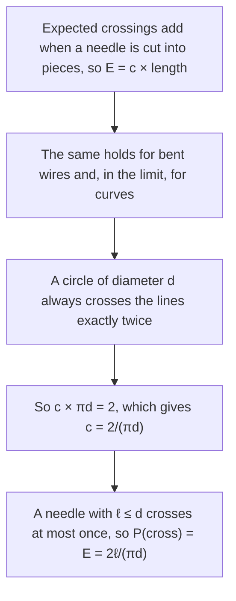

Lesson 41 stated Buffon's formula, $P = \tfrac{2\ell}{\pi d}$, without proof, and it quietly assumed that "at random" always has an obvious meaning. This lesson repairs both. You will derive Buffon's formula twice: once as an area in a rectangle, which is the method of Lesson 41 in disguise, and once by a beautiful argument that needs no calculus at all. Then you will use the formula to estimate $\pi$ by experiment, and finish with Bertrand's paradox, a simple question with three different correct answers, which shows that every probability depends on a model of how the randomness happens.

## Describing a dropped needle

A needle of length $\ell$ falls on a floor ruled with parallel lines $d$ apart, with $\ell \le d$. Two numbers pin down where it lands, as far as crossing is concerned:

- $x$, the distance from the needle's center to the nearest line, between $0$ and $\tfrac d2$;
- $\theta$, the acute angle between the needle and the lines, between $0$ and $\tfrac{\pi}{2}$ radians ($0^\circ$ to $90^\circ$).


Half the needle reaches a vertical distance $\tfrac{\ell}{2}\sin\theta$ from its center (right-triangle trigonometry, Lesson 24). So the needle crosses the nearest line exactly when

$$x \le \frac{\ell}{2}\sin\theta.$$

Since $\ell \le d$, it can't reach a second line (apart from touching two lines at once when $\ell = d$, which has probability 0).

"Dropped at random" now needs a precise meaning. Buffon's model is that $x$ is uniform on $[0, \tfrac d2]$, $\theta$ is uniform on $[0, \tfrac{\pi}{2}]$, and the two are independent. That is a modeling choice, a natural one for a needle tossed carelessly from a height, and experiments agree with it. Keep the word *choice* in mind; it matters at the end of the lesson.

## The sample space is a rectangle

Each drop is a point $(\theta, x)$ in the rectangle $0 \le \theta \le \tfrac{\pi}{2}$, $0 \le x \le \tfrac{d}{2}$. That rectangle is the **sample space**, the set of all possible outcomes, and under Buffon's model the point is uniform in it, exactly like the meeting problem of Lesson 41. Its area is $\tfrac{\pi}{2} \cdot \tfrac{d}{2} = \tfrac{\pi d}{4}$.

```plot
{"x": [0, 1.7], "y": [0, 0.6], "xLabel": "θ (radians)", "yLabel": "x", "functions": [{"f": "0.5*sin(x)", "from": 0, "to": 1.5708, "label": "x = (ℓ/2) sin θ"}], "shade": [{"f": "0.5*sin(x)", "from": 0, "to": 1.5708}], "segments": [{"from": [0, 0.5], "to": [1.5708, 0.5], "dashed": true}, {"from": [1.5708, 0], "to": [1.5708, 0.5], "dashed": true}], "caption": "With ℓ = d = 1: the sample space is the dashed rectangle 0 ≤ θ ≤ π/2, 0 ≤ x ≤ 1/2. The needle crosses when the point lies in the shaded region under the curve."}
```

The favorable region lies under the curve $x = \tfrac{\ell}{2}\sin\theta$. Its area is $\tfrac{\ell}{2}$ times the area under one quarter-wave of $y = \sin\theta$, from $0$ to $\tfrac{\pi}{2}$, and that area is exactly 1. This is a calculus fact, but you can check it with rectangles: four midpoint rectangles give about $1.006$, six give about $1.003$, and the total gets closer to 1 as the rectangles get thinner. So

$$P(\text{cross}) = \frac{\ell/2}{\pi d/4} = \frac{2\ell}{\pi d}.$$

The angle range must be in radians here; in degrees, the rectangle's area would be $90 \cdot \tfrac d2$ and the area under the sine curve would no longer be 1.

### Example 1

A needle 5 cm long is dropped on lines 8 cm apart. Find the probability it crosses a line.

$\ell = 5 \le d = 8$, so the formula applies: $P = \dfrac{2 \cdot 5}{\pi \cdot 8} = \dfrac{5}{4\pi} \approx 0.398$.

## A proof with no calculus: Buffon's noodle

In 1860 Joseph-Émile Barbier found an argument that explains *why* $\pi$ appears. It looks at the expected number of crossings, $E$, instead of the probability.



1. **Crossings add.** Paint a needle in two pieces. Every crossing is made by one piece or the other, so the expected crossings of the whole are the sum of the pieces' expected crossings. A needle twice as long expects twice as many crossings, and in general $E = c \cdot (\text{length})$ for some constant $c$.
2. **Shape doesn't matter.** The same adding works for a rigid wire bent into straight pieces, so its expected number of crossings is also $c$ times its total length. A curve can be approximated by many short straight pieces, so the rule extends to curves. A needle dropped this way is called **Buffon's noodle**.
3. **Use a circle.** A circle of diameter $d$ dropped on the floor always crosses the lines exactly twice (its center is less than $\tfrac d2$ from exactly one line, so it straddles that line and can't reach any other; landing exactly tangent to a line has probability 0). Its length is $\pi d$, so $c \cdot \pi d = 2$ and $c = \tfrac{2}{\pi d}$.
4. **Back to the needle.** With $\ell \le d$ a needle crosses 0 or 1 times, so its expected number of crossings equals its probability of crossing: $P = c\,\ell = \tfrac{2\ell}{\pi d}$.

This argument skips some details (why "proportional to length" holds for every length, and the limit from straight pieces to a smooth curve), but it can be made fully rigorous. It shows where $\pi$ comes from: the circle.

### Example 2: a long needle

A needle twice as long as the line spacing ($\ell = 2d$) is dropped. What does $\tfrac{2\ell}{\pi d}$ tell you?

$\tfrac{2(2d)}{\pi d} = \tfrac{4}{\pi} \approx 1.27$. That is more than 1, so it can't be a probability. Steps 1–3 still hold, so it is the *expected number of crossings*: on average the long needle crosses about 1.27 lines. Only for $\ell \le d$, when the needle crosses at most once, does the expected number equal the probability.

## Estimating $\pi$ by experiment

Solve Buffon's formula for $\pi$: if $C$ of $N$ drops cross, then $\tfrac CN \approx \tfrac{2\ell}{\pi d}$, so

$$\pi \approx \frac{2\ell N}{d\,C}.$$

Estimating a number by random sampling like this is called the **Monte Carlo method**. Today it is done by computer simulation, in physics, engineering and finance, rather than with needles.

### Example 3

With $\ell = 3$ cm and $d = 4$ cm, 500 drops produce 239 crossings. Estimate $\pi$.

$\pi \approx \dfrac{2 \cdot 3 \cdot 500}{4 \cdot 239} = \dfrac{3000}{956} \approx 3.138$.

Monte Carlo estimates improve slowly: the typical error shrinks in proportion to $1/\sqrt{N}$, so 100 times as many drops buy only about one more correct digit. That is why a famous report deserves suspicion. In 1901 Mario Lazzarini said he made 3408 tosses with $\ell/d = 5/6$ and counted 1808 crossings, which gives $\pi \approx \tfrac{2 \cdot 5 \cdot 3408}{6 \cdot 1808} = \tfrac{355}{113} \approx 3.1415929$, correct to six decimal places. With that many tosses the typical error is about 0.05, so six correct decimals would be extraordinary luck. Historians widely suspect that the number of tosses was chosen to land on the well-known fraction $\tfrac{355}{113}$.

## Bertrand's paradox

In 1889 Joseph Bertrand asked: a chord of a circle of radius $r$ is chosen at random. What is the probability that it is longer than a side of the inscribed equilateral triangle?

First the geometry. The side of the inscribed equilateral triangle is $r\sqrt3$. A chord whose midpoint is a distance $t$ from the center has length $2\sqrt{r^2 - t^2}$ (Lesson 28), which is more than $r\sqrt3$ exactly when $t < \tfrac r2$.

Now three reasonable ways to "choose a chord at random":

![Three circles. Circle 1: a chord from a fixed point at the top to a random point on the circle; an inscribed equilateral triangle with a vertex at the fixed point is dashed, and the arc opposite that vertex is green; P = 1/3. Circle 2: a dashed radius with its inner half green, and a chord perpendicular to the radius through a random point on it; P = 1/2. Circle 3: a small green disk of half the radius around the center, and a chord whose midpoint is a random point in the disk; P = 1/4. Green marks where the chord is longer than the triangle's side.](images/geo-m10-bertrand.svg)

1. **Random endpoints.** Pick two points uniformly on the circle. By symmetry, fix the first one and draw the inscribed equilateral triangle with a vertex there. Its other two vertices cut off the $120^\circ$ arc opposite the first point, and the chord is longer than a side exactly when the second point lands on that arc: $P = \tfrac{120}{360} = \tfrac13$.
2. **Random radius.** Pick a radius, pick a point uniformly along it, and draw the chord perpendicular to the radius through that point. Then $t$ is uniform on $[0, r]$, and $P(t < \tfrac r2) = \tfrac12$.
3. **Random midpoint.** Pick the chord's midpoint uniformly in the disk. The chord is long when the midpoint lies in the disk of radius $\tfrac r2$: $P = \tfrac{\pi (r/2)^2}{\pi r^2} = \tfrac14$.

Each calculation is correct. They disagree because they answer three different questions: each method spreads probability over the chords in a different way. **Bertrand's paradox** is the lesson that "at random" means nothing until you say how the random choice is made. A geometric probability always rests on a model, as Buffon's did. Which model is "right" depends on the physical situation. Some, notably E. T. Jaynes in 1973, argued that method 2 is the natural answer for experiments like tossing straws onto a circle drawn on the floor, but there is no agreement that the question has one correct answer.

### Example 4: chords longer than the radius

Using each of Bertrand's three methods, find the probability that a random chord is longer than the radius $r$.

**Condition.** $2\sqrt{r^2 - t^2} > r$ means $r^2 - t^2 > \tfrac{r^2}{4}$, so $t < \tfrac{\sqrt3}{2} r$.

**Method 1.** If the two endpoints are separated by a central angle $\varphi$, the chord has length $2r\sin\tfrac{\varphi}{2}$, which equals $r$ when $\varphi = 60^\circ$. The chord is longer than $r$ when the second endpoint is more than $60^\circ$ away from the first in either direction, which leaves an arc of $360 - 2 \cdot 60 = 240^\circ$: $P = \tfrac{240}{360} = \tfrac23$.

**Method 2.** $P = \tfrac{\sqrt3}{2} \approx 0.866$.

**Method 3.** $P = \left(\tfrac{\sqrt3}{2}\right)^2 = \tfrac34$.

Again three different answers, from three different models.

## Common mistakes

- **Using degrees for $\theta$ in the rectangle.** The area under $\sin\theta$ is 1 only with $\theta$ in radians.
- **Using $\tfrac{2\ell}{\pi d}$ as a probability when $\ell > d$.** It is then the expected number of crossings, and it can exceed 1.
- **Measuring $x$ from the needle's end.** It is the distance from the needle's *center* to the nearest line, which is why it runs only from 0 to $\tfrac d2$.
- **Expecting Monte Carlo to be fast.** Accuracy grows like $\sqrt N$; a few hundred drops give only a digit or two.
- **Saying Bertrand's problem has one right answer.** Each method is a different probability model, and each answer is correct for its model.

## Key points

- Buffon's needle ($\ell \le d$): with $x$ uniform on $[0, \tfrac d2]$ and $\theta$ uniform on $[0, \tfrac{\pi}{2}]$, the needle crosses when $x \le \tfrac{\ell}{2}\sin\theta$, and $P = \tfrac{2\ell}{\pi d}$.
- Barbier's argument: expected crossings are proportional to length for any shape; a circle of diameter $d$ always crosses twice, which fixes the constant $\tfrac{2}{\pi d}$.
- Monte Carlo: $\pi \approx \tfrac{2\ell N}{dC}$; the error shrinks only like $\tfrac{1}{\sqrt N}$.
- Bertrand's paradox: random endpoints, random radius and random midpoint give $\tfrac13$, $\tfrac12$ and $\tfrac14$. Probability depends on the model of randomness.
