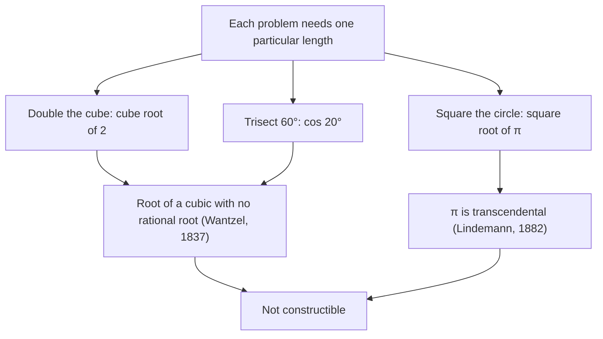

In Lesson 4 you learned the classic constructions: copying segments and angles, bisecting them, drawing perpendiculars and parallels, and building an equilateral triangle and a regular hexagon. A remark at the end of that lesson said that trisecting an arbitrary angle is *impossible* with compass and straightedge. That's a strong claim. It doesn't say nobody has found a way yet; it says no way can ever exist. This lesson explains where a claim like that comes from. We'll turn constructions into arithmetic, find exactly which lengths the two tools can produce, and then see why three famous problems from ancient Greece (trisecting an angle, doubling a cube and squaring a circle) are out of reach, and which regular polygons can be built.

## Lengths as numbers

Start with one segment and call its length 1. A length you can build from that unit segment in finitely many compass and straightedge steps is a **constructible number** (or constructible length). The question "what can the tools do?" becomes "which numbers are constructible?"

Some are easy. Copying the unit segment end to end along a line gives 2, 3, 4 and every whole number. Copying one segment onto another and marking the leftover gives differences. So if $a$ and $b$ are constructible, so are $a + b$ and $a - b$ (for $a > b$).

## Multiplying and dividing with parallel lines

Multiplication is less obvious: a compass can't "multiply." The trick is the Side Splitter Theorem from Lesson 21.

**Product construction.** Draw any angle with vertex $O$. On one side mark $U$ and $B$ with $OU = 1$ and $OB = b$. On the other side mark $A$ with $OA = a$. Draw $\overline{UA}$. Through $B$, construct the parallel to $\overline{UA}$ (Lesson 4, Construction 5); it meets the second side at $P$.

```shape
{"segments": [{"from": [0, 0], "to": [9, 0], "arrow": true}, {"from": [0, 0], "to": [8.4, 4.2], "arrow": true}, {"from": [2, 0], "to": [3, 1.5]}, {"from": [5, 0], "to": [7.5, 3.75], "dashed": true}], "points": [{"at": [0, 0]}, {"at": [2, 0]}, {"at": [5, 0]}, {"at": [3, 1.5]}, {"at": [7.5, 3.75], "label": "P"}], "labels": [{"at": [2.55, 1.9], "text": "A"}, {"at": [-0.45, 0], "text": "O"}, {"at": [2, -0.5], "text": "U"}, {"at": [5, -0.5], "text": "B"}, {"at": [1, -0.5], "text": "1"}, {"at": [3.5, -0.5], "text": "b − 1"}], "caption": "Product construction: OU = 1, OB = b, OA = a. The line through B parallel to UA meets the other side at P, and OP = ab."}
```

Because $\overline{BP} \parallel \overline{UA}$, triangles $OUA$ and $OBP$ are similar (AA: they share $\angle O$, and corresponding angles are congruent). So

$$\frac{OP}{OA} = \frac{OB}{OU} \quad\Longrightarrow\quad \frac{OP}{a} = \frac{b}{1} \quad\Longrightarrow\quad OP = ab.$$

**Quotient construction.** Use the same picture with the roles changed: mark $OU = 1$ and $OB = b$ on one side, $OA = a$ on the other, draw $\overline{BA}$, and draw the parallel to it through $U$, meeting the second side at $Q$. Now $\tfrac{OQ}{OA} = \tfrac{OU}{OB}$, so $OQ = \tfrac{a}{b}$.

The same idea divides a segment into equal parts, which is the most useful version in practice.

### Example 1

Divide a segment $\overline{AB}$ into 5 congruent parts.

**Step 1.** Draw a ray from $A$ that is not along $\overline{AB}$. With any compass opening, step off 5 equal segments along it from $A$, ending at points $X_1, X_2, X_3, X_4, X_5$.

**Step 2.** Draw $\overline{X_5 B}$.

**Step 3.** Through each of $X_1, \dots, X_4$, construct the parallel to $\overline{X_5 B}$. These parallels cut $\overline{AB}$ at four points.

*Why it works:* by the Side Splitter Theorem (applied in triangle $AX_5B$), parallels to $\overline{X_5B}$ cut $\overline{AB}$ in the same ratios as they cut $\overline{AX_5}$, and those pieces are all equal. So $\overline{AB}$ is cut into 5 equal parts. No measuring was needed, and the length of $\overline{AB}$ didn't even have to be known.

## Square roots from a semicircle

The tools can also take square roots, which no amount of adding and multiplying can do. The construction uses Thales' theorem (Lesson 29) and the Geometric Mean (Altitude) Theorem (Lesson 23).


**Square root construction.** On a line, mark $AB = a$ and then $BC = 1$, so $AC = a + 1$. Find the midpoint $M$ of $\overline{AC}$ (perpendicular bisector) and draw the semicircle with center $M$ through $A$ and $C$. Construct the perpendicular to $\overline{AC}$ at $B$; it meets the semicircle at $D$. Then $BD = \sqrt a$.

*Why it works:* $\angle ADC$ is inscribed in a semicircle, so it's a right angle. $\overline{DB}$ is the altitude to the hypotenuse of right triangle $ADC$, so it's the geometric mean of the two pieces of the hypotenuse: $BD = \sqrt{AB \cdot BC} = \sqrt{a \cdot 1} = \sqrt a$.

### Example 2

Starting from a unit segment, construct the length $\varphi = \dfrac{1 + \sqrt5}{2} \approx 1.618$ (the **golden ratio**, studied in the Module 6 honors lesson; it reappears in Lesson 93 as the diagonal of a regular pentagon with side 1).

**Step 1.** Build $\sqrt5$. Either use the semicircle with $a = 5$, or more simply construct a right triangle with legs 1 and 2 (perpendicular at the end of a segment of length 2, then copy the unit onto it). Its hypotenuse is $\sqrt{1^2 + 2^2} = \sqrt5$.

**Step 2.** Extend the hypotenuse by copying the unit segment onto its end: total length $1 + \sqrt5$.

**Step 3.** Bisect that segment with a perpendicular bisector. Each half has length $\tfrac{1 + \sqrt5}{2} \approx \tfrac{1 + 2.236}{2} = 1.618$.

Only additions, a square root and a division by 2 were used, so $\varphi$ is constructible.

## Which numbers are constructible?

Combining the constructions above, every number you can reach from 1 using $+$, $-$, $\times$, $\div$ and square roots, in any finite combination, is constructible. Numbers like $\sqrt{2 + \sqrt3}$ or $\dfrac{3 - \sqrt{7}}{\sqrt5}$ all qualify.

The remarkable part is the converse: *nothing else* is constructible. We state this without a full proof, which needs college algebra (field theory), but the reason can be seen. Put the construction on a coordinate grid. Every new point is an intersection of two lines, a line and a circle, or two circles. Two lines meet where a *linear* system is solved; a circle meets a line or another circle where a *quadratic* equation is solved (subtracting two circle equations leaves a line). Solving a quadratic needs at most one new square root, by the quadratic formula. So each step can only add, subtract, multiply, divide and take square roots of numbers you already had.

This gives a practical test, also stated without proof: *if a cubic equation with rational coefficients has no rational root, none of its roots is constructible.* A cube root of something is the typical number that square roots can never reach.

## The three classical problems

The Greeks posed three construction problems they could not solve with compass and straightedge alone. All three were settled in the 1800s, and all three answers are "impossible."



**Doubling the cube.** Given a cube, construct the edge of a cube with twice the volume. If the old edge is 1, the new edge $x$ satisfies $x^3 = 2$.

### Example 3

Show that the edge needed to double a unit cube is not constructible.

**Step 1.** The edge is a root of $x^3 - 2 = 0$, a cubic with rational (in fact whole-number) coefficients.

**Step 2.** By the Rational Root Theorem from algebra (a rational root $\tfrac pq$ in lowest terms has $p$ dividing the constant term and $q$ dividing the leading coefficient), a rational root would have to be $\pm1$ or $\pm2$. Test them: $1^3 = 1$, $(-1)^3 = -1$, $2^3 = 8$, $(-2)^3 = -8$. None equals 2.

**Step 3.** So the cubic has no rational root, and by the test above $\sqrt[3]{2} \approx 1.26$ is not constructible. Doubling the cube is impossible with compass and straightedge.

**Trisecting an angle.** Some angles can be trisected: a $90^\circ$ angle splits into three $30^\circ$ angles, and $30^\circ$ is constructible (bisect an angle of an equilateral triangle). The claim is that there is no method that works for *every* angle, and one counterexample is $60^\circ$. Trisecting it means constructing $20^\circ$, which is the same as constructing the length $\cos 20^\circ$ (mark 1 along one side and drop a perpendicular to the other). The triple-angle identity $\cos 3\theta = 4\cos^3\theta - 3\cos\theta$ with $\theta = 20^\circ$ gives $4c^3 - 3c = \cos 60^\circ = \tfrac12$, so $c = \cos 20^\circ$ is a root of

$$8c^3 - 6c - 1 = 0.$$

The possible rational roots are $\pm1, \pm\tfrac12, \pm\tfrac14, \pm\tfrac18$, and none of them works (for example, $c = \tfrac12$ gives $1 - 3 - 1 = -3$). So $\cos 20^\circ$ is not constructible, and no compass-and-straightedge method trisects $60^\circ$. Pierre Wantzel published proofs for both doubling the cube and trisection in 1837.

**Squaring the circle.** Given a circle of radius 1, construct a square of the same area, $\pi$. Its side would be $\sqrt\pi$. If $\sqrt\pi$ were constructible, so would $\pi$ be (multiply it by itself). But in 1882 Ferdinand von Lindemann proved that $\pi$ is **transcendental**: it isn't a root of *any* polynomial equation with rational coefficients. Every constructible number is a root of such an equation, so $\pi$ isn't constructible.

"Impossible" here is about these exact rules: an unmarked straightedge, a compass and finitely many steps. Allow a ruler with two marks on it and an angle can be trisected (a "sliding ruler" method is attributed to Archimedes), and paper folding can trisect angles too. Approximations as close as you like are always possible. None of that contradicts Wantzel; it just uses different tools.

## Regular polygons

Lesson 4 built the equilateral triangle, the square and the regular hexagon, and bisecting central angles doubles the number of sides, giving 8, 12, 16, 24 sides and so on. A regular pentagon is also constructible, since $\cos 72^\circ = \tfrac{\sqrt5 - 1}{4}$ uses only a square root. But a regular heptagon (7 sides) is not.

In 1796, at 18, Carl Friedrich Gauss found that a regular 17-gon *is* constructible, the first new constructible polygon with a prime number of sides since antiquity. His work, completed by Wantzel's 1837 proof of the "only if" direction, gives the **Gauss–Wantzel theorem**: a regular $n$-gon is constructible exactly when $n$ is a power of 2 times a product of *distinct* **Fermat primes**, primes of the form $2^{2^k} + 1$.

The known Fermat primes are 3, 5, 17, 257 and 65537. Nobody knows whether there are more; none has been found beyond these five, and many larger numbers of that form have been shown to be composite.

### Example 4

Which regular polygons with 9, 10, 15, 18 and 20 sides are constructible?

- $9 = 3 \cdot 3$: the Fermat prime 3 is used twice, so the factors aren't distinct. **Not constructible** (this is the trisection problem again: a $40^\circ$ central angle would trisect $120^\circ$).
- $10 = 2 \cdot 5$: a power of 2 times the Fermat prime 5. **Constructible** (bisect the pentagon's central angles).
- $15 = 3 \cdot 5$: two distinct Fermat primes. **Constructible.** Its central angle is $24^\circ = 144^\circ - 120^\circ$: two central angles of a pentagon minus one of a triangle ($\tfrac25$ of a turn minus $\tfrac13$ of a turn is $\tfrac{1}{15}$ of a turn).
- $18 = 2 \cdot 9$: contains $3 \cdot 3$. **Not constructible.**
- $20 = 4 \cdot 5$: **constructible.**

A consequence worth knowing: an angle of a whole number of degrees is constructible exactly when it's a multiple of $3^\circ$. ($3^\circ = 18^\circ - 15^\circ$, where $18^\circ$ is a quarter of the pentagon's $72^\circ$ central angle and $15^\circ$ a quarter of $60^\circ$. If $1^\circ$ were constructible, copying it 20 times would construct $20^\circ$, which is impossible.)

## Common mistakes

- **Reading "impossible" as "not yet discovered."** The impossibility proofs show no method can exist under the rules. Claimed trisections always either break a rule (a marked ruler, infinitely many steps) or are approximations.
- **Thinking no angle can be trisected.** Many can ($90^\circ$, $180^\circ$, $45^\circ$). The theorem says no single method works for *every* angle.
- **Forgetting the word "distinct"** in the Gauss–Wantzel theorem: 9 and 25 are odd products of Fermat primes, but with a repeat, so the 9-gon and 25-gon are not constructible.
- **Mixing up the square root construction.** The perpendicular goes up at the point $B$ where the two pieces $a$ and $1$ meet, not at the center $M$. At the center you'd get the radius, $\tfrac{a + 1}{2}$.

## Key points

- A constructible number is a length you can build from a unit segment. Sums, differences, products, quotients and square roots of constructible numbers are constructible, and nothing else is.
- Products and quotients come from parallel lines and similar triangles; square roots come from the altitude in a semicircle.
- A root of a cubic with rational coefficients and no rational root is not constructible, so $\sqrt[3]{2}$ (doubling the cube) and $\cos 20^\circ$ (trisecting $60^\circ$) can't be built (Wantzel, 1837). $\pi$ is transcendental (Lindemann, 1882), so the circle can't be squared.
- Gauss–Wantzel: a regular $n$-gon is constructible exactly when $n$ is a power of 2 times distinct Fermat primes (3, 5, 17, 257, 65537 are the known ones).
