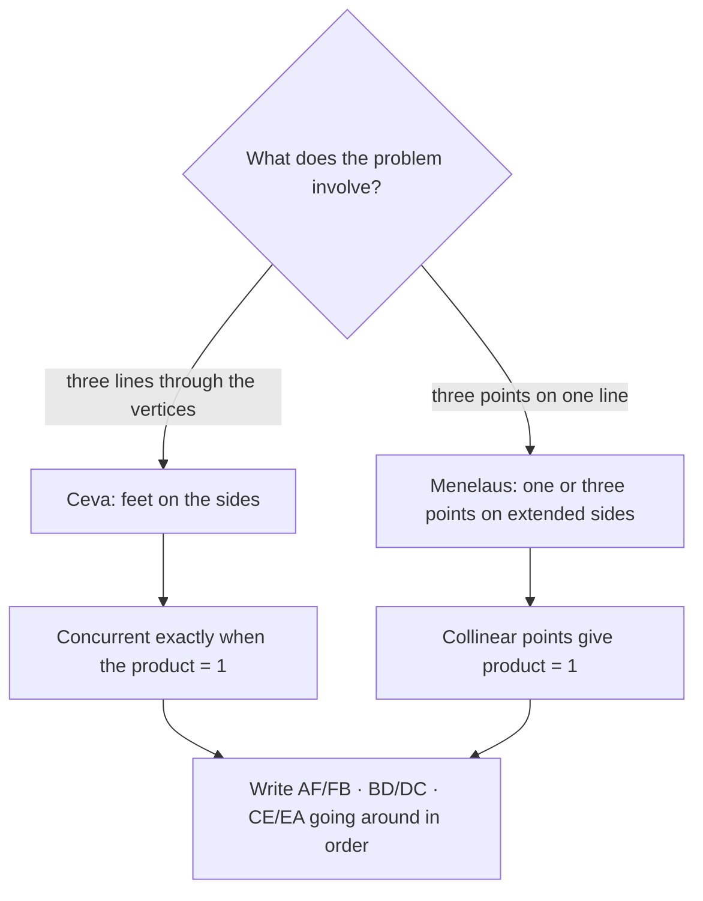

In Lessons 15 and 16 you met four triangle centers, and each needed its own argument: perpendicular bisectors meet because of equidistance, medians meet at the balance point, and so on. This lesson gives one test that settles them all at once. **Ceva's theorem** says exactly when three lines from the vertices of a triangle meet at one point, using nothing but the ratios in which they cut the sides. Its partner, **Menelaus's theorem**, says exactly when three points on the sides (or their extensions) lie on one line. Both turn questions about concurrence and collinearity into multiplying three fractions.

## Cevians and the ratio product

A **cevian** is a segment from a vertex of a triangle to a point on the opposite side. Medians, angle bisectors and (in an acute triangle) altitudes are all cevians, but most cevians are none of these.

Take cevians $\overline{AD}$, $\overline{BE}$, $\overline{CF}$ with $D$ on $\overline{BC}$, $E$ on $\overline{CA}$ and $F$ on $\overline{AB}$. Walk around the triangle $A \to F \to B \to D \to C \to E \to A$ and record how each foot divides its side:

$$\frac{AF}{FB} \cdot \frac{BD}{DC} \cdot \frac{CE}{EA}.$$

Notice the pattern: each fraction starts at the vertex where the previous one ended, and the letters go around the triangle in order. Getting this order right is most of the work.

## Ceva's theorem

**Ceva's theorem.** For cevians $\overline{AD}$, $\overline{BE}$, $\overline{CF}$ whose feet lie on the sides of $\triangle ABC$, the three cevians are concurrent if and only if

$$\frac{AF}{FB} \cdot \frac{BD}{DC} \cdot \frac{CE}{EA} = 1.$$

Giovanni Ceva published it in 1678.

*Proof that concurrent cevians give 1.* Suppose the cevians meet at $P$. We use areas; write $[XYZ]$ for the area of triangle $XYZ$. Triangles $ABD$ and $ADC$ have the same height from $A$, so their areas are in the ratio of their bases: $\tfrac{[ABD]}{[ADC]} = \tfrac{BD}{DC}$. The same is true of $PBD$ and $PDC$ (same height from $P$). When two fractions are equal, $\tfrac{x}{y} = \tfrac{u}{v} = k$, the difference of the tops over the difference of the bottoms is also $k$, since $x - u = k(y - v)$. Subtracting the small triangles from the large ones:

$$\frac{BD}{DC} = \frac{[ABD] - [PBD]}{[ADC] - [PDC]} = \frac{[ABP]}{[ACP]}.$$

In the same way, $\tfrac{CE}{EA} = \tfrac{[BCP]}{[BAP]}$ and $\tfrac{AF}{FB} = \tfrac{[CAP]}{[CBP]}$. Multiply the three: every area appears once on top and once on the bottom, so the product is 1. $\blacksquare$

*Proof of the converse.* Suppose the product is 1. Let $\overline{AD}$ and $\overline{BE}$ meet at $P$, and let ray $\overrightarrow{CP}$ meet $\overline{AB}$ at $F'$. The three cevians through $P$ are concurrent, so by the first part $\tfrac{AF'}{F'B} \cdot \tfrac{BD}{DC} \cdot \tfrac{CE}{EA} = 1$. Comparing with the given product, $\tfrac{AF'}{F'B} = \tfrac{AF}{FB}$. But only one point of $\overline{AB}$ divides it in a given ratio, so $F' = F$, and $\overline{CF}$ passes through $P$. $\blacksquare$

(Ceva's theorem also holds when two of the feet lie on extensions of the sides and the lines meet outside the triangle, if the ratios are given signs. This lesson keeps all three feet on the sides.)

### Example 1

In $\triangle ABC$, cevians $\overline{AD}$, $\overline{BE}$, $\overline{CF}$ are concurrent. $AF = 4$, $FB = 6$, $BD = 9$, $DC = 12$ and $CA = 18$. Find $CE$ and $EA$.

**Step 1.** Ratios: $\tfrac{AF}{FB} = \tfrac46 = \tfrac23$ and $\tfrac{BD}{DC} = \tfrac{9}{12} = \tfrac34$.

**Step 2.** Ceva: $\tfrac23 \cdot \tfrac34 \cdot \tfrac{CE}{EA} = 1$, so $\tfrac12 \cdot \tfrac{CE}{EA} = 1$ and $\tfrac{CE}{EA} = 2$.

**Step 3.** Split 18 in the ratio $2 : 1$: $CE = 12$, $EA = 6$.

## The classic centers in one stroke

**Medians.** Each foot is a midpoint, so each ratio is 1 and the product is $1 \cdot 1 \cdot 1 = 1$. The medians are concurrent.

**Angle bisectors.** The Triangle Angle Bisector Theorem (Lesson 21) says the bisector from $A$ divides $\overline{BC}$ in the ratio of the adjacent sides: $\tfrac{BD}{DC} = \tfrac{AB}{AC}$. With side lengths $a = BC$, $b = CA$, $c = AB$:

$$\frac{AF}{FB} \cdot \frac{BD}{DC} \cdot \frac{CE}{EA} = \frac{b}{a} \cdot \frac{c}{b} \cdot \frac{a}{c} = 1.$$

So the angle bisectors are concurrent (at the incenter).

**Altitudes (acute triangle).** If $D$ is the foot of the altitude from $A$, right triangle $ABD$ gives $BD = c\cos B$, and right triangle $ADC$ gives $DC = b\cos C$ (Lesson 24). Doing the same at each vertex,

$$\frac{b\cos A}{a\cos B} \cdot \frac{c\cos B}{b\cos C} \cdot \frac{a\cos C}{c\cos A} = 1,$$

so the altitudes are concurrent (at the orthocenter). Every factor cancels.

### Example 2

The incircle of $\triangle ABC$ touches $\overline{BC}$, $\overline{CA}$, $\overline{AB}$ at $D$, $E$, $F$. Prove that $\overline{AD}$, $\overline{BE}$, $\overline{CF}$ are concurrent.

**Step 1.** Two tangent segments from the same outside point to a circle are congruent (Lesson 28). From $A$: $AF = AE$; call this length $x$. From $B$: $BF = BD = y$. From $C$: $CD = CE = z$.

**Step 2.** Ceva's product: $\tfrac{AF}{FB} \cdot \tfrac{BD}{DC} \cdot \tfrac{CE}{EA} = \tfrac{x}{y} \cdot \tfrac{y}{z} \cdot \tfrac{z}{x} = 1$.

**Step 3.** By the converse, the three cevians are concurrent. $\blacksquare$ Their common point is called the Gergonne point, after Joseph Gergonne. It is generally *not* the incenter: the incenter lies on the angle bisectors, and $\overline{AD}$ is an angle bisector only when $AB = AC$.

## Menelaus's theorem

Now put the three points on one line instead. A line that crosses the lines of a triangle's sides is a **transversal** of the triangle. A line that misses the vertices can't cross all three sides themselves: it crosses two sides and the extension of the third, or it misses the triangle and meets all three extensions.

**Menelaus's theorem.** If a line meets lines $BC$, $CA$, $AB$ at points $D$, $E$, $F$ (none of them a vertex), then

$$\frac{AF}{FB} \cdot \frac{BD}{DC} \cdot \frac{CE}{EA} = 1.$$

It's named for Menelaus of Alexandria (about 100 CE), who used a version of it in his work on spherical triangles.

*Proof.* Drop perpendiculars from $A$, $B$, $C$ to the transversal, with lengths $h_A$, $h_B$, $h_C$. The perpendiculars from $A$ and $B$ form two right triangles with $F$, and those triangles are similar: their angles at $F$ are vertical angles (or the same angle, if $A$ and $B$ are on the same side of the line). So $\tfrac{AF}{FB} = \tfrac{h_A}{h_B}$. In the same way $\tfrac{BD}{DC} = \tfrac{h_B}{h_C}$ and $\tfrac{CE}{EA} = \tfrac{h_C}{h_A}$. Multiply: $\tfrac{h_A}{h_B} \cdot \tfrac{h_B}{h_C} \cdot \tfrac{h_C}{h_A} = 1$. $\blacksquare$

The formula is the same as Ceva's, so how do you tell them apart? By where the points are. With Ceva, all three feet are on the sides. With Menelaus, one or three of the points are on extensions. (In the signed-ratio version, used in college geometry, Ceva's product is $+1$ and Menelaus's is $-1$, and the converse of Menelaus's theorem says a product of $-1$ forces the three points onto one line. With unsigned lengths, as here, the converse needs the condition that one or three points lie on extensions.)

### Example 3

A line crosses side $\overline{AB}$ of $\triangle ABC$ at $F$, side $\overline{AC}$ at $E$, and the extension of $\overline{BC}$ beyond $C$ at $D$. $AF = 4$, $FB = 6$, $BC = 10$, $CD = 5$ and $AC = 12$. Find $CE$ and $EA$.

**Step 1.** $D$ is beyond $C$, so $BD = BC + CD = 15$ and $\tfrac{BD}{DC} = \tfrac{15}{5} = 3$. Also $\tfrac{AF}{FB} = \tfrac46 = \tfrac23$.

**Step 2.** Menelaus: $\tfrac23 \cdot 3 \cdot \tfrac{CE}{EA} = 1$, so $2 \cdot \tfrac{CE}{EA} = 1$ and $\tfrac{CE}{EA} = \tfrac12$.

**Step 3.** Split 12 in the ratio $1 : 2$: $CE = 4$, $EA = 8$.

### Example 4

Use Menelaus's theorem to prove that the centroid divides each median in the ratio $2 : 1$.

**Step 1.** In $\triangle ABC$, let $D$ be the midpoint of $\overline{BC}$ and $E$ the midpoint of $\overline{CA}$. Medians $\overline{AD}$ and $\overline{BE}$ meet at the centroid $G$.

**Step 2.** Look at $\triangle ADC$ and the line through $B$, $G$, $E$. It crosses side $\overline{AD}$ at $G$, side $\overline{CA}$ at $E$, and the extension of $\overline{DC}$ at $B$. Going around $A \to D \to C \to A$:

$$\frac{AG}{GD} \cdot \frac{DB}{BC} \cdot \frac{CE}{EA} = 1.$$

**Step 3.** $DB = \tfrac12 BC$, so $\tfrac{DB}{BC} = \tfrac12$; and $E$ is a midpoint, so $\tfrac{CE}{EA} = 1$. Then $\tfrac{AG}{GD} \cdot \tfrac12 = 1$, so $\tfrac{AG}{GD} = 2$. $\blacksquare$ Lesson 16 stated this ratio, and the Module 5 honors lesson proved it another way; Menelaus's theorem gives it in two lines.

## Common mistakes

- **Breaking the cycle.** Each ratio must start where the last one ended: $\tfrac{AF}{FB} \cdot \tfrac{BD}{DC} \cdot \tfrac{CE}{EA}$. Writing $\tfrac{FB}{AF}$ for one factor flips it and gives the wrong answer.
- **Using whole sides instead of pieces.** In Ceva's theorem every ratio compares the two pieces of one side, never a piece to the whole side.
- **Forgetting that an extended side changes a length.** In Example 3, $BD$ is $BC + CD = 15$, not 10.
- **Confusing the two theorems.** Same product, different situations: concurrent cevians (Ceva) or collinear points (Menelaus).
- **Assuming the Gergonne point is the incenter.** It comes from the touch points, not from the angle bisectors.

## Key points

- A cevian joins a vertex to a point on the opposite side.
- Ceva: cevians $\overline{AD}$, $\overline{BE}$, $\overline{CF}$ are concurrent exactly when $\tfrac{AF}{FB} \cdot \tfrac{BD}{DC} \cdot \tfrac{CE}{EA} = 1$. It proves at once that medians, angle bisectors and altitudes are concurrent.
- Menelaus: if a transversal meets lines $BC$, $CA$, $AB$ at $D$, $E$, $F$, the same product equals 1. One or three of the points lie on extended sides.
- Both proofs compare areas or perpendicular heights; both theorems turn questions of concurrence or collinearity into multiplying three ratios.
