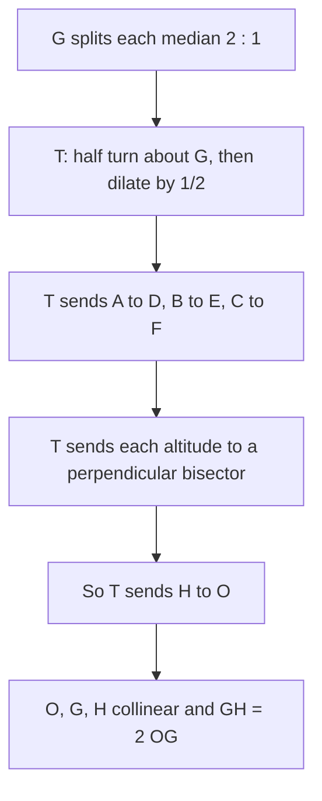

Lesson 16 ended with a remarkable fact, stated without proof: in any triangle, the circumcenter $O$, the centroid $G$ and the orthocenter $H$ lie on one line, the Euler line, with $G$ one-third of the way from $O$ to $H$. Leonhard Euler found it in 1765 by algebraic calculation from the side lengths. The Module 5 honors lesson *Proving the triangle centers exist* proves it with coordinates. This lesson proves it with no coordinates at all, using a single transformation, and then uses a second transformation to find one of the most surprising facts in elementary geometry: nine special points of every triangle lie on one circle.

The tools are ones you already have: the centroid's $2 : 1$ ratio (Lesson 16), midsegments (Lesson 16), dilations (Lesson 37) and Thales' theorem (Lesson 29).

## The medial triangle

The three midpoints of the sides, $D$ on $\overline{BC}$, $E$ on $\overline{CA}$ and $F$ on $\overline{AB}$, form the **medial triangle** $DEF$. Its sides are the three midsegments, so each side of $\triangle DEF$ is parallel to a side of $\triangle ABC$ and half as long. In particular $\overline{EF} \parallel \overline{BC}$.

Now look at the centroid $G$. It lies on median $\overline{AD}$ with $AG = 2\,GD$, and $D$ is on the opposite side of $G$ from $A$. So the map "*rotate $180^\circ$ about $G$, then dilate by $\tfrac12$ from $G$*" sends $A$ to $D$. In the same way it sends $B$ to $E$ and $C$ to $F$. Call this map $T$. (Lesson 37 noted that some books call $T$ a dilation with scale factor $-\tfrac12$.) A half-turn and a dilation each send every line to a parallel line (a rotation by any other angle would not), so $T$ does too; it also keeps angles and halves every length. So $T$ maps $\triangle ABC$ onto its medial triangle.

## Proof of the Euler line

**Euler line theorem.** In any triangle that isn't equilateral, $O$, $G$ and $H$ are collinear, $G$ lies between $O$ and $H$, and $GH = 2\,OG$.

*Proof.*

**Step 1.** The altitude from $A$ is the line through $A$ perpendicular to $\overline{BC}$. Apply $T$. The image passes through $T(A) = D$ and is parallel to the altitude, so it's perpendicular to $\overline{BC}$. A line through the midpoint of $\overline{BC}$ perpendicular to it is the perpendicular bisector of $\overline{BC}$.

**Step 2.** The same holds at each vertex: $T$ sends the three altitudes of $\triangle ABC$ to the three perpendicular bisectors of its sides.

**Step 3.** $H$ lies on all three altitudes, so $T(H)$ lies on all three perpendicular bisectors. The only such point is the circumcenter. So $T(H) = O$.

**Step 4.** By the definition of $T$, $O$ is on the line $HG$, on the other side of $G$ from $H$, and $GO = \tfrac12\,GH$. $\blacksquare$

In an equilateral triangle $O = G = H$, so there's no line to speak of; in every other triangle they are three different points.

The proof also gives a formula. If you know any two of $O$, $G$, $H$, you can find the third: $G$ is $\tfrac13$ of the way from $O$ to $H$, so in coordinates

$$G = \frac{2O + H}{3}, \qquad H = 3G - 2O.$$

### Example 1

Lesson 16 found that the triangle $A(0, 0)$, $B(6, 0)$, $C(2, 4)$ has orthocenter $H(2, 2)$. Find $G$ and $O$, and check the Euler line relation.

**Step 1.** Centroid: $G = \left(\tfrac{0 + 6 + 2}{3}, \tfrac{0 + 0 + 4}{3}\right) = \left(\tfrac83, \tfrac43\right)$.

**Step 2.** Circumcenter. The perpendicular bisector of $\overline{AB}$ is $x = 3$. The midpoint of $\overline{AC}$ is $(1, 2)$ and $\overline{AC}$ has slope 2, so its perpendicular bisector is $y - 2 = -\tfrac12(x - 1)$. At $x = 3$: $y = 2 - 1 = 1$. So $O = (3, 1)$.

**Step 3.** Check $H = 3G - 2O$: $3\left(\tfrac83, \tfrac43\right) - 2(3, 1) = (8 - 6,\ 4 - 2) = (2, 2)$. ✓

**Step 4.** Distances: $OG = \sqrt{\left(\tfrac13\right)^2 + \left(\tfrac13\right)^2} = \tfrac{\sqrt2}{3}$ and $GH = \sqrt{\left(\tfrac23\right)^2 + \left(\tfrac23\right)^2} = \tfrac{2\sqrt2}{3}$, twice as long. ✓

## The nine-point circle

For any triangle, mark these nine points:

- the three midpoints of the sides, $D$, $E$, $F$;
- the three feet of the altitudes;
- the three midpoints of the segments $\overline{AH}$, $\overline{BH}$, $\overline{CH}$ joining the vertices to the orthocenter (sometimes called the **Euler points**).

**Nine-point circle theorem.** All nine points lie on one circle, the **nine-point circle**. Its center $N$ is the midpoint of $\overline{OH}$ (so it's on the Euler line), and its radius is $\tfrac{R}{2}$, half the circumradius.

*Proof.*

**Step 1 (a circle of half size).** Let $\Gamma$ be the image of the circumcircle under the dilation centered at $H$ with scale factor $\tfrac12$. The circumcircle has center $O$ and radius $R$, so $\Gamma$ has center $N$, the midpoint of $\overline{HO}$, and radius $\tfrac R2$. The dilation sends $A$ to the midpoint of $\overline{HA}$, so **the three Euler points lie on $\Gamma$**.

**Step 2 (the side midpoints).** Let $A^*$ be the point of the circumcircle diametrically opposite $A$. Angle $ABA^*$ is inscribed in a semicircle, so it's a right angle (Thales): $\overline{BA^*} \perp \overline{AB}$. The altitude $\overline{CH}$ is also perpendicular to $\overline{AB}$, so $\overline{BA^*} \parallel \overline{CH}$. In the same way $\overline{CA^*} \parallel \overline{BH}$. So $BHCA^*$ is a parallelogram, and its diagonals bisect each other: the midpoint of $\overline{HA^*}$ is the midpoint of $\overline{BC}$, which is $D$. The dilation sends $A^*$ to the midpoint of $\overline{HA^*}$, so **$D$ lies on $\Gamma$**, and so do $E$ and $F$.

**Step 3 (the feet).** Since $\overline{AA^*}$ is a diameter of the circumcircle, its image, the segment from the Euler point $M_A$ (midpoint of $\overline{AH}$) to $D$, is a diameter of $\Gamma$. Let $P_A$ be the foot of the altitude from $A$. $M_A$ is on that altitude and $D$ is on $\overline{BC}$, so $\angle M_A P_A D = 90^\circ$. A right angle that "sees" a segment lies on the circle with that segment as diameter (the converse of Thales' theorem), so **$P_A$ lies on $\Gamma$**. The same goes for the other two feet. $\blacksquare$

(In a right or obtuse triangle the parallelogram in Step 2 can flatten or several points can coincide; the theorem still holds, with a few of the nine points shared.)

The four centers sit on the Euler line in a fixed pattern. $OG = \tfrac13 OH$ and $ON = \tfrac12 OH$, so $GN = \tfrac16 OH$ and $NH = \tfrac12 OH$:

$$OG : GN : NH = 2 : 1 : 3.$$

The nine-point circle was described around 1821 by Charles Brianchon and Jean-Victor Poncelet, and independently in 1822 by Karl Feuerbach, who also found (stated here without proof) that it is tangent to the triangle's incircle. That fact is called **Feuerbach's theorem**.

### Example 2

For the triangle in Example 1, find the nine-point center and radius, and check three of the nine points.

**Step 1.** $N$ is the midpoint of $O(3, 1)$ and $H(2, 2)$: $N = (2.5, 1.5)$.

**Step 2.** The circumradius is $OA = \sqrt{3^2 + 1^2} = \sqrt{10}$, so the nine-point radius is $\tfrac{\sqrt{10}}{2} \approx 1.581$.

**Step 3.** Check one point of each kind:
- Midpoint of $\overline{AB}$, $(3, 0)$: distance to $N$ is $\sqrt{0.5^2 + 1.5^2} = \sqrt{2.5} = \tfrac{\sqrt{10}}{2}$. ✓
- Foot of the altitude from $C$, $(2, 0)$: $\sqrt{0.5^2 + 1.5^2} = \tfrac{\sqrt{10}}{2}$. ✓
- Midpoint of $\overline{CH}$, $(2, 3)$: $\sqrt{0.5^2 + 1.5^2} = \tfrac{\sqrt{10}}{2}$. ✓

### Example 3

A right triangle has legs $CA = 6$ and $CB = 8$, with the right angle at $C$. Describe its Euler line and nine-point circle.

**Step 1.** The hypotenuse is $\sqrt{36 + 64} = 10$. The circumcenter of a right triangle is the midpoint of the hypotenuse (Lesson 15), so $R = 5$. The orthocenter is the right-angle vertex: $H = C$ (Lesson 16).

**Step 2.** The Euler line is the median from $C$ to the hypotenuse, and $OH$ is that median's length, 5. Then $OG = \tfrac53$, $GH = \tfrac{10}{3}$, and $N$ is the midpoint of the median, $2.5$ from each end.

**Step 3.** The nine-point radius is $\tfrac R2 = 2.5$. Several of the nine points coincide here: the feet of the altitudes from $A$ and $B$ are both $C$, and so is the midpoint of $\overline{CH}$, which is just $C$. The midpoints of $\overline{AH}$ and $\overline{BH}$ are the midpoints of the legs. So only five different points remain: the three side midpoints, $C$, and the foot of the altitude to the hypotenuse. Check $C$: it's $2.5$ from $N$, as it should be.

## Common mistakes

- **Putting $G$ at the midpoint of $\overline{OH}$.** The midpoint is $N$. $G$ is one-third of the way from $O$ to $H$, closer to $O$.
- **Mixing up the coordinate formulas.** $H = 3G - 2O$, not $3G - O$ or $2G - O$. Check: with $O = (0, 0)$ it says $H = 3G$, so $G$ is a third of the way to $H$.
- **Using $R$ as the nine-point radius.** The nine-point circle is the circumcircle shrunk by half, so its radius is $\tfrac R2$.
- **Confusing the Euler points with the side midpoints.** Euler points are midpoints of vertex-to-orthocenter segments, not of the sides.
- **Expecting the incenter on the Euler line.** In general it isn't; it's on the line only when the triangle is isosceles.

## Key points

- The map $T$ (half-turn about $G$ plus dilation by $\tfrac12$) sends $\triangle ABC$ to its medial triangle and sends $H$ to $O$. That proves $O$, $G$, $H$ are collinear with $GH = 2\,OG$.
- In coordinates, $G = \tfrac{2O + H}{3}$ and $H = 3G - 2O$.
- The nine-point circle passes through the side midpoints, the feet of the altitudes and the midpoints of $\overline{AH}$, $\overline{BH}$, $\overline{CH}$. Its center $N$ is the midpoint of $\overline{OH}$ and its radius is $\tfrac R2$.
- On the Euler line, $OG : GN : NH = 2 : 1 : 3$.
