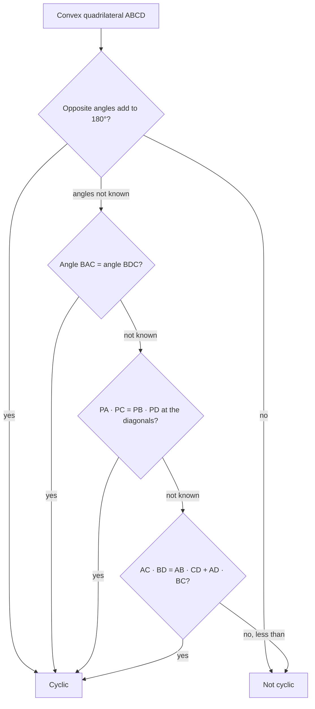

Lesson 29 proved that the opposite angles of a cyclic quadrilateral are supplementary, and Lesson 30 showed that two chords crossing inside a circle cut each other into pieces with equal products. Both are facts about angles or pieces of diagonals. This lesson asks what the *sides* and the *whole diagonals* of a cyclic quadrilateral have to do with each other. The answer is **Ptolemy's theorem**, a relation used nearly 1,900 years ago to build the first trigonometric tables, and it ties together several earlier lessons: it contains the Pythagorean theorem as a special case and produces the golden ratio from Lesson 90.

## Recognizing a cyclic quadrilateral

Ptolemy's theorem applies only to quadrilaterals whose vertices lie on one circle, so first a quick recap of how to recognize one. Points that lie on one circle are **concyclic**. The Module 7 honors lesson, *Concyclic points and the circumcircle*, proves three tests for a convex quadrilateral $ABCD$; here they are without proofs:

- **Opposite angles:** if $m\angle A + m\angle C = 180^\circ$, the quadrilateral is cyclic (the converse of the Lesson 29 theorem).
- **Equal angles on one side:** if $\angle BAC \cong \angle BDC$ with $A$ and $D$ on the same side of $\overleftrightarrow{BC}$, the four points are concyclic.
- **Equal products:** if the diagonals meet at $P$ and $PA \cdot PC = PB \cdot PD$, the quadrilateral is cyclic (the converse of the intersecting chords theorem from Lesson 30).

By the first test, rectangles, squares and isosceles trapezoids are always cyclic, while a parallelogram is cyclic only when it is a rectangle (its opposite angles are congruent, so they can add to $180^\circ$ only as $90^\circ + 90^\circ$). This lesson adds a fourth test, Ptolemy's inequality, near the end; the chart collects all four.

## Ptolemy's theorem

**Ptolemy's theorem.** If $ABCD$ is a cyclic quadrilateral (vertices in that order around the circle), then the product of the diagonals equals the sum of the products of opposite sides:

$$AC \cdot BD = AB \cdot CD + AD \cdot BC.$$

Claudius Ptolemy used it in his astronomy book, the *Almagest* (around 150 CE), to compute a table of chord lengths, an early version of a sine table.

*Proof.* The idea is to split diagonal $\overline{AC}$ into two pieces and find each piece with similar triangles.

**Step 1.** Choose $K$ on $\overline{AC}$ so that $\angle ABK \cong \angle DBC$ (copy $\angle DBC$ at $B$, starting from side $\overline{BA}$, as in Lesson 4).

**Step 2.** $\angle BAK$ is the same angle as $\angle BAC$, and $\angle BAC \cong \angle BDC$ because both are inscribed angles on arc $BC$. So $\triangle ABK \sim \triangle DBC$ by AA, and

$$\frac{AK}{AB} = \frac{DC}{DB} \quad\Longrightarrow\quad AK \cdot BD = AB \cdot CD.$$

**Step 3.** Add $\angle KBD$ to both of the congruent angles from Step 1: $\angle ABD \cong \angle KBC$. Also $\angle BCK$ (which is $\angle BCA$) $\cong \angle BDA$, inscribed angles on arc $AB$. So $\triangle KBC \sim \triangle ABD$ by AA, and

$$\frac{KC}{BC} = \frac{AD}{BD} \quad\Longrightarrow\quad KC \cdot BD = AD \cdot BC.$$

**Step 4.** Add the two equations: $(AK + KC) \cdot BD = AB \cdot CD + AD \cdot BC$. Since $K$ is on $\overline{AC}$, $AK + KC = AC$. $\blacksquare$

### Example 1

Apply Ptolemy's theorem to a rectangle with sides $a$ and $b$ and diagonal $d$.

A rectangle is cyclic. Its diagonals are both $d$; its opposite sides are $a, a$ and $b, b$. Ptolemy gives $d \cdot d = a \cdot a + b \cdot b$, that is,

$$d^2 = a^2 + b^2.$$

The Pythagorean theorem is the rectangle case of Ptolemy's theorem.

### Example 2

An isosceles trapezoid has bases 6 and 12 and legs 5. Find the length of a diagonal.

**Step 1.** An isosceles trapezoid is cyclic, and its diagonals are congruent; call each $d$.

**Step 2.** Opposite sides are the two bases (6 and 12) and the two legs (5 and 5). Ptolemy: $d \cdot d = 6 \cdot 12 + 5 \cdot 5 = 72 + 25 = 97$.

**Step 3.** $d = \sqrt{97} \approx 9.85$.

*Check with coordinates:* put the long base from $(0, 0)$ to $(12, 0)$. The short base is centered, from $(3, h)$ to $(9, h)$, and a leg gives $3^2 + h^2 = 25$, so $h = 4$. The diagonal from $(0, 0)$ to $(9, 4)$ has length $\sqrt{81 + 16} = \sqrt{97}$. ✓

### Example 3

A regular pentagon has side 1. Find its diagonal $d$.

**Step 1.** Take four consecutive vertices $A$, $B$, $C$, $D$ of the pentagon $ABCDE$. They lie on the pentagon's circumcircle, so $ABCD$ is cyclic.

**Step 2.** Its sides are $AB = BC = CD = 1$ and $DA = d$ (a diagonal of the pentagon). Its diagonals $AC$ and $BD$ are also pentagon diagonals, length $d$.

**Step 3.** Ptolemy: $AC \cdot BD = AB \cdot CD + AD \cdot BC$ gives $d^2 = 1 + d$, so $d^2 - d - 1 = 0$.

**Step 4.** The positive root is $d = \dfrac{1 + \sqrt5}{2} \approx 1.618$, the golden ratio $\varphi$ that Lesson 90 constructed with compass and straightedge. That is exactly why the regular pentagon is constructible. (The Module 6 honors lesson on the golden ratio reaches the same ratio with similar golden triangles; Ptolemy's theorem gets there in one line.)

### Example 4

Equilateral triangle $ABC$ is inscribed in a circle, and $P$ is a point on arc $BC$ (the arc not containing $A$) with $PB = 3$ and $PC = 5$. Find $PA$ and the side of the triangle.

**Step 1.** $ABPC$ is cyclic, in that order around the circle. Its diagonals are $\overline{AP}$ and $\overline{BC}$. Ptolemy: $AP \cdot BC = AB \cdot PC + AC \cdot PB$.

**Step 2.** All sides of the triangle are equal, say $s$: $AP \cdot s = s \cdot 5 + s \cdot 3$. Divide by $s$: $PA = 5 + 3 = 8$. (In general, $PA = PB + PC$ for any point on that arc.)

**Step 3.** For the side, use the Law of Cosines (Lesson 26) in $\triangle PBC$. $\angle BPC$ is inscribed in the arc $BAC$ of $240^\circ$, so $m\angle BPC = 120^\circ$:
$$s^2 = 3^2 + 5^2 - 2(3)(5)\cos 120^\circ = 9 + 25 + 15 = 49, \qquad s = 7.$$

## The inequality, and the area of a cyclic quadrilateral

Ptolemy's theorem has a converse in a stronger form, stated here without proof: for *any* quadrilateral $ABCD$,

$$AC \cdot BD \le AB \cdot CD + AD \cdot BC,$$

with equality exactly when $ABCD$ is cyclic. This is **Ptolemy's inequality**. It gives a fourth test: compute both sides; a strict inequality means the quadrilateral is not cyclic.

The area also has a clean formula. **Brahmagupta's formula** (Brahmagupta, India, 628 CE; stated here without proof) says a cyclic quadrilateral with sides $a$, $b$, $c$, $d$ and semiperimeter $s = \tfrac{a + b + c + d}{2}$ has area

$$K = \sqrt{(s - a)(s - b)(s - c)(s - d)}.$$

Let $d$ shrink to 0 and the quadrilateral becomes a triangle: the formula turns into Heron's formula (Lesson 31). Check it on Example 2's trapezoid: sides 5, 6, 5, 12 give $s = 14$, and $K = \sqrt{9 \cdot 8 \cdot 9 \cdot 2} = \sqrt{1296} = 36$. The trapezoid formula agrees: $\tfrac{6 + 12}{2} \cdot 4 = 36$. ✓ For a quadrilateral that isn't cyclic, Brahmagupta's formula gives too large a number, so check that the quadrilateral is cyclic before using it.

## Common mistakes

- **Using a vertex order that skips around.** Ptolemy's theorem pairs the diagonals ($AC$, $BD$) against the *opposite sides* ($AB$ with $CD$, $AD$ with $BC$) for vertices in order around the circle. Pairing a side with a diagonal is wrong.
- **Applying it to a quadrilateral that isn't cyclic.** For a non-square rhombus, for example, the two sides of Ptolemy's relation differ.
- **Testing the wrong angles.** To check that a quadrilateral is cyclic, add *opposite* angles. Consecutive angles of a parallelogram always add to $180^\circ$, and that proves nothing.
- **Using Brahmagupta's formula on any quadrilateral.** Four side lengths don't fix a quadrilateral's shape; the formula is the area only of the cyclic one.

## Key points

- Check that a quadrilateral is cyclic before using Ptolemy's theorem or Brahmagupta's formula: supplementary opposite angles, equal angles on one side, equal diagonal products, or equality in Ptolemy's inequality.
- Ptolemy: in a cyclic quadrilateral $ABCD$, $AC \cdot BD = AB \cdot CD + AD \cdot BC$. The proof splits a diagonal with a point $K$ and uses two pairs of similar triangles.
- Special cases: the Pythagorean theorem (rectangle), the golden ratio (regular pentagon), and $PA = PB + PC$ (equilateral triangle).
- Ptolemy's inequality holds for every quadrilateral, with equality only for cyclic ones. Brahmagupta's formula gives the area of a cyclic quadrilateral from its sides.
