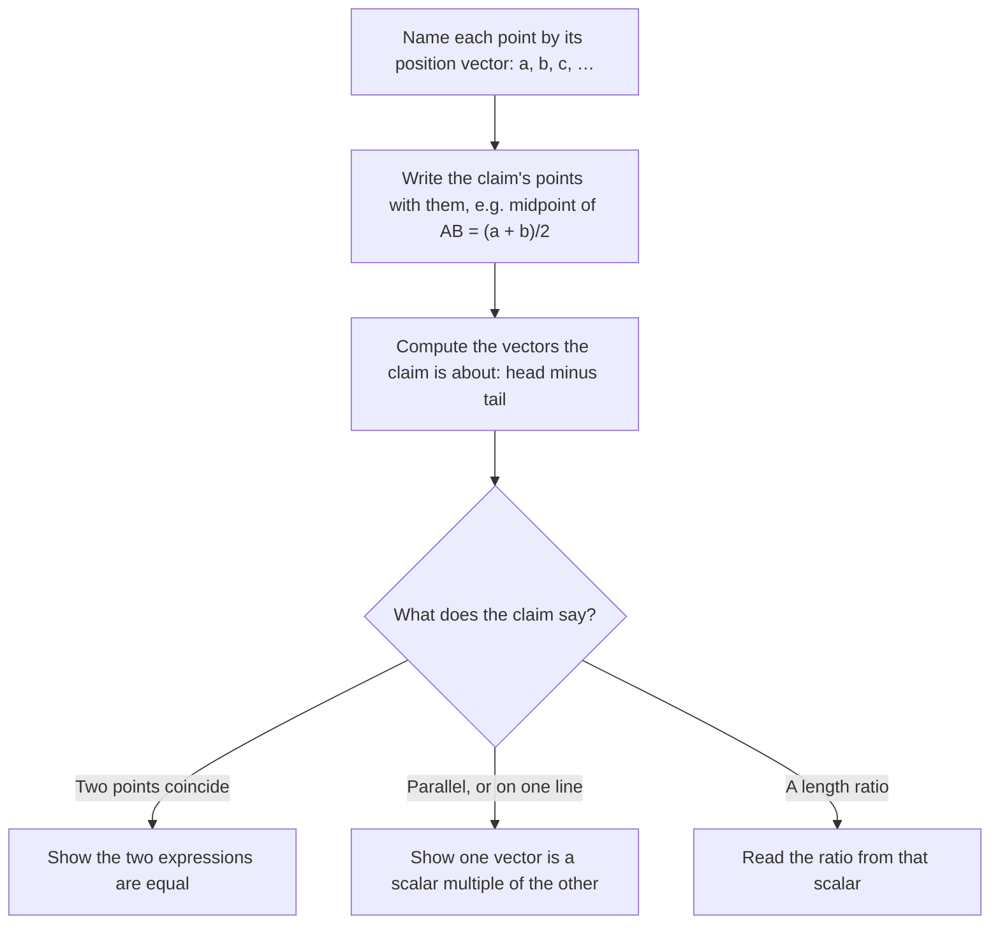

## Arrows that prove things

The vectors lesson treated vectors as arrows you can add and scale. That small toolkit is
enough to prove real theorems of geometry, often in three or four lines, and without drawing a
special case: a vector proof works for every triangle or quadrilateral at once. This honors
lesson shows how. Along the way you'll meet ideas the rest of the course leans on: points as
vectors, lines written as "a point plus multiples of a direction", and the test for parallel
vectors.

Vectors entered geometry in the nineteenth century. Hamilton's quaternions (1843) and Grassmann's
"theory of extension" (1844) both treated directed quantities algebraically, and in the 1880s
Josiah Willard Gibbs and Oliver Heaviside, working separately, shaped the vector notation that
physics and engineering still use.

## Points as position vectors

Fix an origin $O$. Every point $A$ then has a position vector $\mathbf{a} = \overrightarrow{OA}$,
and we'll use the matching lowercase bold letter for it. The key rule from the core lesson
becomes

$$\overrightarrow{AB} = \mathbf{b} - \mathbf{a} \qquad \text{(head minus tail).}$$

Everything below comes from this rule plus addition and scaling. Notice that the origin never
matters in the end: the statements we prove are about vectors like $\mathbf{b} - \mathbf{a}$,
which describe a movement, not a place.

## Points between two points

The midpoint $M$ of $AB$ is halfway along the trip from $A$ to $B$:
$\mathbf{m} = \mathbf{a} + \tfrac12(\mathbf{b} - \mathbf{a})$, which simplifies to the
**midpoint formula**

$$\mathbf{m} = \frac{\mathbf{a} + \mathbf{b}}{2}.$$

In coordinates that is the familiar "average the $x$'s, average the $y$'s".

The same idea finds any point along the segment. Going a fraction $t$ of the way from $A$ to $B$
lands at

$$\mathbf{r} = \mathbf{a} + t(\mathbf{b} - \mathbf{a}) = (1 - t)\,\mathbf{a} + t\,\mathbf{b}.$$

If $R$ divides $AB$ so that $AR : RB = m : n$, then $R$ is $\frac{m}{m+n}$ of the way along, and
the formula becomes the **section formula**

$$\mathbf{r} = \frac{n\,\mathbf{a} + m\,\mathbf{b}}{m + n}.$$

Notice the crossover: the weight on $\mathbf{a}$ is $n$, the part of the ratio *next to* $B$.
That makes sense: when $R$ is close to $B$ ($m$ large), $\mathbf{b}$ should get most of the
weight. The two weights always add up to 1, which is why the answer doesn't depend on where the
origin is.

### Example 1

Find the point $R$ on segment $PQ$, with $P = (-2, 1)$ and $Q = (7, 7)$, such that
$PR : RQ = 2 : 1$.

1. $R$ is $\frac{2}{2+1} = \frac23$ of the way from $P$ to $Q$.
2. $\overrightarrow{PQ} = \begin{bmatrix} 7 - (-2) \\ 7 - 1\end{bmatrix} = \begin{bmatrix} 9 \\ 6\end{bmatrix}$, and $\frac23$ of it is $\begin{bmatrix} 6 \\ 4\end{bmatrix}$.
3. $\mathbf{r} = \mathbf{p} + \begin{bmatrix} 6 \\ 4\end{bmatrix} = \begin{bmatrix} 4 \\ 5\end{bmatrix}$, so $R = (4, 5)$.
4. Check with the section formula: $\frac{1\cdot(-2, 1) + 2\cdot(7, 7)}{3} = \frac{(12, 15)}{3} = (4, 5)$. ✓

```plot
{"x": [-3, 8], "y": [0, 8], "equal": true, "segments": [{"from": [-2, 1], "to": [7, 7]}], "points": [{"at": [-2, 1], "label": "P"}, {"at": [7, 7], "label": "Q"}, {"at": [4, 5], "label": "R (2/3 of the way)"}], "caption": "R divides PQ in the ratio 2 : 1"}
```

## Lines, parallel vectors and collinear points

Let $t$ range over *all* real numbers instead of just $0 \le t \le 1$ and you get the whole line
through $A$ and $B$. In general, the line through a point $P$ in the direction of a nonzero
vector $\mathbf{d}$ is

$$\mathbf{r}(t) = \mathbf{p} + t\,\mathbf{d}, \qquad t \text{ any real number}.$$

The vector $\mathbf{d}$ is a **direction vector** of the line; any nonzero multiple of it
describes the same line. For the line through $P = (-2, 1)$ and $Q = (7, 7)$ we can use
$\mathbf{d} = (9, 6)$, or the simpler $(3, 2)$.

Two nonzero vectors are *parallel* when one is a scalar multiple of the other. (A negative
multiple counts: it points the opposite way along the same direction.) Points that lie on one
line are **collinear**, and vectors give a clean test:

> $A$, $B$, $C$ are collinear exactly when $\overrightarrow{AC}$ is a scalar multiple of
> $\overrightarrow{AB}$ (assuming $A \neq B$).

The shared point $A$ matters. Parallel vectors alone only say the segments point the same way;
because both vectors start at $A$, the segments lie on the *same* line through $A$.

### Example 2

Are $A = (1, 2)$, $B = (4, 3)$, $C = (10, 5)$ collinear? What about $D = (7, 5)$?

1. $\overrightarrow{AB} = (3, 1)$ and $\overrightarrow{AC} = (9, 3) = 3(3, 1)$. A multiple, so $A$, $B$, $C$ are collinear. The scalar also says $AC$ is 3 times as long as $AB$.
2. $\overrightarrow{AD} = (6, 3)$. A multiple of $(3, 1)$ would need $6 = 3k$ and $3 = k$ at once, so $k = 2$ and $k = 3$: impossible. $D$ is not on the line.

## Proofs with vectors

Here is the plan every proof below follows.



*The midsegment theorem.* In triangle $ABC$, let $M$ and $N$ be the midpoints of $AB$ and
$AC$. The segment $MN$ is called a **midsegment**. Then

$$\overrightarrow{MN} = \mathbf{n} - \mathbf{m} = \frac{\mathbf{a} + \mathbf{c}}{2} - \frac{\mathbf{a} + \mathbf{b}}{2} = \frac{\mathbf{c} - \mathbf{b}}{2} = \tfrac12\,\overrightarrow{BC}.$$

So the midsegment is parallel to the third side and exactly half as long. Nothing about the
triangle's shape was assumed.

*The diagonals of a parallelogram bisect each other.* $ABCD$ is a parallelogram when
$\overrightarrow{AB} = \overrightarrow{DC}$, that is, $\mathbf{b} - \mathbf{a} = \mathbf{c} - \mathbf{d}$.
Rearranged, $\mathbf{a} + \mathbf{c} = \mathbf{b} + \mathbf{d}$. Divide by 2: the midpoint of
diagonal $AC$ equals the midpoint of diagonal $BD$. One point is the midpoint of both diagonals,
which is exactly what "bisect each other" means. The same equation gives the missing corner of a
parallelogram: $\mathbf{d} = \mathbf{a} + \mathbf{c} - \mathbf{b}$.

*The medians meet at the centroid.* A **median** of a triangle joins a vertex to the midpoint
of the opposite side. Go $\frac23$ of the way from $A$ along its median to the midpoint
$\frac{\mathbf{b} + \mathbf{c}}{2}$:

$$\mathbf{a} + \tfrac23\left(\frac{\mathbf{b} + \mathbf{c}}{2} - \mathbf{a}\right) = \mathbf{a} + \frac{\mathbf{b} + \mathbf{c}}{3} - \frac{2\mathbf{a}}{3} = \frac{\mathbf{a} + \mathbf{b} + \mathbf{c}}{3}.$$

The result is symmetric in $\mathbf{a}$, $\mathbf{b}$, $\mathbf{c}$, so doing the same from $B$ or
from $C$ lands on the same point. All three medians pass through
$\mathbf{g} = \frac{\mathbf{a} + \mathbf{b} + \mathbf{c}}{3}$, the **centroid**, and it sits
two-thirds of the way along each median from the vertex (so it splits each median $2 : 1$). The
centroid is also the triangle's balance point if it is cut from a uniform sheet.


### Example 3

Find the centroid of the triangle with vertices $A = (1, 1)$, $B = (7, 3)$, $C = (4, 8)$, and
check that it is $\frac23$ of the way from $A$ to the midpoint of $BC$.

1. $\mathbf{g} = \frac{(1, 1) + (7, 3) + (4, 8)}{3} = \frac{(12, 12)}{3} = (4, 4)$.
2. Midpoint of $BC$: $\frac{(7, 3) + (4, 8)}{2} = (5.5, 5.5)$.
3. From $A$: $(1, 1) + \frac23\big((5.5, 5.5) - (1, 1)\big) = (1, 1) + \frac23(4.5, 4.5) = (1, 1) + (3, 3) = (4, 4)$. ✓

### Example 4

*Varignon's theorem*, named for the French mathematician Pierre Varignon (1654–1722): joining the
midpoints of the sides of *any* quadrilateral, in order, gives a parallelogram.

1. Let the quadrilateral be $ABCD$ and the midpoints $P$ (of $AB$), $Q$ (of $BC$), $R$ (of $CD$), $S$ (of $DA$).
2. $\overrightarrow{PQ} = \frac{\mathbf{b} + \mathbf{c}}{2} - \frac{\mathbf{a} + \mathbf{b}}{2} = \frac{\mathbf{c} - \mathbf{a}}{2}$.
3. $\overrightarrow{SR} = \frac{\mathbf{c} + \mathbf{d}}{2} - \frac{\mathbf{d} + \mathbf{a}}{2} = \frac{\mathbf{c} - \mathbf{a}}{2}$.
4. $\overrightarrow{PQ} = \overrightarrow{SR}$: one pair of opposite sides is equal and parallel, so $PQRS$ is a parallelogram. Both sides are also half of diagonal $\overrightarrow{AC}$ (the midsegment theorem again).

A numerical check: with $A = (0, 0)$, $B = (6, 0)$, $C = (8, 5)$, $D = (1, 6)$, the midpoints are
$P = (3, 0)$, $Q = (7, 2.5)$, $R = (4.5, 5.5)$, $S = (0.5, 3)$, and
$\overrightarrow{PQ} = (4, 2.5) = \overrightarrow{SR}$.

```shape
{"polygons": [{"points": [[0, 0], [6, 0], [8, 5], [1, 6]]}], "segments": [{"from": [3, 0], "to": [7, 2.5], "dashed": true}, {"from": [7, 2.5], "to": [4.5, 5.5], "dashed": true}, {"from": [4.5, 5.5], "to": [0.5, 3], "dashed": true}, {"from": [0.5, 3], "to": [3, 0], "dashed": true}], "points": [{"at": [3, 0], "label": "P"}, {"at": [7, 2.5], "label": "Q"}, {"at": [4.5, 5.5], "label": "R"}, {"at": [0.5, 3], "label": "S"}], "labels": [{"at": [-0.4, -0.4], "text": "A"}, {"at": [6.4, -0.4], "text": "B"}, {"at": [8.4, 5.3], "text": "C"}, {"at": [0.7, 6.4], "text": "D"}], "caption": "Varignon: the midpoints P, Q, R, S always form a parallelogram"}
```

The proof never used convexity, so the theorem holds for non-convex quadrilaterals too.

## Common mistakes

- *Swapping the section weights.* For $AR : RB = m : n$ the point is $\frac{n\mathbf{a} + m\mathbf{b}}{m+n}$, not $\frac{m\mathbf{a} + n\mathbf{b}}{m+n}$. Sanity check: the point should be closer to the endpoint with the bigger weight.
- *Using $\frac{m}{n}$ instead of $\frac{m}{m+n}$.* A $2 : 1$ split is $\frac23$ of the way, not $2$ times the way.
- *Placing the centroid $\frac23$ from the midpoint.* It is $\frac23$ of the way from the *vertex*, $\frac13$ from the midpoint.
- *Calling points collinear because two vectors are parallel* when the vectors don't share a point. $\overrightarrow{AB} \parallel \overrightarrow{CD}$ allows two different parallel lines.
- *Proving from a picture.* A drawing with special numbers checks a claim; the letter-vector computation proves it for every case.

## Key points

- With position vectors, $\overrightarrow{AB} = \mathbf{b} - \mathbf{a}$; the midpoint is $\frac{\mathbf{a} + \mathbf{b}}{2}$.
- The point dividing $AB$ in the ratio $m : n$ is $\frac{n\mathbf{a} + m\mathbf{b}}{m + n}$; the point a fraction $t$ of the way is $(1 - t)\mathbf{a} + t\mathbf{b}$.
- A line is $\mathbf{p} + t\mathbf{d}$; nonzero vectors are parallel when one is a multiple of the other; $A, B, C$ are collinear when $\overrightarrow{AC} = k\,\overrightarrow{AB}$.
- Midsegment $= \frac12$(third side); parallelogram diagonals share their midpoint, and $\mathbf{d} = \mathbf{a} + \mathbf{c} - \mathbf{b}$; the centroid is $\frac{\mathbf{a} + \mathbf{b} + \mathbf{c}}{3}$, $\frac23$ of the way along each median.
- To prove "same point", show equal expressions; to prove "parallel", show a scalar multiple.
