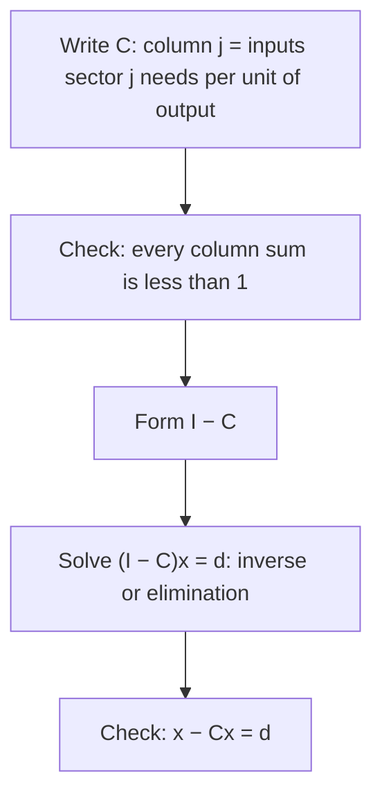

## An economy as a matrix equation

The matrix arithmetic lesson ended by solving $A\mathbf{x} = \mathbf{b}$ with a $2 \times 2$
inverse. This honors lesson puts that tool to work on one of the most famous applications of
linear algebra outside science: a model of how the sectors of an economy depend on each other.

The model is named for the economist Wassily Leontief (1905–1999), who built large tables of how
much each industry in the United States bought from every other industry in the 1930s and 1940s.
His **input–output model** turned those tables into a system of linear equations. It earned him
the 1973 Nobel Memorial Prize in Economic Sciences, and government statistics agencies still
publish input–output tables today. The version here is the basic "open" model; real tables have
dozens or hundreds of sectors, but the algebra is exactly the same.

## The consumption matrix

Picture an economy with two sectors, Energy (E) and Manufacturing (M), measured in dollars of
output. To produce, each sector uses up some output of the others, and of itself:

- each dollar of energy uses \$0.20 of energy (fuel to run power plants) and \$0.30 of manufactured goods;
- each dollar of manufacturing uses \$0.40 of energy and \$0.10 of manufactured goods.


Store these numbers in the **consumption matrix**, one *column* per producing sector:

$$C = \begin{bmatrix} 0.2 & 0.4 \\ 0.3 & 0.1 \end{bmatrix} \qquad \begin{matrix} \leftarrow \text{energy used} \\ \leftarrow \text{manufacturing used} \end{matrix}$$

The entry $c_{ij}$ is the amount of sector $i$'s output used to make one unit of sector $j$'s
output. Column 1 is Energy's "recipe" and column 2 is Manufacturing's.

Now let $\mathbf{x} = (x_1, x_2)$ be the **production vector**: the dollars of energy and of
manufacturing produced. By the row-times-column rule,

$$C\mathbf{x} = \begin{bmatrix} 0.2x_1 + 0.4x_2 \\ 0.3x_1 + 0.1x_2 \end{bmatrix}.$$

The first entry adds up the energy used by both sectors, so $C\mathbf{x}$ is the
**intermediate demand**: what the sectors use up just to produce $\mathbf{x}$. Whatever is left
goes to households, government and exports, the **final demand** $\mathbf{d}$.

## The production equation

Production must cover both kinds of demand:

$$\mathbf{x} = C\mathbf{x} + \mathbf{d}.$$

Move $C\mathbf{x}$ to the left. Since $\mathbf{x} = I\mathbf{x}$, the left side is
$I\mathbf{x} - C\mathbf{x} = (I - C)\mathbf{x}$ (the distributive law), so

$$(I - C)\mathbf{x} = \mathbf{d}, \qquad \mathbf{x} = (I - C)^{-1}\mathbf{d} \quad \text{when } I - C \text{ is invertible.}$$

A common slip is to write $1 - C$; there is no such thing as a number minus a matrix. It must be
$I - C$.

### Example 1

Final demand is \$60 billion of energy and \$30 billion of manufacturing. How much must each
sector produce?

1. $I - C = \begin{bmatrix} 0.8 & -0.4 \\ -0.3 & 0.9 \end{bmatrix}$: subtract each entry of $C$ from the identity.
2. Determinant: $(0.8)(0.9) - (-0.4)(-0.3) = 0.72 - 0.12 = 0.6$.
3. Inverse: $\dfrac{1}{0.6}\begin{bmatrix} 0.9 & 0.4 \\ 0.3 & 0.8 \end{bmatrix} = \begin{bmatrix} 1.5 & 2/3 \\ 0.5 & 4/3 \end{bmatrix}$.
4. $\mathbf{x} = \begin{bmatrix} 1.5(60) + \frac23(30) \\ 0.5(60) + \frac43(30) \end{bmatrix} = \begin{bmatrix} 110 \\ 70 \end{bmatrix}$.
5. Check: $C\mathbf{x} = (0.2 \cdot 110 + 0.4 \cdot 70,\ 0.3 \cdot 110 + 0.1 \cdot 70) = (50, 40)$, and $\mathbf{x} - C\mathbf{x} = (60, 30) = \mathbf{d}$. ✓

So \$110 billion of energy and \$70 billion of manufacturing are needed, even though households
only want \$90 billion of goods in total: the other \$90 billion is used up in production.

Here is the whole procedure:



## Reading the Leontief inverse

The matrix $(I - C)^{-1}$ is called the **Leontief inverse**, and its entries have a meaning of
their own. Because $\mathbf{x} = (I - C)^{-1}\mathbf{d}$, raising the final demand for sector $j$
by one unit (adding $\mathbf{e}_j$ to $\mathbf{d}$) raises production by
$(I - C)^{-1}\mathbf{e}_j$, which is column $j$ of the inverse. In our economy:

- column 1, $(1.5, 0.5)$: one extra dollar of energy for households requires \$1.50 of energy and \$0.50 of manufacturing in total;
- column 2, $(2/3, 4/3)$: one extra dollar of manufactured goods requires about \$0.67 of energy and \$1.33 of manufacturing.

The diagonal entries are above 1: to deliver a dollar of energy you must also make the energy
used along the way. Economists call these entries *multipliers*.

### Example 2

Final demand for manufacturing rises by \$12 billion, with energy demand unchanged. How does
production change?

1. The change in demand is $\Delta\mathbf{d} = (0, 12)$.
2. $\Delta\mathbf{x} = (I - C)^{-1}\Delta\mathbf{d} = 12 \times (\text{column } 2) = 12\left(\frac23, \frac43\right) = (8, 16)$.
3. Energy production must rise by \$8 billion and manufacturing by \$16 billion. No need to re-solve the whole system: linearity lets you add the effect of the change.

## Rounds of production

Why is every entry of the Leontief inverse positive here, and when can we trust the model? Think
of production in rounds. Households want $\mathbf{d}$. Making $\mathbf{d}$ uses up $C\mathbf{d}$,
which also has to be made. Making that uses $C(C\mathbf{d}) = C^2\mathbf{d}$, and so on. The total
production is

$$\mathbf{x} = \mathbf{d} + C\mathbf{d} + C^2\mathbf{d} + C^3\mathbf{d} + \cdots$$

### Example 3

With $\mathbf{d} = (60, 30)$: $C\mathbf{d} = (0.2 \cdot 60 + 0.4 \cdot 30,\ 0.3 \cdot 60 + 0.1 \cdot 30) = (24, 21)$, then
$C^2\mathbf{d} = C(24, 21) = (13.2, 9.3)$, then $C^3\mathbf{d} = (6.36, 4.89)$. The running totals
for energy are 60, 84, 97.2, 103.56, … and they close in on the exact answer 110.

```plot
{"x": [-0.7, 7.7], "y": [0, 125], "bars": [{"x": 0, "height": 60, "width": 0.7}, {"x": 1, "height": 84, "width": 0.7}, {"x": 2, "height": 97.2, "width": 0.7}, {"x": 3, "height": 103.56, "width": 0.7}, {"x": 4, "height": 106.79, "width": 0.7}, {"x": 5, "height": 108.39, "width": 0.7}, {"x": 6, "height": 109.2, "width": 0.7}, {"x": 7, "height": 109.6, "width": 0.7}], "functions": [{"f": "110", "dashed": true, "label": "110"}], "xLabel": "rounds of production included", "yLabel": "energy produced so far", "caption": "Total energy after each round approaches 110"}
```

Each round is smaller than the last because every column of $C$ adds up to less than 1. Here is
the reason. If $s$ is the largest column sum of a matrix $C$ with nonnegative entries, then for
any vector $\mathbf{v}$ with nonnegative entries, the entries of $C\mathbf{v}$ add up to at most
$s$ times the entries of $\mathbf{v}$ (each $v_j$ is spread over column $j$, whose entries total at
most $s$). Here $s = 0.5$, so each round is at most half the size of the one before, and the
rounds shrink to zero like $0.5^k$. Adding up the rounds and comparing with
$(I - C)(I + C + \cdots + C^k) = I - C^{k+1}$ shows the series adds up to $(I - C)^{-1}\mathbf{d}$.
(Making "adds up to" precise needs limits; this is the idea of the proof, not every detail.)

So: *if $C$ has nonnegative entries and every column sum is less than 1, then $I - C$ is
invertible and $(I - C)^{-1}$ has no negative entries.* A consumption matrix with this property
is called **productive**: any nonnegative final demand can be met with nonnegative production. The
column condition has an economic meaning: each sector uses less than \$1 of inputs per \$1 of
output. It is a sufficient condition, not a necessary one; some economies whose columns don't all
satisfy it are still productive.

When the model breaks, the algebra shows it. With $C = \begin{bmatrix} 0.5 & 0.6 \\ 0.7 & 0.5 \end{bmatrix}$
(column sums 1.2 and 1.1), $I - C$ has determinant $0.25 - 0.42 = -0.17$ and every entry of
$(I - C)^{-1}$ is negative, so any positive demand would "require" negative production. The
sectors consume more than they make.

### Example 4

Three sectors with $C = \begin{bmatrix} 0.1 & 0.2 & 0.1 \\ 0.2 & 0.1 & 0.2 \\ 0.1 & 0.1 & 0.1 \end{bmatrix}$ and $\mathbf{d} = (58, 72, 50)$.
The column sums (0.4, 0.4, 0.4) are below 1, so the economy is productive. A $3 \times 3$ inverse
isn't needed: solve $(I - C)\mathbf{x} = \mathbf{d}$ by elimination, as in the elimination lesson.

1. Multiply each equation by 10 to clear decimals: $9x - 2y - z = 580$, $\;-2x + 9y - 2z = 720$, $\;-x - y + 9z = 500$.
2. Move the third equation to the top and multiply it by $-1$: $x + y - 9z = -500$.
3. Eliminate $x$: $(9x - 2y - z) - 9(x + y - 9z) = 580 + 4500$ gives $-11y + 80z = 5080$; $(-2x + 9y - 2z) + 2(x + y - 9z) = 720 - 1000$ gives $11y - 20z = -280$.
4. Add these two: $60z = 4800$, so $z = 80$. Then $11y = -280 + 1600$, so $y = 120$, and $x = -500 - 120 + 720 = 100$.
5. Check row 1 of $(I - C)\mathbf{x}$: $0.9(100) - 0.2(120) - 0.1(80) = 90 - 24 - 8 = 58$. ✓

## Common mistakes

- *Rows instead of columns.* In this convention column $j$ lists what sector $j$ needs. Reading a row as a recipe puts the numbers in the wrong places.
- *Solving $C\mathbf{x} = \mathbf{d}$.* $C\mathbf{x}$ is only the intermediate demand; production satisfies $\mathbf{x} - C\mathbf{x} = \mathbf{d}$.
- *Writing $1 - C$ or subtracting $C$ only on the diagonal.* $I - C$ subtracts every entry of $C$: off-diagonal entries become negative.
- *Expecting production to equal final demand.* Production is always at least $\mathbf{d}$, because the sectors also use up output.
- *Trusting a negative answer.* Negative production means the consumption matrix is not productive (or there is an arithmetic slip); check the column sums.

## Key points

- $c_{ij}$ = units of sector $i$'s output used per unit of sector $j$'s output; $C\mathbf{x}$ is intermediate demand.
- Production equation: $\mathbf{x} = C\mathbf{x} + \mathbf{d}$, that is $(I - C)\mathbf{x} = \mathbf{d}$ and $\mathbf{x} = (I - C)^{-1}\mathbf{d}$.
- Column $j$ of the Leontief inverse is the total production needed for one extra unit of final demand for sector $j$; a demand change $\Delta\mathbf{d}$ changes production by $(I - C)^{-1}\Delta\mathbf{d}$.
- $\mathbf{x} = \mathbf{d} + C\mathbf{d} + C^2\mathbf{d} + \cdots$: rounds of production.
- If $C \ge 0$ and every column sum is below 1, $C$ is productive: $(I - C)^{-1}$ exists and has no negative entries.
