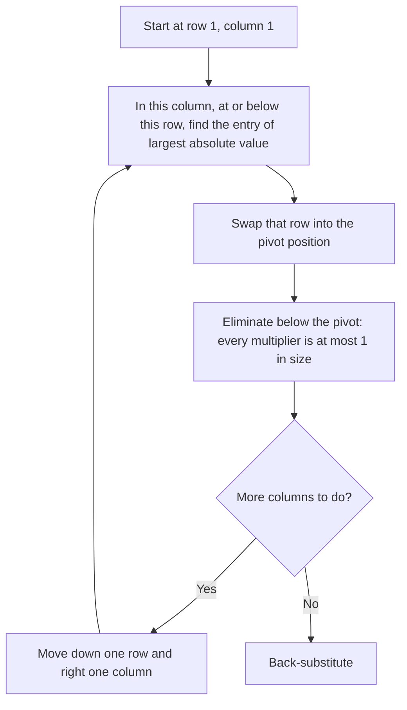

## When exact methods meet real numbers

The elimination lesson solved systems with small whole numbers, where every step is exact. Real
systems come from measurements, and computers store numbers with a fixed number of digits. Two
different things can then go wrong, and it pays to keep them apart:

- the *problem* can be sensitive: tiny changes in the data cause big changes in the answer, no
  matter how carefully you compute;
- the *method* can be careless: an unlucky order of elimination steps can magnify rounding
  errors in a problem that is perfectly well behaved.

This honors lesson looks at both, using only $2 \times 2$ systems, the elimination moves and the
$2 \times 2$ inverse from the matrix arithmetic lesson.

## Nearly parallel lines

Solve

$$\begin{aligned} x + y &= 2 \\ x + 1.001y &= 2.001. \end{aligned}$$

Subtracting the first equation from the second gives $0.001y = 0.001$, so $y = 1$ and $x = 1$.
Now suppose the 2.001 was a measurement and the true value is 2.002, a change of 0.05%. The
subtraction now gives $0.001y = 0.002$, so $y = 2$ and $x = 0$. A change in the fourth digit of
the data moved the answer from $(1, 1)$ to $(0, 2)$.

The picture explains it. The two lines have almost the same slope, so they cross at a shallow
angle, and nudging one of them slides the crossing point a long way. (The plot exaggerates the
effect so it can be seen: it uses 1.2 in place of 1.001, and moves the right side from 2.2 to 2.4.)

```plot
{"x": [-1.5, 3.5], "y": [-1, 3.5], "equal": true, "functions": [{"f": "2 - x"}, {"f": "(2.2 - x)/1.2"}, {"f": "(2.4 - x)/1.2", "dashed": true}], "points": [{"at": [1, 1], "label": "(1, 1)"}, {"at": [0, 2], "label": "(0, 2)"}], "caption": "Solid: x + y = 2 and x + 1.2y = 2.2 cross at (1, 1). Dashed: x + 1.2y = 2.4 crosses x + y = 2 at (0, 2)."}
```

A system whose solution reacts strongly to small changes in its data is called
**ill-conditioned**; one whose solution changes only a little is **well-conditioned**. For
contrast, $x + y = 2$, $x - y = 0$ also has solution $(1, 1)$, but changing a right side by 0.001
moves $x$ and $y$ by only 0.0005 each: those lines cross at a right angle.

## Where the sensitivity comes from

Write the system as $A\mathbf{x} = \mathbf{b}$. If $\mathbf{b}$ changes by a small vector
$\Delta\mathbf{b}$, the solution changes by $\Delta\mathbf{x}$, and subtracting
$A\mathbf{x} = \mathbf{b}$ from $A(\mathbf{x} + \Delta\mathbf{x}) = \mathbf{b} + \Delta\mathbf{b}$
gives $A\,\Delta\mathbf{x} = \Delta\mathbf{b}$, so

$$\Delta\mathbf{x} = A^{-1}\,\Delta\mathbf{b}.$$

The inverse is the amplifier. For our matrix,

$$A = \begin{bmatrix} 1 & 1 \\ 1 & 1.001\end{bmatrix}, \qquad ad - bc = 0.001, \qquad A^{-1} = \frac{1}{0.001}\begin{bmatrix} 1.001 & -1 \\ -1 & 1\end{bmatrix} = \begin{bmatrix} 1001 & -1000 \\ -1000 & 1000\end{bmatrix}.$$

With $\Delta\mathbf{b} = (0, 0.001)$, $\Delta\mathbf{x} = (-1000 \cdot 0.001,\ 1000 \cdot 0.001) = (-1, 1)$,
exactly the jump we saw. Dividing by the tiny $ad - bc$ is what makes the entries of $A^{-1}$
huge.

## Measuring sensitivity: a condition number

To turn "huge" into a number we need sizes of vectors and matrices. The simplest choice is the
**maximum norm** of a vector, its largest component in absolute value,
$\|\mathbf{v}\|_\infty = \max_i |v_i|$, together with the **row-sum norm** of a matrix, the
largest sum of absolute values along a row:

$$\|A\|_\infty = \max_i \big(|a_{i1}| + |a_{i2}| + \cdots + |a_{in}|\big).$$

These fit together: each component of $A\mathbf{v}$ is
$a_{i1}v_1 + \cdots + a_{in}v_n$, whose absolute value is at most
$(|a_{i1}| + \cdots + |a_{in}|)\,\|\mathbf{v}\|_\infty$. So $\|A\mathbf{v}\|_\infty \le \|A\|_\infty\|\mathbf{v}\|_\infty$.

Now combine two copies of that inequality. From $\Delta\mathbf{x} = A^{-1}\Delta\mathbf{b}$,
$\|\Delta\mathbf{x}\|_\infty \le \|A^{-1}\|_\infty\|\Delta\mathbf{b}\|_\infty$. From $\mathbf{b} = A\mathbf{x}$,
$\|\mathbf{b}\|_\infty \le \|A\|_\infty\|\mathbf{x}\|_\infty$. Dividing the first by $\|\mathbf{x}\|_\infty$ and using
the second (with $\mathbf{b} \ne \mathbf{0}$):

$$\frac{\|\Delta\mathbf{x}\|_\infty}{\|\mathbf{x}\|_\infty} \;\le\; \underbrace{\|A\|_\infty\,\|A^{-1}\|_\infty}_{\kappa_\infty(A)}\;\frac{\|\Delta\mathbf{b}\|_\infty}{\|\mathbf{b}\|_\infty}.$$

The number $\kappa_\infty(A) = \|A\|_\infty\|A^{-1}\|_\infty$ is the
**infinity-norm condition number**. It bounds how many times the *relative* error in the data can be magnified in the
answer. It is always at least 1, and large values mean ill-conditioned. (The singular value
decomposition lesson at the end of the course defines the more common condition number
$\sigma_1/\sigma_n$, which uses ordinary lengths. The two versions give different numbers, but
for an $n \times n$ matrix they are within a factor of $n$ of each other, so they agree about
which matrices are badly conditioned.)

### Example 1

Find $\kappa_\infty$ for $A = \begin{bmatrix} 1 & 1 \\ 1 & 1.001\end{bmatrix}$ and for $B = \begin{bmatrix} 1 & 1 \\ 1 & -1\end{bmatrix}$.

1. Row sums of $A$: $2$ and $2.001$, so $\|A\|_\infty = 2.001$. Row sums of $A^{-1}$ (absolute values): $1001 + 1000 = 2001$ and $2000$, so $\|A^{-1}\|_\infty = 2001$.
2. $\kappa_\infty(A) = 2.001 \times 2001 = 4004.001$, about 4000.
3. For $B$: $ad - bc = -2$, so $B^{-1} = \frac{1}{-2}\begin{bmatrix} -1 & -1 \\ -1 & 1\end{bmatrix} = \begin{bmatrix} 0.5 & 0.5 \\ 0.5 & -0.5\end{bmatrix}$.
4. $\|B\|_\infty = 2$ and $\|B^{-1}\|_\infty = 1$, so $\kappa_\infty(B) = 2$.
5. Check against what we saw: changing $b_2$ from 2.001 to 2.002 is a relative change of $0.001/2.001 \approx 0.0005$, and the bound allows a relative change in $\mathbf{x}$ of up to $4004 \times 0.0005 \approx 2$. The actual change was $\|(-1, 1)\|_\infty / \|(1, 1)\|_\infty = 1$, inside the bound.

A useful *rule of thumb*, not a theorem: if $\kappa$ is about $10^k$, expect to lose up to about
$k$ significant digits between the data and the answer. Computers usually work in double precision,
about 16 significant digits, so a system with $\kappa \approx 10^{10}$ may leave only about 6
trustworthy digits.

*The determinant is not the measure.* It's tempting to call a matrix nearly singular when
$ad - bc$ is small, but $0.001I$ has determinant $0.000001$ and condition number exactly 1:
it just scales everything by 0.001, which is perfectly harmless. What matters is how small
$ad - bc$ is *compared with the entries*, and the condition number captures that.

## Round-off and the order of elimination

A computer stores a number as a fixed number of significant digits times a power of ten (in
binary, but the idea is the same). This is **floating-point arithmetic**, and every result is
rounded to fit. The small error introduced each time is **round-off error**. To see what it can
do, imagine a calculator that keeps only 3 significant digits and rounds after every operation.

### Example 2

Solve $0.0002x + y = 1$, $x + y = 3$ with 3-digit arithmetic. (The exact answer is
$x = \frac{10000}{4999} \approx 2.0004$, $y = \frac{4997}{4999} \approx 0.9996$.)

*Without row swaps.* The pivot is 0.0002 and the multiplier is $1/0.0002 = 5000$.

1. New equation 2: $(1 - 5000)y = 3 - 5000$, that is $-4999y = -4997$. Rounded to 3 digits: $-5000y = -5000$.
2. So $y = 1.00$. Back-substitute: $0.0002x = 1 - 1.00 = 0$, so $x = 0$.

The answer $x = 0$ is completely wrong. The huge multiplier swamped equation 2: after rounding,
its information (the 3) was gone, and the new equation 2 was just a copy of equation 1.

*With a row swap first.* Put $x + y = 3$ on top, so the pivot is 1 and the multiplier is
$0.0002/1 = 0.0002$.

1. New equation 2: $(1 - 0.0002)y = 1 - 0.0002 \cdot 3$, that is $0.9998y = 0.9994$. Rounded: $1.00y = 0.999$.
2. So $y = 0.999$, and $x = 3 - 0.999 = 2.001$, rounded to $2.00$.

Both answers are now right to within one unit in the last digit kept.

This system is not ill-conditioned: $\kappa_\infty \approx 4.0$. The problem was well behaved;
the method failed because it divided by a tiny pivot. The cure is **partial pivoting**: in each
column, swap up the row whose entry has the largest absolute value before eliminating. Then every
multiplier is at most 1 in size, so no row gets drowned out by a huge multiple of another.



(If every candidate in a column is 0, that column has no pivot and the square system has no
unique solution, as in the core lesson.) Partial pivoting is what standard library routines,
such as LAPACK's general linear solver, do by default. It is a simplification to say it always
works: it can be fooled, for instance, when one equation has been multiplied by a huge
constant, and numerical analysts have refinements for such cases. But it fixes the common
failure shown above.

Keep the two ideas apart. Pivoting protects against a bad *method*. No method can rescue an
ill-conditioned *problem*: if the data are only known to 4 digits and $\kappa \approx 10^4$, the
answer may not be known to any digits at all.

## How much work is elimination?

Count the multiplications and divisions for an $n \times n$ system. Clearing column $k$ touches
the $n - k$ rows below the pivot; each needs 1 division (its multiplier) and $n - k + 1$
multiplications (the remaining entries of the row, including the right side), for
$(n - k)(n - k + 2)$ in all. Adding these up for $k = 1, \dots, n - 1$ gives

$$\frac{n^3}{3} + \frac{n^2}{2} - \frac{5n}{6},$$

and back-substitution adds $\frac{n(n + 1)}{2}$ more. There are about as many additions and
subtractions. For large $n$ the $\frac{n^3}{3}$ term dominates:

| $n$ | Elimination | Back-substitution |
|---|---|---|
| 10 | 375 | 55 |
| 100 | 338,250 | 5,050 |
| 1,000 | 333,832,500 | 500,500 |

So doubling the number of unknowns multiplies the work by about $2^3 = 8$, while back-substitution
is cheap by comparison. That is why software that must solve many systems with the same matrix
saves the elimination steps and reuses them (the LU factorization, later in the course).

## Common mistakes

- *Blaming the method for an ill-conditioned problem*, or the reverse. Check $\kappa$: if it is small and the answer is bad, look at the method (pivoting); if it is large, the data themselves limit the accuracy.
- *Judging conditioning by the determinant alone.* Scale matters: $0.001I$ has a tiny determinant and $\kappa = 1$.
- *Forgetting absolute values in the row-sum norm.* $\begin{bmatrix} 1 & -1\end{bmatrix}$ has row sum $|1| + |-1| = 2$, not 0.
- *Pivoting on the first nonzero entry.* Exact arithmetic only needs a nonzero pivot; with rounding, choose the *largest* entry in absolute value.
- *Reading $\kappa$ as an exact error.* It is an upper bound on the magnification of relative error; the actual change can be smaller, as in Example 1.

## Key points

- Ill-conditioned: small changes in the data cause large changes in the solution (nearly parallel lines). This is a property of the problem.
- $\Delta\mathbf{x} = A^{-1}\Delta\mathbf{b}$: large entries of $A^{-1}$ amplify errors.
- $\kappa_\infty(A) = \|A\|_\infty\|A^{-1}\|_\infty \ge 1$ bounds the magnification of relative error; $\|A\|_\infty$ is the largest absolute row sum.
- Floating-point arithmetic rounds every result; a tiny pivot and huge multiplier can wipe out an equation.
- Partial pivoting swaps up the largest entry in each column so multipliers are at most 1 in size.
- Elimination takes about $\frac{n^3}{3}$ multiplications; back-substitution about $\frac{n^2}{2}$.
