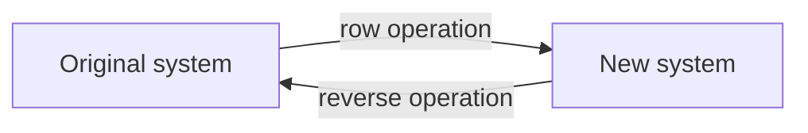

## From equations to matrices

The bridge module solved small systems by hand, writing the variables over and over. Now
we start the college course proper by stripping a system down to its numbers. That makes
the work faster, but more importantly it turns "solving equations" into "doing things to a
matrix", and the rest of linear algebra studies what those matrix operations mean.

## Linear systems and their solution sets

A **system of linear equations** (or **linear system**) is a collection of one or more
linear equations in the same variables $x_1, \dots, x_n$. The set of all solutions is the
**solution set**. Two systems are **equivalent** if they have the same solution set. From
the last module, every linear system has no solution, exactly one, or infinitely many, and
the whole game is to replace a system by an equivalent one that is easy to read.

With three unknowns, each equation is a plane in space. Three planes can meet in a single
point, along a common line, or not at all (for example two parallel planes, or three planes
that meet in pairs like the sides of a tent but have no common point). If all three
equations describe the same plane, every point of that plane is a solution.

The picture shows the cases where no single point is shared, looking along a direction that
lies in all three planes so that each plane appears edge-on, as a line.

## The augmented matrix

Line up the variables in the same order in every equation. The **coefficient matrix**
holds the coefficients; the **augmented matrix** adds the right-hand sides as one more
column. For

$$\begin{aligned} x_1 + 2x_2 - x_3 &= 3 \\ 2x_1 + 5x_2 + x_3 &= 14 \\ -x_1 + x_2 + 4x_3 &= 9 \end{aligned}$$

the coefficient matrix and augmented matrix are

$$\begin{bmatrix} 1 & 2 & -1 \\ 2 & 5 & 1 \\ -1 & 1 & 4\end{bmatrix} \qquad\text{and}\qquad \left[\begin{array}{ccc|c} 1 & 2 & -1 & 3 \\ 2 & 5 & 1 & 14 \\ -1 & 1 & 4 & 9\end{array}\right].$$

The vertical bar is optional; it just reminds you which column is the right side. A missing
variable gets a 0 entry, so $3x_2 - 3x_3 = 3$ becomes the row $[\,0 \;\; 3 \;\; {-3} \;\; 3\,]$.
A system with $m$ equations and $n$ unknowns has an $m \times n$ coefficient matrix and an
$m \times (n + 1)$ augmented matrix.

## Elementary row operations

The three equation moves from the elimination lesson become the three **elementary row operations**:

| Operation | Notation | What it does |
|---|---|---|
| Replacement | $R_2 \leftarrow R_2 - 2R_1$ | add a multiple of one row to another row |
| Interchange | $R_1 \leftrightarrow R_3$ | swap two rows |
| Scaling | $R_2 \leftarrow \tfrac13 R_2$ | multiply a row by a *nonzero* constant |

Each operation is reversible: undo a replacement by subtracting the same multiple, undo a
swap by swapping back, undo scaling by $c$ by scaling by $1/c$. Two matrices are **row equivalent** if one can be turned into the other by a sequence of row operations. The key
fact of this module is:

> If the augmented matrices of two systems are row equivalent, the systems have the same solution set.

The reason is the same as before: a solution of the old system satisfies each new equation
(the new equations are built from old ones), and because the steps reverse, the argument
runs backward too.

Solutions travel along both arrows, so the two systems have the same solution set.

Row operations are not just for augmented matrices. They are a general tool, and you'll
apply them to coefficient matrices, to matrices of vectors, and to $[A \;\; I]$ to find
inverses.

## Two fundamental questions

For any linear system, ask:

1. *Existence:* is the system consistent, that is, does at least one solution exist?
2. *Uniqueness:* if a solution exists, is it the only one?

Row reduction answers both, and much of the course rephrases these two questions in new
language (span, one-to-one, onto, invertibility).

### Example 1

Solve the system above with row operations.

1. Clear the entries below the top-left 1. $R_2 \leftarrow R_2 - 2R_1$ and $R_3 \leftarrow R_3 + R_1$:
$$\left[\begin{array}{ccc|c} 1 & 2 & -1 & 3 \\ 0 & 1 & 3 & 8 \\ 0 & 3 & 3 & 12\end{array}\right]$$
2. Clear below the 1 in row 2. $R_3 \leftarrow R_3 - 3R_2$:
$$\left[\begin{array}{ccc|c} 1 & 2 & -1 & 3 \\ 0 & 1 & 3 & 8 \\ 0 & 0 & -6 & -12\end{array}\right]$$
3. The matrix is now triangular. Row 3 says $-6x_3 = -12$, so $x_3 = 2$.
4. Back-substitute: row 2 says $x_2 + 3x_3 = 8$, so $x_2 = 2$. Row 1 says $x_1 + 2x_2 - x_3 = 3$, so $x_1 = 3 - 4 + 2 = 1$.
5. Check in the original third equation: $-1 + 2 + 8 = 9$. ✓

The solution is unique: $(x_1, x_2, x_3) = (1, 2, 2)$.

### Example 2

Is this system consistent?
$$\begin{aligned} 3x_2 - 3x_3 &= 3 \\ x_1 - x_2 + 2x_3 &= 1 \\ x_1 + 2x_2 - x_3 &= 2 \end{aligned}$$

1. The augmented matrix has a 0 in the top-left corner, so swap, $R_1 \leftrightarrow R_2$:
$$\left[\begin{array}{ccc|c} 1 & -1 & 2 & 1 \\ 0 & 3 & -3 & 3 \\ 1 & 2 & -1 & 2\end{array}\right]$$
2. $R_3 \leftarrow R_3 - R_1$ gives row 3 $= [\,0 \;\; 3 \;\; {-3} \;\; 1\,]$.
3. $R_3 \leftarrow R_3 - R_2$ gives row 3 $= [\,0 \;\; 0 \;\; 0 \;\; {-2}\,]$.
4. That row is the equation $0x_1 + 0x_2 + 0x_3 = -2$, which nothing satisfies.

The system is inconsistent. Geometrically, the three planes have no common point. Notice
that we didn't need to finish the reduction: one row of the form $[\,0 \;\cdots\; 0 \;\; b\,]$
with $b \ne 0$ settles the existence question.

## Common mistakes

- *Changing the row you're using.* In $R_3 \leftarrow R_3 - 3R_2$, only row 3 changes; row 2 is copied unchanged.
- *Forgetting the last column.* Row operations act on the whole row, right side included.
- *Doing two replacements that use each other at once*, like $R_1 \leftarrow R_1 - R_2$ and $R_2 \leftarrow R_2 - R_1$ "simultaneously". Do one operation at a time, using the current rows.
- *Scaling by zero*, which is not a row operation (it can't be undone).
- *Misplacing a missing variable.* $3x_2 - 3x_3 = 3$ starts with a 0 in the $x_1$ column.

## Key points

- Write a system as an augmented matrix; one row per equation, one column per variable, plus the right side.
- Replacement, interchange and scaling (by a nonzero number) are the elementary row operations; each is reversible.
- Row-equivalent augmented matrices describe systems with the same solution set.
- A row $[\,0 \;\cdots\; 0 \;\; b\,]$ with $b \ne 0$ means the system is inconsistent.
- The two basic questions about any system are existence and uniqueness.
