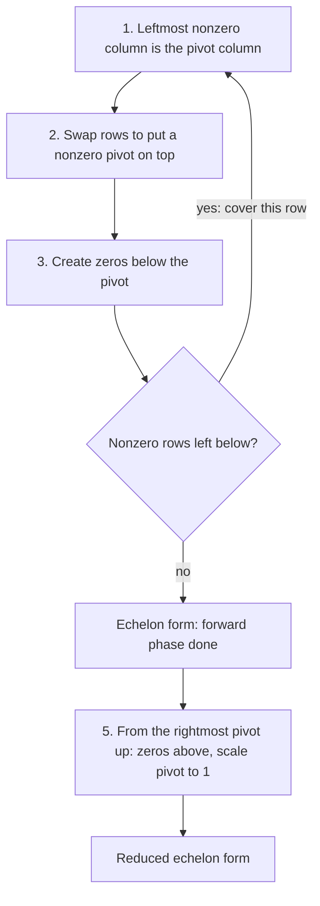

## A standard target

In the last lesson we row-reduced until the system "looked triangular" and then stopped.
To make that precise, and to have one procedure that works for every matrix of every
shape, we need a definite target. There are two: echelon form, which is enough to answer
existence and uniqueness, and reduced echelon form, which lets you read off the solutions
directly. The algorithm that gets you there is the workhorse of the whole course.

## Echelon form

Call a row nonzero if it has at least one nonzero entry. The **leading entry** of a
nonzero row is its leftmost nonzero entry. A matrix is in **echelon form** (row echelon
form, REF) when:

1. all nonzero rows are above any rows of all zeros;
2. each leading entry is in a column to the right of the leading entry of the row above it;
3. all entries in a column below a leading entry are zeros.

(Condition 3 follows from 2, but it's worth saying.) The leading entries form a staircase
descending to the right. For example, with $\blacksquare$ meaning any nonzero number and
$*$ any number at all,

$$\begin{bmatrix} \blacksquare & * & * & * & * \\ 0 & 0 & \blacksquare & * & * \\ 0 & 0 & 0 & \blacksquare & * \\ 0 & 0 & 0 & 0 & 0\end{bmatrix}$$

is an echelon pattern. The picture names its parts: the leading entries (circled) sit on a
staircase, everything below the staircase is zero, and the zero row is at the bottom.

A matrix is in **reduced echelon form** (reduced row echelon form,
**RREF**) if, in addition,

4. each leading entry is 1;
5. each leading 1 is the only nonzero entry in its column.

$$\begin{bmatrix} 1 & * & 0 & 0 & * \\ 0 & 0 & 1 & 0 & * \\ 0 & 0 & 0 & 1 & * \\ 0 & 0 & 0 & 0 & 0\end{bmatrix}$$

## Pivots

A matrix can be row-reduced to many different echelon forms (you can always scale a row,
or add a lower row to a higher one). But the reduced echelon form is special:

> *Uniqueness of the reduced echelon form.* Each matrix is row equivalent to one and only one reduced echelon matrix.

Because of this, the *positions* of the leading entries are the same in every echelon form
of a matrix. A **pivot position** is a location in $A$ that corresponds to a leading 1 in
the RREF of $A$; a **pivot column** is a column containing a pivot position. The nonzero
number you use in a pivot position to clear the entries around it is called a **pivot**.
Pivot positions are the single most informative thing about a matrix: they will tell you
about solutions, span, independence, invertibility and rank.

## The row reduction algorithm

*Forward phase* (produces an echelon form; this part is called **Gaussian elimination**):

1. Start with the leftmost nonzero column. This is a pivot column; its pivot position is at the top.
2. Pick a nonzero entry in that column as the pivot; interchange rows if needed to move it to the top.
3. Use replacement operations to create zeros in every position below the pivot.
4. Cover the row with the pivot (and everything above it) and repeat steps 1–3 on the submatrix below. Continue until there are no nonzero rows left to work on.

*Backward phase* (produces the RREF; the full procedure is **Gauss–Jordan elimination**):

5. Starting with the rightmost pivot and working up and to the left, create zeros *above* each pivot, and scale each pivot row to make the pivot a 1.

Working from the bottom up in step 5 is efficient: each replacement then only changes
entries to the right, which are zeros in the lower rows anyway.

The whole algorithm as a flowchart:

### Example 1

Row-reduce $A = \begin{bmatrix} 0 & 2 & 4 & -2 \\ 1 & 1 & 3 & 2 \\ 2 & 4 & 10 & 2\end{bmatrix}$ to reduced echelon form and find the pivot columns.

1. Column 1 is the leftmost nonzero column, but its top entry is 0. Interchange $R_1 \leftrightarrow R_2$:
$$\begin{bmatrix} 1 & 1 & 3 & 2 \\ 0 & 2 & 4 & -2 \\ 2 & 4 & 10 & 2\end{bmatrix}$$
2. Clear below the pivot: $R_3 \leftarrow R_3 - 2R_1$ makes row 3 $[\,0 \;\; 2 \;\; 4 \;\; {-2}\,]$.
3. Cover row 1. In the submatrix, column 2 has the pivot 2 at the top. $R_3 \leftarrow R_3 - R_2$ turns row 3 into all zeros:
$$\begin{bmatrix} 1 & 1 & 3 & 2 \\ 0 & 2 & 4 & -2 \\ 0 & 0 & 0 & 0\end{bmatrix}$$
   This is an echelon form. The pivot positions are $(1,1)$ and $(2,2)$, so the pivot columns are 1 and 2.
4. Backward phase: scale $R_2 \leftarrow \tfrac12 R_2$ to get $[\,0 \;\; 1 \;\; 2 \;\; {-1}\,]$, then $R_1 \leftarrow R_1 - R_2$:
$$\begin{bmatrix} 1 & 0 & 1 & 3 \\ 0 & 1 & 2 & -1 \\ 0 & 0 & 0 & 0\end{bmatrix}$$

That is the RREF. Columns 3 and 4 are not pivot columns.

### Example 2

Find the pivot columns of $B = \begin{bmatrix} 1 & 2 & 0 & 3 & 1 \\ 2 & 4 & 1 & 4 & 5 \\ -1 & -2 & 1 & -5 & 2\end{bmatrix}$.

1. Pivot in $(1,1)$. $R_2 \leftarrow R_2 - 2R_1$ gives $[\,0 \;\; 0 \;\; 1 \;\; {-2} \;\; 3\,]$; $R_3 \leftarrow R_3 + R_1$ gives $[\,0 \;\; 0 \;\; 1 \;\; {-2} \;\; 3\,]$.
2. Cover row 1. In what's left, column 2 is all zeros, so skip it: the next pivot column is column 3, with pivot at $(2, 3)$.
3. $R_3 \leftarrow R_3 - R_2$ makes row 3 zero:
$$\begin{bmatrix} 1 & 2 & 0 & 3 & 1 \\ 0 & 0 & 1 & -2 & 3 \\ 0 & 0 & 0 & 0 & 0\end{bmatrix}$$
4. The entry above the pivot in column 3 is already 0 and both pivots are 1, so this is already the RREF.

The pivot columns are 1 and 3. The staircase skipped column 2: pivots need not sit on the
main diagonal.

## Counting pivots

Since there is at most one pivot per row and at most one per column, an $m \times n$ matrix
has at most $\min(m, n)$ pivots. A $3 \times 5$ matrix has at most 3 pivots, so at least two
of its five columns are not pivot columns. That simple count will drive several theorems.

## Common mistakes

- *Calling the first nonzero entry of each row a pivot before reducing.* Pivot positions are only visible in an echelon form.
- *Clearing above pivots during the forward phase* while lower rows still need work; it's not wrong, but it creates extra arithmetic.
- *Expecting pivots on the diagonal.* In Example 2 the second pivot is in column 3.
- *Stopping at echelon form when the RREF was asked for.* Leading entries must be 1 with zeros above and below.
- *Thinking echelon forms are unique.* Only the reduced echelon form is; pivot positions are the same in all of them.

## Key points

- Echelon form: zero rows at the bottom, leading entries form a staircase moving right, zeros below each leading entry.
- RREF adds: leading entries are 1 and are the only nonzero entries in their columns. Every matrix has exactly one RREF.
- Pivot positions (and pivot columns) are the locations of the leading 1s in the RREF.
- Forward phase (Gaussian elimination) gives an echelon form; the backward phase (Gauss–Jordan) gives the RREF.
- An $m \times n$ matrix has at most $\min(m, n)$ pivots.
