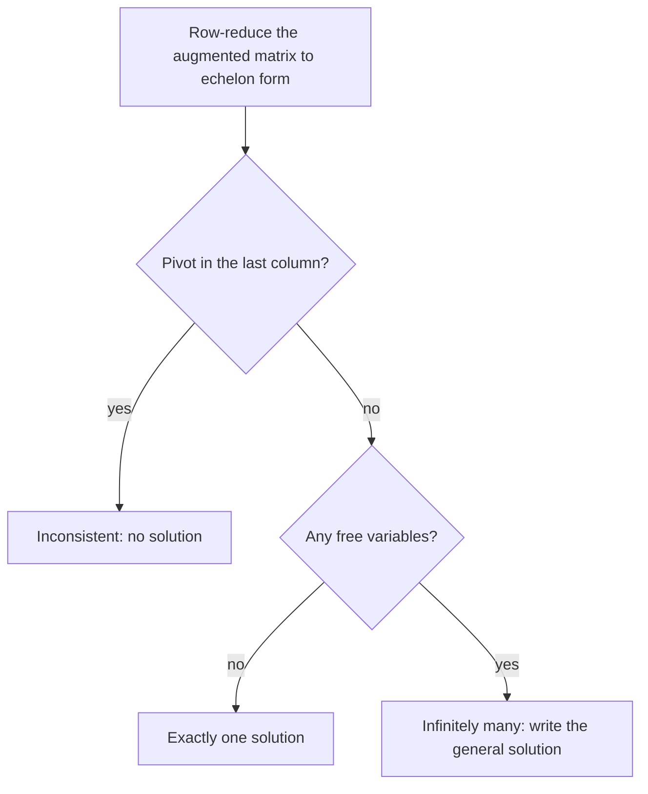

## Reading solutions from the RREF

The last lesson produced the reduced echelon form; this one cashes it in. Once the
augmented matrix of a system is in RREF you can read off, with no further algebra, whether
the system has a solution and what *all* the solutions are. The vocabulary introduced
here (basic and free variables, the general solution) is used for the rest of the course.

## Basic and free variables

Suppose the augmented matrix of a system row-reduces to

$$\left[\begin{array}{cccc|c} 1 & 2 & 0 & 3 & 1 \\ 0 & 0 & 1 & -2 & 3 \\ 0 & 0 & 0 & 0 & 0\end{array}\right].$$

(This is the matrix $B$ from the last lesson, now read as an augmented matrix.) The
corresponding system is

$$\begin{aligned} x_1 + 2x_2 \phantom{{}+x_3} + 3x_4 &= 1 \\ x_3 - 2x_4 &= 3 \\ 0 &= 0. \end{aligned}$$

The variables that correspond to pivot columns ($x_1$ and $x_3$) are called **basic variables**. The others ($x_2$ and $x_4$) are **free variables**. The name says what they
do: you may choose any values for the free variables, and each choice determines the basic
variables. Solve each equation for its basic variable:

$$\begin{cases} x_1 = 1 - 2x_2 - 3x_4 \\ x_2 \text{ is free} \\ x_3 = 3 + 2x_4 \\ x_4 \text{ is free.} \end{cases}$$

This description of every solution is the **general solution** of the system. It is a
**parametric description**: the free variables act as parameters. Choosing $x_2 = 0$,
$x_4 = 0$ gives the solution $(1, 0, 3, 0)$; choosing $x_2 = 1$, $x_4 = -1$ gives
$(2, 1, 1, -1)$. Each different choice gives a different solution, so a consistent system
with even one free variable has infinitely many solutions.

Why is it always possible to solve for the basic variables this way? In the RREF each
equation contains exactly one basic variable (its leading 1), and no basic variable
appears in any other equation (the zeros above and below each pivot). So each equation can
be solved for its own basic variable in terms of free variables alone.

## The existence and uniqueness theorem

Everything can now be said in terms of pivots.

> *Existence and uniqueness theorem.* A linear system is consistent if and only if the rightmost column of the augmented matrix is *not* a pivot column, that is, an echelon form has no row of the form $[\,0 \;\cdots\; 0 \;\; b\,]$ with $b \ne 0$. If the system is consistent, it has exactly one solution when there are no free variables, and infinitely many when there is at least one free variable.

A pivot in the last column is exactly the contradictory equation $0 = b$. Otherwise the
system can be solved as above, and the free variables decide between "one" and "infinitely
many". So a procedure for any system is:

1. Row-reduce the augmented matrix to echelon form.
2. If there is a pivot in the last column, stop: inconsistent.
3. Otherwise continue to RREF, write the system, and solve for the basic variables in terms of the free ones.



A useful count: if a system has more unknowns than equations (an **underdetermined system**), there are more columns than possible pivots, so some variable is free. Such a
system is either inconsistent or has infinitely many solutions; it can never have exactly
one. A system with more equations than unknowns is called **overdetermined**; it is often
inconsistent, but not always.

### Example 1

The augmented matrix of a system row-reduces to
$\left[\begin{array}{ccc|c} 1 & 0 & -3 & 4 \\ 0 & 1 & 2 & -1 \\ 0 & 0 & 0 & 0\end{array}\right]$.
Describe all solutions.

1. Pivots are in columns 1 and 2, and the last column has no pivot, so the system is consistent.
2. $x_1, x_2$ are basic; $x_3$ is free, so there are infinitely many solutions.
3. Row 1: $x_1 - 3x_3 = 4$, so $x_1 = 4 + 3x_3$. Row 2: $x_2 + 2x_3 = -1$, so $x_2 = -1 - 2x_3$.
4. General solution: $x_1 = 4 + 3t$, $x_2 = -1 - 2t$, $x_3 = t$ for any real $t$.

Spot check with $t = 1$: $(7, -3, 1)$ gives row 1: $7 - 3 = 4$ ✓ and row 2: $-3 + 2 = -1$ ✓.
Geometrically the solution set is a line in $\mathbb{R}^3$.

### Example 2

For which values of $h$ and $k$ does the system $x_1 + 3x_2 = 2$, $4x_1 + hx_2 = k$ have
(a) no solution, (b) exactly one, (c) infinitely many?

1. Augmented matrix $\left[\begin{array}{cc|c} 1 & 3 & 2 \\ 4 & h & k\end{array}\right]$. Apply $R_2 \leftarrow R_2 - 4R_1$:
$$\left[\begin{array}{cc|c} 1 & 3 & 2 \\ 0 & h - 12 & k - 8\end{array}\right]$$
2. If $h \ne 12$, the entry $h - 12$ is a pivot, so both columns of the coefficient part have pivots: no free variables and no pivot in the last column. Exactly one solution, whatever $k$ is.
3. If $h = 12$, row 2 is $[\,0 \;\; 0 \;\; k - 8\,]$. When $k \ne 8$ this is a pivot in the last column: no solution.
4. If $h = 12$ and $k = 8$, row 2 is all zeros, $x_2$ is free: infinitely many solutions.

So (a) $h = 12$, $k \ne 8$; (b) $h \ne 12$; (c) $h = 12$, $k = 8$. Geometrically, $h = 12$
makes the lines parallel, and $k = 8$ makes them the same line.

The plot shows two of the cases next to the first line $x_1 + 3x_2 = 2$ (with $x_1$ across and $x_2$ up).

```plot
{"x": [-3, 5], "y": [-2, 3], "functions": [{"f": "(2 - x)/3", "label": "x₁ + 3x₂ = 2"}, {"f": "(12 - 4x)/12", "label": "h = 12, k = 12: parallel", "dashed": true}, {"f": "(8 - 4x)/10", "label": "h = 10, k = 8: crosses"}], "points": [{"at": [2, 0], "label": "(2, 0)"}], "xLabel": "x₁", "yLabel": "x₂", "caption": "h = 12 makes the lines parallel (no solution unless k = 8); h = 10 gives one crossing point"}
```

## Common mistakes

- *Treating a zero row as a contradiction.* $[\,0 \;\; 0 \;\; 0 \;\; 0\,]$ is $0 = 0$, harmless. Only $[\,0 \;\cdots\; 0 \;\; b\,]$ with $b \neq 0$ means inconsistent.
- *Choosing the wrong free variables.* Free variables are the non-pivot columns of the coefficient part, determined by the RREF, not your preference.
- *Solving for basic variables before reaching RREF.* From a non-reduced echelon form the basic variables still depend on each other; back-substitute or finish reducing.
- *Concluding "infinitely many" from free variables alone.* First check consistency: an inconsistent system can have non-pivot columns too.
- *Assuming more equations than unknowns means no solution.* Overdetermined systems can still be consistent.

## Key points

- Pivot columns give basic variables; the other columns give free variables.
- The general solution writes each basic variable in terms of the free variables.
- Consistent ⟺ no pivot in the augmented column. Then: unique ⟺ no free variables.
- More unknowns than equations forces a free variable: no solution or infinitely many.
