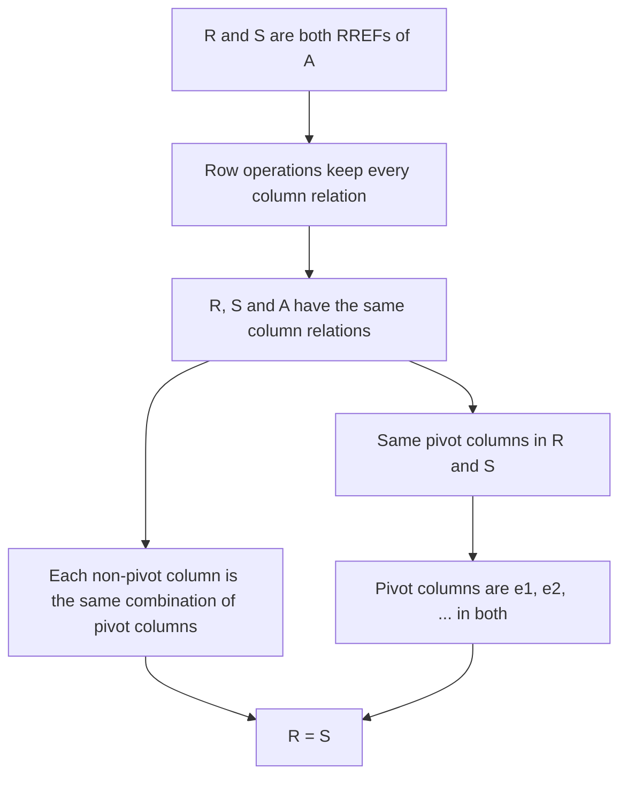

## A promise to keep

The row reduction lesson made a promise without proving it: *each matrix is row equivalent to
one and only one reduced echelon matrix.* Almost everything since then leans on that sentence.
"The pivot columns of $A$", "the free variables of a system" and "the number of pivots" only
make sense if two people who row-reduce the same matrix in different ways are sure to end up
at the same place. If the RREF depended on the order of your row operations, so would the
answer to "how many free variables?", and the existence and uniqueness theorem would be
ambiguous.

This lesson proves the promise. The idea behind the proof is worth more than the theorem:
instead of tracking what row operations *change*, ask what they *keep*.

## Echelon forms really are not unique

First, the claim is about the *reduced* form only. An ordinary echelon form can come out
differently depending on your choices.

### Example 1

Row-reduce $M = \begin{bmatrix} 3 & 6 & 3 \\ 1 & 4 & 5\end{bmatrix}$ in two ways.

1. *Path 1.* $R_2 \leftarrow R_2 - \tfrac13 R_1$ gives the echelon form $\begin{bmatrix} 3 & 6 & 3 \\ 0 & 2 & 4\end{bmatrix}$.
2. *Path 2.* $R_1 \leftrightarrow R_2$, then $R_2 \leftarrow R_2 - 3R_1$, gives the echelon form $\begin{bmatrix} 1 & 4 & 5 \\ 0 & -6 & -12\end{bmatrix}$.
3. The two echelon forms have different entries. Both, though, have their pivots in columns 1 and 2.
4. Finish path 1: $R_2 \leftarrow \tfrac12 R_2$ gives $[\,0 \;\; 1 \;\; 2\,]$; $R_1 \leftarrow R_1 - 6R_2$ gives $[\,3 \;\; 0 \;\; {-9}\,]$; $R_1 \leftarrow \tfrac13 R_1$ gives $[\,1 \;\; 0 \;\; {-3}\,]$.
5. Finish path 2: $R_2 \leftarrow -\tfrac16 R_2$ gives $[\,0 \;\; 1 \;\; 2\,]$; $R_1 \leftarrow R_1 - 4R_2$ gives $[\,1 \;\; 0 \;\; {-3}\,]$.

Both paths end at $\begin{bmatrix} 1 & 0 & -3 \\ 0 & 1 & 2\end{bmatrix}$. One example proves nothing about the infinitely many other ways to reduce, so we need an argument.

## What row operations keep

A quantity or property that a process never changes is called an **invariant** of the process.
Row operations change almost every entry, so the entries are not invariant. Here is something
that is.

Write the columns of an $m \times n$ matrix $A$ as $\mathbf{a}_1, \dots, \mathbf{a}_n$. Call a
list of numbers $c_1, \dots, c_n$ a **column relation** of $A$ if

$$c_1\mathbf{a}_1 + c_2\mathbf{a}_2 + \cdots + c_n\mathbf{a}_n = \mathbf{0}.$$

Read row by row, this says exactly that $(c_1, \dots, c_n)$ is a solution of the homogeneous
system whose coefficient matrix is $A$ (every right-hand side 0): row $i$ of the vector equation
is $a_{i1}c_1 + \cdots + a_{in}c_n = 0$. For instance, if $\mathbf{a}_3 = 2\mathbf{a}_1 - \mathbf{a}_2$, then
$(2, -1, -1)$ is a column relation, because $2\mathbf{a}_1 - \mathbf{a}_2 - \mathbf{a}_3 = \mathbf{0}$.

> *Invariance of column relations.* If $A$ and $B$ are row equivalent, they have exactly the same column relations.

*Proof.* Augment each with a column of zeros. Row operations on $A$ act on $[\,A \;\; \mathbf{0}\,]$ the
same way and keep the zero column zero, so $[\,A \;\; \mathbf{0}\,]$ and $[\,B \;\; \mathbf{0}\,]$ are
row equivalent. By the key fact of the systems lesson, row-equivalent augmented matrices have
the same solution set. Those solution sets are the column relations of $A$ and of $B$. $\square$

So the columns themselves change, but every statement of the form "this column is that
combination of those columns" survives every row operation. That is the invariant we need.

## Reading relations from an RREF

In a reduced echelon matrix $R$, the column relations are visible at a glance.

- The $k$-th pivot column of $R$ is the column with a 1 in row $k$ and zeros elsewhere. Call it $\mathbf{e}_k$.
- A non-pivot column has nonzero entries only in the rows of pivots to its *left* (lower rows have their leading entries further right, or are zero). So if its entries are $r_1, \dots, r_k$ in rows $1, \dots, k$, it equals $r_1\mathbf{e}_1 + \cdots + r_k\mathbf{e}_k$: the same combination of the pivot columns to its left.
- A pivot column is *not* a combination of the columns to its left. If its 1 is in row $k$, every earlier column has a 0 in row $k$ (row $k$ starts at this pivot), so any combination of them has a 0 there too.

Putting the last two facts together:

> In an RREF, a column is a pivot column exactly when it is not a combination of the columns to its left; a non-pivot column's entries are the weights that build it from the pivot columns.

Because column relations are invariant, the same statements hold for the *original* columns of $A$.

### Example 2

In the row reduction lesson, $A = \begin{bmatrix} 0 & 2 & 4 & -2 \\ 1 & 1 & 3 & 2 \\ 2 & 4 & 10 & 2\end{bmatrix}$ reduced to $R = \begin{bmatrix} 1 & 0 & 1 & 3 \\ 0 & 1 & 2 & -1 \\ 0 & 0 & 0 & 0\end{bmatrix}$. Read off and check the relations among the columns of $A$.

1. The pivot columns of $R$ are columns 1 and 2.
2. Column 3 of $R$ is $(1, 2, 0)$, so in $R$: column 3 $= 1\cdot$(column 1) $+ \,2\cdot$(column 2).
3. Column 4 of $R$ is $(3, -1, 0)$, so column 4 $= 3\cdot$(column 1) $- 1\cdot$(column 2).
4. Invariance says the same must hold in $A$. Check: $\mathbf{a}_1 + 2\mathbf{a}_2 = (0, 1, 2) + (4, 2, 8) = (4, 3, 10) = \mathbf{a}_3$. ✓ And $3\mathbf{a}_1 - \mathbf{a}_2 = (0, 3, 6) - (2, 1, 4) = (-2, 2, 2) = \mathbf{a}_4$. ✓

The RREF is a compact record of how every column of $A$ is built from the pivot columns.

## The proof

> *Theorem (uniqueness of the reduced echelon form).* If $R$ and $S$ are reduced echelon matrices that are both row equivalent to $A$, then $R = S$.

*Proof.* $R$ and $S$ are row equivalent to $A$, so by invariance all three have the same column relations.

*Same pivot columns.* Column $j$ of a matrix is a combination of the columns to its left exactly
when there is a column relation with $c_j = -1$ and $c_{j+1} = \cdots = c_n = 0$. That is a
statement about column relations, so it is true for $R$ exactly when it is true for $S$. By the
fact quoted above, column $j$ is a pivot column of $R$ exactly when it is a pivot column of $S$.

*Same pivot columns, entry by entry.* If $R$ and $S$ have pivots in the same columns, the $k$-th
pivot column of each is $\mathbf{e}_k$. So those columns agree.

*Same non-pivot columns.* Let column $j$ be a non-pivot column, with $k$ pivot columns to its
left. In $R$ it equals $r_1\mathbf{e}_1 + \cdots + r_k\mathbf{e}_k$, a column relation. That relation
holds in $S$ too, so column $j$ of $S$ equals $r_1$ times the first pivot column of $S$ plus
$\cdots$ plus $r_k$ times the $k$-th, which is $r_1\mathbf{e}_1 + \cdots + r_k\mathbf{e}_k$ again.

Every column of $R$ equals the matching column of $S$, so $R = S$. $\square$

Notice what the proof did *not* need: any knowledge of which row operations were used, or in
what order. That is the power of an invariant.

## Consequences

Because the RREF is unique, it is a **canonical form** for row equivalence: one standard
representative that every row-equivalent matrix reduces to.

- *Pivot positions are well defined.* Any echelon form of $A$ reduces further to the one RREF, and scaling and clearing above pivots never move a leading entry, so every echelon form has its leading entries in the same positions. (This is why lesson 05 could say pivot positions are "the same in every echelon form".)
- *The number of pivots is well defined*, and so are the basic and free variables of any system.
- *A test for row equivalence.* Two matrices of the same size are row equivalent exactly when they have the same RREF. If both reduce to $R$, run one reduction forward and the other backward ($A \to R \to B$; row operations are reversible). Conversely, if $A$ and $B$ are row equivalent, then the RREF of $B$ is also an RREF of $A$ ($A \to B \to$ RREF), so by uniqueness it is *the* RREF of $A$.

### Example 3

Are $P = \begin{bmatrix} 1 & 2 & -1 \\ 2 & 3 & 0 \\ 1 & 3 & -3\end{bmatrix}$ and $Q = \begin{bmatrix} 1 & 1 & 1 \\ 0 & 1 & -2 \\ 3 & 4 & 1\end{bmatrix}$ row equivalent?

1. Reduce $P$: $R_2 \leftarrow R_2 - 2R_1$ and $R_3 \leftarrow R_3 - R_1$ give rows $[\,0 \;\; {-1} \;\; 2\,]$ and $[\,0 \;\; 1 \;\; {-2}\,]$. Then $R_3 \leftarrow R_3 + R_2$ makes row 3 zero, $R_2 \leftarrow -R_2$ gives $[\,0 \;\; 1 \;\; {-2}\,]$, and $R_1 \leftarrow R_1 - 2R_2$ gives $[\,1 \;\; 0 \;\; 3\,]$.
2. Reduce $Q$: $R_3 \leftarrow R_3 - 3R_1$ gives $[\,0 \;\; 1 \;\; {-2}\,]$; $R_3 \leftarrow R_3 - R_2$ makes it zero; $R_1 \leftarrow R_1 - R_2$ gives $[\,1 \;\; 0 \;\; 3\,]$.
3. Both have RREF $\begin{bmatrix} 1 & 0 & 3 \\ 0 & 1 & -2 \\ 0 & 0 & 0\end{bmatrix}$, so $P$ and $Q$ are row equivalent.

A faster check uses relations: in both matrices column 3 $= 3\cdot$(column 1) $- 2\cdot$(column 2), and
columns 1 and 2 are not multiples of each other. Compare
$Q' = \begin{bmatrix} 1 & 1 & 1 \\ 0 & 1 & -2 \\ 3 & 4 & 2\end{bmatrix}$, which differs from $Q$ in one entry: now
$3\mathbf{q}_1 - 2\mathbf{q}_2 = (1, -2, 1) \ne (1, -2, 2)$, the relation is broken, and $Q'$ reduces to the
identity matrix. So $Q'$ is not row equivalent to $P$.

### Example 4

A $3 \times 4$ matrix $A$ has columns with $\mathbf{a}_1 = (1, 0, 2)$ and $\mathbf{a}_2 = (1, 1, 0)$ (not multiples of each other), $\mathbf{a}_3 = 2\mathbf{a}_1 - \mathbf{a}_2$, and $\mathbf{a}_4 = (0, 0, 1)$, which is not a combination of $\mathbf{a}_1$ and $\mathbf{a}_2$. Find the RREF of $A$ without row-reducing.

1. Column 1 is nonzero, so it is a pivot column: $\mathbf{e}_1$.
2. Column 2 is not a multiple of column 1, so it is a pivot column: $\mathbf{e}_2$.
3. Column 3 $= 2\cdot$(column 1) $- 1\cdot$(column 2), so it is not a pivot column, and in the RREF it is $2\mathbf{e}_1 - \mathbf{e}_2 = (2, -1, 0)$.
4. Column 4 is not a combination of the columns to its left (column 3 adds nothing new, since it is built from columns 1 and 2), so it is the third pivot column: $\mathbf{e}_3$.

$$\operatorname{RREF}(A) = \begin{bmatrix} 1 & 0 & 2 & 0 \\ 0 & 1 & -1 & 0 \\ 0 & 0 & 0 & 1\end{bmatrix}.$$

Writing out $A = \begin{bmatrix} 1 & 1 & 1 & 0 \\ 0 & 1 & -1 & 0 \\ 2 & 0 & 4 & 1\end{bmatrix}$ and row-reducing confirms it.

## A note on history

The method itself is old: a version of elimination on arrays of numbers appears in the Chinese
text *The Nine Chapters on the Mathematical Art*, compiled roughly two thousand years ago. The
uniqueness of the reduced form is a much later, purely theoretical question. The proof above
follows the invariant idea used in many modern textbooks; a short proof by induction on the
number of columns was published by Thomas Yuster in *Mathematics Magazine* in 1984.

## Common mistakes

- *Claiming every echelon form is unique.* Only the reduced form is; Example 1 has two different echelon forms of one matrix.
- *Thinking row operations keep the columns.* They change the columns. What they keep are the relations among the columns.
- *Reading relations from the rows.* The weights for a non-pivot column come from that column's entries in the RREF, read down the column, not across a row.
- *Building a column from the wrong pivot columns.* A non-pivot column of the RREF is a combination of the pivot columns to its *left* only.
- *Testing row equivalence by comparing echelon forms.* Two different echelon forms can come from the same matrix. Compare RREFs (or column relations) instead.

## Key points

- An invariant is something a process never changes. Row operations keep every column relation $c_1\mathbf{a}_1 + \cdots + c_n\mathbf{a}_n = \mathbf{0}$, because those are the solutions of the homogeneous system.
- In an RREF, pivot columns are $\mathbf{e}_1, \mathbf{e}_2, \dots$, and each non-pivot column lists the weights that build it from the pivot columns to its left.
- A column is a pivot column exactly when it is not a combination of the columns to its left; this depends only on column relations.
- Therefore the RREF is unique, pivot positions and the number of pivots are well defined, and two matrices are row equivalent exactly when they have the same RREF.
