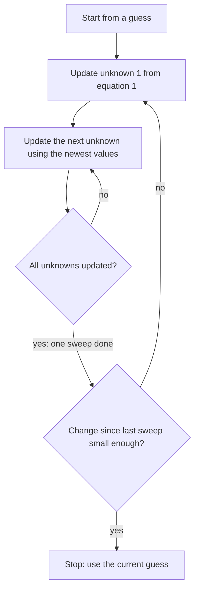

## Big systems, a different tool

The applications lesson built linear systems from conservation rules: flow in equals flow out,
atoms balance, curves pass through points. Scientific models apply the same kind of rule at
every point of a fine grid, which produces systems with thousands or millions of unknowns.
Such systems have a special shape: each equation involves only a few neighboring unknowns, so
almost every coefficient is 0. A matrix whose entries are mostly zeros is called **sparse**.

Row reduction is a **direct method**: it reaches the exact solution (apart from rounding) in a
fixed, finite number of steps. For an $n \times n$ system it takes roughly $n^3/3$
multiplications, and as it clears columns it tends to turn zeros into nonzeros, so it cannot
exploit sparsity well. An **iterative method** works differently: start with a guess, and
improve it again and again with a cheap update that uses only the nonzero coefficients. This
lesson builds the two classic iterative methods and shows when they work.

## A model: equilibrium temperatures

A thin metal plate has its edges held at fixed temperatures. Once the temperatures stop
changing, a standard simplified model says that at each interior grid point the temperature
is the average of the temperatures at its four nearest neighbors (left, right, above, below).
This "average of the neighbors" rule is an approximation of the heat equation that gets more
accurate as the grid gets finer.

### Example 1

Set up and solve the system for $T_1, T_2, T_3, T_4$ in the picture.

1. $T_1$ has neighbors 80 (above), 40 (left), $T_2$ and $T_3$, so $T_1 = \tfrac14(80 + 40 + T_2 + T_3)$. Multiply by 4 and move the unknowns left: $4T_1 - T_2 - T_3 = 120$.
2. The same rule at the other points:
$$\begin{aligned} 4T_1 - T_2 - T_3 &= 120 \\ -T_1 + 4T_2 - T_4 &= 140 \\ -T_1 + 4T_3 - T_4 &= 60 \\ -T_2 - T_3 + 4T_4 &= 80 \end{aligned}$$
   ($T_2$ touches 80 and 60; $T_3$ touches 40 and 20; $T_4$ touches 60 and 20.)
3. Row reduction gives $T_1 = 55$, $T_2 = 60$, $T_3 = 40$, $T_4 = 45$.
4. Check $T_1$: $\tfrac14(80 + 40 + 60 + 40) = \tfrac{220}{4} = 55$. ✓

Each equation has at most 5 nonzero coefficients however large the grid is. A $100 \times 100$
grid of interior points gives 10,000 unknowns, a coefficient matrix with $10^8$ entries, and
fewer than 50,000 of them nonzero.

## The Jacobi method

Solve the $i$-th equation for the $i$-th unknown. For a $2 \times 2$ system
$a_{11}x + a_{12}y = b_1$, $a_{21}x + a_{22}y = b_2$ with nonzero diagonal entries $a_{11}, a_{22}$:

$$x = \frac{b_1 - a_{12}y}{a_{11}}, \qquad y = \frac{b_2 - a_{21}x}{a_{22}}.$$

The **Jacobi method** turns these into an update rule. Start from a guess $(x_0, y_0)$, often
$(0, 0)$. To get the next guess, plug the *old* values into the right-hand sides:

$$x_{k+1} = \frac{b_1 - a_{12}y_k}{a_{11}}, \qquad y_{k+1} = \frac{b_2 - a_{21}x_k}{a_{22}}.$$

One round of updates through all the unknowns is called a **sweep**. If the guesses settle down
to a limit, that limit satisfies both equations, so it is the solution.

### Example 2

Use the Jacobi method on $4x + y = 9$, $x + 3y = 5$, starting from $(0, 0)$. (The exact solution is $(2, 1)$.)

1. The update rule: $x_{k+1} = \tfrac14(9 - y_k)$, $y_{k+1} = \tfrac13(5 - x_k)$.
2. Sweep 1, from $(0, 0)$: $x_1 = \tfrac94 = 2.25$, $y_1 = \tfrac53 \approx 1.6667$.
3. Sweep 2, from $(2.25, 1.6667)$: $x_2 = \tfrac14(9 - 1.6667) \approx 1.8333$, $y_2 = \tfrac13(5 - 2.25) \approx 0.9167$.
4. Continuing: $(2.0208, 1.0556)$, then $(1.9861, 0.9931)$, then $(2.0017, 1.0046)$.

The guesses close in on $(2, 1)$, overshooting a little on alternate sides.

## The Gauss–Seidel method

In a Jacobi sweep, the new $x_{k+1}$ is already known when $y_{k+1}$ is computed, but Jacobi
ignores it. The **Gauss–Seidel method** uses each new value as soon as it has it:

$$x_{k+1} = \frac{b_1 - a_{12}y_k}{a_{11}}, \qquad y_{k+1} = \frac{b_2 - a_{21}x_{k+1}}{a_{22}}.$$

With more unknowns, each update uses the newest available value of every other unknown. As a
bonus, a computer can overwrite each old value in place, so only one copy of the guess is stored.

### Example 3

Repeat Example 2 with Gauss–Seidel, starting from $(0, 0)$.

1. Sweep 1: $x_1 = \tfrac14(9 - 0) = 2.25$; then, using this new $x$, $y_1 = \tfrac13(5 - 2.25) \approx 0.9167$.
2. Sweep 2: $x_2 = \tfrac14(9 - 0.9167) \approx 2.0208$; $y_2 = \tfrac13(5 - 2.0208) \approx 0.9931$.
3. Sweep 3: $(2.0017, 0.9994)$. Sweep 4: $(2.0001, 1.0000)$ to four decimals.

After two sweeps Gauss–Seidel is about as close as Jacobi after four. On the plate of Example 1,
starting from all zeros, the largest error after each sweep is:

| Sweep | 1 | 2 | 3 | 4 | 5 |
|---|---|---|---|---|---|
| Jacobi | 25 | 12.5 | 6.25 | 3.13 | 1.56 |
| Gauss–Seidel | 25 | 8.75 | 2.19 | 0.55 | 0.14 |

For this plate the Jacobi error halves with each sweep and the Gauss–Seidel error eventually
shrinks by a factor of 4. Gauss–Seidel is often faster, but not for every system.

## When do they converge?

Iterating does not always work. A square matrix is **strictly diagonally dominant** if in every
row the diagonal entry is larger in absolute value than the sum of the absolute values of the
other entries in that row. The plate matrix is: $|4| > |-1| + |-1|$ in every row (some rows
have only two other nonzero entries; none has more than four, and $4 > 2$ anyway for those).
Check row by row: row 1 of the plate system has $4$ against $1 + 1 = 2$.

> *Convergence theorem (stated without proof).* If the coefficient matrix is strictly diagonally dominant, the system has exactly one solution, and both the Jacobi and the Gauss–Seidel iterations converge to it from any starting guess.

The condition is sufficient, not necessary: some systems that are not diagonally dominant still
converge. But without it there is no guarantee, and the order of the equations matters.

### Example 4

Try Jacobi on $x + 2y = 3$, $3x + y = 4$ (exact solution $(1, 1)$), then reorder the equations.

1. As written, the update is $x_{k+1} = 3 - 2y_k$, $y_{k+1} = 4 - 3x_k$. From $(0, 0)$: $(3, 4)$, $(-5, -5)$, $(13, 19)$, $(-35, -35)$. The guesses blow up.
2. The matrix $\begin{bmatrix} 1 & 2 \\ 3 & 1\end{bmatrix}$ is not diagonally dominant: in row 1, $1 < 2$.
3. Swap the equations: $3x + y = 4$, $x + 2y = 3$. Now $3 > 1$ and $2 > 1$, so the matrix is strictly diagonally dominant.
4. The new update is $x_{k+1} = \tfrac13(4 - y_k)$, $y_{k+1} = \tfrac12(3 - x_k)$. From $(0, 0)$: $(1.3333, 1.5)$, $(0.8333, 0.8333)$, $(1.0556, 1.0833)$, $(0.9722, 0.9722)$, closing in on $(1, 1)$.

A row interchange does not change the solution set, but it changed which unknown each equation
is solved for, and that decided whether the method converges.

## Direct or iterative?

- *Direct methods* (row reduction, and the LU factorization later in the course) give the exact answer in a predictable number of steps, apart from round-off. They are the usual choice for small and medium systems whose matrices are mostly nonzero.
- *Iterative methods* give an approximation that improves with each sweep. A sweep costs about two operations per nonzero coefficient, stores nothing beyond the guess, and keeps the matrix sparse. They are the usual choice for very large sparse systems, provided they converge.
- *Stopping.* In practice you stop when the change between sweeps is below a chosen tolerance. That is a rule of thumb: a small change usually, but not always, means a small error.

The methods are named after the 19th-century German mathematicians Carl Gustav Jacobi and
Philipp Ludwig von Seidel; Gauss used a similar method by hand decades before Seidel published
his. Modern software uses faster relatives of these ideas, but the core move, improving a guess
using one equation at a time, is the same.

## Common mistakes

- *Mixing up the two methods.* Jacobi uses only the previous sweep's values; Gauss–Seidel uses each new value immediately.
- *Solving each equation for the wrong unknown.* Equation $i$ is solved for unknown $i$, the one with the diagonal coefficient.
- *Assuming every system converges.* Without diagonal dominance the guesses can blow up, as in Example 4.
- *Testing diagonal dominance by columns or against single entries.* Compare each diagonal entry with the sum of the absolute values of the *other entries in its row*.
- *Treating a small change between sweeps as proof of accuracy.* It is a practical stopping rule, not a guarantee.

## Key points

- Large models produce sparse systems; iterative methods update a guess using only the nonzero coefficients.
- Jacobi: solve equation $i$ for $x_i$ and plug in the previous sweep's values. Gauss–Seidel: the same, but use each new value as soon as it is computed.
- In the plate model each interior temperature is the average of its four neighbors, giving a sparse, strictly diagonally dominant system.
- If the matrix is strictly diagonally dominant, both methods converge to the unique solution from any start. Reordering equations can create diagonal dominance.
- Direct methods are exact in a fixed number of steps; iterative methods trade exactness for cheap sweeps on huge sparse systems.
