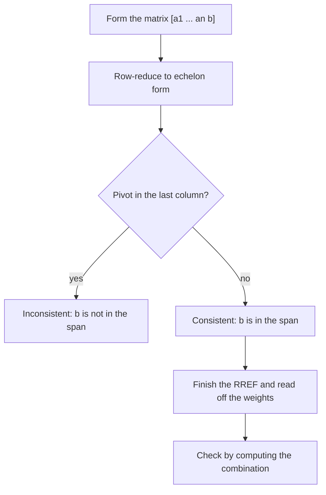

## A second way to read a system

So far a linear system has been a list of equations, read across the rows. This module
reads the same system *down the columns*, as a question about vectors: can a target vector
be built by scaling and adding some given vectors? That shift in viewpoint is the heart of
linear algebra. Row reduction stays the computational tool; what changes is the meaning.

## Vectors in $\mathbb{R}^n$

The plane vectors of Module 1 generalize directly. A **column vector** with $n$ real
entries is an element of $\mathbb{R}^n$:

$$\mathbf{u} = \begin{bmatrix} u_1 \\ u_2 \\ \vdots \\ u_n\end{bmatrix}.$$

Two vectors are equal when all corresponding entries are equal. Vectors in $\mathbb{R}^n$
are added and scaled entry by entry, and those operations obey the familiar rules for all
$\mathbf{u}, \mathbf{v}, \mathbf{w}$ and scalars $c, d$:

| Property | Rule |
|---|---|
| commutative, associative | $\mathbf{u} + \mathbf{v} = \mathbf{v} + \mathbf{u}$, $(\mathbf{u} + \mathbf{v}) + \mathbf{w} = \mathbf{u} + (\mathbf{v} + \mathbf{w})$ |
| zero and negatives | $\mathbf{u} + \mathbf{0} = \mathbf{u}$, $\mathbf{u} + (-\mathbf{u}) = \mathbf{0}$ |
| distributive | $c(\mathbf{u} + \mathbf{v}) = c\mathbf{u} + c\mathbf{v}$, $(c + d)\mathbf{u} = c\mathbf{u} + d\mathbf{u}$ |
| scalars | $c(d\mathbf{u}) = (cd)\mathbf{u}$, $1\mathbf{u} = \mathbf{u}$ |

Each rule holds because it holds for the numbers in each entry. For $n = 3$ you can still
picture vectors as arrows in space; for $n \ge 4$ you can't draw them, but the algebra is
identical, and the pictures from $\mathbb{R}^2$ and $\mathbb{R}^3$ remain a reliable guide.

## Linear combinations

Given vectors $\mathbf{v}_1, \dots, \mathbf{v}_p$ in $\mathbb{R}^n$ and scalars
$c_1, \dots, c_p$, the vector

$$\mathbf{y} = c_1\mathbf{v}_1 + c_2\mathbf{v}_2 + \cdots + c_p\mathbf{v}_p$$

is a **linear combination** of $\mathbf{v}_1, \dots, \mathbf{v}_p$ with **weights**
$c_1, \dots, c_p$. Weights can be any real numbers, including zero and negatives.

```plot
{"x": [-2, 7], "y": [-2, 6], "equal": true, "segments": [{"from": [0, 0], "to": [2, 1], "arrow": true, "label": "v₁"}, {"from": [0, 0], "to": [-1, 2], "arrow": true, "label": "v₂"}, {"from": [0, 0], "to": [4, 2], "arrow": true, "dashed": true}, {"from": [4, 2], "to": [3, 4], "arrow": true, "dashed": true}, {"from": [0, 0], "to": [3, 4], "arrow": true, "label": "2v₁ + v₂"}], "caption": "The linear combination 2v₁ + v₂ = (3, 4)"}
```

The basic question is the reverse: *given* $\mathbf{b}$, can we find weights with
$x_1\mathbf{a}_1 + x_2\mathbf{a}_2 + \cdots + x_n\mathbf{a}_n = \mathbf{b}$? This is called
a **vector equation**. Comparing entries turns it into an ordinary linear system, and the
columns of its augmented matrix are exactly the given vectors:

> The vector equation $x_1\mathbf{a}_1 + \cdots + x_n\mathbf{a}_n = \mathbf{b}$ has the same solution set as the linear system with augmented matrix $[\,\mathbf{a}_1 \;\; \mathbf{a}_2 \;\; \cdots \;\; \mathbf{a}_n \;\; \mathbf{b}\,]$. In particular, $\mathbf{b}$ is a linear combination of $\mathbf{a}_1, \dots, \mathbf{a}_n$ exactly when that system is consistent.

### Example 1

Is $\mathbf{b} = \begin{bmatrix} 4 \\ -7 \\ 11\end{bmatrix}$ a linear combination of $\mathbf{a}_1 = \begin{bmatrix} 1 \\ -2 \\ 3\end{bmatrix}$ and $\mathbf{a}_2 = \begin{bmatrix} 2 \\ -3 \\ 5\end{bmatrix}$?

1. Set up $x_1\mathbf{a}_1 + x_2\mathbf{a}_2 = \mathbf{b}$ and its augmented matrix $\left[\begin{array}{cc|c} 1 & 2 & 4 \\ -2 & -3 & -7 \\ 3 & 5 & 11\end{array}\right]$.
2. $R_2 \leftarrow R_2 + 2R_1$ gives $[\,0 \;\; 1 \;\; 1\,]$; $R_3 \leftarrow R_3 - 3R_1$ gives $[\,0 \;\; {-1} \;\; {-1}\,]$; then $R_3 \leftarrow R_3 + R_2$ gives a zero row.
3. $R_1 \leftarrow R_1 - 2R_2$: the RREF is $\left[\begin{array}{cc|c} 1 & 0 & 2 \\ 0 & 1 & 1 \\ 0 & 0 & 0\end{array}\right]$, so $x_1 = 2$, $x_2 = 1$.
4. Check: $2\mathbf{a}_1 + \mathbf{a}_2 = \begin{bmatrix} 2 + 2 \\ -4 - 3 \\ 6 + 5\end{bmatrix} = \begin{bmatrix} 4 \\ -7 \\ 11\end{bmatrix}$. ✓

So yes: $\mathbf{b} = 2\mathbf{a}_1 + \mathbf{a}_2$.

## Span

The set of *all* linear combinations of $\mathbf{v}_1, \dots, \mathbf{v}_p$ is called the
**span** of those vectors, written $\operatorname{Span}\{\mathbf{v}_1, \dots, \mathbf{v}_p\}$.
It is the set of all vectors of the form $c_1\mathbf{v}_1 + \cdots + c_p\mathbf{v}_p$ with
arbitrary scalars. Some immediate facts:

- The span always contains $\mathbf{0}$ (take all weights 0) and each $\mathbf{v}_i$ (weight 1 on it, 0 elsewhere).
- Asking "is $\mathbf{b}$ in $\operatorname{Span}\{\mathbf{a}_1, \dots, \mathbf{a}_n\}$?" is the same as asking whether $[\,\mathbf{a}_1 \;\cdots\; \mathbf{a}_n \;\; \mathbf{b}\,]$ is consistent.

Geometrically, in $\mathbb{R}^3$:

- If $\mathbf{v} \ne \mathbf{0}$, $\operatorname{Span}\{\mathbf{v}\}$ is the set of multiples $c\mathbf{v}$: a *line through the origin* in the direction of $\mathbf{v}$.
- If $\mathbf{u}$ and $\mathbf{v}$ are nonzero and not multiples of each other, $\operatorname{Span}\{\mathbf{u}, \mathbf{v}\}$ is the *plane through the origin* containing them.
- If $\mathbf{v}$ is a multiple of $\mathbf{u}$, adding $\mathbf{v}$ contributes nothing new; the span is still a line.

The picture shows both shapes at once: the plane $\operatorname{Span}\{\mathbf{u}, \mathbf{v}\}$, a line
$\operatorname{Span}\{\mathbf{w}\}$ crossing it at the origin, and a vector $\mathbf{b}$ that is not in the plane.


In $\mathbb{R}^2$, two vectors that are not multiples of each other span the whole plane:
every vector in the plane can be reached. Example 1 says $\mathbf{b}$ lies in the plane
spanned by $\mathbf{a}_1$ and $\mathbf{a}_2$.

### Example 2

Is $\mathbf{b} = \begin{bmatrix} 1 \\ 2 \\ 3\end{bmatrix}$ in $\operatorname{Span}\{\mathbf{a}_1, \mathbf{a}_2\}$ for the same $\mathbf{a}_1, \mathbf{a}_2$?

1. Augmented matrix $\left[\begin{array}{cc|c} 1 & 2 & 1 \\ -2 & -3 & 2 \\ 3 & 5 & 3\end{array}\right]$.
2. $R_2 \leftarrow R_2 + 2R_1$: $[\,0 \;\; 1 \;\; 4\,]$. $R_3 \leftarrow R_3 - 3R_1$: $[\,0 \;\; {-1} \;\; 0\,]$.
3. $R_3 \leftarrow R_3 + R_2$: $[\,0 \;\; 0 \;\; 4\,]$, a pivot in the last column.

The system is inconsistent, so $\mathbf{b}$ is *not* in the span. Geometrically, the span
is a plane through the origin in $\mathbb{R}^3$, and this $\mathbf{b}$ sticks out of it.
Two vectors can never span all of $\mathbb{R}^3$: the coefficient matrix is $3 \times 2$,
so it has at most two pivots, and some $\mathbf{b}$ will always produce a pivot in the last
column.

Every "is $\mathbf{b}$ in the span?" question follows the same route:



## Common mistakes

- *Putting the vectors in rows.* The given vectors become the *columns* of the augmented matrix, with $\mathbf{b}$ as the last column.
- *Forgetting that the span contains $\mathbf{0}$.* Every span passes through the origin; a line not through the origin is never a span.
- *Thinking two vectors always span a plane.* If one is a multiple of the other (or zero), they span only a line (or a point).
- *Reading weights from the wrong place.* The weights are the solution of the system, not the entries of $\mathbf{b}$.

## Key points

- $\mathbb{R}^n$ is the set of column vectors with $n$ real entries; add and scale entrywise.
- A linear combination is $c_1\mathbf{v}_1 + \cdots + c_p\mathbf{v}_p$; the $c_i$ are weights.
- $x_1\mathbf{a}_1 + \cdots + x_n\mathbf{a}_n = \mathbf{b}$ is solved by row-reducing $[\,\mathbf{a}_1 \;\cdots\; \mathbf{a}_n \;\; \mathbf{b}\,]$.
- $\operatorname{Span}\{\mathbf{v}_1, \dots, \mathbf{v}_p\}$ is the set of all linear combinations; it always contains $\mathbf{0}$.
- In $\mathbb{R}^3$ the span of one nonzero vector is a line through $\mathbf{0}$; of two non-parallel vectors, a plane through $\mathbf{0}$.
