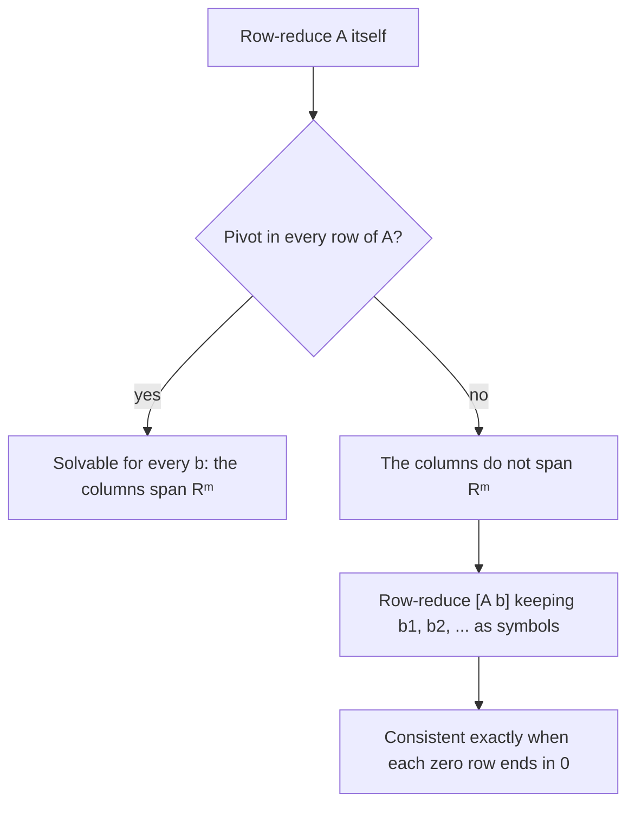

## One equation for the whole system

A linear combination of vectors comes up so often that it gets its own notation: a matrix
times a vector. With it, any linear system can be written as a single equation
$A\mathbf{x} = \mathbf{b}$. The payoff isn't just shorter notation; it lets us state
theorems about *all* right-hand sides $\mathbf{b}$ at once, and it sets up the idea of a
matrix as a function, which is the next module.

## The product $A\mathbf{x}$

If $A$ is an $m \times n$ matrix with columns $\mathbf{a}_1, \dots, \mathbf{a}_n$ and
$\mathbf{x}$ is in $\mathbb{R}^n$, the **matrix–vector product** $A\mathbf{x}$ is the linear
combination of the columns of $A$ using the entries of $\mathbf{x}$ as weights:

$$A\mathbf{x} = \begin{bmatrix} \mathbf{a}_1 & \mathbf{a}_2 & \cdots & \mathbf{a}_n\end{bmatrix}\begin{bmatrix} x_1 \\ \vdots \\ x_n\end{bmatrix} = x_1\mathbf{a}_1 + x_2\mathbf{a}_2 + \cdots + x_n\mathbf{a}_n.$$

$A\mathbf{x}$ is defined only when the number of columns of $A$ equals the number of entries
of $\mathbf{x}$, and the result is in $\mathbb{R}^m$. For hand computation the
**row–vector rule** is faster: entry $i$ of $A\mathbf{x}$ is the sum of products of row $i$
of $A$ with the entries of $\mathbf{x}$. That's exactly how the left sides of a system's
equations are formed, and it agrees with the matrix product from Module 1.

### Example 1

Compute $A\mathbf{x}$ for $A = \begin{bmatrix} 2 & -1 & 3 \\ 0 & 4 & 1\end{bmatrix}$ and $\mathbf{x} = \begin{bmatrix} 1 \\ 2 \\ -1\end{bmatrix}$ both ways.

1. Columns view: $1\begin{bmatrix} 2 \\ 0\end{bmatrix} + 2\begin{bmatrix} -1 \\ 4\end{bmatrix} + (-1)\begin{bmatrix} 3 \\ 1\end{bmatrix} = \begin{bmatrix} 2 - 2 - 3 \\ 0 + 8 - 1\end{bmatrix} = \begin{bmatrix} -3 \\ 7\end{bmatrix}$.
2. Row view: row 1: $2(1) + (-1)(2) + 3(-1) = -3$; row 2: $0(1) + 4(2) + 1(-1) = 7$.

Both give $\begin{bmatrix} -3 \\ 7\end{bmatrix}$. Note sizes: $(2 \times 3)$ times a vector in $\mathbb{R}^3$ gives a vector in $\mathbb{R}^2$.

The column view is easy to draw: walk along $1\mathbf{a}_1$, then $2\mathbf{a}_2$, then $-\mathbf{a}_3$, head to tail.

```plot
{"x": [-5, 4], "y": [-2, 9], "equal": true, "segments": [{"from": [0, 0], "to": [2, 0], "arrow": true, "label": "a₁"}, {"from": [2, 0], "to": [0, 8], "arrow": true, "label": "2a₂"}, {"from": [0, 8], "to": [-3, 7], "arrow": true, "label": "−a₃"}, {"from": [0, 0], "to": [-3, 7], "arrow": true, "dashed": true, "label": "Ax = (−3, 7)"}], "caption": "Ax = 1·a₁ + 2·a₂ + (−1)·a₃ = (−3, 7), drawn head to tail"}
```

Two algebraic properties follow from the column definition, and they're the defining
feature of everything linear: for $A$ $m \times n$, $\mathbf{u}, \mathbf{v}$ in
$\mathbb{R}^n$ and a scalar $c$,

$$A(\mathbf{u} + \mathbf{v}) = A\mathbf{u} + A\mathbf{v}, \qquad A(c\mathbf{u}) = c(A\mathbf{u}).$$

Also, the identity matrix $I_n$ satisfies $I_n\mathbf{x} = \mathbf{x}$, since its columns are
$\mathbf{e}_1, \dots, \mathbf{e}_n$ and $x_1\mathbf{e}_1 + \cdots + x_n\mathbf{e}_n = \mathbf{x}$.

## Three views of one problem

Putting the last two lessons together, these three statements say the same thing and have
the same solution set:

| View | Form |
|---|---|
| matrix equation | $A\mathbf{x} = \mathbf{b}$ |
| vector equation | $x_1\mathbf{a}_1 + \cdots + x_n\mathbf{a}_n = \mathbf{b}$ |
| linear system | augmented matrix $[\,\mathbf{a}_1 \;\cdots\; \mathbf{a}_n \;\; \mathbf{b}\,] = [\,A \;\; \mathbf{b}\,]$ |

So: *$A\mathbf{x} = \mathbf{b}$ has a solution if and only if $\mathbf{b}$ is a linear
combination of the columns of $A$*, that is, $\mathbf{b}$ is in the span of the columns.
Move between the views freely: compute with the augmented matrix, think with columns.

## When is $A\mathbf{x} = \mathbf{b}$ solvable for every $\mathbf{b}$?

Often we care about all right-hand sides at once. Say the columns of $A$ *span*
$\mathbb{R}^m$ if every vector in $\mathbb{R}^m$ is a linear combination of them.

> *Theorem.* For an $m \times n$ matrix $A$, these statements are either all true or all false:
> 1. For each $\mathbf{b}$ in $\mathbb{R}^m$, $A\mathbf{x} = \mathbf{b}$ has a solution.
> 2. Each $\mathbf{b}$ in $\mathbb{R}^m$ is a linear combination of the columns of $A$.
> 3. The columns of $A$ span $\mathbb{R}^m$.
> 4. $A$ has a pivot position in every row.

Statements 1–3 are the same fact in different words. The link to 4: if every row of $A$
has a pivot, then an echelon form of $[\,A \;\; \mathbf{b}\,]$ can't have a row
$[\,0 \;\cdots\; 0 \;\; d\,]$ with $d \ne 0$, because no row of $A$'s echelon form is all
zeros. If some row of $A$'s echelon form *is* all zeros, you can choose $\mathbf{b}$ so
that the last column has a nonzero entry there, and that system is inconsistent.

Be careful: the theorem is about the *coefficient* matrix $A$, not the augmented matrix.
A pivot in every row of $[\,A \;\; \mathbf{b}\,]$ could include a pivot in the last column,
which means *no* solution.

To decide the question for a particular $A$:



### Example 2

Let $A = \begin{bmatrix} 1 & 2 & -1 \\ 2 & 5 & 1 \\ 3 & 7 & 0\end{bmatrix}$. Is $A\mathbf{x} = \mathbf{b}$ consistent for every $\mathbf{b}$? If not, describe the $\mathbf{b}$ that work.

1. Row-reduce $[\,A \;\; \mathbf{b}\,]$ keeping $b_1, b_2, b_3$ as symbols. $R_2 \leftarrow R_2 - 2R_1$ and $R_3 \leftarrow R_3 - 3R_1$:
$$\left[\begin{array}{ccc|c} 1 & 2 & -1 & b_1 \\ 0 & 1 & 3 & b_2 - 2b_1 \\ 0 & 1 & 3 & b_3 - 3b_1\end{array}\right]$$
2. $R_3 \leftarrow R_3 - R_2$: row 3 becomes $[\,0 \;\; 0 \;\; 0 \;\; b_3 - b_1 - b_2\,]$.
3. Row 3 of $A$'s echelon form is zero, so $A$ lacks a pivot in row 3: the columns do *not* span $\mathbb{R}^3$.
4. The system is consistent exactly when $b_3 - b_1 - b_2 = 0$, i.e. $b_3 = b_1 + b_2$.

For instance $\mathbf{b} = (1, 1, 2)$ works and $\mathbf{b} = (1, 1, 1)$ doesn't. The
columns of $A$ span the plane $b_3 = b_1 + b_2$ through the origin. (You can see why: row 3
of $A$ is row 1 plus row 2.)

## Common mistakes

- *Size mismatch.* A $2 \times 3$ matrix multiplies vectors in $\mathbb{R}^3$, and $A\mathbf{x}$ lands in $\mathbb{R}^2$.
- *Using columns as rows* in the row–vector rule. Row $i$ of $A$ pairs with the whole vector $\mathbf{x}$.
- *Checking pivots of the augmented matrix* to decide whether the columns span $\mathbb{R}^m$; use the coefficient matrix.
- *Thinking more columns guarantees spanning.* A $3 \times 5$ matrix can still fail to span $\mathbb{R}^3$ if its echelon form has a zero row.

## Key points

- $A\mathbf{x}$ is the linear combination of the columns of $A$ with weights from $\mathbf{x}$; compute it with the row–vector rule.
- $A(\mathbf{u} + \mathbf{v}) = A\mathbf{u} + A\mathbf{v}$ and $A(c\mathbf{u}) = cA\mathbf{u}$.
- $A\mathbf{x} = \mathbf{b}$, the vector equation, and the augmented matrix $[\,A \;\; \mathbf{b}\,]$ all have the same solutions.
- $A\mathbf{x} = \mathbf{b}$ is solvable for every $\mathbf{b}$ exactly when the columns of $A$ span $\mathbb{R}^m$, exactly when $A$ has a pivot in every row.
