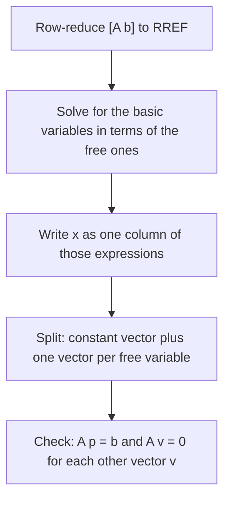

## Describing infinitely many solutions as vectors

In Module 2 a general solution was a list like "$x_1 = 4 + 3x_3$, $x_2 = -1 - 2x_3$,
$x_3$ free". Now that we have vectors and spans, we can write such a solution set as a
single vector formula and *see* its shape: a point, a line, a plane, or a higher-dimensional
flat, always related to a span. This lesson also reveals a structural fact: the solutions of
$A\mathbf{x} = \mathbf{b}$ are a shifted copy of the solutions of $A\mathbf{x} = \mathbf{0}$.

## Homogeneous systems

A system is **homogeneous** if it can be written $A\mathbf{x} = \mathbf{0}$. Every
homogeneous system is consistent, because $\mathbf{x} = \mathbf{0}$ always works; this is
the **trivial solution**. The interesting question is whether there are others, a
**nontrivial solution** $\mathbf{x} \ne \mathbf{0}$.

> $A\mathbf{x} = \mathbf{0}$ has a nontrivial solution if and only if the system has at least one free variable.

That follows straight from the existence and uniqueness theorem: the system is always
consistent, so it has infinitely many solutions (including nonzero ones) exactly when
there's a free variable. In particular, a homogeneous system with more unknowns than
equations always has a nontrivial solution.

## Parametric vector form

### Example 1

Describe the solutions of $A\mathbf{x} = \mathbf{0}$ for $A = \begin{bmatrix} 1 & 2 & -3 \\ 2 & 5 & -4\end{bmatrix}$.

1. Row-reduce $[\,A \;\; \mathbf{0}\,]$. $R_2 \leftarrow R_2 - 2R_1$ gives $[\,0 \;\; 1 \;\; 2 \;\; 0\,]$; $R_1 \leftarrow R_1 - 2R_2$ gives $[\,1 \;\; 0 \;\; {-7} \;\; 0\,]$.
2. So $x_1 - 7x_3 = 0$ and $x_2 + 2x_3 = 0$, with $x_3$ free: $x_1 = 7x_3$, $x_2 = -2x_3$.
3. Write the solution vector and pull out the free variable:
$$\mathbf{x} = \begin{bmatrix} x_1 \\ x_2 \\ x_3\end{bmatrix} = \begin{bmatrix} 7x_3 \\ -2x_3 \\ x_3\end{bmatrix} = x_3\begin{bmatrix} 7 \\ -2 \\ 1\end{bmatrix}.$$

The solution set is $\operatorname{Span}\{(7, -2, 1)\}$, a line through the origin in
$\mathbb{R}^3$. Check: $A\begin{bmatrix} 7 \\ -2 \\ 1\end{bmatrix} = \begin{bmatrix} 7 - 4 - 3 \\ 14 - 10 - 4\end{bmatrix} = \mathbf{0}$. ✓

Writing $\mathbf{x} = s\mathbf{u} + t\mathbf{v}$ (with parameters $s, t$ ranging over all
real numbers) is called **parametric vector form**. Each free variable contributes one
vector. The recipe:

1. Row-reduce to RREF and solve for the basic variables in terms of the free ones.
2. Write $\mathbf{x}$ as a column whose entries are those expressions.
3. Split the column into a sum, one vector per free variable (plus a constant vector, if the system isn't homogeneous).



### Example 2

Describe the solutions of the single equation $2x_1 - 4x_2 + 6x_3 = 0$.

1. The augmented matrix $[\,2 \;\; {-4} \;\; 6 \;\; 0\,]$ reduces to $[\,1 \;\; {-2} \;\; 3 \;\; 0\,]$, so $x_1 = 2x_2 - 3x_3$ with $x_2, x_3$ free.
2. $\mathbf{x} = \begin{bmatrix} 2x_2 - 3x_3 \\ x_2 \\ x_3\end{bmatrix} = x_2\begin{bmatrix} 2 \\ 1 \\ 0\end{bmatrix} + x_3\begin{bmatrix} -3 \\ 0 \\ 1\end{bmatrix}$.

The solution set is $\operatorname{Span}\{(2, 1, 0), (-3, 0, 1)\}$, a plane through the
origin. In general, the solution set of $A\mathbf{x} = \mathbf{0}$ is always a span: of
nothing extra (just $\{\mathbf{0}\}$) when there are no free variables, of one vector for
one free variable, and so on.

## Nonhomogeneous systems

When $\mathbf{b} \ne \mathbf{0}$, the parametric vector form picks up a constant vector.

### Example 3

Solve $A\mathbf{x} = \mathbf{b}$ for the $A$ of Example 1 and $\mathbf{b} = \begin{bmatrix} 1 \\ 4\end{bmatrix}$.

1. Row-reduce $\left[\begin{array}{ccc|c} 1 & 2 & -3 & 1 \\ 2 & 5 & -4 & 4\end{array}\right]$ with the same steps: $\left[\begin{array}{ccc|c} 1 & 0 & -7 & -3 \\ 0 & 1 & 2 & 2\end{array}\right]$.
2. $x_1 = -3 + 7x_3$, $x_2 = 2 - 2x_3$, $x_3$ free.
3. $\mathbf{x} = \begin{bmatrix} -3 + 7x_3 \\ 2 - 2x_3 \\ x_3\end{bmatrix} = \begin{bmatrix} -3 \\ 2 \\ 0\end{bmatrix} + x_3\begin{bmatrix} 7 \\ -2 \\ 1\end{bmatrix}$.

Compare with Example 1: the same direction vector, plus a fixed vector
$\mathbf{p} = (-3, 2, 0)$. Geometrically the solution set is the line through $\mathbf{p}$
parallel to the homogeneous solution line.

```plot
{"x": [-5, 5], "y": [-4, 4], "equal": true, "functions": [{"f": "-x/2", "label": "Ax = 0"}, {"f": "-x/2 + 2", "label": "Ax = b", "dashed": true}], "points": [{"at": [0, 2], "label": "p"}], "segments": [{"from": [0, 0], "to": [0, 2], "arrow": true}], "caption": "Schematic: the solutions of Ax = b are the solutions of Ax = 0 shifted by p"}
```

This is always the pattern:

> *Structure of solution sets.* Suppose $A\mathbf{x} = \mathbf{b}$ is consistent and $\mathbf{p}$ is one solution. Then the solution set of $A\mathbf{x} = \mathbf{b}$ is the set of all $\mathbf{w} = \mathbf{p} + \mathbf{v}_h$, where $\mathbf{v}_h$ is any solution of $A\mathbf{x} = \mathbf{0}$.

The vector $\mathbf{p}$ is called a **particular solution**. Why it works: if
$A\mathbf{p} = \mathbf{b}$ and $A\mathbf{v}_h = \mathbf{0}$ then
$A(\mathbf{p} + \mathbf{v}_h) = \mathbf{b} + \mathbf{0} = \mathbf{b}$; and if $\mathbf{w}$ is
any solution then $A(\mathbf{w} - \mathbf{p}) = \mathbf{b} - \mathbf{b} = \mathbf{0}$, so
$\mathbf{w} - \mathbf{p}$ is a homogeneous solution. Any particular solution will do; a
different choice of $\mathbf{p}$ describes the same set.

In three dimensions with two free variables the picture is two parallel planes. The
homogeneous solutions form a plane through the origin; adding $\mathbf{p}$ to each of them
slides that plane, without turning it, onto the solutions of $A\mathbf{x} = \mathbf{b}$.


## Common mistakes

- *Treating the trivial solution as interesting.* $\mathbf{x} = \mathbf{0}$ always solves $A\mathbf{x} = \mathbf{0}$; the question is about nonzero solutions.
- *Forgetting the free variable's own row.* In Example 1 the vector is $(7, -2, 1)$, with a 1 in the $x_3$ slot, not $(7, -2)$.
- *Sign errors moving terms.* $x_1 - 7x_3 = 0$ gives $x_1 = +7x_3$.
- *Thinking the solution set of $A\mathbf{x} = \mathbf{b}$ is a span.* It doesn't contain $\mathbf{0}$ unless $\mathbf{b} = \mathbf{0}$; it's a span shifted by $\mathbf{p}$.

## Key points

- $A\mathbf{x} = \mathbf{0}$ is always consistent; it has a nontrivial solution exactly when there's a free variable.
- Parametric vector form writes solutions as $\mathbf{p} + s\mathbf{u} + t\mathbf{v} + \cdots$, one vector per free variable.
- The homogeneous solution set is a span (a point, line, plane, …, through the origin).
- If $\mathbf{p}$ solves $A\mathbf{x} = \mathbf{b}$, all solutions are $\mathbf{p}$ plus homogeneous solutions: a translated span.
