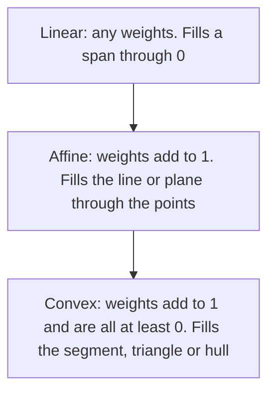

## When the weights must add to 1

Lesson 10 ended with a puzzle. The solutions of $A\mathbf{x} = \mathbf{0}$ form a span, but
the solutions of $A\mathbf{x} = \mathbf{b}$ with $\mathbf{b} \ne \mathbf{0}$ do not: they are
a span *shifted* away from the origin. Lines and planes that miss the origin are everywhere
in geometry, graphics and applications, so they deserve their own algebra. That algebra is
the linear combination of Lesson 8 with one extra rule: **the weights add up to 1**. Add a
second rule, that the weights are never negative, and you get mixtures, averages and the
inside of triangles. This lesson develops both ideas with the tools you already have: row
reduction, span and independence.

## Affine combinations

An **affine combination** of points $\mathbf{v}_1, \dots, \mathbf{v}_p$ in $\mathbb{R}^n$ is
a linear combination

$$\mathbf{y} = c_1\mathbf{v}_1 + c_2\mathbf{v}_2 + \cdots + c_p\mathbf{v}_p \quad\text{with}\quad c_1 + c_2 + \cdots + c_p = 1.$$

Start with two points $\mathbf{p}$ and $\mathbf{q}$. Their affine combinations are
$(1 - t)\mathbf{p} + t\mathbf{q}$, and rearranging gives

$$(1 - t)\mathbf{p} + t\mathbf{q} = \mathbf{p} + t(\mathbf{q} - \mathbf{p}).$$

That is the line through $\mathbf{p}$ in the direction $\mathbf{q} - \mathbf{p}$: the whole
line through the two points. At $t = 0$ you are at $\mathbf{p}$, at $t = 1$ at $\mathbf{q}$,
at $t = \tfrac12$ at the midpoint; $t = 1.5$ lies beyond $\mathbf{q}$ and $t = -0.5$ before
$\mathbf{p}$. Compare the *linear* combinations $s\mathbf{p} + t\mathbf{q}$ with no condition:
when $\mathbf{p}$ and $\mathbf{q}$ are not multiples of each other (as in the picture below), they fill a whole plane through the origin. The condition $c_1 + c_2 = 1$ cuts that plane
down to the one line through the two points, and that line passes through $\mathbf{0}$ only
in special cases.

```plot
{"x": [-2, 8], "y": [-1, 5.5], "equal": true, "functions": [{"f": "0.5x + 0.5", "dashed": true}], "segments": [{"from": [1, 1], "to": [5, 3]}], "points": [{"at": [1, 1]}, {"at": [5, 3]}, {"at": [3, 2]}, {"at": [7, 4]}, {"at": [-1, 0]}], "labels": [{"at": [1.9, 0.35], "text": "p (t = 0)"}, {"at": [5.9, 2.3], "text": "q (t = 1)"}, {"at": [3.8, 1.3], "text": "t = 1/2"}, {"at": [6.2, 4.6], "text": "t = 1.5"}, {"at": [-1.3, 0.6], "text": "t = −1/2"}, {"at": [2.2, 2.6], "text": "0 ≤ t ≤ 1"}], "caption": "Affine combinations (1 − t)p + tq of p = (1, 1) and q = (5, 3) fill the line; 0 ≤ t ≤ 1 gives the segment"}
```

The same thing happens with more points. The set of all affine combinations of
$\mathbf{v}_1, \dots, \mathbf{v}_p$ is their **affine hull**. Of two distinct points it is
the line through them; of three points not on one line, the plane through them.

### Turning an affine question into a span question

> *Theorem.* $\mathbf{y}$ is an affine combination of $\mathbf{v}_1, \dots, \mathbf{v}_p$ if and only if $\mathbf{y} - \mathbf{v}_1$ is a linear combination of $\mathbf{v}_2 - \mathbf{v}_1, \dots, \mathbf{v}_p - \mathbf{v}_1$.

*Proof.* If $\mathbf{y} = c_1\mathbf{v}_1 + \cdots + c_p\mathbf{v}_p$ with weights adding to
1, then $c_1 - 1 = -(c_2 + \cdots + c_p)$, so

$$\mathbf{y} - \mathbf{v}_1 = (c_1 - 1)\mathbf{v}_1 + c_2\mathbf{v}_2 + \cdots + c_p\mathbf{v}_p = c_2(\mathbf{v}_2 - \mathbf{v}_1) + \cdots + c_p(\mathbf{v}_p - \mathbf{v}_1).$$

Conversely, if $\mathbf{y} - \mathbf{v}_1 = c_2(\mathbf{v}_2 - \mathbf{v}_1) + \cdots + c_p(\mathbf{v}_p - \mathbf{v}_1)$,
then $\mathbf{y} = (1 - c_2 - \cdots - c_p)\mathbf{v}_1 + c_2\mathbf{v}_2 + \cdots + c_p\mathbf{v}_p$,
and these weights add to 1. $\blacksquare$

So the affine hull is $\mathbf{v}_1 + \operatorname{Span}\{\mathbf{v}_2 - \mathbf{v}_1, \dots, \mathbf{v}_p - \mathbf{v}_1\}$:
a span, shifted to pass through $\mathbf{v}_1$. A set of that form, a span shifted by a fixed
vector, is called a **flat**. Points, lines and planes are flats; so is the solution set of
any consistent system $A\mathbf{x} = \mathbf{b}$, by Lesson 10.

A second way to set up the same question: $\mathbf{y}$ is an affine combination of the
$\mathbf{v}_i$ exactly when $\begin{bmatrix}\mathbf{y} \\ 1\end{bmatrix}$ is a linear
combination of the "lifted" vectors $\begin{bmatrix}\mathbf{v}_i \\ 1\end{bmatrix}$. The extra
row of 1s forces $c_1 + \cdots + c_p = 1$. This is exactly the trick behind the homogeneous
coordinates used in computer graphics, and it lets you answer any affine question by row
reduction.

### Example 1

Let $\mathbf{v}_1 = (1, 0, 2)$, $\mathbf{v}_2 = (3, 1, 1)$, $\mathbf{v}_3 = (0, 2, 4)$. Is $\mathbf{y} = (5, -3, -3)$ in the plane through these three points? What about $\mathbf{z} = (2, 1, 1)$?

1. Differences: $\mathbf{v}_2 - \mathbf{v}_1 = (2, 1, -1)$, $\mathbf{v}_3 - \mathbf{v}_1 = (-1, 2, 2)$, and $\mathbf{y} - \mathbf{v}_1 = (4, -3, -5)$.
2. Solve $a(2, 1, -1) + b(-1, 2, 2) = (4, -3, -5)$. Swap the first two rows of $\left[\begin{array}{cc|c} 2 & -1 & 4 \\ 1 & 2 & -3 \\ -1 & 2 & -5\end{array}\right]$, then $R_2 \leftarrow R_2 - 2R_1$ and $R_3 \leftarrow R_3 + R_1$: rows $[\,1 \;\; 2 \;\; {-3}\,]$, $[\,0 \;\; {-5} \;\; 10\,]$, $[\,0 \;\; 4 \;\; {-8}\,]$.
3. $R_3 \leftarrow R_3 + \tfrac45 R_2$ gives a zero row, so the system is consistent: $b = -2$, $a = -3 - 2(-2) = 1$.
4. Weights: $c_2 = a = 1$, $c_3 = b = -2$, $c_1 = 1 - 1 - (-2) = 2$. Check: $2(1, 0, 2) + (3, 1, 1) - 2(0, 2, 4) = (5, -3, -3)$. ✓

So $\mathbf{y} = 2\mathbf{v}_1 + \mathbf{v}_2 - 2\mathbf{v}_3$ is in the plane. For $\mathbf{z}$,
$\mathbf{z} - \mathbf{v}_1 = (1, 1, -1)$ and the same steps give rows $[\,1 \;\; 2 \;\; 1\,]$,
$[\,0 \;\; {-5} \;\; {-1}\,]$, $[\,0 \;\; 4 \;\; 0\,]$, then $[\,0 \;\; 0 \;\; {-\tfrac45}\,]$:
a pivot in the last column. $\mathbf{z}$ is not on the plane.

## Affine independence

Three points on one line don't determine a plane; one of them is redundant. The matching
idea is **affinely independent**: no point in the set is an affine combination of the others.
By the theorem above (and the independence test of Lesson 11), the following are equivalent
for $\mathbf{v}_1, \dots, \mathbf{v}_p$:

1. The set is affinely independent.
2. The differences $\mathbf{v}_2 - \mathbf{v}_1, \dots, \mathbf{v}_p - \mathbf{v}_1$ are linearly independent.
3. The lifted vectors $\begin{bmatrix}\mathbf{v}_1 \\ 1\end{bmatrix}, \dots, \begin{bmatrix}\mathbf{v}_p \\ 1\end{bmatrix}$ in $\mathbb{R}^{n+1}$ are linearly independent.

Three points are affinely dependent exactly when they are collinear; four points in
$\mathbb{R}^3$, exactly when they are coplanar. Since the lifted vectors live in
$\mathbb{R}^{n+1}$, at most $n + 1$ points of $\mathbb{R}^n$ can be affinely independent: three
in the plane (a triangle), four in space (a tetrahedron). Notice that affine independence is
not linear independence: the three points $(1, 0)$, $(0, 1)$, $(1, 1)$ are affinely
independent (they form a triangle) but, as vectors in $\mathbb{R}^2$, linearly dependent.

## Barycentric coordinates

If $\mathbf{v}_1, \mathbf{v}_2, \mathbf{v}_3$ are affinely independent points of
$\mathbb{R}^2$, every point $\mathbf{y}$ of the plane can be written as
$\mathbf{y} = c_1\mathbf{v}_1 + c_2\mathbf{v}_2 + c_3\mathbf{v}_3$ with $c_1 + c_2 + c_3 = 1$ in
*exactly one* way: the lifted vectors are three independent vectors in $\mathbb{R}^3$, so the
$3 \times 3$ system has a pivot in every row and every column. The numbers $(c_1, c_2, c_3)$
are the **barycentric coordinates** of $\mathbf{y}$ relative to the triangle. August Möbius
introduced them in 1827; the name comes from the barycenter (center of mass): put masses
$c_1, c_2, c_3$ at the corners and $\mathbf{y}$ is their balance point.

What the signs tell you:

| Barycentric coordinates | Where the point is |
|---|---|
| all three positive | strictly inside the triangle |
| one is 0, the others positive | on an edge (the edge opposite the zero) |
| two are 0 (the third is 1) | at a vertex |
| at least one negative | outside the triangle |

Each coordinate also has an area meaning: $c_1$ is the area of the triangle
$\mathbf{y}\mathbf{v}_2\mathbf{v}_3$ divided by the area of $\mathbf{v}_1\mathbf{v}_2\mathbf{v}_3$
(with a minus sign when $\mathbf{y}$ is on the far side of edge $\mathbf{v}_2\mathbf{v}_3$),
and likewise for $c_2$ and $c_3$. The proof uses Cramer's rule and the determinant–area
formula from Module 6.


### Example 2

Find the barycentric coordinates of $\mathbf{p} = (4, 4)$ relative to $\mathbf{v}_1 = (1, 1)$, $\mathbf{v}_2 = (7, 3)$, $\mathbf{v}_3 = (3, 7)$. Is $\mathbf{p}$ inside the triangle?

1. The lifted system: $c_1 + 7c_2 + 3c_3 = 4$, $c_1 + 3c_2 + 7c_3 = 4$, $c_1 + c_2 + c_3 = 1$.
2. Subtract the second equation from the first: $4c_2 - 4c_3 = 0$, so $c_2 = c_3$.
3. Subtract the third from the first: $6c_2 + 2c_3 = 3$, so $8c_2 = 3$ and $c_2 = c_3 = \tfrac38$.
4. Then $c_1 = 1 - \tfrac38 - \tfrac38 = \tfrac14$. Check: $\tfrac14(1, 1) + \tfrac38(7, 3) + \tfrac38(3, 7) = (\tfrac14 + \tfrac{21}{8} + \tfrac98, \tfrac14 + \tfrac98 + \tfrac{21}{8}) = (4, 4)$. ✓

All three are positive, so $\mathbf{p}$ is inside. Area check: the triangle has area
$\tfrac12|6 \cdot 6 - 2 \cdot 2| = 16$, and triangle $\mathbf{p}\mathbf{v}_2\mathbf{v}_3$ has area
$\tfrac12|3 \cdot 3 - (-1)(-1)| = 4 = \tfrac14 \cdot 16$, matching $c_1$.

Computer graphics leans on this. A graphics card draws a surface as many small triangles,
stores a color (or texture position, or depth) at each corner, and gives every pixel inside
the triangle the blend $c_1(\text{color}_1) + c_2(\text{color}_2) + c_3(\text{color}_3)$ using that
pixel's barycentric coordinates. (Real renderers also correct for perspective; that detail is
left out here.)

## Convex combinations

A **convex combination** is an affine combination whose weights are also nonnegative:
$c_1 + \cdots + c_p = 1$ and every $c_i \ge 0$. For two points, $(1 - t)\mathbf{p} + t\mathbf{q}$
with $0 \le t \le 1$ is the segment from $\mathbf{p}$ to $\mathbf{q}$; for three affinely
independent points it is the filled triangle. The set of all convex combinations of some
points is their **convex hull**: the smallest shape containing them with no dents or holes,
like a rubber band stretched around pins.



Weights that are nonnegative and add to 1 are proportions, so convex combinations are
*mixtures*. If you blend materials in proportions $c_1, \dots, c_p$ (by mass), each
percentage in the blend is the same convex combination of the ingredients' percentages.

### Example 3

Three fertilizer blends contain, by mass, A: 20% nitrogen (N) and 10% phosphate (P); B: 10% N and 20% P; C: 30% N and 30% P. Can they be mixed to give 18% N and 22% P? What about 28% N and 12% P?

1. With mass fractions $c_1, c_2, c_3$: $20c_1 + 10c_2 + 30c_3 = 18$, $10c_1 + 20c_2 + 30c_3 = 22$, $c_1 + c_2 + c_3 = 1$.
2. Subtract the second equation from the first: $10c_1 - 10c_2 = -4$, so $c_2 = c_1 + 0.4$.
3. The third equation gives $c_3 = 1 - c_1 - c_2 = 0.6 - 2c_1$. Put both into the first: $20c_1 + 10c_1 + 4 + 18 - 60c_1 = 18$, so $c_1 = \tfrac{4}{30} = \tfrac{2}{15}$.
4. Then $c_2 = \tfrac{8}{15}$ and $c_3 = \tfrac13 = \tfrac{5}{15}$, all nonnegative: mix 2 parts A, 8 parts B and 5 parts C. Check nitrogen: $(0.2 \cdot 2 + 0.1 \cdot 8 + 0.3 \cdot 5)/15 = 2.7/15 = 18\%$. ✓

For 28% N and 12% P the same steps give $c_1 = \tfrac{17}{15}$, $c_2 = -\tfrac{7}{15}$,
$c_3 = \tfrac13$. The weights add to 1, so the target lies in the plane of the problem, but
$c_2 < 0$ would mean adding a *negative* amount of B. The target is outside the triangle of
blends (the convex hull), so no real mixture reaches it.

## Common mistakes

- *Forgetting the sum condition.* Weights that solve $c_1\mathbf{v}_1 + c_2\mathbf{v}_2 + c_3\mathbf{v}_3 = \mathbf{y}$ but don't add to 1 show a linear combination, not an affine one. Add the row of 1s (or use differences) to build the condition in.
- *Thinking affine weights must be between 0 and 1.* Only convex weights must. Affine weights can be negative or bigger than 1; that is how points outside the triangle are reached.
- *Confusing affine with linear independence.* $(1, 0)$, $(0, 1)$, $(1, 1)$ are affinely independent but linearly dependent; two distinct points on a line through the origin, such as $(1, 1)$ and $(2, 2)$, are affinely independent too.
- *Reading a negative barycentric coordinate as "on the edge".* Zero means on the line of an edge; negative means across it, outside the triangle.
- *Calling every flat a span.* A flat passes through $\mathbf{0}$ only if it happens to contain it; the solution set of $A\mathbf{x} = \mathbf{b}$ with $\mathbf{b} \ne \mathbf{0}$ never does.

## Key points

- Affine combination: weights add to 1. The affine hull of two points is the line through them; of three non-collinear points, the plane through them.
- $\mathbf{y}$ is an affine combination of $\mathbf{v}_1, \dots, \mathbf{v}_p$ ⟺ $\mathbf{y} - \mathbf{v}_1 \in \operatorname{Span}\{\mathbf{v}_2 - \mathbf{v}_1, \dots, \mathbf{v}_p - \mathbf{v}_1\}$ ⟺ $(\mathbf{y}, 1)$ is a linear combination of the lifted $(\mathbf{v}_i, 1)$.
- A flat is a span shifted by a vector; solution sets of consistent systems are flats.
- Affinely independent ⟺ the differences are linearly independent; at most $n + 1$ such points in $\mathbb{R}^n$.
- Barycentric coordinates locate a point relative to a triangle; all positive means inside, a negative one means outside.
- Convex combination: weights add to 1 and are $\ge 0$; convex hulls are the possible mixtures.
