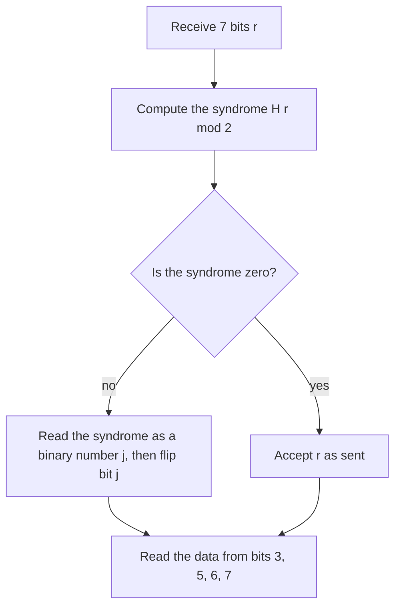

## Same algebra, different numbers

Look back over Lessons 8–11. Every computation used only four things: adding, subtracting,
multiplying, and dividing by a nonzero number. Nothing required the scalars to be real
numbers. Any number system where those four operations obey the usual rules (commutative,
associative, distributive, with 0, 1, negatives, and reciprocals of nonzero numbers) is
called a **field**, and the whole theory of span, independence and solution sets works over
any field. The rational numbers and the complex numbers (Module 8) are fields. So are some
finite number systems, and the smallest of them powers the two applications in this lesson:
a puzzle and the codes that protect computer data.

## The field GF(2)

**GF(2)** is the field with just two elements, 0 and 1, and arithmetic mod 2 (keep the
remainder after dividing by 2):

| $+$ | 0 | 1 |
|---|---|---|
| **0** | 0 | 1 |
| **1** | 1 | 0 |

Multiplication is ordinary: $0 \cdot 1 = 0$, $1 \cdot 1 = 1$. The one surprise is $1 + 1 = 0$.
So $-1 = 1$: every element is its own negative, and *subtracting is the same as adding*. (GF
stands for "Galois field", after Évariste Galois. Arithmetic mod 4 would *not* be a field:
$2 \cdot 2 = 0$ there, so 2 has no reciprocal. Mod a prime it always is.)

Vectors in $\text{GF}(2)^n$ are strings of $n$ bits, added entry by entry with $1 + 1 = 0$
(this is the "exclusive or" of computing): $(1, 1, 0, 1) + (0, 1, 1, 1) = (1, 0, 1, 0)$.
Since the only weights are 0 and 1, a linear combination is just *the sum of some of the
vectors*. That makes spans finite and countable:

- $p$ vectors have $2^p$ subsets, so their span has at most $2^p$ vectors.
- It has exactly $2^p$ when the vectors are linearly independent. If two different subsets had the same sum, adding the two sums would give $\mathbf{0}$ as the sum of the vectors in exactly one of the subsets, a dependence relation; and a dependence relation gives two different subsets with the same sum.

Row reduction works as before, with two simplifications: scaling a row by 1 does nothing, so
only swaps and "add one row to another" are needed, and every pivot is 1. All the theorems of
this module carry over word for word: a system is consistent unless there is a pivot in the
last column; the solutions of $A\mathbf{x} = \mathbf{b}$ are a particular solution plus the
homogeneous solutions; the columns are independent exactly when every column has a pivot.
What changes is counting. A free variable can take only 2 values, so a consistent system with
$k$ free variables has exactly $2^k$ solutions, not infinitely many.

### Example 1

Are $\mathbf{v}_1 = (1, 1, 0)$, $\mathbf{v}_2 = (0, 1, 1)$, $\mathbf{v}_3 = (1, 0, 1)$ linearly independent over the reals? Over GF(2)?

1. Columns: $\begin{bmatrix} 1 & 0 & 1 \\ 1 & 1 & 0 \\ 0 & 1 & 1\end{bmatrix}$. Over the reals, $R_2 \leftarrow R_2 - R_1$ gives $[\,0 \;\; 1 \;\; {-1}\,]$, then $R_3 \leftarrow R_3 - R_2$ gives $[\,0 \;\; 0 \;\; 2\,]$: a pivot in every column, so the vectors are independent over $\mathbb{R}$.
2. Mod 2, $-1 = 1$ and $2 = 0$. The same steps give $[\,0 \;\; 1 \;\; 1\,]$ and then $[\,0 \;\; 0 \;\; 0\,]$: column 3 has no pivot, so the vectors are dependent over GF(2).
3. The relation: $\mathbf{v}_1 + \mathbf{v}_2 + \mathbf{v}_3 = (2, 2, 2) = (0, 0, 0)$ mod 2.

The same three vectors are independent over one field and dependent over another, so always
say which field you mean.

## Lights Out

*Lights Out*, a handheld game released by Tiger Electronics in 1995, has a 5 × 5 grid of
lights. Pressing a light toggles it and its neighbors above, below, left and right (on
becomes off, off becomes on). The goal is to turn every light off. To see the mathematics on
a small scale, use a single row of $n$ lights, where pressing a light toggles it and the
lights directly beside it.

Record a pattern of lights as a vector in $\text{GF}(2)^n$ (1 = on). Pressing light $j$ adds a
fixed vector $\mathbf{a}_j$, its toggle pattern, to the current pattern. Two facts make this
linear algebra:

- The order of presses doesn't matter, because vector addition is commutative.
- Pressing a light twice does nothing, because $\mathbf{a}_j + \mathbf{a}_j = \mathbf{0}$.

So a strategy is just a *set* of lights to press, a vector $\mathbf{x}$ with $x_j = 1$ when
light $j$ is pressed, and its total effect is $x_1\mathbf{a}_1 + \cdots + x_n\mathbf{a}_n = A\mathbf{x}$,
where $A$ has the toggle patterns as columns. Starting from pattern $\mathbf{b}$ we need
$\mathbf{b} + A\mathbf{x} = \mathbf{0}$, which mod 2 is

$$A\mathbf{x} = \mathbf{b}.$$

Everything from this module now has a meaning in the game. A starting pattern can be solved
exactly when $\mathbf{b}$ is in the span of the toggle patterns. A set of presses that changes
nothing at all, a nonzero solution of $A\mathbf{x} = \mathbf{0}$, is called a
**quiet pattern**. And by Lesson 10, if $\mathbf{p}$ solves the puzzle, the solutions are
exactly $\mathbf{p}$ plus the quiet patterns.

### Example 2

Three lights in a row, only the left one on: $\mathbf{b} = (1, 0, 0)$. Which lights should you press?

1. The toggle patterns are $\mathbf{a}_1 = (1, 1, 0)$, $\mathbf{a}_2 = (1, 1, 1)$, $\mathbf{a}_3 = (0, 1, 1)$, so the augmented matrix is $\left[\begin{array}{ccc|c} 1 & 1 & 0 & 1 \\ 1 & 1 & 1 & 0 \\ 0 & 1 & 1 & 0\end{array}\right]$.
2. $R_2 \leftarrow R_2 + R_1$: $[\,0 \;\; 0 \;\; 1 \;\; 1\,]$. Swap $R_2$ and $R_3$ to get rows $[\,0 \;\; 1 \;\; 1 \;\; 0\,]$ and $[\,0 \;\; 0 \;\; 1 \;\; 1\,]$.
3. Back-substitute: $x_3 = 1$; $x_2 + x_3 = 0$ gives $x_2 = 1$; $x_1 + x_2 = 1$ gives $x_1 = 0$.
4. Press lights 2 and 3. Check: $(1, 0, 0) + (1, 1, 1) + (0, 1, 1) = (2, 2, 2) = (0, 0, 0)$. ✓

The coefficient matrix has a pivot in every row and every column, so with three lights
*every* starting pattern is solvable, in exactly one way.

### Example 3

Five lights in a row. Which starting patterns can be solved, and how do you solve the one in the picture, $\mathbf{b} = (0, 0, 1, 0, 0)$?

1. Reduce $[\,A \;\; \mathbf{b}\,]$ with $b_1, \dots, b_5$ as symbols. The rows of $A$ are $(1,1,0,0,0)$, $(1,1,1,0,0)$, $(0,1,1,1,0)$, $(0,0,1,1,1)$, $(0,0,0,1,1)$.
2. $R_2 \leftarrow R_2 + R_1$ gives $[\,0 \;\; 0 \;\; 1 \;\; 0 \;\; 0 \;\; b_1 + b_2\,]$; swap it with $R_3$.
3. $R_4 \leftarrow R_4 + R_3$ (the new $R_3$, $[\,0 \;\; 0 \;\; 1 \;\; 0 \;\; 0\,]$) gives $[\,0 \;\; 0 \;\; 0 \;\; 1 \;\; 1 \;\; b_1 + b_2 + b_4\,]$; then $R_5 \leftarrow R_5 + R_4$ gives $[\,0 \;\; 0 \;\; 0 \;\; 0 \;\; 0 \;\; b_1 + b_2 + b_4 + b_5\,]$.
4. So a pattern is solvable exactly when $b_1 + b_2 + b_4 + b_5 = 0$ mod 2: an even number of lights on among positions 1, 2, 4, 5. That is 16 of the 32 patterns. For instance $(1, 0, 0, 0, 0)$ can't be solved at all.
5. For $\mathbf{b} = (0, 0, 1, 0, 0)$, with $x_5 = t$ free: $x_4 = t$, $x_3 = b_1 + b_2 = 0$, $x_2 = b_3 + x_3 + x_4 = 1 + t$, $x_1 = b_1 + x_2 = 1 + t$.

In vector form $\mathbf{x} = (1, 1, 0, 0, 0) + t(1, 1, 0, 1, 1)$, with $t$ either 0 or 1: press
lights 1 and 2 (as in the picture), or lights 4 and 5. The vector $(1, 1, 0, 1, 1)$ is a quiet
pattern: pressing lights 1, 2, 4 and 5 toggles lights 1 and 2 twice each, light 3 twice, and
lights 4 and 5 twice each, so nothing changes.

The real 5 × 5 game works the same way with a $25 \times 25$ matrix. Row-reduced mod 2 by
computer, it has 23 pivots, so 2 free variables. Consequences, published by Marlow Anderson
and Todd Feil in 1998: every solvable puzzle has exactly $2^2 = 4$ solutions (counting each
light at most once), and only $2^{23}$ of the $2^{25}$ possible patterns, one in four, can be
solved. On a 3 × 3 board the $9 \times 9$ matrix has 9 pivots, so every pattern is solvable in
exactly one way.

## Parity checks and the Hamming code

Bits sent over a network or stored in memory are sometimes flipped by noise. The simplest
protection is a **parity bit**: append one bit chosen so the total number of 1s is even. If
one bit flips, the count becomes odd and the receiver knows something went wrong, but not
where.

In a paper published in 1950, Richard Hamming of Bell Labs described a code that also says
*where*. Take the $3 \times 7$ **parity-check matrix** whose column $j$ is the number $j$
written in binary (top row = 4s digit, then 2s, then 1s):

$$H = \begin{bmatrix} 0 & 0 & 0 & 1 & 1 & 1 & 1 \\ 0 & 1 & 1 & 0 & 0 & 1 & 1 \\ 1 & 0 & 1 & 0 & 1 & 0 & 1\end{bmatrix}.$$

A **codeword** is a 7-bit vector $\mathbf{c}$ with $H\mathbf{c} = \mathbf{0}$ (mod 2). The
codewords are the solution set of a homogeneous system, so the sum of two codewords is
another codeword. Columns 1, 2 and 4 of $H$ are the three standard basis vectors, so each
equation contains exactly one of bits 1, 2 and 4, and the system can be solved for those three
bits with bits 3, 5, 6 and 7 free: put 4 data bits there, and the three equations fix bits 1,
2 and 4. That gives $2^4 = 16$ codewords, and this code is the **Hamming code** (often
written Hamming(7,4)).

Now suppose bit $j$ flips in transit, so the receiver gets $\mathbf{r} = \mathbf{c} + \mathbf{e}_j$.
By linearity,

$$H\mathbf{r} = H\mathbf{c} + H\mathbf{e}_j = \mathbf{0} + (\text{column } j \text{ of } H).$$

The vector $H\mathbf{r}$ is called the **syndrome**. It is $\mathbf{0}$ when no bit flipped,
and otherwise it is column $j$, which spells out $j$ in binary. Because the seven columns are
different and nonzero, any single flipped bit is located and can be flipped back. The code has
limits: with two flipped bits the syndrome points to the wrong position. Variations of
Hamming's idea are still used in error-correcting computer memory.

### Example 4

Encode the data bits 1, 0, 1, 1 (in positions 3, 5, 6, 7). Then suppose bit 5 flips, and decode.

1. Set $c_3 = 1$, $c_5 = 0$, $c_6 = 1$, $c_7 = 1$. Row 3 of $H$: $c_1 + c_3 + c_5 + c_7 = 0$, so $c_1 = 1 + 0 + 1 = 0$.
2. Row 2: $c_2 + c_3 + c_6 + c_7 = 0$, so $c_2 = 1 + 1 + 1 = 1$. Row 1: $c_4 + c_5 + c_6 + c_7 = 0$, so $c_4 = 0 + 1 + 1 = 0$.
3. The codeword is $\mathbf{c} = (0, 1, 1, 0, 0, 1, 1)$. After bit 5 flips, $\mathbf{r} = (0, 1, 1, 0, 1, 1, 1)$.
4. Syndrome: row 1 gives $r_4 + r_5 + r_6 + r_7 = 0 + 1 + 1 + 1 = 1$; row 2 gives $r_2 + r_3 + r_6 + r_7 = 1 + 1 + 1 + 1 = 0$; row 3 gives $r_1 + r_3 + r_5 + r_7 = 0 + 1 + 1 + 1 = 1$.
5. $H\mathbf{r} = (1, 0, 1)$, which is 101 in binary, or 5. Flip bit 5 back and read the data: 1, 0, 1, 1. ✓

## Common mistakes

- *Forgetting $1 + 1 = 0$.* Mod 2, a row like $[\,0 \;\; 0 \;\; 2\,]$ is a zero row.
- *Writing $\mathbf{b} - A\mathbf{x}$ with signs.* Mod 2, minus is plus; "turn $\mathbf{b}$ off" and "make $\mathbf{b}$" are the same equation $A\mathbf{x} = \mathbf{b}$.
- *Expecting infinitely many solutions.* A free variable mod 2 has two values, so $k$ free variables give $2^k$ solutions.
- *Carrying independence across fields.* Vectors independent over $\mathbb{R}$ may be dependent mod 2 (Example 1).
- *Reading the syndrome bits in the wrong order.* The top row of $H$ is the 4s digit here; with $H$ written another way, match the syndrome to a column of $H$ instead.

## Key points

- A field is a number system with $+$, $-$, $\times$, $\div$ obeying the usual rules; the theory of this module works over any field.
- GF(2) is $\{0, 1\}$ with $1 + 1 = 0$. Linear combinations are sums of subsets; $p$ independent vectors span exactly $2^p$ vectors.
- Lights Out: a press set $\mathbf{x}$ solves start pattern $\mathbf{b}$ when $A\mathbf{x} = \mathbf{b}$ mod 2. Solvable patterns are the span of the columns; quiet patterns are the homogeneous solutions; all solutions are one solution plus quiet patterns.
- A consistent system mod 2 with $k$ free variables has exactly $2^k$ solutions.
- Hamming(7,4): codewords solve $H\mathbf{c} = \mathbf{0}$; the syndrome $H\mathbf{r}$ of a word with one flipped bit is the column of $H$ for that bit, which locates it.
